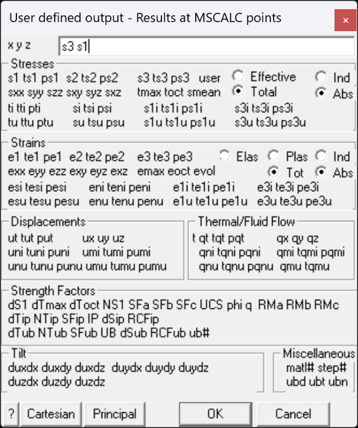

Calcula resultados en puntos definidos por el usuario, durante el análisis BEM de Map3D.

Los resultados del análisis se pueden calcular en ubicaciones de coordenadas definidas por el usuario.

Cuando seleccionas MSCALC, se te solicita un nombre de archivo de datos y el formato de salida deseado, como se indica a continuación.

#### Formato del archivo de datos:

El archivo de datos es simplemente un archivo de texto (*.txt) con una lista de las ubicaciones de coordenadas donde se calcularán los resultados.

El formato de este archivo requiere un conjunto de coordenadas por línea

x1 y1 z1 x2 y2 z2 x3 y3 z3 x4 y4 z4 ...

donde x y z representan las coordenadas de cada punto.

Si lo deseas, puedes especificar x y z dipub ddrub Y, además, también puedes especificar x y z dipub ddrub so phi

Aquí dipub ddrub representan, respectivamente, el buzamiento y la dirección de buzamiento del plano UB deseado

- estos solo se usarían si calculas algunos componentes UB, como su tu

so y phi representan, respectivamente, la cohesión y el ángulo de fricción

- estos solo se usarían si calculas algunos parámetros de resistencia UB, como sfu rcfu dsu ntu

#### Formato del archivo de salida:

Los resultados se escriben de vuelta en el mismo archivo de datos, con las coordenadas x y z seguidas de los parámetros especificados por el usuario.

#### Esfuerzos:

s1 ts1 ps1 esfuerzo principal mayor s1, su rumbo y su inclinación. s2 ts2 ps2 esfuerzo principal intermedio s2, su rumbo y su inclinación. s3 ts3 ps3 esfuerzo principal menor s3, su rumbo y su inclinación. user Valor definido por el usuario. sxx syy szz sxy syz sxz Componentes cartesianos del esfuerzo. tmax esfuerzo cortante máximo tmax=½ ( s1 - s3 ) toct esfuerzo cortante octaédrico toct=¹/3 [( s1 - s2 )² + ( s2 - s3 )² +( s3 - s1 )²]1/2 smean esfuerzo medio smean=¹/3 ( s1 + s2 + s3 ) ti tti pti esfuerzo cortante máximo en el plano de la malla, su rumbo y su inclinación. si tsi psi esfuerzo normal en el plano de la malla, su rumbo y su inclinación. s1i ts1i ps1i esfuerzo máximo tangencial al plano de la malla, su rumbo y su inclinación. s3i ts3i ps3i esfuerzo mínimo tangencial al plano de la malla, su rumbo y su inclinación. tu ttu ptu esfuerzo cortante máximo en el plano ubicuo, su rumbo y su inclinación. su tsu psu esfuerzo normal al plano ubicuo, su rumbo y su inclinación. s1u ts1u ps1u esfuerzo máximo tangencial al plano ubicuo, su rumbo y su inclinación. s3u ts3u ps3u esfuerzo mínimo tangencial al plano ubicuo, su rumbo y su inclinación. La orientación del plano ubicuo se especifica en

Plot > Strength Factors > Ubiquitous Parameters Effective/Total componentes del esfuerzo efectivo o del esfuerzo total. Estas opciones solo se usan en Map3D Thermal-Fluid Flow, ya que este código permite calcular distribuciones de presión de poros en estado estacionario. Induced/Absolute El esfuerzo inducido es el esfuerzo sin la contribución del esfuerzo previo a la explotación. Representa el cambio de esfuerzo desde la condición previa a la explotación. El esfuerzo absoluto es el esfuerzo que incluye la contribución del esfuerzo previo a la explotación.

#### Deformaciones:

e1 te1 pe1 deformación principal mayor e1, su rumbo y su inclinación. e2 te2 pe2 deformación principal intermedia e2, su rumbo y su inclinación. e3 te3 pe3 deformación principal menor e3, su rumbo y su inclinación. exx eyy ezz exy eyz exz Componentes cartesianos de la deformación. emax deformación cortante máxima emax=½ ( e1 - e3 ) eoct deformación cortante octaédrica eoct=¹/3 [( e1 - e2 )² + ( e2 - e3 )² +( e3 - e1 )²]1/2 evol deformación volumétrica evol=( e1 + e2 + e3 ) esi tesi pesi deformación cortante máxima en el plano de la malla, su rumbo y su inclinación. eni teni peni deformación normal en el plano de la malla, su rumbo y su inclinación. e1i te1i pe1i deformación máxima tangencial al plano de la malla, su rumbo y su inclinación. e3i te3i pe3i deformación mínima tangencial al plano de la malla, su rumbo y su inclinación. esu tesu pesu deformación cortante máxima en el plano ubicuo, su rumbo y su inclinación. enu tenu penu deformación normal al plano ubicuo, su rumbo y su inclinación. e1u te1u pe1u deformación máxima tangencial al plano ubicuo, su rumbo y su inclinación. e3u te3u pe3u deformación mínima tangencial al plano ubicuo, su rumbo y su inclinación. Elastic/Plastic/Total componentes de la deformación elástica, plástica o total. Estas opciones solo se usan en Map3D Non-Linear, ya que este código permite calcular deformaciones no lineales. Induced/Absolute La deformación inducida es la deformación sin la contribución previa a la explotación. Representa el cambio de deformación desde la condición previa a la explotación. La deformación absoluta es la deformación que incluye la contribución de la deformación previa a la explotación.

#### Desplazamientos:

ut tut put desplazamiento total, su rumbo y su inclinación. ux uy uz Componentes cartesianos del desplazamiento. uni tuni puni desplazamiento normal al plano de la malla, su rumbo y su inclinación. umi tumi pumi desplazamiento máximo tangencial al plano de la malla, su rumbo y su inclinación. unu tunu punu desplazamiento normal al plano ubicuo, su rumbo y su inclinación. umu tumu pumu desplazamiento máximo tangencial al plano ubicuo, su rumbo y su inclinación.

#### Flujo:

t temperatura/carga hidráulica.

qt tqt pqt flujo total, su rumbo y su inclinación. qx qy qz Componentes cartesianos del flujo.

qni tqni pqni desplazamiento normal al plano de la malla, su rumbo y su inclinación.

qmi tqmi pqmi desplazamiento máximo tangencial al plano de la malla, su rumbo y su inclinación. qnu tqnu pqnu desplazamiento normal al plano ubicuo, su rumbo y su inclinación. qmu tqmu pqmu desplazamiento máximo tangencial al plano ubicuo, su rumbo y su inclinación.

#### Resistencia:

- ds1 esfuerzo principal mayor en exceso Ds1 = s1 - ( _UCS_ + _q_ s3 )

- dtmax esfuerzo cortante máximo en exceso Dtmax = ½(s1 - s3) - [ _UCS_ + ½(s1+s3) ( _q_ -1) ]/( _q_ +1) = [s1 - ( _UCS_ + _q_ s3) ]/( _q_ +1)

- dtoct esfuerzo cortante octaédrico en exceso Dtoct = toct - [ _UCS_ + ( _q_ –1) smean ] Ö(2) /( _q_ +2)

- NS1 probabilidad mediante la distribución normal N(Ds1 /std)

- SF-A La relación resistencia/esfuerzo se puede determinar como ( _UCS_ + _q_ s3 )/ s1

- SF-B La relación resistencia/esfuerzo se puede determinar como ( _UCS_ + _q_ s3 - s3 )/(s1 - s3)

- SF-C La relación resistencia/esfuerzo se puede determinar como [ _UCS_ + ½(s1+s3) ( _q_ -1) ]/[ ½(s1 - s3)( _q_ +1) ]

- dTip esfuerzo cortante en el plano en exceso Dtip = tip - [ Cohesion + sip tan(j) ]

- NTip probabilidad mediante la distribución normal N(Dtip /std)

- SFip La relación resistencia/esfuerzo se puede determinar como [ Cohesion + sip tan(j) ] / tip

- dSip esfuerzo de pared en el plano en exceso Dsip = [ 3 s1i - s3i ] - UCS

- RCFip Factor de condición de la roca para el esfuerzo de pared en el plano RCFip = [ 3 s1i - s3i ]/UCS

- dTub esfuerzo cortante del plano ubicuo en exceso Dtub

- NTub probabilidad mediante la distribución normal N(Dtub /std)

- SFub La relación resistencia/esfuerzo se puede determinar como [ Cohesion + sub tan(j) ] / tub

- dSub esfuerzo de pared del plano ub en exceso Dsub = [ 3 s1ub - s3ub ] - UCS

- RCFub Factor de condición de la roca para el esfuerzo de pared del plano ub RCFip = [ 3 s1ub - s3ub ]/UCS

- UB# Grafica el número de conjunto UB (1, 2 o 3) que tiene el mayor valor de Dtub

#### Varios:

matl# el número del material dentro del cual se ubica el punto. El material anfitrión es el material número 1. En problemas donde se usan varios materiales, los resultados pueden calcularse en una zona de material alterno.

step# el número de la etapa de explotación.

ubd, ubt, ubn representan, respectivamente, el buzamiento, la dirección de buzamiento y la normal del plano ubicuo.

#### Otros:

Cartesian   configura la salida de componentes cartesianos del esfuerzo. Principal   configura la salida de componentes principales del esfuerzo.

#### Notas:

Esta función debe estar activada antes de realizar el análisis de discretización

Analysis > Discretization.

Se puede especificar cualquier número de puntos.

El modelo se discretiza según las ubicaciones de los puntos especificados.
