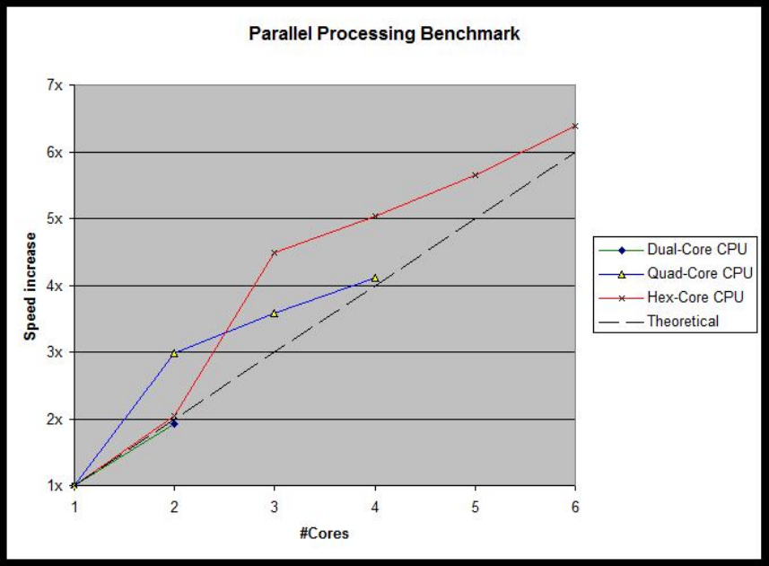

Muestra el número de núcleos o hilos activos.

Map3D admite por completo el procesamiento en paralelo y la E/S de disco en paralelo con la opción multiprocesador/multiunidad.

Si tienes licencia para usar la opción multiprocesador/multiunidad, Map3D realiza todos los procedimientos de análisis en paralelo, distribuidos entre todos los procesadores disponibles.

**CPU:** Las CPU recientes están disponibles con dos, cuatro y seis núcleos. Map3D V58 ahora admite el procesamiento en paralelo, que permite velocidades de cálculo mayores. Esto reduce más de 6 veces los tiempos de ensamblaje de matrices y de mallas. Los equipos con varias CPU serían aún más rápidos.

La siguiente prueba comparativa de procesamiento en paralelo muestra claramente que puedes esperar que las CPU de doble núcleo sean más de dos veces más rápidas,

las de cuatro núcleos más de 4 veces más rápidas y las de seis núcleos más de 6 veces más rápidas. En las CPU con hyper-threading habilitado, 2 hilos de cálculo se superponen en el mismo núcleo. Por esta razón, Map3D-MP logra un rendimiento superior al máximo teórico.

Para lograr estas mejoras de rendimiento, es necesario mejorar la potencia de procesamiento, la velocidad de E/S de disco o ambas Analysis > Options > Drive #.
