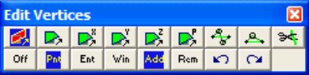

Esta rutina se puede iniciar seleccionando cualquier función de edición (por ejemplo, un botón) o simplemente haciendo clic derecho sobre cualquier vértice.

Al iniciar cualquier rutina de edición de entidades, primero se solicita crear una lista de los vértices que se desea editar.

   - Si Tools > Shift-key Selection está marcado, se debe mantener presionada la tecla Shift para realizar selecciones múltiples.

   - De forma predeterminada, las entidades seleccionadas se agregan a la lista; sin embargo, si se mantiene presionada la tecla Ctrl, las entidades seleccionadas se eliminan de la lista.

   - Mientras se mantiene presionada la tecla Shift o Ctrl, se puede arrastrar para abrir una ventana de selección.

   - Al presionar la barra espaciadora se activa automáticamente la última función de edición utilizada.

- Al mantener presionada la tecla Alt mientras se hace clic derecho, se repite automáticamente la última función de edición utilizada.

Esta barra de herramientas controla las diversas funciones que se usan para crear la lista.

Cancela la edición.

Selecciona vértices eligiendo uno a la vez.

Selecciona vértices eligiendo grupos.

Incluye todas las entidades dentro de la ventana seleccionada.

- Las entidades solo se seleccionan si están contenidas por completo dentro de la ventana.

- Esta función también se puede activar manteniendo presionada la tecla Shift o Ctrl y arrastrando para abrir una ventana de cruce.

Las entidades seleccionadas se agregan a la lista.

Las entidades seleccionadas se eliminan de la lista.

Deshace la última selección.

Rehace la última selección.

Una vez seleccionadas las entidades deseadas, se puede elegir cualquiera de los botones de edición:

CAD > Edit > Stretch Vertices

CAD > Edit > Move Vertices to Point

CAD > Edit > Move Vertices to X CAD > Edit > Move Vertices to Y CAD > Edit > Move Vertices to Z CAD > Edit > Move Vertices to Plane CAD > Edit > Smooth Construction Lines CAD > Edit > Remove Construction Vertex CAD > Edit > Subdivide Construction Lines

- haga doble clic en cualquier vértice para ejecutar la función resaltada,

- haga clic derecho para ver una lista de opciones.

Una vez completada cualquier operación de edición, se tiene una oportunidad de deshacer las modificaciones seleccionando

#### Undo

También se puede restaurar el mismo conjunto de selección y modificar de nuevo el mismo conjunto de entidades seleccionando

Redo

Se puede ajustar el tiempo de doble clic mediante

Tools > Double Click Time
