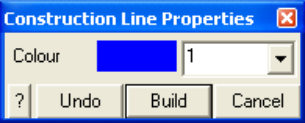

Edita el color de las líneas de construcción.

Al iniciar esta rutina, primero se solicita crear una lista de las entidades que se desea editar

- Si Tools > Shift-key Selection está marcado, se debe mantener presionada la tecla Shift para realizar selecciones múltiples.

- El uso de esta barra de herramientas se detalla en Build A List of Entities for Editing

- Al presionar la barra espaciadora se activa automáticamente la última función de edición utilizada.

Una vez seleccionadas las entidades deseadas, se puede elegir cualquiera de los botones de edición:

CAD > Edit > Entity Properties Edita el tipo de bloque, el color, la secuencia de minería, CAD > Edit > Erase Entities Borra las entidades seleccionadas, CAD > Edit > Move Entities Mueve las entidades seleccionadas, CAD > Edit > Copy Entities Copia las entidades seleccionadas, CAD > Edit > Scale Entities Escala las entidades seleccionadas, CAD > Edit > Rotate Azimuth Rota el azimut de las entidades seleccionadas, CAD > Edit > Rotate Dip Rota el buzamiento de las entidades seleccionadas, CAD > Edit > Dump to File Vuelca las entidades seleccionadas a un archivo, CAD > Edit > Group Agrupa las entidades seleccionadas en un solo bloque,

- haga doble clic en cualquier vértice para ejecutar la función resaltada,

- haga clic derecho para ver una lista de opciones.

Si alguno de los campos del cuadro de diálogo indica "Variable", es porque algunos de los bloques seleccionados tienen propiedades distintas en ese campo. Para dejar estas propiedades como están (es decir, distintas para cada bloque), deje el campo como "Variable". Para cambiar el valor de ese campo en todos los bloques seleccionados, ingrese el valor deseado.

Colour - especifica el número de color que se usará para mostrar la línea de construcción.

- Hay un total de 10 colores disponibles para la visualización. Se numeran del 1 al 10,

del 11 al 20,

del 21 al 30, etc.,

- de modo que se muestra el mismo color para los números

- 1, 11, 21..., 2, 22, 32..., 3, 23, 33..., etc.

OK - completa la edición de las líneas de construcción y modifica las propiedades que se hayan cambiado.

Cancel - cancela la edición de las entidades.

Una vez completada cualquier operación de edición, se tiene una oportunidad de deshacer las modificaciones seleccionando

#### Undo

También se puede restaurar el mismo conjunto de selección y modificar de nuevo el mismo conjunto de entidades seleccionando

#### Redo

Se puede ajustar el tiempo de doble clic mediante

#### Tools > Double Click Time

Para ver ejemplos del uso de líneas de construcción en la construcción de modelos, consulte:

Model Building Tutorials
