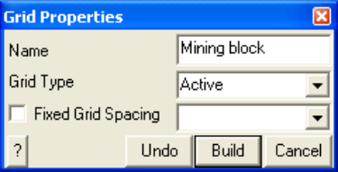

Edita el nombre de la malla y el espaciado máximo.

Al iniciar esta rutina, primero se solicita crear una lista de las entidades que se desea editar

- Si Tools > Shift-key Selection está marcado, se debe mantener presionada la tecla Shift para realizar selecciones múltiples.

- El uso de esta barra de herramientas se detalla en Build A List of Entities for Editing

- Al presionar la barra espaciadora se activa automáticamente la última función de edición utilizada.

Una vez seleccionadas las entidades deseadas, se puede elegir cualquiera de los botones de edición:

CAD > Edit > Entity Properties Edita el tipo de bloque, el color, la secuencia de minería, CAD > Edit > Erase Entities Borra las entidades seleccionadas, CAD > Edit > Move Entities Mueve las entidades seleccionadas, CAD > Edit > Copy Entities Copia las entidades seleccionadas, CAD > Edit > Scale Entities Escala las entidades seleccionadas, CAD > Edit > Rotate Azimuth Rota el azimut de las entidades seleccionadas, CAD > Edit > Rotate Dip Rota el buzamiento de las entidades seleccionadas, CAD > Edit > Dump to File Vuelca las entidades seleccionadas a un archivo, CAD > Edit > Group Agrupa las entidades seleccionadas en un solo bloque,

- haga doble clic en cualquier vértice para ejecutar la función resaltada,

- haga clic derecho para ver una lista de opciones.

Si alguno de los campos del cuadro de diálogo indica "Variable", es porque algunos de los bloques seleccionados tienen propiedades distintas en ese campo. Para dejar estas propiedades como están (es decir, distintas para cada bloque), deje el campo como "Variable". Para cambiar el valor de ese campo en todos los bloques seleccionados, ingrese el valor deseado.

Name - especifica un nombre descriptivo para la malla.

Grid Type - especifica si la malla estará activa (se usa en el análisis de esfuerzos) o inactiva (no se usa en el análisis de esfuerzos).

Maximum Spacing - especifica el espaciado máximo permitido.

- Este parámetro se puede usar para forzar una discretización fina y uniforme en mallas seleccionadas. Se debe tener extrema precaución al especificar este valor, ya que un valor pequeño puede generar fácilmente un problema de tamaño enorme.

- En general, este parámetro se debe dejar en blanco (es decir, sin usar) y la discretización se debe dejar al parámetro _AG_. Este último concentra elementos solo donde se solicitan resultados del análisis, con lo que optimiza el uso de elementos y minimiza el tamaño del problema.

CAD > Properties Control Parameters.

- Si este campo se deja en blanco, el parámetro no se usa.

OK - completa la edición de los bloques y modifica las propiedades que se hayan cambiado.

Cancel - cancela la edición de las entidades.

Una vez completada cualquier operación de edición, se tiene una oportunidad de deshacer las modificaciones seleccionando

Undo

También se puede restaurar el mismo conjunto de selección y modificar de nuevo el mismo conjunto de entidades seleccionando

Redo

Se puede ajustar el tiempo de doble clic mediante

Tools > Double Click Time
