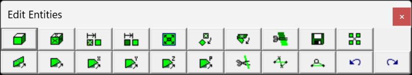

Activa la barra de herramientas Edit.

Esta barra de herramientas ofrece acceso rápido a las funciones de edición que se usan en la etapa de construcción y edición del modelo del análisis BEM de Map3D Analysis > Go to CAD

Las funciones de edición se agrupan en dos secciones, según se desee modificar bloques o coordenadas.

#### Modificar bloques:

CAD > Edit > Entity Properties Edita el tipo de bloque, el color, la secuencia de minería, etc. CAD > Edit > Erase Entities Borra las entidades seleccionadas. CAD > Edit > Move Entities Mueve las entidades seleccionadas. CAD > Edit > Copy Entities Copia las entidades seleccionadas. CAD > Edit > Scale Entities Escala las entidades seleccionadas.

CAD > Edit > Rotate Azimuth Rota el azimut de las entidades seleccionadas.

CAD > Edit > Rotate Dip Rota el buzamiento de las entidades seleccionadas. CAD > Edit > Slice Entities Corta las entidades seleccionadas.

CAD > Edit > Dump to File Vuelca las entidades seleccionadas a un archivo. CAD > Edit > Group Agrupa las entidades seleccionadas en un solo bloque.

#### Modificar coordenadas:

CAD > Edit > Stretch Vertices Estira los vértices seleccionados. CAD > Edit > Move Vertices to Point Mueve los vértices seleccionados a un punto. CAD > Edit > Move Vertices to X Mueve la coordenada x de los vértices seleccionados. CAD > Edit > Move Vertices to Y Mueve la coordenada y de los vértices seleccionados. CAD > Edit > Move Vertices to Z Mueve la coordenada z de los vértices seleccionados. CAD > Edit > Move Vertices to Plane Mueve los vértices seleccionados a un plano.

CAD > Edit > Subdivide Construction Lines Subdivide una línea de construcción.

CAD > Edit > Smooth Construction Lines Suaviza las líneas de construcción. CAD > Edit > Remove Construction Vertex Elimina un vértice de construcción.

#### Undo - Redo

Una vez completada cualquier operación de edición, se tiene una oportunidad de deshacer las modificaciones seleccionando

#### Undo

También se puede restaurar el mismo conjunto de selección y modificar de nuevo el mismo conjunto de entidades seleccionando

Redo

Al presionar la barra espaciadora se activa automáticamente la última función de edición utilizada.
