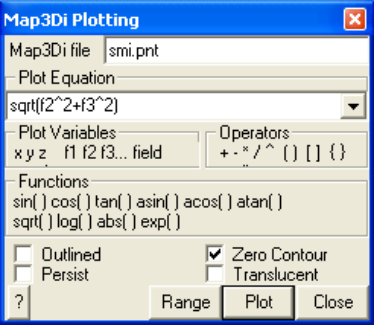

Esta opción permite visualizar los datos de Map3Di.

#### Map3Di File:

El archivo de datos de Map3Di es simplemente un archivo de datos ASCII con la extensión predeterminada ".PNT".

Consulte CAD > Properties > Map3Di para obtener detalles sobre el formato de los datos.

Consulte Visualization > Plane > Make Map3Di File para obtener detalles sobre el formato de los datos.

#### Plot Equation:

Define el parámetro que se graficará.

La lista desplegable permite almacenar hasta 20 ecuaciones distintas. Se guardan entre sesiones de Map3D en el archivo map3d.ini.

#### Plot Variables:

f1 f2 f3… - campos de datos del archivo de eventos.

#### Functions:

sin() cos() tan() - funciones trigonométricas seno, coseno y tangente. asin() acos() atan() - funciones trigonométricas inversas. sqrt() - función raíz cuadrada. log() - función logaritmo natural. abs() - valor absoluto.

exp() - función exponencial (antilogaritmo).

#### Location:

x y z - coordenadas del punto de la malla.

#### Operators:

+ - * / ^   operadores de suma, resta, multiplicación, división y exponenciación. Tenga en cuenta que primero se calculan las exponenciales, luego las multiplicaciones y divisiones, y por último las sumas y restas.

() [] &#123;&#125;   tipos de paréntesis y corchetes. Los pares deben coincidir.

>   valor máximo. Por ejemplo, si la ecuación de graficación se especifica como f1 > 10, se graficará el mayor entre f1 y 10.

&lt;   valor mínimo. Por ejemplo, si la ecuación de graficación se especifica como f1 &lt; 10, se graficará el menor entre f1 y 10.

#### Point Plotting Options:

Outlined – Se delinean los parches de datos de Map3Di.

#### Other:

Persist – cuando está marcado, los puntos se vuelven a graficar cada vez que el modelo se reorienta, se traslada o se amplía. Como esto puede consumir mucho tiempo en modelos grandes, es posible que esta opción no siempre sea conveniente. Translucent - dibuja los puntos como esferas translúcidas.

Zero Contour - cuando no está marcado, no se dibujan los contornos por debajo del rango mínimo de contornos. Esto es útil para mostrar contornos cuando solo importa la parte superior del rango. Range – especifica el mínimo, el máximo y el intervalo para el escalado de radios y el trazado de contornos.

Plot - regenera el gráfico. Este botón se puede colocar en la barra de herramientas View (Tools > View Toolbar Configure) o en la barra de herramientas Contour (Tools > Contour Toolbar Configure).
