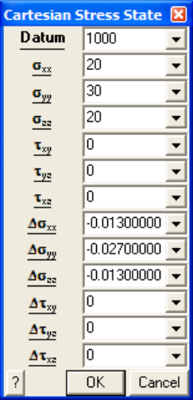

El estado de esfuerzos previo a la minería se especifica como una variación lineal con la profundidad, en componentes cartesianas o principales.

La variación de cada una de las componentes cartesianas se describe como una variación lineal con la profundidad (por ejemplo, para la componente sxx)

- sxx + Dsxx ( _z_ - _Datum_ )

Para determinar los valores apropiados de cada una de estas componentes, primero se debe seleccionar una profundidad

- ( _z_ = _Datum_ )

en la que los esfuerzos tengan valores conocidos. Estos últimos valores son los

sxx  syy  szz  txy  tyz  txz

valores constantes.

La variación de cada componente con la profundidad se puede especificar entonces mediante los

Dsxx  Dsyy  Dszz  Dtxy  Dtyz  Dtxz

valores de variación. Si el sistema de coordenadas se configuró con _z_ positivo hacia arriba, las variaciones se deben especificar como cantidades negativas para que los esfuerzos aumenten con la profundidad.

Por ejemplo, si se sabe que la componente sxx tiene un valor de

30 MPa en _z_ = -1000m

y varía como ( _z_ es positivo hacia arriba)

- 0.027 MPa/m

se especificaría

Datum = -1000 sxx = 30 Dsxx = -0.027
