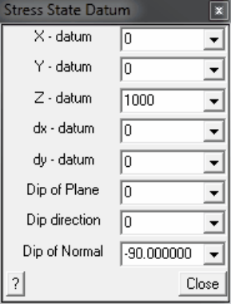

La variación de cada una de las componentes de esfuerzo se describe como una variación lineal, en componentes principales o cartesianas.

Si se desea, esta variación se puede especificar en las direcciones x, y y z definiendo un datum inclinado. Esto se usa en lugares donde la topografía tiene una pendiente dominante.

Para definir un datum inclinado, se debe especificar un punto del plano que representa el datum ( _X-datum_ , _Y-datum_ y _Z-datum_ ),

así como la pendiente del plano. La pendiente se especifica como un gradiente en las direcciones X ( _dx-datum_ ) y Y ( _dydatum_ ).

Para mayor comodidad, la pendiente del plano se puede especificar mediante el "Dip" y la "Dip direction" del plano, o mediante la "Dip direction" y el "Dip of the Normal" del plano. Los gradientes se determinan automáticamente a partir de estos últimos valores de la siguiente manera:

_dx-datum_ = -sin(q) sin(j) _dy-datum_ = -cos(q) sin(j)

por lo tanto

tan(q)= _dx/dy_ tan(j)=sqrt( _dx_ ^2+ _dy_ ^2)

Definidos de esta manera, los esfuerzos varían tanto con la profundidad como con la posición horizontal.
