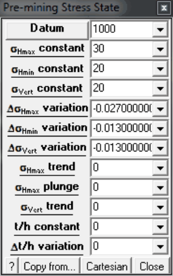
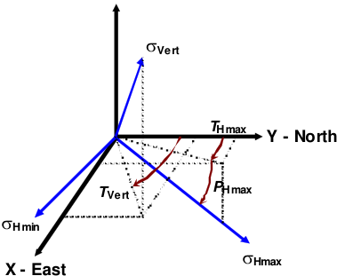

Datum - El estado de esfuerzos previo a la minería se especifica como una variación lineal con la profundidad, en componentes principales o cartesianas.

Copy from... - permite copiar el estado de esfuerzos de otro material.

- Solo se copia el estado de esfuerzos.

- Las demás propiedades del material no se modifican.

Cartesian - El estado de esfuerzos previo a la minería se especifica como una variación lineal con la profundidad, en componentes principales o cartesianas.

Las tres componentes del esfuerzo principal se denominan componentes _Hmax_ , _Hmin_ y _Vert_.

- sHmax es el esfuerzo horizontal (casi) máximo.

- sHmin es el esfuerzo horizontal (casi) mínimo.

- sVert es el esfuerzo (casi) vertical.

Estas componentes del esfuerzo son perpendiculares entre sí.

Las componentes horizontales y vertical no tienen que ser exactamente horizontales o verticales. El rumbo y la inmersión de sHmax se pueden ajustar mediante _THmax_ y _PHmax_ . El rumbo de sVert se puede ajustar mediante _TVert_ .

La variación de cada una de estas componentes se describe como una variación lineal con la profundidad (por ejemplo, para la componente sHmax)

sHmax + DsHmax ( _z_ - _Datum_ )

Para determinar los valores apropiados de cada una de estas componentes, primero se debe seleccionar una profundidad _z_ en la que los esfuerzos tengan valores conocidos.

_Datum_ se debe establecer en este valor de _z_.

La magnitud del esfuerzo a esta profundidad se especifica mediante los siguientes valores constantes

sHmax sHmin sVert

La variación de cada componente con la profundidad se puede especificar entonces mediante los siguientes valores de variación

DsHmax DsHmin DsVert

Si el sistema de coordenadas se configuró con _z_ positivo hacia arriba, las variaciones se deben especificar como cantidades negativas para que los esfuerzos aumenten con la profundidad.

Por ejemplo, si se sabe que la componente _Hmax_ tiene un valor de

30 MPa en _z_ = 1000m

y varía como ( _z_ es positivo hacia arriba)

0.027 MPa/m

se especificaría

Datum = 1000 sa = 30 Dsa = -0.027

Por último, el rumbo y la inmersión de la componente _Hmax_ y el rumbo de la componente _Vert_ definen de forma única la orientación del estado de esfuerzos.

Los parámetros

_t/h_ constant

D _t/h_ variation

se refieren a la distribución de temperatura ambiente o carga hidráulica y se especifican de la misma manera que los esfuerzos.
