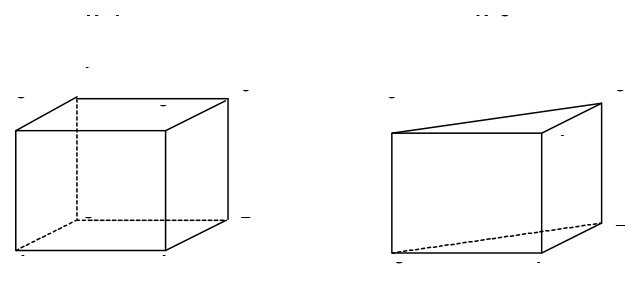
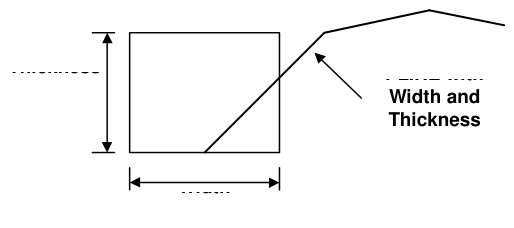
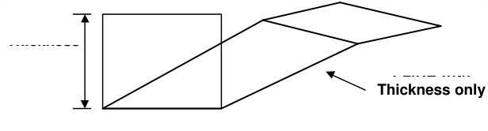
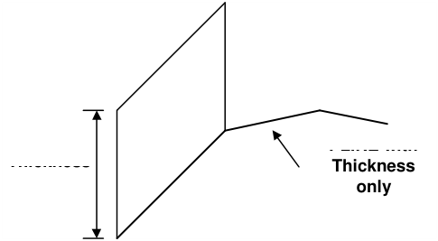
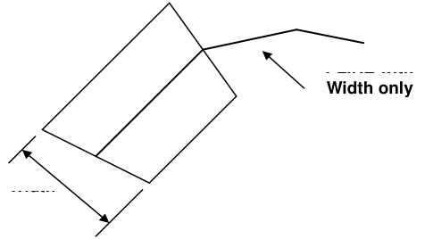
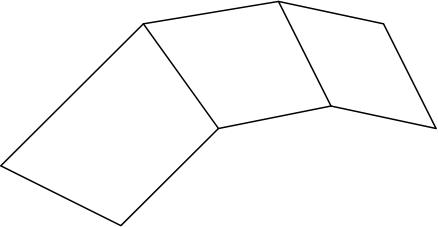
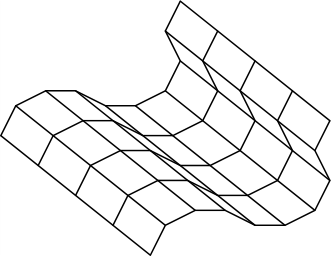

El formato DXF es un archivo de intercambio de dibujos de AutoCAD con la extensión ".DXF".

Este formato es útil para intercambiar datos del modelo con otro software CAD.

#### Entidades de AutoCAD de tipo bloque tridimensional

El método más confiable para generar datos compatibles con Map3D es usar entidades tridimensionales de AutoCAD. Este tipo de entidad genera bloques con una estructura idéntica a la de los bloques 3D FF de Map3D, por lo que se pueden pasar directamente a Map3D. Al usar este comando se garantiza el cierre de todas las superficies, ya que cada entidad tridimensional define un bloque cerrado. Hay muchas maneras de generar estos objetos desde AutoCAD, como se describe a continuación.

#### 3DMESH

El método recomendado para definir entidades tridimensionales de AutoCAD es usar el comando 3DMESH, con THICKNESS y WIDTH de AutoCAD iguales a cero. Estas 3DMESH se pueden especificar con cualquier valor deseado de M y N. Si N es igual a 3 o 4, estas entidades ingresan a Map3D como bloques. Este enfoque es el más general, pero también el más complejo de especificar, ya que se deben definir el piso y el techo de la galería a lo largo de toda su longitud.

#### PLINE, POLYLINE o ELLIPSE con WIDTH y THICKNESS

La técnica más sencilla para generar una galería o un tajeo con sección transversal rectangular regular y altura uniforme es usar el comando PLINE de AutoCAD. Basta con definir un UCS (sistema de coordenadas del usuario) de AutoCAD para la galería y luego definir la línea central de la cota del piso de la galería con el comando PLINE de AutoCAD. A continuación, se especifica el ancho de la galería con el comando PEDIT de AutoCAD. Se puede especificar un ancho constante o un ancho variable en cada vértice. El COLOUR de AutoCAD (número de bloque de Map3D) y el THICKNESS de AutoCAD (altura de la galería) se especifican con el comando CHANGE PROPERTIES de AutoCAD. Los comandos POLYLINE y ELLIPSE de AutoCAD también se pueden usar para crear galerías con WIDTH y THICKNESS de AutoCAD especificados.

#### PLINE, POLYLINE o SOLID solo con THICKNESS

Otro método sencillo para definir galerías o tajeos con sección transversal rectangular es usar cualquiera de los comandos PLINE, POLYLINE o SOLID de AutoCAD con un THICKNESS de AutoCAD especificado (altura de la galería) y WIDTH de AutoCAD igual a cero (véase la Figura 32). Aunque este enfoque es más general que PLINE, también es más complejo de especificar, ya que se debe definir la planta de la galería a lo largo de toda su longitud. Si se usan los comandos PLINE o POLYLINE de AutoCAD, se debe formar un lazo cerrado con 3 o 4 segmentos de línea.

#### Otras entidades tridimensionales de AutoCAD

AutoCAD ofrece rutinas para generar varios objetos tridimensionales, entre ellos esferas, toroides, cajas, conos, etc. Todos ellos se pueden usar si se desea. El usuario es responsable de cerrar los extremos abiertos de formas como hemisferios y conos.

#### Entidades de AutoCAD de tipo placa bidimensional

Los datos compatibles con Map3D también se pueden especificar mediante entidades bidimensionales de AutoCAD. Esta técnica es menos confiable que los métodos descritos anteriormente, porque ya no se garantiza el cierre de todas las superficies. El usuario debe definir las excavaciones con una serie de placas de superficie (todas con el mismo número de color de AutoCAD), que deben unirse por sus bordes y envolver por completo la excavación con una piel de superficie continua. Estas superficies tienen una estructura idéntica a la de las placas de superficie de Map3D. Con este método no se garantiza el cierre de todas las superficies, ya que el usuario puede omitir un parche de superficie y dejar así un hueco en la superficie de la excavación. El usuario debe tener cuidado de colocar todas las placas de modo que todas las superficies cierren perfectamente.

#### LINE, PLINE, 3DPOLY, POLYLINE y ELLIPSE - solo THICKNESS

Estas entidades se pueden usar para definir placas bidimensionales. Basta con definir un UCS (sistema de coordenadas del usuario) de AutoCAD para la placa y luego definir el borde de la placa con cualquiera de los comandos LINE, PLINE, 3DPOLY, POLYLINE o ELLIPSE de AutoCAD. El COLOUR de AutoCAD (número de bloque de Map3D) y el THICKNESS de AutoCAD (ancho de la placa) se especifican con el comando CHANGE PROPERTIES de AutoCAD. El WIDTH de AutoCAD debe ser igual a cero.

#### LINE, PLINE, 3DPOLY, POLYLINE y ELLIPSE con solo WIDTH

Con estas entidades, se define la línea central de la placa con cualquiera de los comandos LINE, PLINE, 3DPOLY, POLYLINE o ELLIPSE de AutoCAD. A continuación, se especifica el ancho con el comando PEDIT de AutoCAD. Se puede especificar un ancho constante o un ancho variable en cada vértice. El THICKNESS de AutoCAD debe ser igual a cero.

#### 3DFACE, POLYLINE o LWPOLYLINE

Las superficies bidimensionales también se pueden generar con el comando 3DFACE de AutoCAD. Este método es más general, pero como se deben especificar todas las esquinas del 3DFACE de AutoCAD, también es más complejo.

#### 3DMESH

Se pueden generar superficies bidimensionales complejas con tipos de 3DMESH con N mayor que 4 (por ejemplo, Rulesurf, Tabsurf, Revsurf, etc.). Para estas formas, la rutina de conversión DXF crea una serie de 3DFACE para describir la superficie de la excavación. Estas superficies tienen una estructura idéntica a la de las placas de superficie de Map3D. En estos casos es bastante fácil asegurar el cierre de la superficie, debido a la naturaleza regular de la construcción.

#### Entidades de AutoCAD no admitidas

Hay varias entidades de AutoCAD no admitidas, es decir, que Map3D no fue diseñado para reconstruirlas tal como aparecen en AutoCAD. Estas entidades incluyen CIRCLE, ARC y DOUGHNUT. Es posible que estas entidades se admitan en futuras actualizaciones de Map3D. Tenga en cuenta que la mayoría de las formas se pueden generar por otros medios con el comando ELLIPSE o el comando 3DMESH de AutoCAD.

#### DATOS EXTENDIDOS DE ENTIDAD (EXTENDED ENTITY DATA) de AutoCAD DXF

Los DXF EXTENDED ENTITY DATA (EED) forman parte de la especificación DXF. Los EED permiten etiquetar cada ENTITY de DXF con atributos de datos personalizados. A continuación se presenta una lista de los EED que admite Map3D.

La mayoría de los sistemas CAD permiten agregar estos EED al DXF. Por ejemplo, Deswik los llama "atributos", por lo que desde Deswik ahora se pueden crear geometrías de Map3D, incluida la especificación de nombres, colores y secuencia de minería de los bloques de Map3D:

- Exporte cada bloque con DXF-POLYLINE/POLYFACEMESH; esta es la opción predeterminada de Deswik.

- Se recomienda no usar DXF-3DFACE.

- En Deswik, los atributos se exportan al DXF como Extended Entity Data de AutoCAD.

- Los nombres de los atributos (no distinguen entre mayúsculas y minúsculas) se definen de la siguiente manera: `o` MAP3D_BLOCKNAME - nombre del bloque (el valor predeterminado es en blanco).

   - MAP3D_BLOCKCOLOR o MAP3D_BLOCKCOLOUR - número de color de Map3D (el valor predeterminado es el número de color definido en Deswik).

   - MAP3D_BLOCKTYPE - 1 para FF, 2 para DD, 98 para FF inactivo, 99 para DD inactivo, 0 para plano de malla (el valor predeterminado es 1 para FF).

   - MAP3D_MSTEP# - # es el número del paso de minería (el valor predeterminado es que se extrae en el paso 1).

   - Ø Por ejemplo, para excavar en el paso de minería 2, cree un atributo llamado MAP3D_MSTEP2 y especifique 0 (excavación) como valor del atributo.

   - Ø Por ejemplo, para rellenar en el paso de minería 3, cree un atributo llamado MAP3D_MSTEP3 y especifique 4 (donde es el número de material que representa el relleno) como valor del atributo.

   - MAP3D_BLOCKNUMBER - número identificador único del bloque (el valor predeterminado es un número único distinto para cada DXF-POLYLINE/POLYFACEMESH o cada DXF-3DFACE).

- Los nombres de los atributos no distinguen entre mayúsculas y minúsculas.

- Todos los atributos se pueden definir como cadenas (código de grupo 1000), enteros (código de grupo 1070 o 1071) o números reales (código de grupo 1040).

- Todos los atributos son opcionales; se asignan valores predeterminados como se especificó anteriormente.

- Tenga en cuenta que, si no se especifica ningún atributo definido por Map3D, el DXF se leerá correctamente siempre que se use DXF-POLYLINE/POLYFACEMESH.

- Map3D simplemente supondrá que cada DXF-POLYLINE/POLYFACEMESH es un bloque independiente.

- Si se usan varios DXF-3DFACE, Map3D puede tener dificultades para agruparlos en bloques.

- Los problemas ocurren solo cuando los bloques adyacentes comparten sus esquinas y tienen el mismo nombre.

- MAP3D_BLOCKNUMBER se puede usar para identificar los DXF-3DFACE que pertenecen a bloques distintos.
