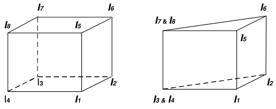
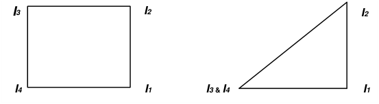
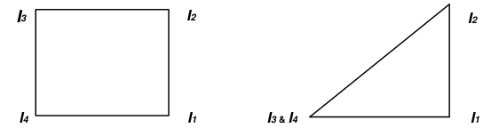
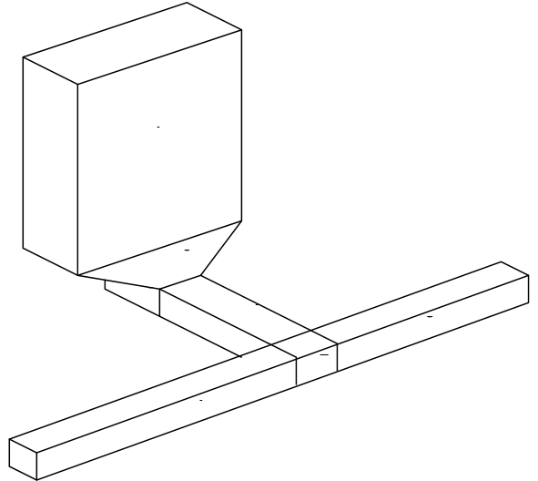
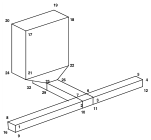
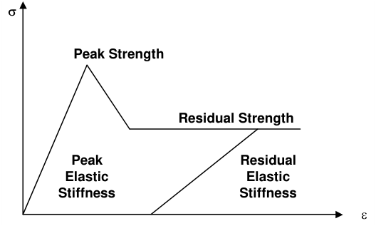

El formato INP es un archivo de datos ASCII editable con la extensión ".INP".

Es el formato de modelo recomendado para Map3D. Este formato admite toda la funcionalidad de Map3D.

El archivo está organizado en 7 secciones:

1. Título del trabajo

2. Parámetros de control

3. Especificación de bloques

4. Especificación de coordenadas

5. Especificación de propiedades de materiales

6. Especificación de mallas

7. Especificación de pasos de minería

Las líneas de comentario deben comenzar con un asterisco "*" en la columna 1.

Se omiten las líneas en blanco.

La longitud máxima de línea es de 256 caracteres.

Para separar los campos de datos se pueden usar comas o espacios.

#### 1. Título del trabajo

Esta sección permite especificar un título descriptivo del proyecto: se debe especificar 1 línea de datos. No se necesitan comillas. Solo se usarán los primeros 70 caracteres.

#### 2. Parámetros de control

Esta sección permite especificar los parámetros de control del trabajo.

#### _NLD,NIT,NPS RPAR,STOL AL,AG DOL,DON DOC,DOE,DOG,DOR_

Se debe especificar 1 línea de datos. Todos los parámetros deben aparecer en una sola línea.

Solo se deben especificar los primeros 7 parámetros ( **_NLD,NIT,NPS  RPAR,STOL  AL,AG_** ). A los demás parámetros se les asignarán valores predeterminados, que pueden ser o no apropiados para su aplicación.

Para obtener una descripción detallada de los parámetros, consulte CAD > Properties > Control Parameters

**_NPS_** Este elemento especifica el número de planos de simetría que se usarán en el análisis. Normalmente no se usan planos de simetría. Si se usa simetría, los esfuerzos de campo lejano (Stress State) deben estar alineados con el eje de simetría.

**_NPS_** =0   sin simetría **_NPS_** =1 _x_ &lt;=> _-x_ , la geometría se refleja en el plano _y-z_ **_NPS_** =2 _x_ &lt;=> _-x_ y _y_ &lt;=> _-y_ , la geometría se refleja en los planos _y-z_ y _x-z_ **_NPS_** =3 _x_ &lt;=> _-x, y_ &lt;=> _-y_ y _z_ &lt;=> _-z_ , la geometría se refleja en los planos _y-z_ , _x-z_ y _x-y_

**_RPAR_** Durante el proceso de solución de la matriz, el programa modifica continuamente el parámetro de relajación para intentar obtener la convergencia con el menor número posible de iteraciones. Este parámetro limita el valor máximo que se usará. Se recomienda el valor sugerido de 1.2 para problemas bien condicionados. Para problemas muy mal condicionados se debe usar un valor de 0.8.

#### 3. Especificación de bloques

Esta sección permite definir la geometría del modelo. Aquí se construyen los bloques 3D FF y los planos DD.

**_N  'Block_Name' I_ 1** **_,I_ 2** **_,I_ 3** **_,I_ 4** **_I_ 5** **_,I_ 6** **_,I_ 7** **_,I_ 8** **_Type  Thickness,Width_**

Se debe especificar 1 línea de datos por bloque.

Todos los parámetros deben aparecer en una sola línea. Solo se deben especificar los primeros 5 parámetros ( **_N I_ 1** **_,I_ 2** **_,I_ 3** **_,I_ 4** ). Use **_N_** =0 para terminar la lista de bloques. Para obtener una descripción detallada de los parámetros, consulte

CAD > Build > Block

CAD > Build > FF Loop

#### CAD > Build > DD Loop

- **_N_** especifica el número de color del bloque. Se usa para identificar este bloque al establecer los códigos de material y también para definir el color del bloque en la visualización gráfica. Se deben usar distintos números de color para representar agrupaciones lógicas de bloques (por ejemplo, para distintos niveles, secciones o unidades lógicas de minería, como desarrollo, tajeo, etc.). Se debe usar el mismo número de identificación de bloque en el mayor número posible de bloques.

Hay un total de 10 colores disponibles para la visualización. Se numeran del

1 al 10, del 11 al 20, del 21 al 30, etc.,

de modo que se muestra el mismo color para los números

1, 11, 21...,

- 2, 22, 32...,

3, 23, 33..., etc.

- **_'Block_Name'_** especifica un nombre descriptivo para el bloque (por ejemplo, tajeo 4540). El programa usará este nombre al proporcionar información sobre el volumen del bloque, errores y advertencias. El nombre del bloque es opcional, pero si se usa debe aparecer entre comillas simples. Solo se usarán los primeros 20 caracteres de cualquier nombre de bloque.

- **_I_ 1** **_,I_ 2** **_,I_ 3** **_,I_ 4** **_I_ 5** **_,I_ 6** **_,I_ 7** **_,I_ 8** representan los números de los puntos de coordenadas que forman las esquinas del bloque. Se describen en detalle más adelante.

- **_Type_** especifica qué tipo de elemento de contorno se usará. Los elementos inactivos (98 para FF inactivo y 99 para DD inactivo) se pueden usar para mostrar elementos que se incluyen solo con fines de visualización y que no se usan en el análisis de esfuerzos propiamente dicho.

- Para elementos tridimensionales, como excavaciones, zonas de material alternativo, tajeos rellenados, etc., se deben usar elementos de tipo **_Type_** =1 (Fictitious Force).

- Las primeras 4 esquinas ( **_I_ 1** **_,I_ 2** **_,I_ 3** **_,I_ 4** ) representan los números de coordenadas que definen un lado (por ejemplo, la base) de un bloque de 6 caras. Las siguientes 4 esquinas ( **_I_ 5** **_,I_ 6** **_,I_ 7** **_,I_ 8** ) definen el lado opuesto del bloque (por ejemplo, la parte superior). Las esquinas se pueden ingresar en sentido horario o antihorario. Cualquiera de las esquinas se puede repetir para definir formas de 3 lados y cuñas. Los bloques se pueden vincular entre sí para formar excavaciones más grandes y complejas, usando números de coordenadas comunes para especificar bloques adyacentes.

- Si se desea, se pueden construir superficies de 3 o 4 lados usando solo las primeras 4 esquinas ( **_I1,I2,I3,I4_** ). Las siguientes 4 esquinas ( **_I5,I6,I7,I8_** ) se deben especificar como ceros. Las esquinas se pueden ingresar en sentido horario o antihorario. Cualquiera de las esquinas se puede repetir para definir formas de 3 lados y cuñas.

- Estas superficies se pueden vincular entre sí para formar excavaciones más grandes y complejas, usando números de coordenadas comunes para especificar placas adyacentes. El usuario debe asegurarse de construir superficies completamente cerradas, sin dejar huecos ni placas faltantes.

- Se deben usar elementos de tipo **_Type_** =2 (Displacement Discontinuity) para excavaciones de minería tabular, fracturas y planos de falla.

- Las superficies se construyen con superficies de 3 o 4 lados usando solo las primeras 4 esquinas ( **_I_ 1** **_,I_ 2** **_,I_ 3** **_,I_ 4** ). Las siguientes 4 esquinas ( **_I_ 5** **_,I_ 6** **_,I_ 7** **_,I_ 8** ) se deben especificar como ceros. Las esquinas se pueden ingresar en sentido horario o antihorario. Cualquiera de las esquinas se puede repetir para definir formas de 3 lados y cuñas.

- Estas superficies se pueden vincular entre sí para formar formas más grandes y complejas, usando números de coordenadas comunes para especificar superficies adyacentes.

- **_Thickness_** Este parámetro solo se usa en elementos de tipo 2 (discontinuidad de desplazamiento), donde sirve para especificar el espesor aparente del material de relleno (es decir, relleno de falla, ancho de veta, ancho de explotación o altura de pilar). El desplazamiento normal (cierre) de esta estructura cuando está rellena se limitará a este espesor. Además, el desplazamiento normal (cierre) y el desplazamiento de corte (deslizamiento) se dividen entre el _Thickness_ para determinar la deformación que ocurre en el material de relleno. Este parámetro se debe especificar en las mismas unidades que se usan para especificar las posiciones de las coordenadas (es decir, metros o pies).

- **_Width_** especifica el ancho máximo permitido.

- Este parámetro se puede usar para forzar una discretización uniforme en entidades seleccionadas. Se debe tener extrema precaución al especificar este valor, ya que un valor pequeño puede generar fácilmente un problema de tamaño enorme.

- En general, este parámetro se debe dejar en blanco (es decir, sin usar) y la discretización se debe dejar a los parámetros **_AL_** y **_AG_**. Estos últimos concentran elementos solo donde se solicitan resultados del análisis, con lo que optimizan el uso de elementos y minimizan el tamaño del problema.

- Para ver un ejemplo del uso de este parámetro, consulte Tabular Mining Example.

#### Un ejemplo sencillo

Para ilustrar la construcción de modelos con bloques tridimensionales, considere la construcción de una configuración sencilla de punto de extracción. Este modelo se ha ensamblado a partir de 7 bloques. Los bloques 1, 2 y 3 forman la galería de extracción, el bloque 4 forma el crucero, los bloques 5 y 6 representan el punto de extracción y el bloque 7 representa el tajeo. Map3D reconoce y elimina las superficies comunes a bloques adyacentes.

Muchos bloques pueden compartir el mismo número de bloque (color), lo que permite usar un grupo de bloques para construir formas de excavación complejas. Una consideración importante aquí es que se debe usar el menor número posible de números de bloque, ya que se mantendrán en la base de datos todas las superficies entre bloques que tengan números de bloque distintos.

Los números de coordenadas de la misma configuración de punto de extracción son necesarios si se desea construir el modelo con la especificación del archivo de entrada de Map3D. Los bloques se numerarían de la siguiente manera:

- Especificación de bloques

- N 'Block Name' I1,I2,I3,I4 I5,I6,I7,I8 Type,Thic,Width

- 1 'Block 1' 1 2 7 8 9 10 15 16 1 0 0

- 1 'Block 2' 2 3 6 7 10 11 14 15 1 0 0

- 1 'Block 3' 3 4 5 6 11 12 13 14 1 0 0

- 1 'Block 4' 7 6 26 25 15 14 30 29 1 0 0

- 2 'Block 5' 25 26 27 28 29 30 31 32 1 0 0

- 2 'Block 6' 21 22 23 24 25 26 27 28 1 0 0

- 2 'Block 7' 17 18 19 20 21 22 23 24 1 0 0

0

#### 4. Especificación de coordenadas

Esta sección permite especificar las ubicaciones de coordenadas que se usan para definir las esquinas de los bloques, los planos DD y los planos de malla.

#### _M X,Y,Z_

Se debe especificar 1 línea de datos por punto de coordenadas. Todos los parámetros deben aparecer en una sola línea. Se deben especificar los 4 parámetros ( **_M X,Y,Z_** ). Use N=0 para terminar la lista de coordenadas.

**_M_** Este parámetro es el número de coordenada. Las coordenadas se pueden ingresar en cualquier orden.

- **_X,Y,Z_** Estos parámetros representan la ubicación de la coordenada. Se recomienda usar **_X_** para Este, **_Y_** para Norte y **_Z_** para la elevación (positiva hacia arriba). Los valores se deben especificar en unidades de longitud (metros o pies).

#### 5. Especificación de propiedades de materiales

Esta sección permite especificar las propiedades de cada material usado en el modelo. Las propiedades de cada material se definen en grupos de tres líneas que especifican, respectivamente, el estado de esfuerzos, los parámetros constitutivos y los parámetros de resistencia.

**_M_ sa, sb, sc   Dsa, Dsb, Dsc** **_Ta,Pa,Tc   Datum   t/h_ ,D** **_t/h Mt   E_ p** **_,E_ r** **_v_ p** **_,v_ r** **_G_ n** **_,G_ s** **_A,C   'Material Name'_**

#### _Mf T_ o p , _T_ o r _UCS_ p , _UCS_ r _Cohesion_ p , _Cohesion_ r fp , fr fi

Para obtener una descripción detallada de los parámetros, consulte CAD > Properties > Material Properties

- Se deben especificar 3 líneas de datos por material; use _N=0_ para terminar la lista.

#### Especificación de propiedades de materiales - Línea 1 - Estado de esfuerzos

Esta línea de datos establece el estado de esfuerzos inicial del material número **_N_** . El material número 1 está reservado para el macizo rocoso huésped.

**_M_ sa, sb, sc   Dsa, Dsb, Dsc** **_Ta,Pa,Tc   Datum   t/h_ ,D** **_t/h_**

Se debe especificar 1 línea de datos numéricos por material. Todos los parámetros deben aparecer en una sola línea. Solo se deben especificar los primeros 4 parámetros ( **_M_ sa, sb, sc** ). Para obtener una descripción detallada de los parámetros, consulte Stress State

#### Especificación de propiedades de materiales - Línea 2 - Propiedades constitutivas

Las propiedades constitutivas se especifican de cinco maneras distintas,

**_Mt_ =1** **_E_ p** **_,E_ r** **_v_ p** **_,v_ r** **_G_ n** **_,G_ s** **_0,0   A,C   'Material Name'_**

- donde **_E_ p** **_,E_ r** **_v_ p** **_,v_ r** representan, respectivamente, los valores pico y residual del módulo de Young (a escala de macizo rocoso, de deformación) y de la relación de Poisson

#### _E_ = 9 _BS_ /(3 _B_ + _S_ )

#### _v_ = (3 _B_ -2 _S_ )/(6 _B_ +2 _S_ )

**_G_ n** **_,G_ s** representan, respectivamente, los módulos viscosos normal y de corte,

- **_A,C_** representan, respectivamente, el coeficiente de expansión y la conductividad (solo se usan en Map3D Thermal-Fluid Flow).

Para obtener más detalles, consulte

**Mohr-Coulomb in 3D FF Blocks**

**Mohr-Coulomb in DD Planes**

- **_Mt_ =2** **_B_ p** **_,B_ r** **_S_ p** **_,S_ r** **_G_ n** **_,G_ s** **_0,0   A,C   'Material Name'_**

   - donde **_B_ p** **_,B_ r** **_S_ p** **_,S_ r** representan, respectivamente, los valores pico y residual de los módulos volumétrico y de corte,

**_B_ =** **_E_ (1-2** **_v_ )/3**

**_S_ =** **_E_ / [ 2(1+** **_v_ ) ]**

**_G_ n** **_,G_ s** representan, respectivamente, los módulos viscosos normal y de corte,

   - **_A,C_** representan, respectivamente, el coeficiente de expansión y la conductividad (solo se usan en Map3D Thermal-Fluid Flow).

- **_Mt_ =3** **_Kn_ p** **_,Kn_ r** **_Ks_ p** **_,Ks_ r** **_G_ n** **_,G_ s** **_0,0   A,C   'Material Name'_**

   - donde **_Kn_ p** **_,Kn_ r** **_Ks_ p** **_,Ks_ r** representan, respectivamente, los valores pico y residual de la rigidez normal y de corte,

#### _K_ n = _N/Thickness K_ s = _S/Thickness_

**_G_ n** **_,G_ s** representan, respectivamente, los módulos viscosos normal y de corte,

- **_A,C_** representan, respectivamente, el coeficiente de expansión y la conductividad (solo se usan en Map3D Thermal-Fluid Flow).

Este tipo de material solo se puede usar en planos DD.

**_Mt_ =4** **_N_ p** **_,N_ r** **_S_ p** **_,S_ r** **_G_ n** **_,G_ s** **_B,Et   A,C   'Material Name'_**

- donde **_N_ p** **_,N_ r** **_S_ p** **_,S_ r** representan, respectivamente, los valores pico y residual de los módulos normal y de corte,

- **_G_ n** **_,G_ s** representan, respectivamente, los módulos viscosos normal y de corte,

- **_A,C_** representan, respectivamente, el coeficiente de expansión y la conductividad (solo se usan en Map3D Thermal-Fluid Flow).

Este tipo de material solo se puede usar en planos DD.

Para obtener más detalles, consulte **Fault-Gouge in DD planes**

**_Mt_ =5** **_N_ p** **_,N_ r** **_S_ p** **_,S_ r** **_G_ n** **_,G_ s** **_B,Et   A,C   'Material Name'_**

- donde **_N_ p** **_,N_ r** **_S_ p** **_,S_ r** representan, respectivamente, los valores pico y residual de los módulos normal y de corte,

- **_G_ n** **_,G_ s** representan, respectivamente, los módulos viscosos normal y de corte,

- **_B,Et_** representan, respectivamente, el límite de compresión y la deformación de transición,

- **_A,C_** representan, respectivamente, el coeficiente de expansión y la conductividad (solo se usan en Map3D Thermal-Fluid Flow).

Este tipo de material solo se puede usar en planos DD. Para obtener más detalles, consulte **Backfill-Hyperbolic in DD planes**

Para el macizo rocoso huésped y las zonas no homogéneas encerradas por elementos FF, el valor de **_Mt_** debe ser 1 o 2. Para el material de relleno colocado en elementos DD, se puede usar cualquier valor de **_Mt_**.

En el análisis elástico solo se usa el valor pico. En el análisis no lineal (deslizamiento de fallas o fluencia del material en Map3D Non-Linear), el valor residual solo se usa después de que el material cede.

#### Especificación de propiedades de materiales - Línea 3 - Parámetros de resistencia

Se debe especificar 1 línea de datos numéricos por material.

Todos los parámetros deben aparecer en una sola línea.

Se deben especificar todos los parámetros si **_Mf_** es distinto de cero. Los parámetros de resistencia se pueden especificar de cuatro maneras distintas:

#### _Mf_ =0

No se usa ningún criterio de falla.

**_Mf_ =1** **_To_ p** **_,To_ r** **_UCS_ p** **_,UCS_ r** **_Cohesion_ p** **_,Cohesion_ r wp** **_,_ wr wi**

Estos parámetros se definen en detalle en

**Mohr-Coulomb in 3D FF Blocks**

**Mohr-Coulomb in DD Planes**

**_Mf_ =2** **_To_ p** **_,To_ r sc p** **_,_ sc r** **_m_ p** **_,m_ r** **_s_ p** **_,s_ r** Estos parámetros se definen en detalle en

**Hoek-Brown in 3D FF Blocks**

#### _Mf_ =3 _To_ p _,To_ r _UCS_ p _,UCS_ r _Cohesion_ p _,Cohesion_ r wp _,_ wr

Estos parámetros se definen en detalle en

**Drucker-Prager in 3D FF Blocks**

#### 6. Especificación de mallas

Esta sección permite definir la ubicación de los planos de malla donde se calcularán los resultados del análisis.

**_N  'Gird_Name' I_ 1** **_,I_ 2** **_,I_ 3** **_,I_ 4** **_I_ 5** **_,I_ 6** **_,I_ 7** **_,I_ 8** 0,0,0,0

**_N  'Grid_Name' I_ 1** **_,I_ 2** **_,I_ 3** **_,I_ 4** **_I_ 5** **_,I_ 6** **_,I_ 7** **_,I_ 8** **_Type  Thickness,Width_**

Se debe especificar 1 línea de datos por bloque.

Todos los parámetros deben aparecer en una sola línea.

Use **_N_** =0 para terminar la lista de mallas.

- **_N_** Este parámetro es el número de malla. Las mallas se deben numerar consecutivamente a partir de 1, pero se pueden ingresar en cualquier orden.

**_I3 I2_**

**_I4 I1_**

- **_'Grid_Name'_** Este parámetro permite especificar un nombre descriptivo para la malla (por ejemplo, malla del techo a través del tajeo 4540). El programa usará este nombre al proporcionar información sobre la malla. El nombre de la malla es opcional, pero si se usa debe aparecer entre comillas simples. Solo se usarán los primeros 20 caracteres de cualquier nombre de malla.

- **_I_ 1** **_,I_ 2** **_,I_ 3** **_,I_ 4** Estos parámetros representan los números de los puntos de coordenadas que forman las esquinas de la malla.

Las mallas se construyen con planos de 4 lados. Las esquinas se pueden ingresar en sentido horario o antihorario.

**_I_ 5** **_,I_ 6** **_,I_ 7** **_,I_ 8** Estos parámetros no se usan y se deben especificar como ceros. **_Thickness_** Este parámetro no se usa y se debe especificar como cero. **_Spacing_** especifica el espaciado máximo permitido.

- Este parámetro se puede usar para forzar una discretización uniforme en la malla. Se debe tener extrema precaución al especificar este valor, ya que un valor pequeño puede generar fácilmente un problema de tamaño enorme.

- En general, este parámetro se debe establecer en cero (es decir, sin usar) y la discretización se debe dejar a los parámetros **_AL_** y **_AG_**. Estos últimos concentran elementos solo donde se solicitan resultados del análisis, con lo que optimizan el uso de elementos y minimizan el tamaño del problema.

#### 7. Especificación de pasos de minería

Este elemento permite especificar el código de material que se asignará a las entidades seleccionadas en cada paso de minería.

#### _'Mining_Step_Title'_

#### _N, Mc_

Se debe especificar 1 línea de datos numéricos por especificación de bloque.

Todos los parámetros deben aparecer en una sola línea.

Se deben especificar 2 parámetros ( **_N,Mc_** ).

La secuencia de minería se define especificando repetidamente una lista de códigos de material. Cada lista termina con **_N_** =0. En cada paso de minería, solo es necesario especificar los códigos de material que cambian. Los bloques permanecen inactivos hasta que se les asigna un código de material.

A los bloques a los que nunca se les asigna un código de material se les asignará un tipo de bloque 98 o 99 (es decir, inactivo). Estos bloques se incluirán en la base de datos solo con fines de visualización; no se usarán en el análisis ni se crearán intersecciones para estas superficies.

- **_'Mining_Step_Title'_** Este parámetro permite especificar un nombre descriptivo para cada paso de minería. El programa usará este nombre al proporcionar información sobre el paso de minería. Es opcional, pero si se usa debe aparecer entre comillas simples.

- **_N_** Este parámetro es el número de identificación del bloque que se usa para identificar a qué bloques se asigna el código de material especificado. Se pueden ingresar en cualquier orden. 0 especifica el final de cada lista de pasos de minería.

**_Mc_** Este parámetro establece el código de material del bloque. **_Mc_** _=0_ esfuerzos superficiales iguales a cero. Normalmente se usa para indicar superficies de excavación libres de esfuerzos.

**_Mc=-M_** Un número de material negativo inserta (aplica) el estado de esfuerzos inicial del material como condición de contorno. Esto permite especificar cualquier condición de carga superficial deseada. En realidad equivale a insertar un material con rigidez cero, que por lo tanto no puede acumular ni disipar esfuerzos. Normalmente se usa para indicar excavaciones con algún estado de esfuerzos interno debido al sostenimiento, el relleno o la presurización activa.

En la mayoría de los análisis, el macizo huésped es tan rígido en comparación con el relleno que la cantidad de esfuerzo acumulado o disipado es insignificante. La excepción sería la deformación no lineal del material o las áreas de cierre grandes.

**_Mc=+M_** Un número de material positivo **_M_** especifica la inserción del material número **_M_** en el estado de esfuerzos inicial especificado para ese material. El material se coloca con el estado de esfuerzos de partida igual al estado de esfuerzos inicial del material y luego puede acumular o disipar esfuerzos con la deformación. La cantidad de cambio de esfuerzos dependerá de la rigidez del material insertado. Esta opción se usa para asignar propiedades de material alternativas a zonas definidas por bloques de tipo 1, o para colocar material de relleno de falla o de relleno en elementos de tipo 2 (discontinuidades de desplazamiento) para simular fallas o zonas de minería tabular rellenadas.

- En la siguiente tabla se presenta un ejemplo sencillo que ilustra esta función:

* Mining Step Specification * Mining Step #1 * N,Mc

'Block #1 is assigned properties of Ore Material #2' 1   2 0

'Block #1 is excavated'

1   0 0 'Block #1 is backfilled with Material #3' 1   3 0
