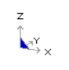
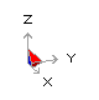

La orientación del modelo se indica mediante un icono de orientación ubicado en la esquina inferior izquierda de la pantalla. Este icono indica la dirección de los ejes (X hacia el Este, Y hacia el Norte y Z hacia arriba).

En la vista anterior, el eje Y apunta principalmente hacia el interior de la pantalla y un poco hacia la derecha, el eje X apunta principalmente hacia la derecha y un poco hacia fuera de la pantalla, y el eje Z apunta directamente hacia arriba. Observe que la parte posterior del icono está sombreada en azul.

En la vista anterior, el eje Y apunta principalmente hacia la derecha y un poco hacia el interior de la pantalla, el eje X apunta principalmente hacia fuera de la pantalla y un poco hacia la derecha, y el eje Z apunta directamente hacia arriba. Observe que el interior del icono está sombreado en rojo.

Hay tres modelos de rotación seleccionables:

1. Se pueden aplicar rotaciones a la geometría actual. Este modo permite horizontes no horizontales

2. Se pueden aplicar rotaciones de modo que el horizonte permanezca siempre horizontal, suponiendo que el eje Z+ apunta hacia arriba (Tools > Global Transform Z+ up). Esto hace que la rotación con el mouse ocurra en sentido opuesto al de Tools > Global Transform Z- up.

3. Se pueden aplicar rotaciones de modo que el horizonte permanezca siempre horizontal, suponiendo que el eje Z- apunta hacia arriba (Tools > Global Transform Z- up).

Esto hace que la rotación con el mouse ocurra en sentido opuesto al de Tools > Global Transform Z+ up. El modelo se puede rotar manteniendo presionado el botón izquierdo del mouse y esperando a que aparezca el puntero de arrastre

y luego arrastrando el icono de orientación hasta la posición deseada. Al arrastrar hacia arriba o hacia abajo, el modelo rota hacia arriba o hacia abajo. Cerca de la parte inferior de la pantalla, al arrastrar hacia la izquierda o hacia la derecha, el modelo rota hacia la izquierda o hacia la derecha. Cerca de la parte superior de la pantalla, al arrastrar hacia la izquierda o hacia la derecha, el modelo rota en sentido antihorario u horario. Esta operación se puede personalizar con Tools > Rotation Toolbar.

El modelo también se puede rotar con controles de pantalla táctil, arrastrando 1 o 2 dedos por la pantalla y pellizcando para hacer zoom. Esta operación se puede personalizar con Tools > Rotation Toolbar.

Notas:

Antes de rotar el modelo, debe definir el centro de rotación deseado

#### View > Centre

Puede ajustar el tiempo de espera del arrastre con

#### Tools > Drag Wait Time

Las operaciones de rotación y traslación se pueden repetir automáticamente escribiendo n# antes de seleccionar la operación. Por ejemplo, para producir una visualización animada de un gráfico de esfuerzos, especifique

Plot > Options > Persist Plot > Stress > Sigma:1 View > Rotation Increment > 10 escriba 35# desde el teclado

seleccione rotar a la derecha (desde la barra de herramientas de rotación o con la tecla PageDown)

Presione la tecla Esc para cancelar la animación.

Al ingresar 0# se repetirá la operación indefinidamente. Presione la tecla Esc para detenerla.

Temas relacionados:

Traslación del modelo Selección de posiciones de vista especiales

#### Índice

#### - 0 -

Archivos 001 002 ...     510, 600

**- 3 -**

Formas de excavación 3D     27, 29, 30

#### - A -

Cancelación de un análisis de Map3D     461 Acerca de Map3D     2 Deformación absoluta     223, 299 Esfuerzo absoluto     209, 299 Precisión     45, 308, 381, 462, 482 AG - espaciamiento de malla     45, 300, 301, 302, 308, 381, 462 AL - tamaño de elemento     45, 300, 301, 308, 381, 462 Zonas de materiales alternativos     30

Cuadro de diálogo Analysis     172, 308, 328, 381, 461, 462, 463, 464, 465, 489, 490

Cuadro de diálogo Analysis Options     329, 465, 466, 467, 468, 469, 471, 473, 477, 478, 482, 484, 485, 486, 487, 489

Resultados del análisis     164, 171, 172, 173, 186, 510, 524, 600

Tiempo de análisis     45, 308, 381, 462 Animación     184, 508 Aplicaciones de Map3D     11 Modelos tal como fueron construidos     27 Discretización automatizada     45, 300, 301, 302, 308, 381, 462 Valor promedio de los puntos de contorno     317

#### - B -

Relleno     30, 33, 477, 487 Ejecución de análisis por lotes     466

Análisis BEM     317, 390, 433, 461, 462, 465, 466, 467, 469, 471, 473, 477, 478, 482, 484, 485, 486, 487, 489, 490, 569, 594, 595, 597, 598

Volcado de pantalla a mapa de bits     173, 174, 184, 185, 508 Modelos de bloques     29, 30 BMP     173, 174, 184, 508 Intersecciones booleanas     467 Método de elementos de contorno     12, 13, 477, 482, 487, 570

Barra de herramientas Build     331, 335, 341, 348, 358, 360, 362, 364, 365, 366, 367, 368, 369, 436, 494, 507 Construcción de bloques FF 3D     331, 335, 341, 348, 364, 365, 366, 367, 368, 369, 390, 394, 395, 397, 398, 400, 402, 407, 408, 410, 412, 413, 415, 416, 418, 421, 423 Construcción de líneas de construcción     362, 364, 365, 366, 367, 368, 369, 498

Construcción de planos DD     331, 335, 341, 348, 364, 365, 366, 367, 368, 369, 390, 394, 395, 397, 398, 400, 402, 407, 408, 410, 412, 413, 415, 416, 418, 421, 423

Construcción de líneas de malla de puntos de campo     358, 360 Construcción de planos de malla de puntos de campo     358, 360, 364, 365, 366, 367, 368, 369, 494, 496

Construcción de planos de líneas de puntos de campo     364, 365, 366, 367, 368, 369

Construcción de túneles     331, 335, 341, 348, 364, 365, 366, 367, 368, 369 Explotación masiva - Tutorial de construcción de modelos     85

#### - C -

CAD     426, 427, 428, 429 CAD > Build     331, 335, 341, 348, 358, 360, 362, 364, 365, 366, 367, 368, 369 Menú CAD > Build     494, 507

CAD > Edit     390, 394, 395, 397, 398, 400, 402, 407, 408, 410, 412, 413, 415, 416, 418, 421, 423 Menú CAD > Edit     495, 496, 498 CAD > Properties     308, 317, 381, 390 Menú CAD > Properties     313, 314, 386, 387 CAD > Propertiesu     313, 386 CAD > Snap     369, 370, 371, 372, 373, 376, 377, 378, 379

Menú CAD > Snap     494 Menú CAD     303, 425 Barra de herramientas CAD     436, 494, 507

Deformación cartesiana     221 Esfuerzo cartesiano     208 Borrado de datos de líneas de construcción     169 Borrado de datos del modelo     165 Verificación de cierre y superposición     467 Matriz de coeficientes     471, 484, 485, 487 Problemas comunes al construir modelos     39 Concluir el análisis actual     489, 490 Realización de un análisis de esfuerzos BEM     462 Realización de un análisis de Map3D     328 Configuración de barras de herramientas     196, 432, 433, 434, 435, 436 Modo consola     466 Datos de líneas de construcción     169, 170, 171, 508, 510, 511 Análisis de contactos e intersecciones     464 Opciones de gráficos de contornos     304 Rango de contornos     302 Barra de herramientas Contouring     432, 433, 594, 595, 597, 598 Copia de datos del modelo     397 Fluencia lenta elasto-viscoplástica     469 Fuente personalizada de botones     439 Colores personalizados     437, 438, 439

**- D -**

Espesor de planos DD     496 Planos DD     27, 35, 36 Búfer de profundidad     440, 441 Deswick     511 Compatibilidad con digitalizador     426, 502 Análisis de discretización     462, 484, 485, 569 Discretización y agrupamiento (lumping)     45, 300, 301, 302, 308, 381, 462 Visualización de la vista discretizada     600 Discretización de un modelo     462 Prueba de rendimiento del disco     441 Requisitos de espacio en disco     45, 308, 381, 462, 484, 485 Componentes de desplazamiento     224 Elementos de discontinuidad de desplazamiento     27, 35, 36 Barra de herramientas Displacement     224 Visualización de una imagen de pantalla guardada     184, 185, 508

Soluciones divergentes     45, 300, 301, 308, 381, 462 DOC - agrupamiento de matriz     45, 300, 301, 308, 381, 462 DOE - agrupamiento de elementos     45, 308, 381, 462 DOG - agrupamiento de malla     45, 308, 381, 462 DOL - precisión de la solución     45, 300, 301, 302, 308, 381, 462 DON - acondicionamiento de matriz     45, 300, 301, 308, 381, 462 DOR - relación de aspecto de elementos     45, 308, 381, 462 Rotación del modelo por arrastre     431, 601 Traslación del modelo por arrastre     431, 599 Zoom del modelo por arrastre     431, 599 Drucker-Prager en bloques FF 3D     232, 238, 240, 243, 246, 248, 251, 254, 256, 533 Volcado de resultados del análisis     175, 180 Volcado de la imagen de pantalla     173, 174, 175, 508 Formato de archivo de líneas de construcción DXF     510, 511 Volcado de pantalla a DXF     174 Formato de archivo de modelo DXF     511, 525 Formato de archivo de imagen de pantalla DXF     174

**- E -** Barra de herramientas Edit     390, 394, 395, 397, 398, 400, 402, 407, 408, 410, 412, 413, 415, 416, 418, 421, 423, 436, 495, 496, 498, 499, 501 Edición de datos del modelo     390, 430, 495, 496, 498, 499, 501 Esfuerzo efectivo     209 Deformación elástica     222, 298 Fluencia lenta elasto-viscoplástica     469 Agrupamiento de elementos (lumping)     45, 300, 301, 308, 381, 462 Tamaño de elemento     45, 300, 301, 308, 381, 462 Cálculo de la tasa de liberación de energía     478 Borrado de datos del modelo     394 ESS     200, 202, 203, 205 Archivos EVP     443, 446 Esfuerzo en exceso     232, 238, 240, 243, 246, 248, 251, 254, 256, 259, 263, 265, 266, 268, 272, 276, 526, 531, 533, 535, 547, 556, 595 Coeficiente de expansión y conductividad     568 EXTENDED ENTITY DATA     511 Extrusión de planos en bloques     365

#### - F -

Criterio de falla     232, 238, 240, 243, 246, 248, 251, 254, 256, 259, 263, 265, 266, 268, 272, 276, 526, 531, 533, 535, 547, 556, 595

Especificación del estado de esfuerzos en campo lejano     503, 505 Planos de falla     36 Fault-Gouge en planos DD     259, 263, 265, 266, 268, 272, 276, 535

Elementos de fuerza ficticia     27, 29 Menú File > Output     173, 174, 175, 180 Menú File     164, 165, 166, 167, 168, 169, 170, 171, 172, 173, 184, 185, 186, 507, 508, 524, 525 Búsqueda de un punto de coordenadas especificado en el modelo     195 Reglas de flujo     526, 535, 547, 556, 568 Componentes de flujo     230 Barra de herramientas Flow     230 Análisis de flujo de fluidos/térmico     568 Dibujo a mano alzada - Tutorial de construcción de modelos     60

Hyperbolic-Backfill en planos DD     259, 263, 265, 266, 268, 272, 276, 556

#### - I -

Especificación del estado de esfuerzos in situ     503, 505 Bloques inactivos     39 Deformación inducida     223, 299 Esfuerzo inducido     209, 299 Especificación del estado de esfuerzos inicial     503, 505 Inicialización de todos los parámetros de visualización     195 Formato de archivo de modelo INP     515, 525

En el plano     259, 263, 265, 266, 268, 272, 276 Deformación en el plano     213, 215, 216, 218 Esfuerzo en el plano     200, 202, 203, 205 Interpretación de resultados     15, 23, 478 Análisis de intersecciones     464, 467, 468, 485, 569 Introducción     2

#### - J -

#### - G -

GIF     173, 174, 184, 508

Ir a gráficos en la etapa de análisis actual     463 Ir a la etapa de construcción y edición del modelo     463 Agrupamiento de malla (lumping)     45, 300, 301, 302, 308, 381, 462 Selección de malla     303, 425, 436

Espaciamiento de malla     45, 300, 301, 302, 308, 381, 462 Superficie del terreno     35 Agrupación de datos del modelo     408

#### - H -

Menú Help     456, 457

Eliminación de superficies ocultas     440, 441 Barra de herramientas Hide block colours     189, 190, 196, 435 Barra de herramientas Hide Cline Colours     190 Barra de herramientas Hide construction line colours     190, 196, 435 Barra de herramientas Hide     186, 196, 435 Ocultar diversas partes del modelo     186 Hoek-Brown en bloques FF 3D     232, 238, 240, 243, 246, 248, 251, 254, 256, 531

JPEG     173, 174, 184 JPG     173, 174, 184

#### - L -

Arrendamiento de Map3D     2

Limitaciones y deficiencias     15

Carga de un modelo desde un archivo     164, 165, 167, 464, 507, 525

Carga de resultados del análisis desde un archivo reciente     186

Carga de resultados del análisis desde un directorio usado recientemente 524

Carga de resultados del análisis desde un archivo de reinicio     164, 171 Carga de datos de líneas de construcción desde un archivo     169, 170 Carga de datos del modelo desde un directorio usado recientemente 524

Carga de datos del modelo desde un archivo usado recientemente     186 Cálculo de la rigidez del sistema de carga     478 Cálculo local de la tasa de liberación de energía     478 Agrupamiento (lumping) y discretización     45, 300, 301, 302, 308, 381, 462

#### - M -

Map3D     2, 9, 11, 12, 13, 569, 570 Opciones de análisis de Map3D     329 Map3Di     314, 387, 453 Códigos de material     33 Especificación de propiedades de los materiales     313, 386, 464, 503, 505, 526, 531, 533, 535, 547, 556, 568 Acondicionamiento de matriz     45, 300, 301, 308, 381, 462 Agrupamiento de matriz (lumping)     45, 300, 301, 308, 381, 462 Solución de la matriz     465, 467, 486 Deformación cortante máxima     212 Esfuerzo cortante máximo     199 Esfuerzo medio     207 Valor medio de los puntos de contorno     317 Menu Commands - Cuadro de diálogo Analysis     172, 308, 381, 461, 462, 463, 464, 465, 489, 490 Menu Commands – Cuadro de diálogo Analysis     328 Menu Commands - Cuadro de diálogo Analysis Options 465, 466, 467, 468, 469, 471, 473, 477, 478, 482, 484, 485, 486, 487, 489 Menu Commands – Cuadro de diálogo Analysis Options 329

Menu Commands - CAD     426, 427, 428, 429 Menu Commands - CAD > Build     331, 335, 341, 348, 358, 360, 362, 364, 365, 366, 367, 368, 369 Menu Commands - Menú CAD > Build     494, 507 Menu Commands - CAD > Edit     390, 394, 395, 397, 398, 400, 402, 407, 408, 410, 412, 413, 415, 416, 418, 421, 423

Menu Commands - Menú CAD > Edit     495, 496, 498 Menu Commands - CAD > Properties     308, 313, 314, 317, 381, 386, 387, 390 Menu Commands - CAD > Snap     369, 370, 371, 372, 373, 376, 377, 378, 379 Menu Commands - Menú CAD > Snap     494 Menu Commands - Menú CAD     303, 425 Menu Commands  File     169, 170 Menu Commands - File     164, 165, 166, 167, 168, 169, 171, 172, 173, 184, 185, 186 Menu Commands - File > Output     173, 174, 175, 180 Menu Commands - Menú File     507, 524, 525 Menu Commands - Menú Help     456, 457

Menu Commands - Plot     302 Menu Commands - Plot > Displacement     224 Menu Commands - Plot > Flow     230 Menu Commands - Plot > Miscellaneous     302 Menu Commands - Plot > Properties     308, 313, 317, 381, 386, 390

Menu Commands - Plot > Strain     210, 212, 213, 215, 216, 218, 220, 221, 222, 223, 226, 298, 299 Menu Commands - Plot > Strength Factors     232, 238, 240, 243, 246, 248, 251, 254, 256, 259, 263, 265, 266, 268, 272, 276

Menu Commands - Plot > Stress     198, 199, 200, 202, 203, 205, 207, 208, 209, 226, 299

Menu Commands - Plot > Surface Components     279, 280, 281, 282, 283, 284, 285, 286, 287, 292, 294, 295, 296, 297, 298, 300, 301

Menu Commands - Menú Plot     594, 595, 597, 598 Menu Commands – Menú Plot     304, 317 Menu Commands - Seismic     443, 446, 453, 456, 492 Menu Commands - Tools     196, 430, 431, 432, 433, 434, 435, 436, 437, 438, 439, 440, 441, 442 Menu Commands – Menú Tools Menu Commands - Tools Menú Tools     439

Menu Commands - View > Find Coordinate     195 Menu Commands - View > Hide     186 Menu Commands - View > Hide Block Colours     189, 190

Menu Commands - View > Hide Cline Colours     190 Menu Commands - View > Initialize     195 Menu Commands - View > Length     196, 435 Menu Commands - View > Pan     196, 435 Menu Commands - View > Render     192, 194, 600 Menu Commands - View > Zoom     196, 435 Menu Commands - View > Zoom Extents     195 Menu Commands - Menú View     196, 197 Menu Commands - Menú File     508 Fusión de superficies adyacentes     468 Fusión de puntos de coordenadas cercanos entre sí 467 Fusión de datos del modelo     507, 525 Diseño de mina     23 Selección de etapa de explotación     173 Secuencia de etapas de explotación     33

Construcción de modelos     12, 27, 29, 30, 33, 35, 36, 39, 60, 85, 106, 314, 331, 335, 341, 348, 358, 360, 362, 387, 390, 394, 395, 397, 398, 400, 402, 407, 408, 410, 412, 413, 415, 416, 418, 421, 423, 426, 463, 467, 468, 485, 486, 494, 496, 498, 507, 525 Datos del modelo     164, 165, 166, 167, 168, 186, 314, 387, 464, 467, 486, 507, 509, 511, 515, 524, 525, 569 Icono de orientación del modelo     601 Mohr-Coulomb en bloques FF 3D     232, 238, 240, 243, 246, 248, 251, 254, 256, 526 Mohr-Coulomb en planos DD     259, 263, 265, 266, 268, 272, 276, 547 Desplazamiento de puntos de campo muy cercanos a superficies de contorno     473 Desplazamiento de datos del modelo     395, 412, 413, 415, 416, 418

#### - N -

Modelado numérico     9, 11, 12, 13, 15, 23

#### - O -

Volcado de pantalla a OBJ     175 Formato de archivo de imagen de pantalla OBJ     175 Esfuerzo cortante octaédrico     207 Deformación cortante octaédrica     220 Tajos abiertos     36 OpenGL     440, 441 Zonas de mineral     27, 29, 30 Visión general de Map3D     9 Visión general de la construcción de modelos     12

#### - P -

Estudios paramétricos     15 Volcado de pantalla a PDF 3D     175 Formato de archivo de imagen de pantalla PDF 3D     175 Tamaño del cuadro de selección     442 Deformación plástica     222, 298 Plot > Displacement     224 Plot > Flow     230 Plot > Miscellaneous     302 Plot > Properties     308, 313, 317, 381, 386, 390

Menú Plot > Properties     313, 386

Plot > Strain     210, 212, 213, 215, 216, 218, 220, 221, 222, 223, 226, 298, 299 Plot > Strength Factors     232, 238, 240, 243, 246, 248, 251, 254, 256, 259, 263, 265, 266, 268, 272, 276 Plot > Stress     198, 199, 200, 202, 203, 205, 207, 208, 209, 226, 299 Plot > Surface Components     279, 280, 281, 282, 283, 284, 285, 286, 287, 292, 294, 295, 296, 297, 298, 300, 301 Menú Plot     302, 303, 304, 317, 425, 594, 595, 597, 598 Opciones de gráficos     304 Gráficos de componentes de superficie durante el análisis     461, 462 PNG     173, 174, 184, 508 Formato de archivo de líneas de construcción PNT     508, 510 Volcado de resultados del análisis a PNT     175, 180 Volcado de pantalla a PNT     175, 508 Formato de archivo de modelo PNT     509, 525 Formato de archivo de imagen de pantalla PNT     175, 508 Problemas mal condicionados     45, 300, 301, 308, 381, 462 Deformaciones principales     210 Esfuerzos principales     198 Probabilidad     232, 238, 240, 243, 248, 251, 256, 259, 263, 265, 266, 268, 272, 276 Tamaño del problema     45, 308, 381, 462

#### - R -

RAM para almacenamiento de matrices     485, 487 Rango para trazar contornos     302 Directorios usados recientemente     524 Archivos usados recientemente     186 Confiabilidad de las predicciones del modelado     15 Renderizado de los contornos     304 Renderizado del modelo     192, 194 Renumeración de superficies para que el volumen sea positivo     486 Restablecimiento de todos los parámetros de visualización     195 Archivos de reinicio     510, 600 Reinicio de un análisis     172 Restauración de una posición de vista y un rango de contornos guardados previamente     185

Predicciones de la respuesta del macizo rocoso     15, 23, 478 Resta de resultados del análisis     172 Rotación de datos del modelo     400, 402 Soporte y ventas     2 Rotación del modelo     197, 431, 601 Colocación de sostenimiento     30, 33, 477, 487 Barra de herramientas Rotation     431 Ejecución de varios análisis consecutivos     466 Barra de herramientas Surface Components     279, 280, 281, 282, 283, 284, 285, 286, 287, 292, 294, 296, 297, 298, 300, 301, 598 **- S -** Barra de herramientas Surface Components (r)     295 Modelos de superficie     27, 30 Suspensión de un análisis de Map3D     489 Ventas y soporte     2

Ventas y soporte     2 Guardado de un modelo en un archivo     166 Guardado de un modelo con un nuevo nombre de archivo     166, 168 Guardado de datos de líneas de construcción en un archivo     171 Guardado de datos de líneas de construcción con un nuevo nombre de archivo     171 Guardado de datos del modelo     407 Guardado de la posición de vista y de los rangos de contornos actuales 185 Escalado de datos del modelo     398 Volcado de pantalla     173, 174, 175, 184, 185, 508 Sísmica     443, 446, 453, 456, 492 Menú Seismic     443, 446, 453, 456, 492 Momento sísmico     317 Desplazamiento suave en el cuadro de diálogo Analysis     442 Suavizado de líneas de construcción     421, 423 Barra de herramientas Snap     369, 370, 371, 372, 373, 376, 377, 378, 379, 436, 494, 502 Precisión de la solución     45, 300, 301, 302, 308, 381, 462, 482

#### - T -

Tutorial de explotación tabular - Construcción de modelos     106 Zonas de explotación tabular     36 Enfoque observacional de Terzaghi     15 Prueba del rendimiento del disco     441 Análisis de flujo térmico/de fluidos     568 Formas de excavación tridimensionales     27, 29, 30 Barras de herramientas     431, 433, 436, 594, 595, 597, 598 Menú Tools     196, 430, 431, 432, 433, 434, 435, 436, 437, 438, 439, 440, 441, 442 Deformación total     222, 298 Esfuerzo total     209 Traslación y zoom del modelo     599 Traslación del modelo     196, 431 Barra de herramientas Translation     431 Tutorial     60, 85, 106

Barra de herramientas Solve     433, 434 Posiciones de vista especiales     197 Análisis de flujo térmico/de fluidos en estado estacionario     568 Barra de herramientas Strain     210, 212, 213, 215, 216, 218, 220, 221, 222, 223, 226, 298, 299, 597 Criterio de resistencia     232, 238, 240, 243, 246, 248, 251, 254, 256, 259, 263, 265, 266, 268, 272, 276, 526, 531, 533, 535, 547, 556, 595 Barra de herramientas Strength Factors     232, 238, 240, 243, 246, 248, 251, 254, 256, 259, 263, 265, 266, 268, 272, 276, 595

#### - U -

Plano ubicuo     259, 263, 265, 266, 268, 272, 276 Deformación en el plano ubicuo     213, 215, 216, 218 Esfuerzo en el plano ubicuo     200, 202, 203, 205 Actualización del archivo de resultados     172 Fuente de botones definida por el usuario     439 Colores definidos por el usuario     437, 438, 439 Gráficos de contornos definidos por el usuario     443, 446, 453, 456, 492 Volcado de resultados del análisis definido por el usuario     175, 180 Gráficos definidos por el usuario     226 Puntos definidos por el usuario para el cálculo de esfuerzos     473

Icono de orientación de esfuerzos     599 Barra de herramientas Stress     198, 199, 200, 202, 203, 205, 207, 208, 209, 226, 299, 594 Estiramiento de datos del modelo     410 Subdivisión de cuadriláteros no planares en triángulos 485

#### - V -

Menú View > Hide Block Colours     189, 190 Menú View > Hide Cline Colours     190 Menú View > Hide     186 Menú View > Render     192, 194, 600 Menú View     195, 196, 197, 435 Barra de herramientas View     189, 190, 196, 435 Visualización de planos de malla     303, 425, 436 Visualización de etapas de explotación     173 Volcado de pantalla a VRML     175 Formato de archivo de imagen de pantalla VRML     175

#### - W -

Volcado de pantalla a WRL     175 Formato de archivo de imagen de pantalla WRL     175 [www.map3d.com/how_to_buy](https://www.map3d.com/how_to_buy)     2

#### - Z -

Z-buffering     440, 441 Zoom para que todas las entidades sean visibles     195 Zoom del modelo     197, 431
