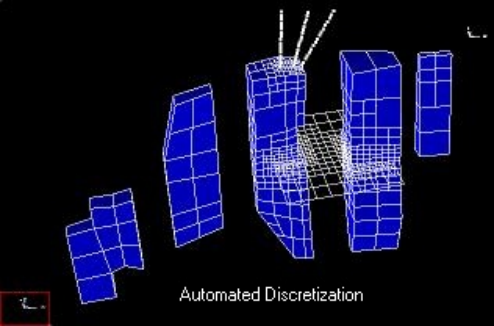
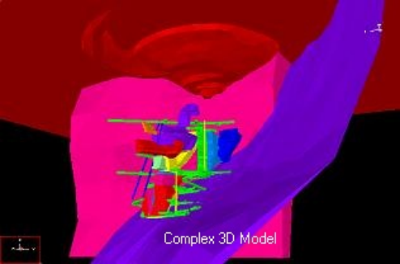
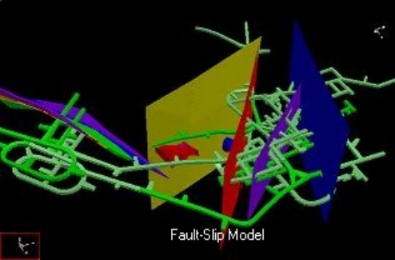
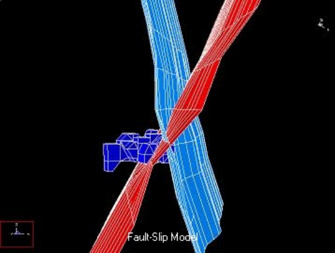
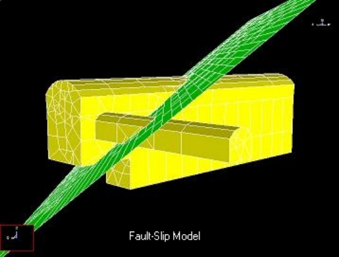

**Map3D Fault-Slip** - análisis de esfuerzos en macizo rocoso elástico y fallas con deslizamiento totalmente plástico.

Este módulo se usa para realizar análisis de esfuerzos de modelos 3D. Este software se utiliza en proyectos civiles, geológicos y mineros.

Incluye el modelador CAD 3D (Map3D Modeller), el visualizador de resultados (Map3D Results Viewer) y la base de datos visual SIG.

El análisis de esfuerzos utiliza el BEM (método de elementos de contorno) y tiene muchas características:

- Problemas de tamaño muy grande. Map3D puede realizar análisis de esfuerzos en modelos con miles de excavaciones (más de un millón de grados de libertad). Esto permite una representación detallada de la geometría y elimina la necesidad de simplificar modelos grandes (la simplificación excesiva es una de las principales fuentes de error en el modelado). Se pueden simular fácilmente modelos que abarcan toda la mina.

- Formas de excavación 3D complejas y completas. Se pueden analizar fácilmente modelos detallados tal como fueron construidos y formas 3D complejas. Como el análisis de esfuerzos se basa en el método de elementos de contorno (BEM), solo es necesario especificar las superficies de las excavaciones (y de otras características). No hace falta definir (subdividir en elementos) los pilares entre excavaciones adyacentes. Cualquier forma arbitraria se combina fácilmente en un único modelo grande listo para el análisis.

- Múltiples zonas elásticas con distintos módulos (diques rígidos o mineral blando). Map3D puede incorporar plenamente zonas de materiales alternativos. Esto facilita considerar tipos de roca rígidos o blandos.

- Zonas con diferentes estados de esfuerzo previos a la explotación.

- Explotación tabular con pilares en fluencia. Esta aproximación suele ser adecuada para minas grandes de vetas angostas.

- Planos de falla discretos no planares que se deslizan y se dilatan de forma elasto-visco-plástica (incluida la fluencia lenta). Estas características se implementan mediante el método de discontinuidad de desplazamiento. Se implementan reglas de flujo elasto-visco-plásticas para adaptarse a una variedad de tipos de comportamiento. El análisis de deslizamiento de fallas, tanto para la explotación como para la simulación de sismos, se resuelve fácilmente.

- Se pueden simular grietas y fracturas, incluidos los cálculos de la tasa de liberación de energía y del factor de intensidad de esfuerzos. La propagación de fracturas se puede simular como una serie de pasos discretos.

- Se requieren múltiples etapas de explotación para considerar efectos como la colocación de relleno o la propagación de grietas. Actualmente, Map3D permite 40 etapas. Se pueden sustituir distintos materiales en excavaciones o fracturas en cualquier etapa.

- Las intersecciones booleanas automáticas permiten que excavaciones, fallas y fracturas se crucen y se superpongan. Sin esta capacidad, modelar características que se intersectan sería prácticamente imposible en modelos complejos. Map3D maneja estas situaciones con facilidad.

- Discretización automatizada. Los modelos se pueden discretizar manualmente si se desea, o se puede dejar esta tarea a las rutinas automatizadas integradas en el programa. Estas rutinas garantizan que los elementos se concentren solo donde se necesitan, lo que proporciona una alta precisión uniforme y optimiza el tiempo de análisis.

Hay disponible una versión de demostración de Map3D Fault-Slip sin cargo. Están disponibles todas las funciones, pero solo se permite ejecutar problemas de tamaño pequeño. Esta versión es sumamente útil para enseñar los fundamentos del modelado, la visualización y el CAD 3D.

Map3Di Integrated Seismicity
