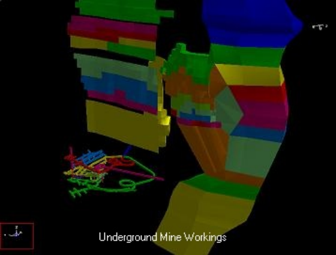
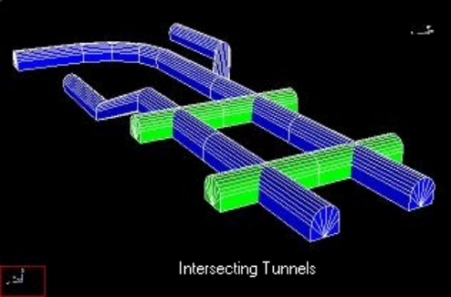
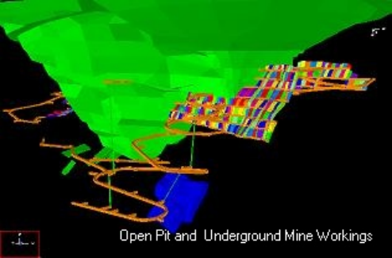
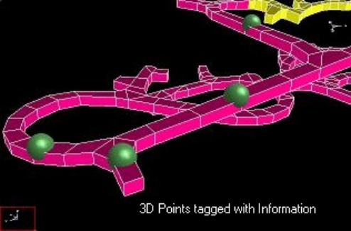
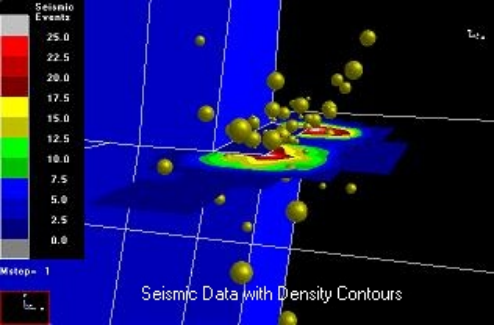

**Map3D Modeller** - CAD 3D y base de datos visual SIG.

Este módulo se usa para construir y visualizar modelos 3D. Este software se utiliza en proyectos civiles, geológicos y mineros.

El sistema CAD 3D, fácil de usar (basado en OpenGL), incluye dibujo a mano alzada, digitalización o selección de objetos para construir y editar 5 tipos básicos de entidades:

- Bloques 3D. Estas entidades se usan para construir tajeos, zonas de mineral, diques y túneles. La construcción resulta más sencilla si se define una serie de secciones transversales o

planos de nivel (cada uno puede tener una forma distinta y un número distinto de puntos). Map3D puede simplificarlos fácilmente si se desea y luego interpolar entre los lazos para formar formas 3D complejas.

- Características 2D. Estas entidades se usan para construir fallas, explotación tabular, topografía del terreno y fracturas. Estas características no tienen que ser planas. Se admiten por completo fracturas y fallas curvas y desplazadas.

- Planos de malla. Se pueden definir secciones transversales para trazar contornos o simplemente para cortar el modelo.

- · Líneas de malla. Son particularmente útiles para representar la ubicación de sondajes y del sostenimiento del terreno. Las ubicaciones y orientaciones de los instrumentos se identifican con facilidad.

- Líneas de construcción. Los datos topográficos simples, como las líneas centrales de las galerías, se representan más fácilmente con líneas de construcción. Esto permite importar y exportar fácilmente a otros paquetes CAD (capacidad completa de dxf y pnt) y ofrece una forma rápida de mostrar datos de líneas.

- Modelos con sombreado de fuente de luz. Se admite el sombreado con fuente de luz de OpenGL para mejorar la representación del modelo.

Incluye un conjunto completo de funciones de edición, como copiar, mover, estirar, aplanar, escalar, rotar y más. Esto permite manipular gráficamente con facilidad las entidades anteriores.

La base de datos visual SIG se puede usar para almacenar, analizar y mostrar una base de datos con cualquier información deseada, incluidos datos sísmicos e información geológica como la ley, la calidad del macizo rocoso, etc.

Los puntos 3D se pueden etiquetar con una serie de:

- valores numéricos (p. ej., color, magnitud, orientación, tiempo, etc.),

- palabras clave (para filtrar),

- mensajes de texto,

- nombres de archivo (p. ej., archivos de gráficos, documentos, hojas de cálculo, dibujos, etc.).

La visualización de estos elementos se puede filtrar de varias maneras. La ubicación de cada punto se puede mostrar como esferas sombreadas en color, con tamaño y color escalados según distintas combinaciones de parámetros. La densidad de magnitud de los puntos se puede representar con contornos sobre un plano según funciones de densidad definidas por el usuario. Los planos de contorno pueden ser definidos por el usuario o ajustados mediante regresión lineal automática.

Map3D Results Viewer
