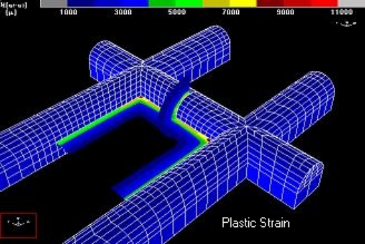
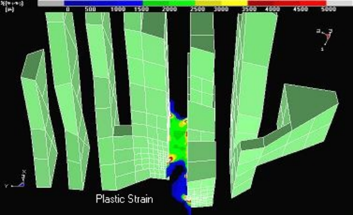
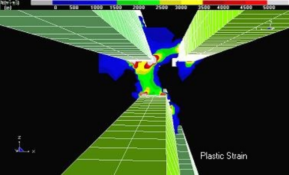
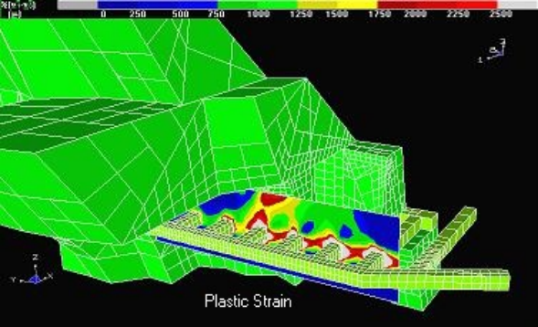

**Map3D Non-Linear** - respuesta no lineal del macizo rocoso.

Incluye todas las capacidades de Map3D Fault-Slip y agrega la capacidad de que el macizo rocoso 3D ceda ante cargas que superan la resistencia de la roca y se deforme de forma no lineal para disipar los esfuerzos en exceso. Esta función es útil para simular vetas potentes, pilares sobreesforzados, estribos, relleno y respuesta de fluencia lenta. Esta formulación resuelve el problema no lineal en la superficie de los elementos de contorno e interpola estos efectos entre dichos contornos. Esto representa una primera aproximación al modelado inelástico que presenta la ventaja de admitir problemas de gran tamaño y una ejecución muy rápida.

Map3D Visco-Plastic
