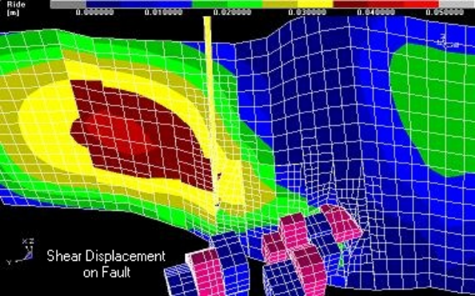
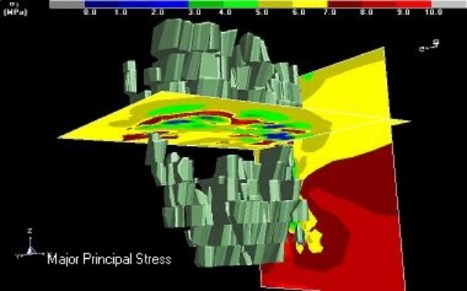
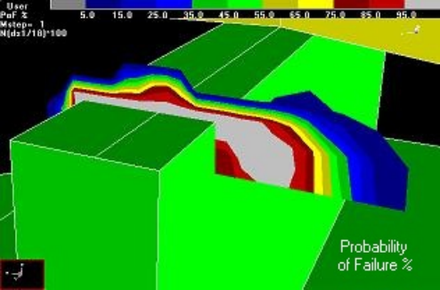
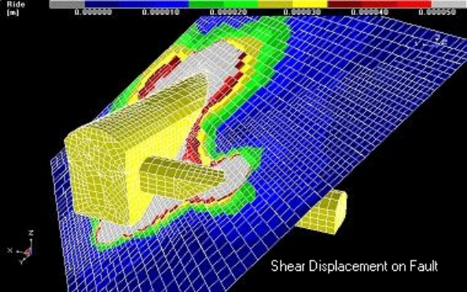
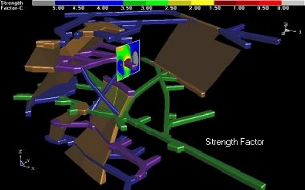

**Map3D Results Viewer** - visualización y análisis de los resultados del análisis de esfuerzos.

Incluye la base de datos visual SIG, pero no el sistema CAD.

- visualiza los resultados de análisis de esfuerzos generados por los códigos de análisis de esfuerzos de Map3D

- muestra contornos en planos de corte, a lo largo de líneas y en puntos específicos

- funciones de contorno definidas por el usuario

- exportación directa a Excel para graficar en x-y

- visualización de trayectorias 3D

- visualización de todos los parámetros de esfuerzo, deformación, desplazamiento y resistencia, incluidas las componentes principales y los valores resultantes, en planos y líneas definidos por el usuario

- exportación en formatos dxf y pnt para compatibilidad con otros sistemas CAD y de visualización

- contornos de probabilidad de falla

- contornos de factor de seguridad

- modelos con sombreado de fuente de luz

- contornos topográficos

**Map3D Fault-Slip**
