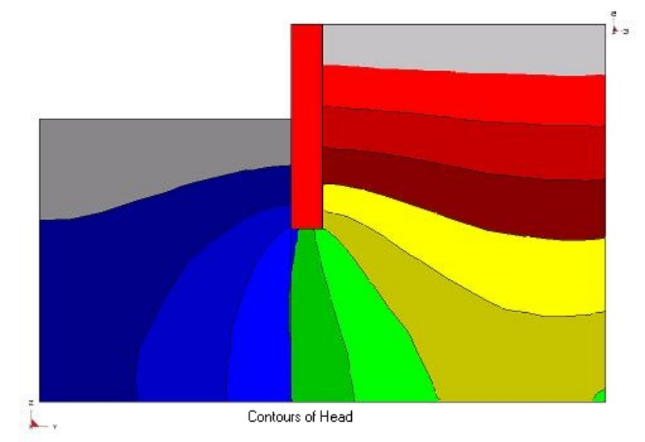
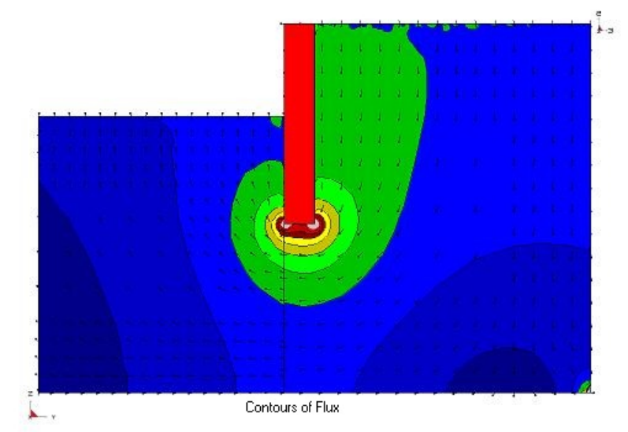

**Map3D Thermal-Fluid Flow** - análisis de esfuerzos térmicos y flujo de fluidos.

Incluye todas las capacidades de Map3D Fault-Slip y agrega la solución simultánea de esfuerzos térmicos y flujo de fluidos en estado estacionario. El programa está configurado de modo que solo se necesita especificar las condiciones de contorno de temperatura/carga hidráulica, y luego se resuelve simultáneamente el problema de esfuerzos térmicos. Esta función es útil para simular efectos de calentamiento/enfriamiento y la respuesta drenada/no drenada.

Map3D Non-Linear
