**Map3D Visco-Plastic** - respuesta elasto-visco-plástica 3D del macizo rocoso (aún en desarrollo; no está disponible comercialmente por el momento).

Incluye todas las capacidades de Map3D Fault-Slip y agrega la capacidad de que el macizo rocoso 3D se comporte de forma elasto-visco-plástica. Este modelo ofrece una solución completa de las ecuaciones de plasticidad incremental no asociada y agrega la capacidad de que el macizo rocoso 3D ceda ante cargas que superan la resistencia de la roca y se deforme de forma no lineal para disipar los esfuerzos en exceso. Esta capacidad de simulación proporciona los grandes desplazamientos necesarios para simular estudios de interacción entre el sostenimiento del terreno y el relleno. Esta función es útil para simular vetas potentes, pilares sobreesforzados, estribos, relleno y respuesta de fluencia lenta. Esta formulación resuelve el problema no lineal en zonas específicas del macizo rocoso.

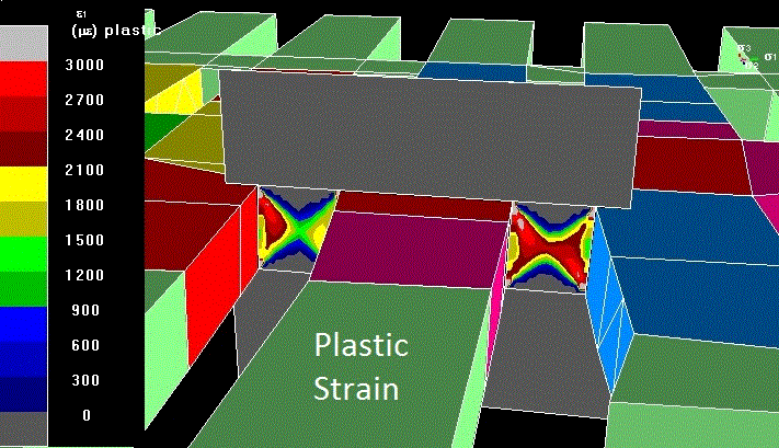

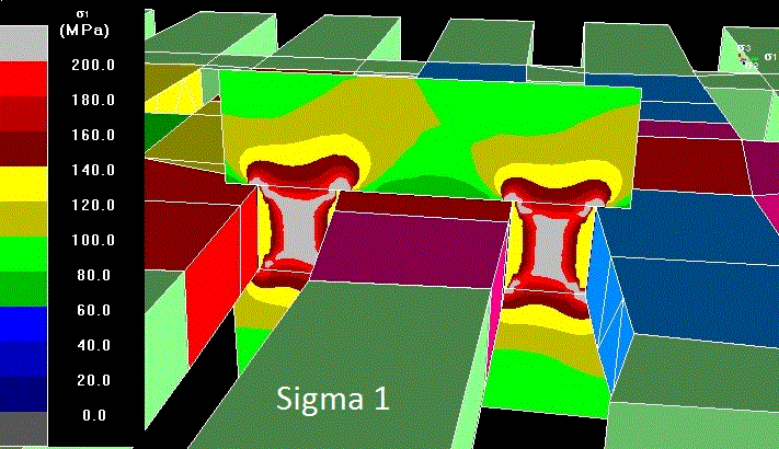

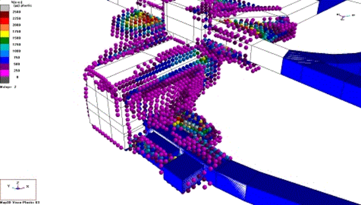

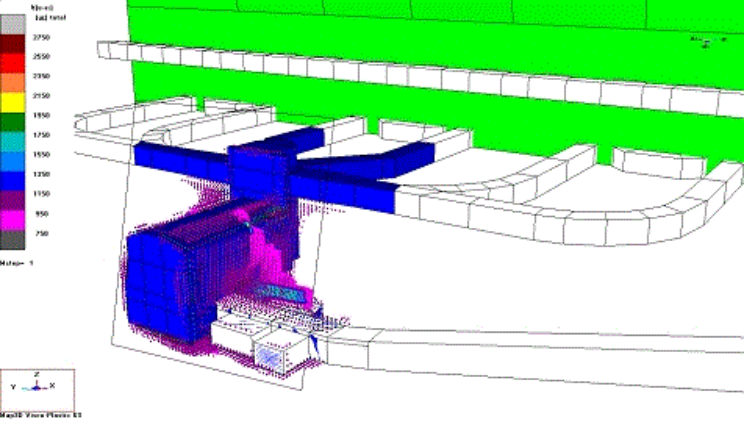

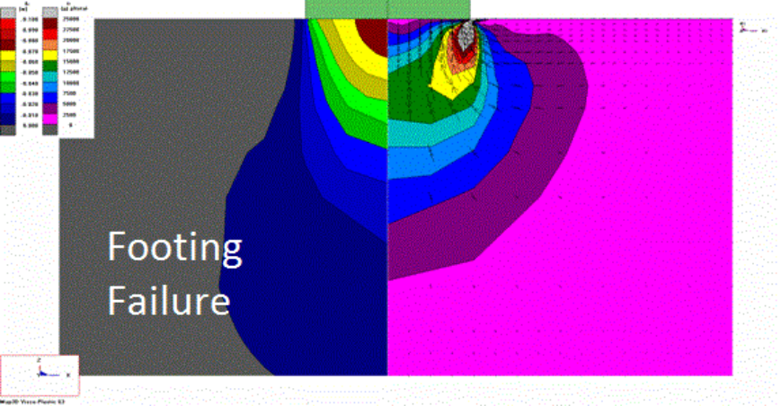

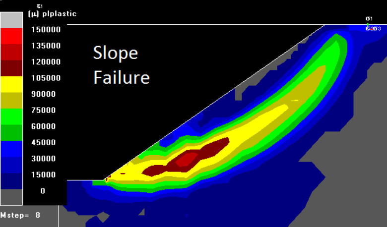

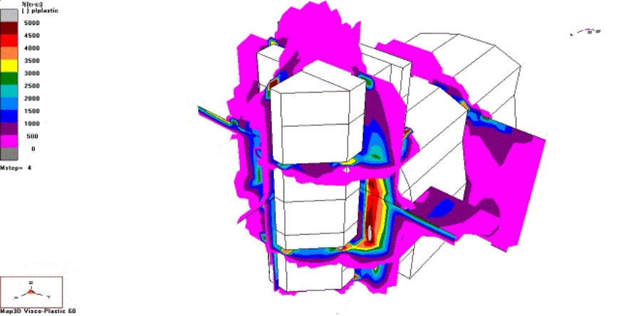

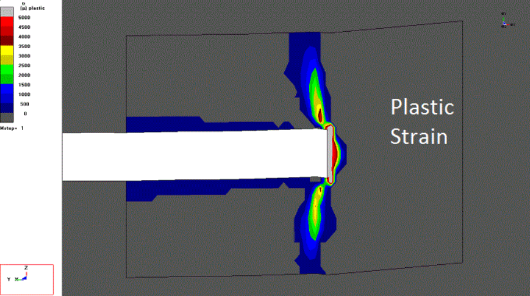

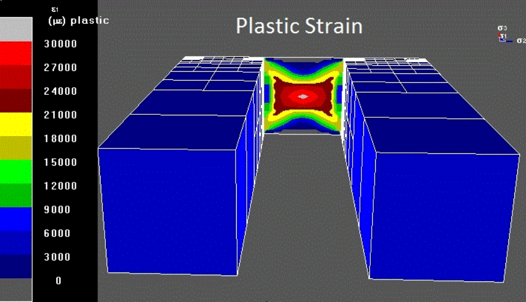

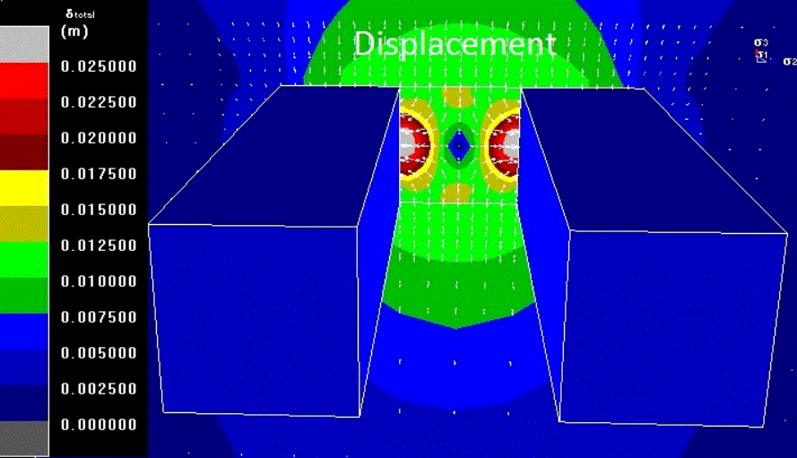

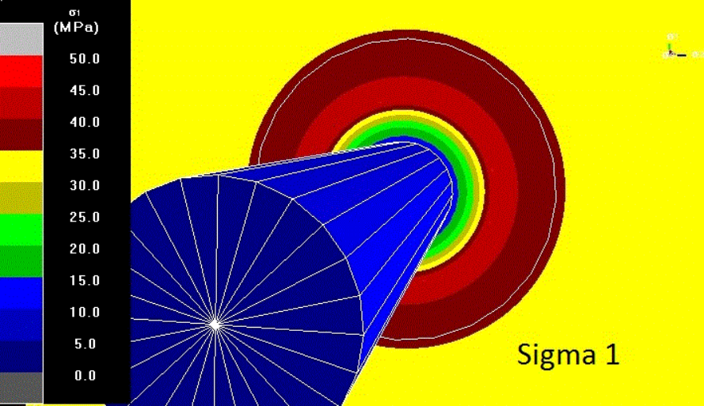

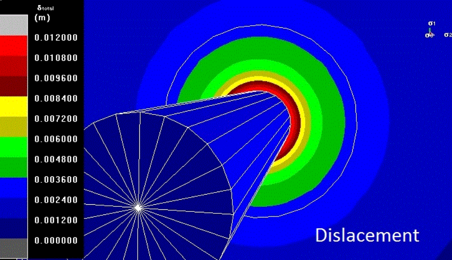

Map3D Overview
