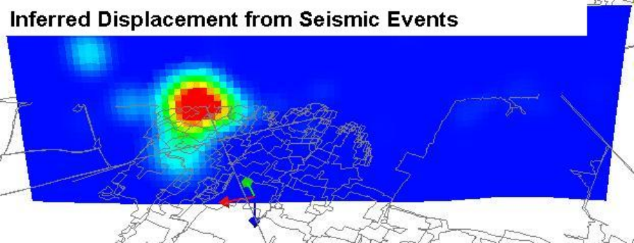
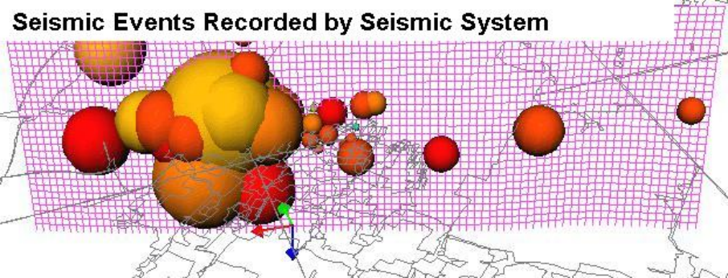
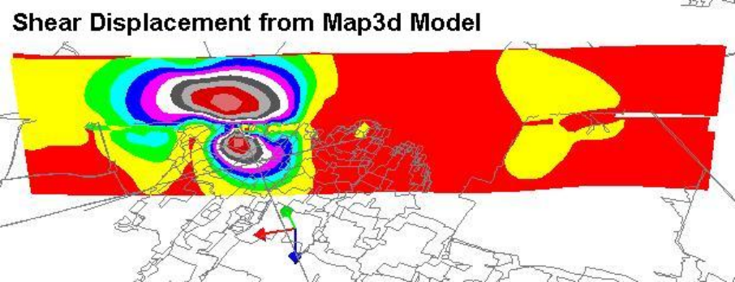

**Map3Di Integrated Seismicity** - superpone efectos de carga de campo externos en el análisis de esfuerzos.

Incluye todas las capacidades de Map3D Fault-Slip y agrega efectos de carga de campo. Los efectos de carga de campo se pueden importar desde cualquier base de datos de calentamiento térmico, presión de fluidos, comportamiento no lineal y deformaciones indicadas por la sismicidad. Estos efectos se pueden usar para caracterizar características geológicas 2D y 3D, adaptarse a cambios de litología e incorporar los efectos de la carga sísmica en el análisis de esfuerzos.

El modelado numérico permite predecir la respuesta del macizo rocoso como resultado del avance de las excavaciones mineras. Aunque el efecto de características geológicas como fallas o cambios de litología se puede incorporar fácilmente al modelo, a menudo la ubicación, la orientación y las propiedades de comportamiento

de dichas características son inciertas. Esto puede dar lugar a resultados de modelado de baja confiabilidad y, por lo tanto, de utilidad limitada para los operadores de la mina. Map3Di permite superponer efectos de carga de campo externos en el modelo de Map3D. La carga de campo puede provenir del calentamiento térmico, la presión de fluidos, el comportamiento no lineal, etc. Además, estos efectos se pueden determinar a partir de muchas formas de monitoreo in situ, incluidas, por ejemplo, las presiones de fluidos (p. ej., descenso del nivel en pozos, presas, fracturamiento hidráulico), el calentamiento (p. ej., calentamiento natural, almacenamiento de residuos nucleares) y las deformaciones (p. ej., monitoreadas con extensómetros).

Otra fuente importante de información de carga de campo in situ proviene de la actividad sísmica. Por definición, la presencia de sismicidad indica que el macizo rocoso cede ante la carga y, por lo tanto, se deforma de alguna manera. La sismicidad podría indicar cizallamiento en un plano de falla o no linealidad 3D del material, posiblemente debida a una característica litológica débil. Map3Di permite superponer en el modelo de mina de Map3D las deformaciones indicadas por la sismicidad. Por ejemplo, si la sismicidad indica que se produce cizallamiento en algún punto, esto se puede imponer en el modelo y así redistribuir los esfuerzos para tener en cuenta este efecto.

El concepto detrás de Map3Di es superponer alguna carga de campo conocida junto con las características habituales del modelado (esfuerzo previo a la explotación, geometría del modelo, diques, fallas, etc.) para obtener una predicción compuesta de los esfuerzos, las deformaciones y los desplazamientos en todo el macizo rocoso. La integración del modelado numérico con el monitoreo sísmico mediante el método de elementos de contorno de Map3Di permite superponer en el modelo numérico las deformaciones indicadas por la sismicidad. Esto caracteriza eficazmente las características geológicas y tiene en cuenta el efecto que estas tienen sobre la respuesta del macizo rocoso.

La información de carga de campo se reduce a especificar: el deslizamiento y la dilatación en un segmento de un plano de deslizamiento, y/o la deformación de una zona 3D. Pero, ¿de dónde proviene esa información?

- Suponga que mide la distribución de temperatura en toda su mina y quiere aplicar esta carga de campo a un modelo de Map3Di. Para ello, se subdivide todo el macizo rocoso en pequeñas zonas 3D y se especifica la temperatura en cada zona. Luego se debe calcular la "expansión térmica libre" de cada zona. Después, basta indicar a Map3Di que use esta carga de campo. Map3Di realiza los cálculos necesarios para determinar la contribución al esfuerzo de la carga de campo integrada.

- Suponga que inyecta lechada pesada en una fractura y, una vez que fragua, perfora algunos taladros para determinar la cantidad de dilatación que provocó en la fractura, y quiere aplicar esta carga de campo a un modelo de Map3Di. Para ello, se subdivide la fractura en pequeñas zonas planas y se especifica la dilatación en cada zona. Después, basta indicar a Map3Di que use esta carga de campo. Map3Di realiza los cálculos necesarios para determinar la contribución al esfuerzo de la carga de campo integrada.

- Suponga que, a partir de la sismicidad, determina que algunas porciones del macizo rocoso se deforman y otras no. Para ello, se subdivide todo el macizo rocoso en pequeñas zonas 3D y se calcula la deformación en cada zona. Después, basta indicar a Map3Di que use esta carga de campo. Map3Di realiza los cálculos necesarios para determinar la contribución al esfuerzo de la carga de campo integrada.

Tenga en cuenta que el modelo de Map3Di puede contener todas las características habituales, incluidas excavaciones, diques rígidos, fallas, etc. Los efectos de la carga de campo y de todas estas otras características se superponen para obtener una predicción compuesta final de los esfuerzos, las deformaciones y los desplazamientos en todo el macizo rocoso.

¿Cómo nos ayuda Map3Di a superar las deficiencias de aplicar el enfoque observacional de Terzaghi al diseño? Adoptar este enfoque ofrece muchos beneficios posibles:

- Primero, reconozcamos que se pretende aplicar condiciones de carga de campo conocidas, medidas a partir de datos de campo (sismicidad, temperatura, presiones de fluidos o deformaciones). Esto en sí mismo puede considerarse un ejercicio de calibración o ajuste fino, y no de predicción. Literalmente se agrega información al modelo.

- La riqueza de información que proviene del monitoreo sísmico es enorme. El monitoreo sísmico aporta el volumen y la distribución espacial de información sobre la respuesta del macizo rocoso que no se puede obtener de ninguna otra forma a un costo razonable. Map3Di ofrece un mecanismo para usar directamente esta información en la calibración del modelo. Debido a la naturaleza en tiempo real de la sismicidad, resulta práctico recorrer el ciclo de explotación/monitoreo/rediseño en cada incremento de la explotación. Así, en lugar de pasar años haciendo observaciones visuales para desarrollar un historial de la respuesta del macizo rocoso, existe la posibilidad de calibrar el modelo mucho más rápido.

- Quizá lo más importante es que ofrece la posibilidad de adaptarse en tiempo real a condiciones cambiantes del macizo rocoso. Esto permite reconocer y adaptarse a condiciones locales que cambian con rapidez, como la litología o el diaclasamiento. Se puede actualizar la calibración del modelo a medida que cambian las condiciones. Esto puede mejorar significativamente la confiabilidad de las predicciones.

- Por último, al incorporar, por ejemplo, algún deslizamiento de falla indicado por la sismicidad, en realidad se caracteriza el efecto de ese deslizamiento y se incorpora al modelo. Por ejemplo, si la sismicidad indica que se produce cizallamiento en algún punto, esto se puede imponer en el modelo y así redistribuir los esfuerzos para tener en cuenta exactamente este efecto.

Map3D Thermal-Fluid Flow
