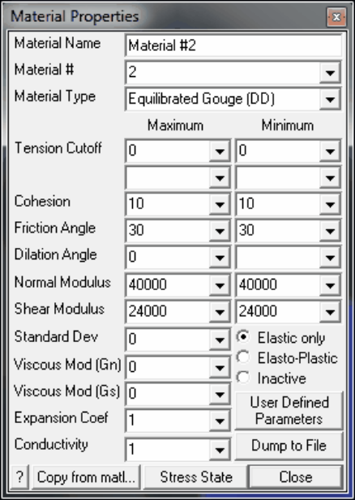
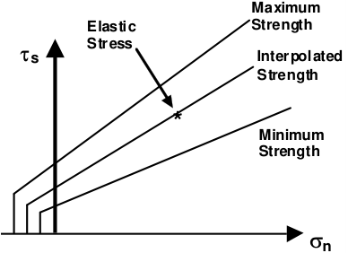
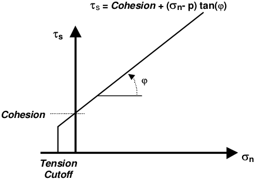
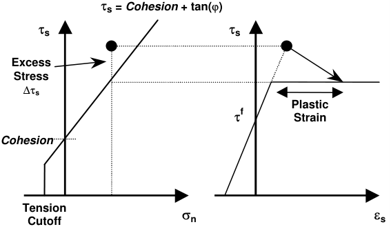
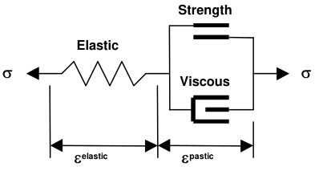

El material Equilibrated-Gouge se puede usar para describir la respuesta no lineal en planos DD tanto en Map3D Fault-Slip como en Map3D Non-Linear.

Este material es similar al tipo de material Fault-Gouge, pero ajusta automáticamente los parámetros de resistencia para llevar el relleno de falla a un equilibrio crítico en la primera etapa de explotación.

En la etapa 1 del análisis de esfuerzos, se calculan los esfuerzos elásticos en todas las ubicaciones del plano de falla DD. A partir de esta información, los parámetros de resistencia requeridos (cohesión y ángulo de fricción) se determinan por interpolación, de modo que cada ubicación quede exactamente en el punto de falla.

Esto se hace interpolando linealmente entre los valores mínimo y máximo de resistencia especificados. Si el esfuerzo elástico cae por debajo del mínimo, se usa el mínimo. Si el esfuerzo elástico supera el máximo, se usa el máximo.

Los valores de resistencia interpolados se usan luego en todas las etapas de explotación posteriores.

Esto se puede considerar el peor escenario, en el que cualquier cambio de esfuerzo inducido por la explotación tiene el potencial de provocar deslizamiento en la falla.

#### Equilibrated-Gouge en planos DD

Material Name - especifica un nombre descriptivo para el material.

Material # - especifica el número del material.

- El material n.º 1 está reservado para el material huésped.

- Los demás números de material se usan para definir zonas de materiales alternativos, como mineral, relleno de falla, relleno, etc.

Material Type - especifica el tipo de material (Mohr-Coulomb, Hoek-Brown, Drucker-Prager, Fault-Gouge, Hyperbolic-Backfill, Quadratic-Backfill, Equilibrated-Gouge, Yielding-Pillar o ninguno).

- Fault-Gouge - define la envolvente de falla como una línea recta, igual que Mohr-Coulomb en planos DD, pero sin _UCS_ .

- La resistencia se define en función de los esfuerzos cortante y normal en el plano de la siguiente manera:

#### Fault-Gouge en planos DD

- Tension Cutoff y Cohesion se especifican en unidades de esfuerzo (MPa o psi).

- El ángulo de fricción y el ángulo de dilatación se especifican en grados.

- La cohesión y el ángulo de fricción definen la respuesta al corte.

- El límite de tracción (tension cutoff) define la respuesta en la dirección normal al plano de corte.

- Los valores máximos (Maximum) especifican la resistencia interpolada máxima permitida.

- Los valores mínimos (Min) especifican la resistencia interpolada mínima permitida.

- Si se especifica la presión de fluido como parte de Stress State, se usa el esfuerzo normal efectivo (sn-p) (aquí p es la presión de fluido).

Normal and Shear Modulus - especifique los módulos en unidades de esfuerzo (MPa o psi).

- En los planos DD, los esfuerzos cortante y normal que actúan sobre las superficies del elemento se relacionan con la parte elástica del desplazamiento cortante (deslizamiento) y del desplazamiento normal (cierre) mediante los módulos de corte y normal.

- Los valores pico de estos parámetros se usan hasta la falla.

- Después de la fluencia, se usan los valores residuales.

Standard Deviation - especifique la desviación estándar en unidades de esfuerzo (MPa o psi).

- Este parámetro describe la incertidumbre que se tiene sobre los parámetros de resistencia.

- Este parámetro solo se usa para graficar la probabilidad de falla por corte Plot > Strength Factors > InPlane Probability N-distribution.

Viscous Modulus ( _Gn_ y _Gs_ ) - Estos parámetros se usan solo en análisis no lineales (bloques FF 3D en Map3D Non-Linear y planos DD en Map3D Fault-Slip).

- El módulo viscoso describe la respuesta de fluencia lenta, donde la resistencia a la fluencia lenta se determina como el coeficiente de fluencia lenta _C_ multiplicado por la tasa de deformación plástica.

- Observe que se deben seleccionar tanto el coeficiente de fluencia lenta _C_ como el tamaño del paso de tiempo D _t_ , y luego especificar el cociente de ambos como el módulo viscoso _G_ .

- Especifique el módulo viscoso en unidades de esfuerzo (MPa o psi).

Expansion Coefficient y Conductivity solo se usan en Map3D Thermal-Fluid Flow. · Map3D Thermal-Fluid Flow se puede usar para resolver simultáneamente el flujo de calor/fluidos en estado estacionario acoplado al análisis de esfuerzos.

Elastic only - cuando está activada, este material responderá solo de forma elástica; es decir, no se usarán los parámetros de resistencia.

- Esto se puede usar para definir zonas con distintas propiedades elásticas y/o estados de esfuerzo iniciales. Por ejemplo, diques rígidos, zonas de mineral blando, relleno o elementos de sostenimiento.

Elasto-Plastic - cuando está activada, este material responderá de forma elasto-visco-plástica; es decir, los parámetros de resistencia se usarán como regla de flujo.

- Esto se puede usar para definir zonas con distintas propiedades elásticas y parámetros de resistencia.

- Observe que en Map3D Fault-Slip solo los elementos DD (es decir, el relleno de falla) pueden responder de forma no lineal.

- En Map3D Non-Linear, el macizo rocoso 3D también puede ceder plásticamente.

Inactive - cuando está activada, este material no se usará en el análisis de esfuerzos y, por lo tanto, no afectará los esfuerzos, las deformaciones ni los desplazamientos predichos.

- Esto se puede usar para definir zonas con distintos parámetros de resistencia que se usarán al generar contornos de factores de resistencia.

User Defined - permite especificar parámetros definidos por el usuario para usarlos en los contornos.

- Se definen parámetros distintos para cada número de material.

#### Plot > Stress > User

   - Estos parámetros se usan con

- Esto se puede usar para definir zonas con distintos parámetros de resistencia que se usarán al generar contornos de factores de resistencia.

Dump to File - permite volcar todos los datos de propiedades de los materiales a un archivo para verlos en el Bloc de notas o en Excel.

Copy from material permite copiar las propiedades del material de un número de material a otro. Se copian todas las propiedades, incluido el estado de esfuerzos.

Stress State - especifica el estado de esfuerzos inicial (en campo lejano) del material.

- La mayoría de los materiales se insertan en bloques con el mismo estado de esfuerzos (en campo lejano).

#### · Los materiales como puntales o relleno se colocan con esfuerzos iniciales casi nulos.

En el análisis elástico, los esfuerzos cortante y normal en el plano de debilidad (en una falla, un conjunto de diaclasas o un plano de estratificación) se usan normalmente con el criterio de resistencia de Mohr-Coulomb para estimar la cantidad de daño por sobreesfuerzo. Cabe esperar que un mayor esfuerzo en exceso en un análisis elástico se correlacione, en general, con mayores cantidades de deformación plástica (deslizamiento) en un análisis no lineal. Como estos parámetros dependen de la orientación, este criterio es representativo de la estabilidad de un macizo rocoso anisótropo.

**Fault-Gouge en planos DD**

El sobreesfuerzo se puede presentar de varias formas, entre ellas:

Plot > Strength Factors > dTip Esfuerzo cortante en exceso en el plano

Plot > Strength Factors > dTub Esfuerzo cortante en exceso en el plano ubicuo

Plot > Strength Factors > SF-ip Strength/Stress

Plot > Strength Factors > SF-ub Strength/Stress

En cambio, en el análisis no lineal los esfuerzos nunca pueden superar la resistencia, a menos que se use algo de fluencia lenta (en este último caso, la fluencia lenta viscosa puede permitir estados de esfuerzo por encima del criterio de falla, lo que indica una falta de equilibrio estático). Por lo tanto, en el análisis no lineal normalmente se considera directamente la deformación plástica o la tasa de deformación plástica predicha por el modelo como indicador de daño.

En planos DD, las deformaciones elásticas se determinan a partir de los esfuerzos mediante

ts = tf + _Shear Modulus_ eselastic

sn = sf + _Normal Modulus_ enelastic

donde _Shear Modulus_ y _Normal Modulus_ representan, respectivamente, los módulos elásticos del material de relleno de falla en las direcciones de corte y normal, y tf y sf representan el estado de esfuerzos inicial en las direcciones de corte y normal, y

eselastic =  dselastic / _Thickness_

enelastic =  dnelastic / _Thickness_

donde dselastic y dnelastic representan, respectivamente, la componente elástica del desplazamiento cortante (deslizamiento) y del desplazamiento normal (cierre), y _Thickness_ representa el espesor del plano DD (es decir, relleno de falla, ancho de veta, ancho de explotación o altura del pilar). El espesor del plano DD se establece con

#### CAD > Build > DDLoop

y se puede modificar con

#### CAD > Edit > Entity Properties

En elementos DD, si el esfuerzo cortante supera la resistencia, la deformación plástica se puede determinar limitando el esfuerzo

ts - ts° - _C_ Desplastic /D _t_ = _Cohesion_ + tan(j) ( sn - sn° - _C_ Denplastic /D _t_ )

donde

ts° = _Shear Modulus_ esplastic

sn° = _Normal Modulus_ enplastic

La deformación plástica acumulada eplastic se determina como la suma de los incrementos de fluencia plástica Deplastic de todos los pasos de fluencia.

Si el esfuerzo normal cae por debajo del límite de tracción (tension cutoff), la deformación plástica se puede determinar limitando el esfuerzo

sn - sn° - _C_ Denplastic /D _t_ = _To_

En el caso de falla por corte, la deformación normal plástica también puede tener una componente de dilatación

enplastic = tan( _dilation angle_ ) esplastic

La deformación total es igual a la suma de las partes elástica y plástica.

La respuesta de fluencia lenta se simula con un modelo de fluencia lineal (de Bingham).

En cada paso de fluencia, el estado de esfuerzos en todos los elementos en fluencia (elementos donde el esfuerzo supera la resistencia) se calcula como la resistencia más la resistencia a la fluencia lenta

_Strength_ + _C_ Denplastic /D _t_

_C_ = _G_ D _t_

donde la resistencia a la fluencia lenta se determina como el coeficiente de fluencia lenta _C_ multiplicado por la tasa de deformación plástica. Observe que se deben seleccionar tanto el coeficiente de fluencia lenta _C_ como el tamaño del paso de tiempo D _t_ , y luego especificar el cociente de ambos como el módulo viscoso _G_ . La resistencia a la fluencia lenta se puede usar simplemente como técnica para amortiguar las deformaciones no lineales o para una simulación real de fluencia lenta dependiente del tiempo

#### Analysis > Options > Creep

Las deformaciones, el desplazamiento cortante (deslizamiento) y el desplazamiento normal (cierre) se pueden presentar de varias formas, entre ellas:

#### Plot > Surface > Value > Elastic

**546 Map3D User's Manual - Version 72** Plot > Surface > Value > Plastic Plot > Surface > Value > Total Plot > Strain > E1 - Major principal strain Plot > Surface > Es Shear Strain Plot > Surface > En Normal Strain Plot > Surface > ds Shear Displacement (Ride) Plot > Surface > dn Normal Displacement (Closure)

También es de interés el incremento de fluencia plástica Deplastic, la contribución a la resistencia al corte del elemento viscoso

Dts   = _C_ Desplastic /D _t_ Plot > Surface > dEs Incremental Shear Strain Plot > Surface > dTs Excess Shear Stress Temas relacionados: Mohr-Coulomb en planos DD Backfill-Hyperbolic en planos DD
