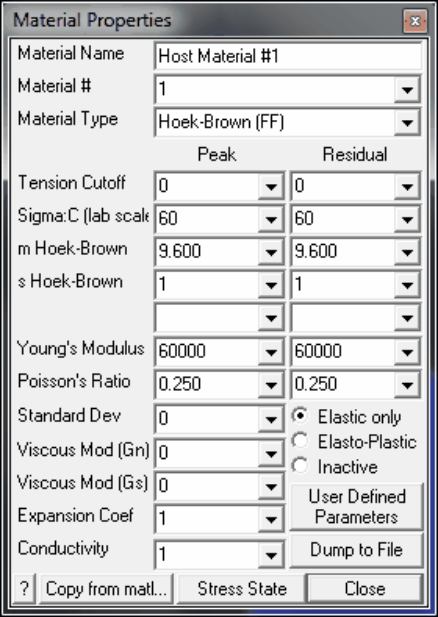
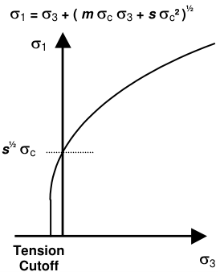

El material Hoek-Brown solo se puede usar como criterio de falla para análisis elásticos en Map3D Fault-Slip.

Material Name - especifica un nombre descriptivo para el material.

Material # - especifica el número del material.

- El material n.º 1 está reservado para el material huésped.

- Los demás números de material se usan para definir zonas de materiales alternativos, como mineral, relleno de falla, relleno, etc.

Material Type - especifica el tipo de material (Mohr-Coulomb, Hoek-Brown, Drucker-Prager, Fault-Gouge, Hyperbolic-Backfill, Quadratic-Backfill, Equilibrated-Gouge, Yielding-Pillar o ninguno).

- Hoek-Brown - define la envolvente de falla como una línea curva.

- Para bloques FF 3D, el criterio de Hoek-Brown define la resistencia en función de los esfuerzos principales de la siguiente manera:

**Hoek-Brown en bloques FF 3D**

- Tension cutoff y sc se especifican en unidades de esfuerzo (MPa o psi).

- Solo se usan los valores pico.

Young's Modulus y Poisson's Ratio - especifique el módulo de Young (a escala de macizo rocoso - deformación) en unidades de esfuerzo (MPa o psi).

- Solo se usan los valores pico.

Standard Deviation - especifique la desviación estándar en unidades de esfuerzo (MPa o psi).

- Este parámetro describe la incertidumbre que se tiene sobre los parámetros de resistencia.

- Este parámetro solo se usa para graficar la probabilidad de falla por corte Plot > Strength Factors > Rockmass Probability N-distribution.

Viscous Modulus ( _Gn_ y _Gs_ ) - Estos parámetros no se usan para el material Hoek-Brown.

Expansion Coefficient y Conductivity solo se usan en Map3D Thermal-Fluid Flow. Map3D Thermal- Fluid Flow se puede usar para resolver simultáneamente el flujo de calor/fluidos en estado estacionario acoplado al análisis de esfuerzos.

Elastic only - cuando está activada, este material responderá solo de forma elástica; es decir, no se usarán los parámetros de resistencia.

- Esto se puede usar para definir zonas con distintas propiedades elásticas y/o estados de esfuerzo iniciales. Por ejemplo, diques rígidos, zonas de mineral blando, relleno o elementos de sostenimiento.

Elasto-Plastic - cuando está activada, este material responderá de forma elasto-visco-plástica; es decir, los parámetros de resistencia se usarán como regla de flujo.

- Esto se puede usar para definir zonas con distintas propiedades elásticas y parámetros de resistencia.

- Observe que en Map3D Fault-Slip solo los elementos DD (es decir, la relleno de falla) pueden responder de forma no lineal.

- En Map3D Non-Linear, el macizo rocoso 3D también puede ceder plásticamente.

- Por el momento no se admite la fluencia de materiales Hoek-Brown.

Inactive - cuando está activada, este material no se usará en el análisis de esfuerzos y, por lo tanto, no afectará los esfuerzos, las deformaciones ni los desplazamientos predichos.

- Esto se puede usar para definir zonas con distintos parámetros de resistencia que se usarán al generar contornos de factores de resistencia.

User Defined - permite especificar parámetros definidos por el usuario para usarlos en los contornos.

- Se definen parámetros distintos para cada número de material.

      - Plot > Stress > User

   - Estos parámetros se usan con

- Esto se puede usar para definir zonas con distintos parámetros de resistencia que se usarán al generar contornos de factores de resistencia.

Dump to File - permite volcar todos los datos de propiedades de los materiales a un archivo para verlos en el Bloc de notas o en Excel.

Copy from material - permite copiar las propiedades del material de un número de material a otro. Se copian todas las propiedades, incluido el estado de esfuerzos.

Stress State - especifica el estado de esfuerzos inicial (en campo lejano) del material.

- La mayoría de los materiales se insertan en bloques con el mismo estado de esfuerzos (en campo lejano).

- Los materiales como puntales o relleno se colocan con esfuerzos iniciales casi nulos.

Temas relacionados:

Mohr_Coulomb en bloques FF 3D

Drucker-Prager en bloques FF 3D
