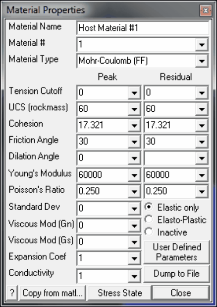
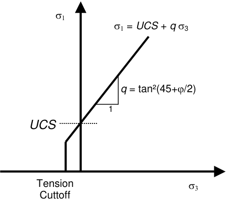
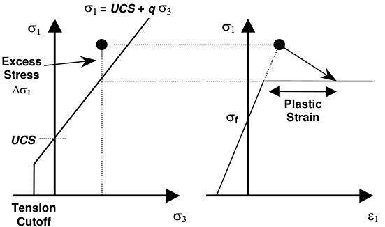
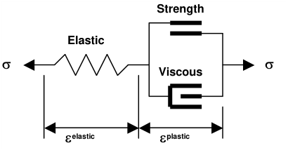

El material Mohr-Coulomb se puede usar para describir la respuesta no lineal en bloques FF 3D en Map3D NonLinear. También se puede usar como criterio de falla para análisis elásticos en Map3D Fault-Slip.

Material Name - especifica un nombre descriptivo para el material.

Material # - especifica el número del material.

- El material n.º 1 está reservado para el material huésped.

- Los demás números de material se usan para definir zonas de materiales alternativos, como mineral, relleno de falla, relleno, materiales ablandados, etc.

Material Type - especifica el tipo de material (Mohr-Coulomb, Hoek-Brown, Drucker-Prager, Fault-Gouge, Equilibrated-Gouge, Yielding-Pillar, Hyperbolic-Backfill, Quadratic-Backfill, Softened-Material o ninguno).

- Mohr-Coulomb - define la envolvente de falla como una línea recta.

- Para bloques FF 3D, el criterio de Mohr-Coulomb define la resistencia en función de los esfuerzos principales de la siguiente manera:

#### Mohr-Coulomb en bloques FF 3D

- Tension cutoff y _UCS_ - se especifican en unidades de esfuerzo (MPa o psi).

- El ángulo de fricción y el ángulo de dilatación se especifican en grados.

- La cohesión se relaciona con _UCS_ y el ángulo de fricción mediante la relación _UCS_ =2 _Coh_ tan(45+j/2). Si se especifica la cohesión, _UCS_ se determina a partir de esta relación.

- Los valores pico de estos parámetros se usan hasta la falla. Después de la fluencia, se usan los valores residuales para obtener una respuesta de ablandamiento por deformación.

- Los valores residuales se ignoran en los análisis elásticos.

Young's Modulus y Poisson's Ratio - especifique el módulo de Young (a escala de macizo rocoso - deformación) en unidades de esfuerzo (MPa o psi).

- Los valores pico de estos parámetros se usan hasta la falla.

- Después de la fluencia, se usan los valores residuales. Los valores residuales se ignoran en los análisis elásticos.

Standard Deviation - especifique la desviación estándar en unidades de esfuerzo (MPa o psi).

- Este parámetro describe la incertidumbre que se tiene sobre los parámetros de resistencia.

- Este parámetro solo se usa para graficar la probabilidad de falla por corte Plot > Strength Factors > Rockmass Probability N-distribution.

Viscous Modulus ( _Gn_ y _Gs_ ) - Estos parámetros se usan solo en análisis no lineales (bloques FF 3D en Map3D Non-Linear y planos DD en Map3D Fault-Slip). Para bloques FF 3D solo se usa _Gs_ .

- El módulo viscoso describe la respuesta de fluencia lenta, donde la resistencia a la fluencia lenta se determina como el coeficiente de fluencia lenta _C_ multiplicado por la tasa de deformación plástica. Observe que se deben seleccionar tanto el coeficiente de fluencia lenta _C_ como el tamaño del paso de tiempo D _t_ , y luego especificar el cociente de ambos como el módulo viscoso _G_ .

- Especifique el módulo viscoso en unidades de esfuerzo (MPa o psi).

Expansion Coefficient y Conductivity solo se usan en Map3D Thermal-Fluid Flow.

- Map3D Thermal-Fluid Flow se puede usar para resolver simultáneamente el flujo de calor/fluidos en estado estacionario acoplado al análisis de esfuerzos.

Elastic only - cuando está activada, este material responderá solo de forma elástica; es decir, no se usarán los parámetros de resistencia.

- Esto se puede usar para definir zonas con distintas propiedades elásticas y/o estados de esfuerzo iniciales. Por ejemplo, diques rígidos, zonas de mineral blando, relleno o elementos de sostenimiento.

Elasto-Plastic - cuando está activada, este material responderá de forma elasto-visco-plástica; es decir, los parámetros de resistencia se usarán como regla de flujo.

- Esto se puede usar para definir zonas con distintas propiedades elásticas y parámetros de resistencia.

- Observe que en Map3D Fault-Slip solo los elementos DD (es decir, la relleno de falla) pueden responder de forma no lineal.

- En Map3D Non-Linear, el macizo rocoso 3D también puede ceder plásticamente.

Inactive - cuando está activada, este material no se usará en el análisis de esfuerzos y, por lo tanto, no afectará los esfuerzos, las deformaciones ni los desplazamientos predichos.

- Esto se puede usar para definir zonas con distintos parámetros de resistencia que se usarán al generar contornos de factores de resistencia.

User Defined - permite especificar parámetros definidos por el usuario para usarlos en los contornos.

- Se definen parámetros distintos para cada número de material.

   - Plot > Stress > User

- Estos parámetros se usan con

- Esto se puede usar para definir zonas con distintos parámetros de resistencia que se usarán al generar contornos de factores de resistencia.

Dump to File - permite volcar todos los datos de propiedades de los materiales a un archivo para verlos en el Bloc de notas o en Excel.

Copy from material - permite copiar las propiedades del material de un número de material a otro. Se copian todas las propiedades, incluido el estado de esfuerzos.

Stress State - especifica el estado de esfuerzos inicial (en campo lejano) del material.

- La mayoría de los materiales se insertan en bloques con el mismo estado de esfuerzos (en campo lejano).

- Los materiales como puntales o relleno se colocan con esfuerzos iniciales casi nulos.

En el análisis elástico, los esfuerzos principales se usan normalmente con el criterio de resistencia de Mohr-Coulomb o de Hoek-Brown para estimar la cantidad de daño por sobreesfuerzo. Cabe esperar que un mayor esfuerzo en exceso en un análisis elástico se correlacione, en general, con mayores cantidades de deformación plástica en un análisis no lineal. Como ninguno de los parámetros es sensible a la orientación, este criterio es representativo de la estabilidad de un macizo rocoso homogéneo.

#### Mohr-Coulomb en bloques FF 3D

El sobreesfuerzo se puede presentar de varias formas, entre ellas:

Plot > Strength Factors > dS1 - Excess Stress

Plot > Strength Factors > dTmax - Excess Stress

Plot > Strength Factor > SF-A - Strength/Stress Plot > Strength Factor > SF-B - Strength/Stress

Plot > Strength Factors > SF-C - Strength/Stress

En cambio, en el análisis no lineal los esfuerzos nunca pueden superar la resistencia, a menos que se use algo de fluencia lenta (en este último caso, la fluencia lenta viscosa puede permitir estados de esfuerzo por encima del criterio de falla, lo que indica una falta de equilibrio estático). Por lo tanto, en el análisis no lineal normalmente se considera directamente la deformación plástica o la tasa de deformación plástica predicha por el modelo como indicador de daño.

En bloques FF 3D, las deformaciones elásticas se determinan a partir de los esfuerzos mediante

sxx   = sxxf  + [ (1-n) exxelastic + n ( eyyelastic + ezzelastic ) ] _E_ / [ (1+n) (1-2n) ] syy  = syyf + [ (1-n) eyyelastic + n ( ezzelastic + exxelastic  ) ] _E_ / [ (1+n) (1-2n) ] szz   = szzf  + [ (1-n) ezzelastic  + n ( exxelastic + eyyelastic ) ] _E_ / [ (1+n) (1-2n) ] txy  = txyf +  exyelastic _E_ / (1+n) tyz  = tyzf  +  eyzelastic _E_ / (1+n) txz  = txzf  +  exzelastic _E_ / (1+n)

donde _E_ y n representan, respectivamente, el módulo de Young (a escala de macizo rocoso - deformación) y la relación de Poisson, y sf y tf representan el estado de esfuerzos inicial (previo a la explotación)

En Map3D Non-Linear, si el esfuerzo supera la resistencia, la deformación plástica se puede determinar limitando el esfuerzo

donde

s1 - s1° - _C_ De1plastic /D _t_ = _UCS_ + _q_ ( s3 - s3° - _C_ De3plastic /D _t_ ) s1°  = [ (1-n) e1plastic + n ( e2plastic + e3plastic ) ] _E_ / [ (1+n) (1-2n) ] s2°  = [ (1-n) e2plastic + n ( e3plastic + e1plastic ) ] _E_ / [ (1+n) (1-2n) ] s3°  = [ (1-n) e3plastic + n ( e1plastic + e2plastic ) ] _E_ / [ (1+n) (1-2n) ]

La deformación plástica acumulada eplastic se determina como la suma de los incrementos de fluencia plástica Deplastic de todos los pasos de fluencia.

Si el esfuerzo cae por debajo del límite de tracción (tension cutoff), la deformación plástica se puede determinar limitando el esfuerzo

s3 - s3° - _C_ De3plastic /D _t_ = _To_

La deformación volumétrica plástica también puede tener una componente de dilatación

evolume = ( e1plastic + e2plastic + e3plastic ) = tan( _dilation angle_ ) e1plastic

La deformación total es igual a la suma de las partes elástica y plástica.

La respuesta de fluencia lenta se simula con un modelo de fluencia lineal (de Bingham).

En cada paso de fluencia, el estado de esfuerzos en todos los elementos en fluencia (elementos donde el esfuerzo supera la resistencia) se calcula como la resistencia más la resistencia a la fluencia lenta

s = _Strength_ + _C_ Deplastic /D _t_

_C_ = _G_ D _t_

donde la resistencia a la fluencia lenta se determina como el coeficiente de fluencia lenta _C_ multiplicado por la tasa de deformación plástica. Observe que se deben seleccionar tanto el coeficiente de fluencia lenta _C_ como el tamaño del paso de tiempo D _t_ , y luego especificar el cociente de ambos como el módulo viscoso _G_ . La resistencia a la fluencia lenta se puede usar simplemente como técnica para amortiguar las deformaciones no lineales o para una simulación real de fluencia lenta dependiente del tiempo

#### Analysis > Options > Creep

Las deformaciones se pueden presentar de varias formas, entre ellas:

Plot > Strain > Value > Elastic

Plot > Strain > Value > Plastic Plot > Strain > Value > Total

Plot > Strain > E1 - Major principal strain Plot > Strain > E2 - Intermediate principal strain

Plot > Strain > E3 - Minor principal strain

Plot > Strain > Emax - Maximum shear strain

Plot > Strain > Evolume - Volumetric shear strain

Temas relacionados:

Hoek-Brown en bloques FF 3D

Drucker-Prager en bloques FF 3D
