Los materiales ablandados se pueden usar para simular la fluencia del terreno y los efectos resultantes de redistribución de esfuerzos. Aunque el modelado de plasticidad es sin duda el mejor método para ello, el ablandamiento del material también se puede usar para simular la fluencia del terreno, la redistribución de esfuerzos y, por lo tanto, el posible impacto en las áreas circundantes. La ventaja de este enfoque es que permite al ingeniero investigar el comportamiento no lineal de forma rápida y sencilla.

La teoría del ablandamiento se explica en detalle en **Elastic softening to simulate plastic yielding.pdf** . A continuación se presenta un breve resumen.

En el modelado numérico, la descompresión de un macizo rocoso elástico se logra permitiendo deformaciones plásticas. Estas deformaciones sirven para disipar el esfuerzo en exceso indicado por la respuesta elástica. En la figura siguiente se muestra un método alternativo para inducir deformaciones plásticas. Aquí, el módulo esfuerzo-deformación se reduce progresivamente en magnitud. Se observa que, aunque técnicamente esto reduce la rigidez de la respuesta elástica esfuerzo-deformación, se puede interpretar como equivalente a incrementos (Dep ) de deformación plástica.

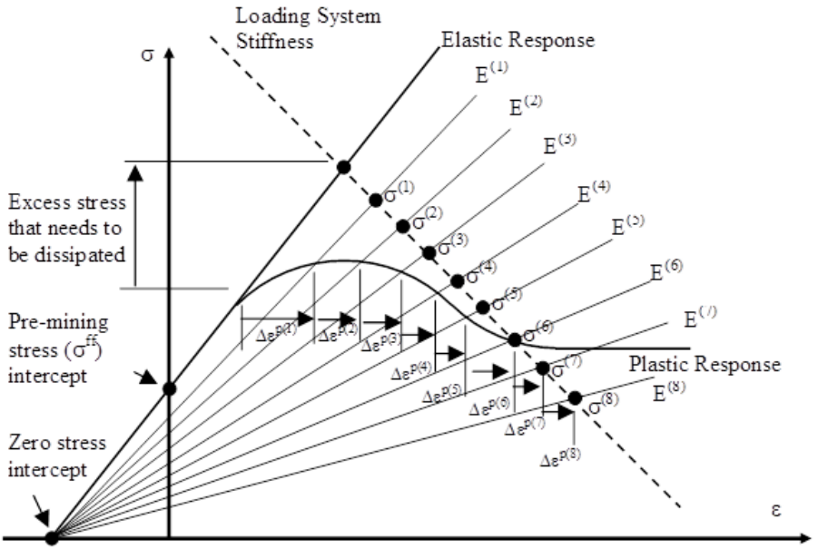

En general se entiende que la falla de la roca es resultado de una falla por corte y se puede simular con la reducción del módulo de corte, mientras que los cambios de volumen se asocian con dilatación o compactación según las condiciones de esfuerzo y la naturaleza de la propia roca. La reducción del módulo de corte se puede usar para reducir el diferencial de esfuerzos (s1-s3), y la reducción del módulo volumétrico se puede usar para controlar la deformación volumétrica

(evolume=e1+e2+e3). Esto permite controlar de forma independiente el proceso de falla por corte y la respuesta de dilatación. Ya sea que el ablandamiento sea automático o manual, es evidente que se debe tener cuidado de descomprimir en una magnitud realista para asegurar que el estado de esfuerzos final en los pilares afectados satisfaga un criterio de resistencia bien calibrado.

El módulo volumétrico sin ablandar **_B_** y el módulo de corte **_G_** se pueden determinar a partir del módulo de Young **_E_** y la relación de Poisson de la siguiente manera:

**_B = E/3/(1-2_** n **_) G = E/2/(1+_** n **_)_**

El módulo volumétrico ablandado **_Bs_** y el módulo de corte ablandado **_Gs_** se determinan mediante el parámetro de ablandamiento volumétrico (Volume Softening) **_b_** y el parámetro de ablandamiento por corte (Shear Softening) **_g_** de la tabla siguiente, de modo que

**_Bs = B×b Gs = G×g_**

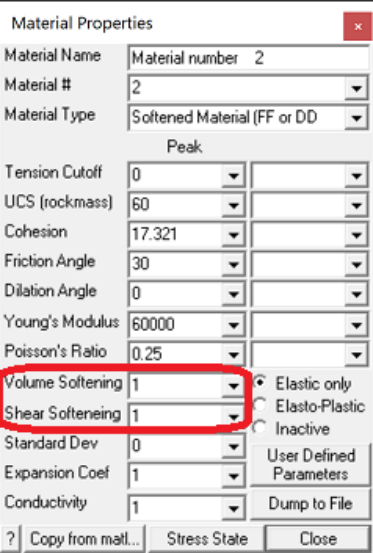

Por ejemplo, un ablandamiento por corte con **_g=1_** representa la ausencia de ablandamiento, mientras que un ablandamiento por corte con **_g=0.5_** representa una reducción del 50% del módulo de corte...

Para demostrar la sencillez del procedimiento de ablandamiento, se presenta un ejemplo de un túnel sobreesforzado con fluencia de las paredes laterales. Observe que el objetivo de este ejemplo no es reproducir los resultados del modelado plástico, ni se debe esperar poder hacerlo. Sin embargo, demostrará el ablandamiento de las paredes laterales, la descompresión, la transferencia de esfuerzos y la fluencia. Aquí se busca demostrar que, con el ablandamiento:

- los esfuerzos se pueden disipar hacia los estribos circundantes,

- se pueden generar las deformaciones y los desplazamientos mayores asociados con la plasticidad.

#### Resultados del modelo plástico

Considere un túnel circular de 1 m de radio con esfuerzos homogéneos previos a la explotación de 30 MPa. Se utilizó un criterio de falla de Mohr-Coulomb en todo el modelo, con un UCS de 11.9 MPa, un ángulo de fricción de 30°, un módulo de Young de 6780 MPa y una relación de Poisson de 0.21. Este modelo se analizó con Map3D Visco-Plastic. Se utilizó un comportamiento elástico/perfectamente plástico con la tasa de dilatación igual a cero. A continuación, el esfuerzo principal mayor se muestra a la izquierda y el desplazamiento a la derecha.

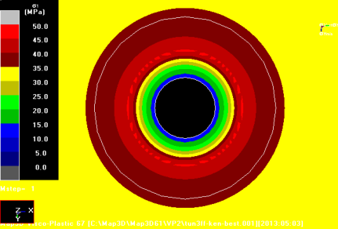

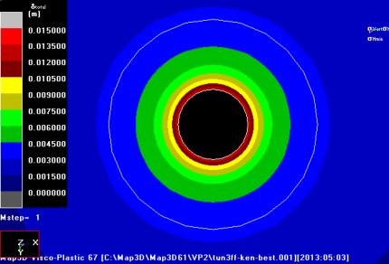

Estos resultados del modelo de Map3D Visco-Plastic coinciden estrechamente con la solución analítica cerrada para los esfuerzos y desplazamientos plásticos. A modo de referencia, también se muestra la solución analítica elástica.

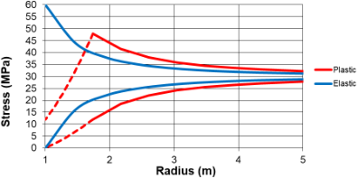

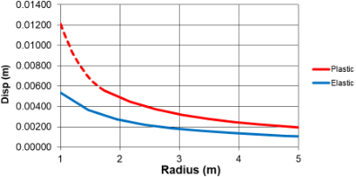

#### Resultados del modelo ablandado

Para modelar lo anterior con ablandamiento, se ablandó una zona alrededor de las paredes laterales del túnel, como se muestra a continuación, donde la galería se muestra en azul y la zona ablandada en morado. Esta zona ablandada se eligió del mismo tamaño que la zona plástica determinada anteriormente (radio de 1.74 m).

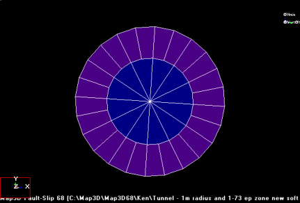

En este caso se busca demostrar que el cierre plástico se puede emular con un modelo ablandado sencillo.

Aquí, el módulo de corte elástico se ablandó con un factor de **_g=0.2_** , mientras que el módulo volumétrico se mantuvo constante. A continuación, el esfuerzo principal mayor se muestra a la izquierda y el desplazamiento a la derecha.

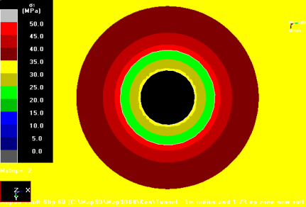

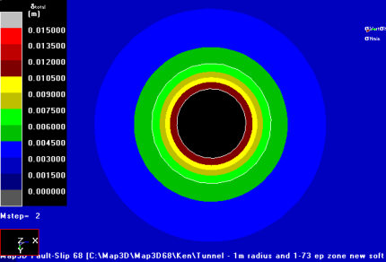

Los resultados ablandados muestran una excelente coincidencia tanto con el esfuerzo principal menor plástico como con el desplazamiento. Observe que, aunque los valores reales del esfuerzo principal mayor ablandado no coinciden en detalle con los resultados plásticos en la zona de fluencia, en promedio tienen aproximadamente la magnitud correcta. Además, el esfuerzo se ha redistribuido hacia el "estribo" elástico con bastante exactitud, mostrando casi exactamente la concentración de esfuerzos esperada.

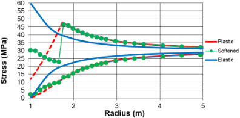

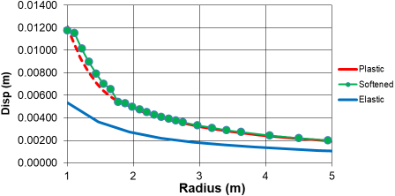

Aunque los resultados del ablandamiento no coinciden perfectamente con los del análisis plástico, es evidente que simularon la fluencia del material de las paredes laterales y acercaron mucho más los resultados elásticos a los del modelo plástico. Parece que el ablandamiento del material se puede usar para simular la fluencia del terreno, la redistribución de esfuerzos y, por lo tanto, el posible impacto en las áreas circundantes. La ventaja de este enfoque es que permite al ingeniero investigar el comportamiento no lineal de forma rápida y sencilla en comparación con el modelado plástico. Los modelos ablandados requieren muy poco tiempo de análisis adicional en comparación con los modelos elásticos simples.

En **Elastic softening to simulate plastic yielding.pdf** se ofrecen una descripción más detallada y ejemplos.
