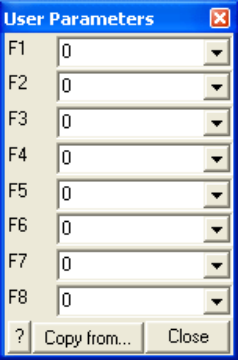

Permite especificar parámetros definidos por el usuario para usarlos en los contornos.

#### Plot > Stress > User

Estos parámetros se usan con

Se definen parámetros distintos para cada número de material. Por lo tanto, los resultados del análisis calculados en distintas zonas de materiales alternativos usarán los parámetros definidos por el usuario que correspondan a cada zona.
