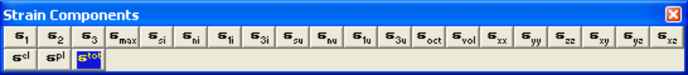

Active la barra de herramientas de deformación, después del análisis BEM de Map3D.

Esta barra de herramientas ofrece acceso rápido a las componentes de deformación.

Plot > Strain > E1 Deformación principal mayor e1 Plot > Strain > E2 Deformación principal intermedia e2 Plot > Strain > E3 Deformación principal menor e3 Plot > Strain > Emax Deformación cortante máxima emax = ½( e3 - e3 )

Plot > Strain > Esi Deformación cortante máxima en el plano esi Plot > Strain > Eni Deformación normal en el plano eni Plot > Strain > E1i Deformación máxima en el plano e1i Plot > Strain > E3i Deformación máxima en el plano e3i Plot > Strain > Esu Deformación cortante máxima en el plano ubicuo esu Plot > Strain > Enu Deformación normal en el plano ubicuo enu Plot > Strain > E1u Deformación máxima en el plano ubicuo e1u Plot > Strain > E3u Deformación máxima en el plano ubicuo e3u Plot > Strain > Eoct Deformación cortante octaédrica eoct = 1/3 [(e1 - e2)² + (e2 - e3)² +(e3 - e1)²]½ Plot > Strain > Evol Deformación volumétrica evol = (e1 + e2 + e3) Plot > Strain > Exx Componente cartesiana de deformación  exx Plot > Strain > Eyy Componente cartesiana de deformación  eyy Plot > Strain > Ezz Componente cartesiana de deformación  ezz Plot > Strain > Exy Componente cartesiana de deformación  exy Plot > Strain > Eyz Componente cartesiana de deformación  eyz Plot > Strain > Exz Componente cartesiana de deformación  exz Plot > Strain > Value > Elastic eelastic Plot > Strain > Value > Plastic eplastic Plot > Strain > Value > Total etotal

Notas:

La barra de herramientas de deformación solo se puede activar después de la etapa de construcción del modelo (CAD)

Etapas de análisis de Map3D.

Cualquiera de estas componentes se puede agregar a la barra de herramientas de contornos si se desea

Tools > Configure Contouring Toolbar
