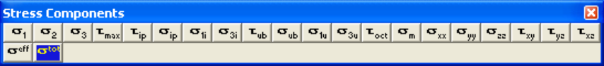

Active la barra de herramientas de esfuerzo, después del análisis BEM de Map3D.

Esta barra de herramientas ofrece acceso rápido a las componentes de esfuerzo.

Plot > Stress > S1 Esfuerzo principal mayor s1 Plot > Stress > S2 Esfuerzo principal intermedio s2 Plot > Stress > S3 Esfuerzo principal menor s3 Plot > Stress > Tmax Esfuerzo cortante máximo ½(s1 - s3)

Plot > Stress > Tip Esfuerzo cortante en el plano tip Plot > Stress > Sip Esfuerzo normal en el plano sip Plot > Stress > S1i Esfuerzo máximo en el plano si1 Plot > Stress > S3i Esfuerzo mínimo en el plano si3 Plot > Stress > Tub Esfuerzo cortante en el plano ubicuo tub Plot > Stress > Sub Esfuerzo normal en el plano ubicuo sub Plot > Stress > S1u Esfuerzo máximo en el plano ubicuo s1u Plot > Stress > S3u Esfuerzo mínimo en el plano ubicuo s3u Plot > Stress > Toct Esfuerzo cortante octaédrico toct = 1/3 [(s1 - s2)² + (s2 - s3)² +(s3 - s1)²]½ Plot > Stress > Smean Esfuerzo medio smean = 1/3 (s1 + s2 + s3)

Plot > Stress > Sxx Componente cartesiana de esfuerzo sxx Plot > Stress > Syy Componente cartesiana de esfuerzo syy Plot > Stress > Szz Componente cartesiana de esfuerzo szz Plot > Stress > Txy Componente cartesiana de esfuerzo txy Plot > Stress > Tyz Componente cartesiana de esfuerzo tyz

Plot > Stress > Txz Componente cartesiana de esfuerzo txz

Plot > Stress > Value > Seff Esfuerzo efectivo seff

Plot > Stress > Value > Stotal Esfuerzo total stotal

Notas:

La barra de herramientas de esfuerzo solo se puede activar después de la etapa de construcción del modelo (CAD)

Etapas de análisis de Map3D

Cualquiera de estas componentes se puede agregar a la barra de herramientas de contornos si se desea

Tools > Configure Contouring Toolbar
