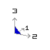
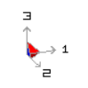

La orientación del estado de esfuerzos principales en campo lejano se indica mediante el icono de orientación de esfuerzos ubicado en la esquina superior derecha de la pantalla.

En la vista anterior, el eje s1 apunta principalmente hacia el interior de la pantalla y un poco hacia la derecha, el eje s2 apunta principalmente hacia la derecha y un poco hacia fuera de la pantalla, y el eje s3 apunta directamente hacia arriba. Observe que la parte posterior del icono está sombreada en azul.

En la vista anterior, el eje s1 apunta principalmente hacia la derecha y un poco hacia el interior de la pantalla, el eje s2 apunta principalmente hacia fuera de la pantalla y un poco hacia la derecha, y el eje s3 apunta directamente hacia arriba. Observe que el interior del icono está sombreado en rojo.

Observe que la longitud de los ejes se escala según la magnitud de las componentes del esfuerzo principal.

Las componentes del esfuerzo principal previo a la explotación se especifican mediante "CAD > Properties > Material Properties > Stress State".
