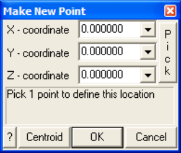

Crea un nuevo punto de visualización. Consulte Visualization para ver una descripción de las rutinas de visualización disponibles en Map3D.

Los puntos de visualización se pueden mostrar como esferas con sombreado de fuente de luz cuyo diámetro y/o color varía según la magnitud, y se pueden representar con contornos sobre un plano para mostrar la densidad, etc.

Cada punto se puede etiquetar con una serie de:

- valores numéricos (p. ej., color, magnitud, orientación, etc.)

- mensajes de texto

- nombres de archivo (p. ej., archivos de gráficos, documentos, hojas de cálculo, etc.)

Al hacer clic con el botón izquierdo en un punto, la ubicación, la magnitud y el mensaje de texto se muestran en la barra de estado.

Al hacer clic con el botón derecho en un punto se activa la base de datos visual (Visual Database). Esta función se puede usar para mostrar una base de datos con información geológica útil, como la ley, la calidad del macizo rocoso, etc.

Al activar la función, se solicitan las coordenadas del nuevo punto de visualización.

Tenga en cuenta que, si ya hay un archivo de visualización activo, este nuevo punto se agregará al archivo. Si no hay ningún archivo de visualización activo, se solicitará abrir uno y este nuevo punto se agregará al archivo.

X, Y and Z coordinate - especifica las coordenadas del punto de visualización.

Pick - activa la retícula del cursor para seleccionar de forma interactiva las coordenadas del modelo.

Para facilitar la selección visual de puntos del modelo, están disponibles todas las funciones de referencia a objetos (snap).

#### CAD > Snap

Una vez seleccionadas, las coordenadas del punto de visualización se muestran en el cuadro de diálogo.

Centroid - activa el cursor para seleccionar una entidad del modelo. Las coordenadas se calcularán en el centro de la entidad seleccionada.

OK - finaliza la edición de las coordenadas y crea y muestra el punto de visualización.

Una vez creado el punto de visualización, se puede hacer clic con el botón derecho en el punto para agregar mensajes de texto y/o nombres de archivo.

- El mensaje de texto y el nombre de archivo se muestran en la barra de estado en la parte inferior de la pantalla al seleccionar un evento con el botón izquierdo del mouse.

- También se pueden editar al seleccionar un evento con el botón derecho del mouse.

- Al seleccionar con el botón derecho del mouse también se puede mostrar el archivo, si el nombre de archivo se ha asociado con una aplicación (consulte la documentación de Windows sobre cómo "Asociar un archivo con un programa").
