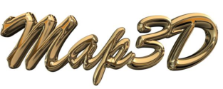

Map3D es desarrollado y respaldado por el Dr. Terry Wiles (support@map3d.com), de Map3D International Ltd. El desarrollo de Map3D comenzó a fines de la década de 1970 y desde entonces ha pasado por muchas revisiones importantes. Está disponible comercialmente desde 1990. El programa está en desarrollo constante y cuenta con el respaldo de profesionales dedicados con más de 50 años de experiencia en mecánica de rocas y modelamiento numérico.

El programa es utilizado por cientos de empresas mineras, civiles y geotécnicas, consultoras, centros de investigación y universidades de todo el mundo (entre ellos Argentina, Armenia, Australia, Austria, Bélgica, Bolivia, Botsuana, Brasil, Bulgaria, Burkina Faso, Canadá, China, Colombia, República Democrática del Congo, República Dominicana, Ecuador, Egipto, El Salvador, Eritrea, Finlandia, Ghana, Grecia, Guatemala, Honduras, India, Indonesia, Irlanda, Italia, Japón, Kazajistán, Corea, Malí, México, Marruecos, Mongolia, Namibia, Nicaragua, Papúa Nueva Guinea, Perú, Filipinas, Portugal, Rusia, Arabia Saudita, Sudáfrica, España, Suecia, Suiza, Tanzania, Turquía, Reino Unido, Estados Unidos, Zambia y Zimbabue). Map3D suele indicarse como requisito en las ofertas de empleo. La versión de demostración (demo_version) se utiliza en todo el mundo para enseñar a los estudiantes los fundamentos del modelamiento numérico y el CAD 3D.

Se ha utilizado en muchos proyectos, como el diseño de minas subterráneas y a rajo abierto, la evaluación de la estabilidad minera, el diseño de repositorios de residuos nucleares, simulaciones de propagación de fracturas, problemas de deslizamiento de fallas, retroanálisis de esfuerzos in situ, diseño de canteras, estabilidad de taludes de rajo, propagación de fracturas hidráulicas, fallas de taludes de suelo, etc. La investigación y el desarrollo actuales se centran en procedimientos cuantitativos de diseño, modelamiento plástico 3D, simulación del soporte del terreno, la capacidad de evaluar el potencial de estallidos de roca, la simulación del discado (discing) y la integración del modelamiento con el monitoreo sísmico.

**Método de elementos de contorno**: Map3D se formula con el muy eficiente método indirecto de elementos de contorno e incorpora el uso simultáneo de elementos de fuerza ficticia (FF), de discontinuidad de desplazamiento (DD) y elementos de contorno especiales propios para las versiones de análisis térmico, no lineal y viscoplástico (versiones de Map3D).

La investigación y el desarrollo de los últimos 50 años han permitido superar muchas de las supuestas limitaciones del método de elementos de contorno. El programa admite secuencias de minado de múltiples etapas, múltiples zonas de material con distintas propiedades y estados de esfuerzo, y una respuesta discontinua de la roca con un número limitado de rasgos discretos. Tanto las zonas 3D como las zonas DD pueden tener un comportamiento no lineal y/o plástico. Múltiples planos de falla que se intersectan pueden deslizar y abrirse según la resistencia al corte especificada por el usuario. Puede simularse el análisis acoplado de esfuerzos térmico/de fluidos en régimen permanente. Los problemas de fluencia y relajación en tiempo real pueden abordarse mediante pasos de tiempo explícitos.

**Modelamiento elástico frente a plástico**: los defensores del modelamiento plástico suelen atribuirle capacidades exclusivas frente al modelamiento elástico, como:

- La capacidad de predecir la magnitud, la ubicación, el momento y la orientación del daño.

- La capacidad de simular la redistribución de esfuerzos debida a la fluencia.

- La capacidad de seguir el daño acumulado a medida que avanza la minería.

Aunque Map3D puede analizar la plasticidad 3D completa del macizo rocoso, también puede abordar todas estas supuestas capacidades exclusivas del modelamiento plástico mediante modelamiento elástico.

Esto es posible gracias a nuevas herramientas de análisis incorporadas al programa:

- Los modelos elásticos de Map3D son plenamente capaces de predecir la magnitud, la ubicación, el momento y la orientación del daño mediante el cálculo del exceso de esfuerzo.

- Pueden evaluarse tres modos principales de falla:

   - Falla del macizo rocoso.

   - Falla de tipo falla geológica en el plano.

Debilidad orientada estructuralmente en planos ubicuos (UB) (con hasta 3 sets de diaclasas).

- La redistribución de esfuerzos puede simularse incorporando zonas ablandadas.

- Hay una nueva funcionalidad para seguir el daño acumulado (exceso de esfuerzo) en los modelos elásticos: el daño se sigue a medida que avanza la minería.

   - Se registra el valor máximo de exceso de esfuerzo alcanzado durante el avance de la minería, que puede graficarse a medida que progresan las etapas de minado.

Se almacenan tanto la primera etapa de fluencia como las etapas de fluencia máxima, y pueden mostrarse como números de trayectoria.

Las nuevas capacidades de MAP3D permiten abordar muchos comportamientos que antes solo eran posibles con modelamiento no lineal y plástico.

Esto se logra manteniendo la facilidad de uso y las ventajas de rendimiento computacional del modelamiento elástico.

Estas capacidades anulan en gran medida cualquier ventaja que ofrezca el modelamiento plástico.

En caso de que se requiera una simulación plástica:

- Map3D Visco-Plastic ofrece la capacidad de simular completamente la fluencia del macizo rocoso con los mismos archivos de entrada del modelo.

- Map3D Fault-Slip ofrece la capacidad de simular completamente la fluencia por deslizamiento de fallas con los mismos archivos de entrada del modelo.

**Precisión del programa**: la precisión de la solución se controla mediante un procedimiento de discretización automatizado. Los elementos pueden concentrarse automáticamente en las zonas de interés según parámetros controlados por el usuario. Esto libera al usuario del tedioso proceso de discretizar manualmente su modelo, a la vez que mejora la precisión y minimiza el tamaño del problema.

**Tamaño del problema**: Map3D puede abordar más de 24 millones de grados de libertad en un PC con unos pocos GB de espacio en disco. Aunque los problemas pequeños pueden resolverse en minutos, los más grandes pueden requerir una noche o algunos días. Esta enorme eficiencia se logra mediante el agrupamiento de matrices. Esto permite especificar en detalle la geometría minera existente de toda la mina y añadir nueva minería según sea necesario. Así se reduce en gran medida el esfuerzo necesario para preparar y ejecutar los análisis, y es posible considerar toda la mina cuando sea necesario.

**Multiprocesamiento y múltiples discos**: Map3D admite plenamente el procesamiento en paralelo, de modo que los tiempos de cálculo escalan linealmente con el número de procesadores (los procesadores de 6 núcleos resuelven los problemas 6 veces más rápido que los de un solo núcleo). Además, el programa incorpora una funcionalidad de discos superpuestos que permite que las velocidades de lectura y escritura escalen linealmente con el número de discos (con 4 discos, la lectura y escritura son 4 veces más rápidas que con uno solo).

**Preprocesamiento**: Map3D incorpora un paquete CAD completo con numerosas funciones para intercambiar datos con otros paquetes CAD. Muchas funciones, como el trazado y la extrusión automatizados, permiten construir modelos complejos con facilidad. Las rutinas exhaustivas de verificación de errores y de corrección automática permiten utilizar casi cualquier geometría de modelo. Las rutinas de intersección booleana corrigen las conexiones de bloques superpuestas o desajustadas sin intervención del usuario. Se admite plenamente la importación y exportación de archivos de geometría en formato DXF o PNT (ASCII).

**Posprocesamiento**: se incluye un paquete de visualización completo con cientos de funciones de graficado y exportación de datos. Los gráficos definidos por el usuario y las exportaciones de datos seleccionadas visualmente reducen el esfuerzo necesario para la interpretación y la elaboración de informes. Los datos pueden exportarse directamente a Excel y graficarse automáticamente.

#### Por qué usar Map3D

Map3D se ha desarrollado desde cero específicamente para aplicaciones mineras. El programa está diseñado para que obtenga respuestas de alta precisión rápidamente y pueda dedicarse a la ingeniería en lugar de al modelamiento. Los problemas grandes y complejos pueden construirse fácilmente con la interfaz CAD propia de Map3D o fuera del programa e importarse después en diversos formatos. Ningún otro programa puede realizar los análisis que hace Map3D en el mismo tiempo (tiempo de ejecución, preprocesamiento y posprocesamiento), con el mismo costo (muchas veces más barato) y con la misma facilidad (Map3D puede usarse en faena para análisis rutinarios). Algunas de las ventajas de Map3D son:

- Ruta de actualización cómoda entre análisis elástico, de deslizamiento de fallas, térmico/de flujo de fluidos, no lineal y viscoplástico (versiones de Map3D) con la misma interfaz

- Amplio programa de capacitación tanto en la funcionalidad del programa como en la interpretación detallada de resultados de ingeniería (consulte Capacitación en Map3D)

- Potente interfaz CAD integrada: no se requiere software de terceros

- Construcción sencilla de formas 3D simples o complejas.

- Problemas de gran tamaño resueltos fácilmente en un computador de escritorio (24.000.000 de grados de libertad)

- Función automatizada para generar gráficos en Excel a partir de datos de contornos

- Gráficos de probabilidad de falla

- La capacidad automatizada de intersección de bloques libera al usuario del trabajo de construcción manual

- Permite la colocación de relleno

- Secuencias de minado de múltiples etapas

- Elementos de alta precisión (requiere la mitad de elementos para lograr el mismo grado de precisión que la mayoría de los programas)

- Gracias a procedimientos avanzados de agrupamiento, los tiempos de ejecución son muy cortos en comparación con otros programas

- Hasta 100 zonas de material distintas

- Simulaciones viscoplásticas de deslizamiento de fallas

- Minería tabular con pilares cedentes

- La discretización automatizada garantiza un grado de precisión fácil de controlar y coherente

- Potente visor de resultados integrado

- Manipulación sencilla de los resultados para interpretar la falla del macizo rocoso, el deslizamiento en planos de falla, los resultados en sondajes orientados y el deslizamiento ubicuo en planos de estratificación o sets de diaclasas.

- La base de datos de visualización interactiva integrada permite mostrar y representar mediante contornos datos sísmicos

- Gráficos de contornos de funciones definidas por el usuario

- Incluye soporte del programa

- Desarrollo y mejoras continuos durante más de 26 años

- Incorporación de elementos de fuerza ficticia y de discontinuidad de desplazamiento (así como elementos especiales para flujo térmico/de fluidos y plasticidad 3D).

- Elementos de orden superior para problemas de flexión

- Grillas planas, grillas lineales y grillas de puntos para visualizar resultados

- Criterios de falla isótropos y anisótropos

- Gráficos RCF (factor de condición de la pared rocosa)

- Solucionadores integrados acelerados, precondicionados y de gradiente conjugado que trabajan en conjunto para obtener soluciones rápidas, confiables y precisas

- Función de importación y exportación de datos de entrada a otros programas CAD

- Función de importación y exportación de resultados de análisis a otros programas

- Sin costosas tarifas de adquisición: Map3D se licencia anualmente

- Interfaz directa con Deswik que permite crear geometrías de Map3D, incluida la especificación de nombres de bloques, colores y secuencia de minado de Map3D.

- Exportación directa a Excel, 3D-PDF, VRML y mucho más.

**Algunos usuarios**: entre los usuarios actuales y anteriores de Map3D se encuentran: University of Toronto (Canada), Vale (formerly CRVD INCO Ontario) (Creighton Mine, Stobie Mine, Frood Mine, South Mine, Garson Mine, Levack Mine, Mines Research, Mines Technology - Methods & Design), INCO Manitoba (Canada), Noranda (Canada), CNG Softeck Co. (Korea), Anglo Gold (South Africa), Golder Associates (Canada and Australia), Placer Dome Western Area Joint Venture (South Africa), Mount Isa Mines (Australia), Brunswick Mining and Smelting (Canada), Goldcorp (Canada), Mincad Systems (Australia), Kanowna Belle Gold Mines (Australia), U. of British Columbia (Canada), U. of Western Australia, U. of New South Wales (Australia), Laval U. (Canada), McGill U. (Canada), Rock Mechanics Technology (England), Endeavor Mine (Australia), Australian Mining Consultants, Aur Resources (Canada), CSIR Division of Mining Technology (South Africa), Snowden Mining Industry Consultants (South Africa and Australia), Tara Mines (Ireland), Georock Inc. (Canada), Romec n.v. (Belgium), Agnico Eagle - Division Laronde (Canada), Queensland University (Australia), Geomechanics Research Centre Laurentian U. (Canada), Agnew Gold (Australia), Western Mining Corp. (Australia), Tao Lekoa Mine (South Africa), AngloGold Ashanti (South Africa and Australia), Kalgoorlie Consolidated Gold Mines (Australia), INWE Rock Engineering, Lourence Geotechnical (Australia), Western Deep Levels (South Mine, West Mine, Regional Office), Zinkgruvan Mining AB (Sweden), Elandsrand Gold Mine (South Africa), TWP Consulting (South Africa), Tshepong Mine (South Africa), CAMBIOR Inc. (Canada), Natural Resources Canada, Avmin Target Mine (South Africa), SRK Consulting (South Africa, Australia, Sweden), U. of Waterloo (Canada), St Ives Gold (Australia), Mine Geant Dormant (Canada), Normandy Jundee Operation (Australia), KULeuven - Unit Mining (Belgium), Leinster Nickel Operation (Australia), Doyon Mine (Canada), ISS International (South Africa), ISS Pacific (Australia), Musselwhite Mine (Canada), Finsch Diamond Mine (South Africa), Queen's University (Canada), Plutonic Gold Mine (Australia), Campbell Mine (Canada), JCI Travistock Colliery (South Africa), Strata Control Technology (Australia), Cayeli Bakir Isletmeleri A. S. (Turkey), Asker - Thabazimbi ISCOR (South Africa), Douglas Partners (Australia), U. of Queensland (Australia), Bambanani Mine (South Africa), Palabora Mining Company Ltd. (South Africa), Newcrest Mining Ltd. (Australia), Delft U. of Technology (The Netherlands), ANGLOVAAL (South Africa), Impala Platinum (South Africa), Battle Mountain Canada, Black Mountain (South Africa), Tsumeb - Otjihase Mine (Namibia), Kloof, Division of Kloof G.M. Co. Ltd. (South Africa), Rustenburg Platinum Mines Ltd. (South Africa), Savuka Mine (South Africa), BCL Botswana (Botswana), Terra Sancta (Australia), Mines Aurizon - Casa Berardi (Canada), Rockland Ltd. (Canada), Darlot Gold Mine (Australia), Forrestania Gold NL (Australia), WA Department of Minerals and Energy (Australia), Great Central Mines - Wiluna Gold (Australia), Central Mines Engineering Group - Inco Ltd (Canada), Kundana Gold (Australia), Henty Gold Mine - Goldfields Ltd. (Australia), Elura Mine (Australia), Western Australia School of Mines, Cannington - BHP World Minerals (Australia), WMC Olympic Dam Operations (Australia), BFP Consultants Pty Ltd (Australia), Julius Kruttschnitt Mineral Research Centre (Australia), Mountan U. of Leoben (Austria), CNR-C.S. Problemi Minerari (Italy), Japan Nuclear Development Institute (Japan), Lassonde Mineral Engineering (Canada), Coffey Geosciences Pty Ltd (Australia), Pajingo Joint Venture (Australia), TauTona Mine (South Africa), Bronzewing - McClure Gold Operations (Australia), Normandy Golden Grove Operation (Australia), McArther River Mining Pty Ltd (Australia), Boulby Mine - Cleveland Potash Limited (United Kingdom), AngloGold Ashanti Mineracao: Cuiaba (Brasil), Harmony Gold Mining Company Limited (Australia), Mirarco Mining Innovation (Canada), Northam Platinum Limited Zondereinde Division (South Africa), Open House Management Solutions (South Africa), Great Noligwa Mine (South Africa), Konkola Copper Mines (Zambia), Osborne Mines (Australia), Politecnico di Torino (Italy), Atomic Energy Canada, Ekati Diamond Mine (Canada), Musslewhite Mine (Canada), Cadia Holdings Ltd. (Australia), INGWE Rock Engineering (South Africa), Mountan University of Technology (Austria), Australian Centre for Geomechanics, Granites Gold Mine (Australia), Northparkes Mines (Australia), Basis Soft Inc. (Korea), Ritsumeikan University (Japan), Science & Technology Central South University (Changsha, Hunan China), Groundwork Consulting (Australia), LionOre Australia, MPI Mines (Australia), Lisheen Mine (Ireland), Northeastern University (Shengyang, Liaoning, P.R.China), Beck Arndt Engineering (Australia), La Mine Niobec (Canada), Second Avenue Subway (New York USA), Anglo Platinum (South Africa), Ressources MSV Inc. (Canada), Selwyn Operations (Australia), Newmont Australia Technical Services (Australia), Kigam - Geotechnical Engineering Division (Korea), Dempers and Seymour P/L (Australia), Cobar Management Pty Ltd (Australia), Big Bell Mining Operations (Australia), Auriongold Kalgoorlie Operations (Australia), Peak Gold Mines (Australia), Driefontein Consolidated (Pty) Ltd (South Africa), Newmont - Pajingo Joint Venture (Australia), AurionGold - Paddington Gold Pty Limited (Australia), Mincor Operations (Australia), Falconbridge Ltd. (Canada), Sons of Gwalia - Southern Cross Operations (Australia), E-Mining Technology S.A. (Chile), Beaconsfield Gold (Australia), MMG Rosebery Mine (Australia), Instituto Innovacion en Mineria y Metalurgia (Chile), IRSM of Chinese Academy of Sciences (China), Brently, Lucas & Associates (South Africa), Kirkland Lake Gold Inc.(Canada), Chelopech Mining AD (Bulgaria), Northwind Enterprises (Australia), Cameco Corporation (Canada), Barrick Goldstrike Mines (USA), Barrick Gold -Lawlers Gold Mine (Australia), RMIT - Faculty of Engineering (Australia), Perilya Broken Hill Ltd (Australia), Placer (PNG) - Porgera Joint Venture (Papua New Guinea), Codelco Chile - Division Andina (Chile), Codelco Chile - Division El Teniente (Chile), Codelco Chile - Division Norte (Chile), IM2 S.A. - Filial Codelco (Chile), Codelco Chile - Division Salvador, Geo-Engineering Technology Limitada (Chile), Xstrata Copper (Australia), Xstrata Nickel (Australia), Mining Geotechnical Solutions (Australia), Freeport McMoRan Copper & Gold (USA), Kopanang Gold Mine (South Africa), Seoul National University (Korea), Lawlers Gold Mine (Australia), Bendigo Mining Limited (Australia), Codelco, Gerencia Corporativa (Chile), Stawell Gold Mines (Australia), Samancor - Western Chrome Mines (South Africa), Mponeng Mine (South Africa), KMCL - Bulyanhulu Site (Tanzania), Ballarat Goldfields (Australia), Goldfields Mine Management (Australia), Dynatec Corporation (Canada), P.T. Freeport Indonesia, EKJV Management (Australia), BHPB Nickel West - Leinster Nickel Operation (Australia), Birla - Mt. Gordon (Australia), Ridgeway Project - Cadia Holdings (Australia), U. of South Australia, Sunrise Dam Gold Mine (Australia), Oxiana Golden Grove (Australia), Moab Khotsong Mine (South Africa), MIDD & MIDDindi Consulting (South Africa), Redco Ltda (Chile), Mining One Pty Ltd (Australia), Birla Nifty - Nifty Copper (Australia), Cracow Gold Mine (Australia), Beta-Hunt Mine (Australia), Universidad de Chile - Facultad de Ciencias Fisicas y Mathematicas, Geotechnical Consulting Pty Ltd (Australia), NVI Mining Ltd. Myra Falls (Australia), East Bolder Mine - Stillwater Mining (USA), Cambior - La Mine Geant-Dormant (Canada), University of Quebec Chicoutimia (Canada), New Gold Afton Project (Australia), A Karzulovic & Associates (Chile), Strata Engineering (Australia), Peter O'Bryan & Associates (Australia), Barrick Granny Smith (Australia), Xstrata Nickel - Raglan Mine (Canada), Genivar (Canada), President Steyn Gold Mine (South Africa), GFL Mining Services Limited (South Africa), Mopani Copper Mine (Zambia), Tau Lekoa Mine (South Africa), Stanford University Department of Geophysics (USA), Simon Fraser University - Department of Earth Sciences (Canada), Resolution Copper Company (Canada), North American Tungsten Corporation (Canada), Gold Fields Technical Services (South Africa), Maggie Hays - Lake Johnston Operations (Australia), Nickel West Cliffs Project - BHP Billiton (Australia), Ditton Geotechnical Services (Australia), GeoMech Services (Australia), Outokumpu Torino Works (Finland), Wardell Armstrong International Ltd (UK), Cosmos Nickel Project - Jubilee Mines NL (Australia), Long Nickel Project - Lighting Nickel Pty (Australia), RESPEC (USA), Xstrata Nickel - Craig Mine (Canada), Northern 3500 Orebody - Xstrata Copper (Australia), Xstrata Zinc - Mount Isa Mines (Australia), Goldfields - Beatrix 4 Shaft (South Africa), Omya Central Europe (Austria), Pyhasalmi Mine Oy (Finland), Outokumpu Torino Works (Finland), Mining One Pty Ltd (Australia), P.T. Newmont Tenggara (Indonesia), Peak Gold Mines (Australia), Argyle Diamond Mine (Australia), Bullant Gold Mine (Australia), Geosinergia Ingenieria y Medio Ambiente Ltd (Chile), Lonmin Platinum (South Africa), DERK Ingenieria y Geologia Ltda (Chile), Montana Exploradora de Guatemala S.A.(Guatemala), St. Barbara Limited (Australia), Boliden Mineral AB (Sweden), Vattenfall Power Consultant (Sweden), Lulea University of Technology (Sweden), LKAB Mining Technology (Sweden), Associacao Instituto Technologio Vale - ITV (Brasil), Mina San Rafael, S.A. - Mina El Escobal (Guatemala), Hecla - Lucky Friday Mine (USA), Kittila Mine - Agnico-Eagle Finland Oy (Finland), Central Institute of Mining and Fuel Research (India), Sibanye Gold (South Africa), Global Mine Design (UK), Eagle Mine LLC (USA), Newmont USA Limited - Leeville Operation (USA), Agnico Eagle Mines Limited (Mexico), NIOSH OMSHR Pittsburg Mining Research Division (USA), ARANZ Geo Limited (New Zealand), Thiess Pty Ltd (Australia), Glencore - Ernest Henry - Copper (Australia), Syama Mine, Society des Mines de Syama (Mali), Glencore Mount Isa Mines Ltd (Australia), La Mancha Resources - Frogs Leg Mine (Australia), Northern Star Resources Limited (Australia), Dundee Precious Metals - Kapan (Armenia), Minera Cuzcatlan (Mexico), Minera Candelaria (Chile), SVS Ingenieros (Chile), ENAMI CHILE (Chile), Kibali Gold Mine - Randgold Resources Ltd. (Democratic Republic of Congo), Unki Mines (Pvt) Ltd (Zimbabwe), Lady Loretta - Zinc Assets Australia (Australia), Salt Lake Mining Pty Ltd (Australia), Mt Carlton and Pajingo - Evolution Mining (Australia), NIOSH OMSHR Spokane Research Lab (USA), Rubicon Minerals Corporation (Canada), Les Mines Opinaca Ltee, Projet Eleonore (Canada), Lac des Iles Mine - North American Palladium (Canada), Pakalnis and Associates (Canada), Nyrstar - Langlois Mine (Canada), Mufulira Mine - Mopani Copper Mines Plc (Zambia), Black Mountain (South Africa), Bindura Nickel Corporation, Trojan Nickel Mine (Zimbabwe), Fosterville Gold Mine Pty Ltd (Australia), Ranger 3 Deeps - E.R.A. (Australia), Kazzinc Ltd (Kazakhstan), Independence Group - Jabiru - Jaguar Limited (Australia), MMG - Dugald River Mine (Australia), AuRico Gold Inc (Canada), Nyrstar Myra Falls Ltd (Canada), Universidad de Chile (Chile), GMT Ltda (Chile), MINSUR S.A. (Peru), AMEC Chile (Chile), Compania Minera El Toqui (Chile), Devourge Industries Ltd (Zambia), Assmang Manganese - Black Rock Mine Operation (South Africa), School of Engineering and ICT, U. of Tasmania (Australia), Primero Gold Canada Inc (Canada), AMEC Earth and Environmental (Canada), Mine Westwood - IAMGOLD (Canada), Stantec Inc (Canada), Knight Piesold Ltd (Canada), Osisko Mining Corporation (Canada), Kinross Gold Corporation - Technical Services (Canada), Silver Lake Resources, Daisy Milano Mine Site (Australia), Minerals and Metals Group, Golden Grove (Australia), South32 Cannington Pty Ltd (Australia), Morobe Mining, Nine Mile, Awilunga Estate (Papua New Guinea), Copper Mines of Tasmania (Australia), AngloGold Ashanti Mineracao: Cuiaba (Brasil), Mineracao Serra Grande (Brasil), Xstrata Zinc, Mine Matagami (Canada), St. Andrew Goldfields Ltd., Holt-Holloway Mine (Canada), Hecla Quebec - Casa Berardi (Canada), Barrick Cortez (USA), Barrick Gold Corp. - Hemlo Operations (Canada), ASDR Industries (Canada), Centre for Excellence in Mining Innovation (Canada), Two Rivers Platinum (Pty) Ltd (South Africa), Chibuluma Copper South Mine PLC (Zambia), Loulo Mine, Randgold Resources Limited (Zambia), Santiago University (Chile), Tomas Fernando Villegas Barba (Mexico), ACE [Arab Consulting Engineers] (Egypt), Growth & Intl Projects, GoldFields Australasia (Australia), Tritton Resources Pty Limited (Australia), Compania Minera San Geronimo (Chile), Jacobina Mineracao - Yamana Gold Inc (Brasil), FF GeoMechanics (Chile), Minera Florida Ltda (Chile), Minera Triton S.A. (Nicaragua), Minera Sierra Gorda SCM (Chile), Sociedad Minera El Brocal S.A.A. (Peru), GFI Mining SA (Pty) Ltd, Kloof Division (South Africa), Anglogold Ashanti - Obuasi Mine (Ghana), ARMgold/Harmony Freegold JV (South Africa), BCG Engineering Inc (Canada), University of New South Wales (Australia), Agnico-Eagle - Division Goldex (Canada), McArthur River Mine - Cameco Corporation (Canada), Thinkrox Inc (Canada), New Gold Inc., New Afton (Canada), Snap Lake Mine, De Beers Canada Inc (Canada), Mine Design Engineering (Canada), DB Operating Corporation (Canada), BCD Resources (Operations) NL - Tasmania Mine (Australia), Minera El Toqui (Chile), Capstone Gold S.A. (Mexico), Universidad De La Serena (Chile), Segala Mining Co SA (SEMICO SA) (Mali), Bariq Mining Limited (Saudi Arabia), TREM Rock Engineering (South Africa), U. of Saskatchewan, Civil & Geological Eng. (Canada), Call & Nicholas Inc (USA), LVI Geotechnical (Australia), Camborne School of Mines, U. of Exeter (UK), PUCOBRE (Chile), Compania Minera Dona Ines de Collahuasi (Chile), Compania Minera Nevada SpA (Chile), Mining Plus Pty Ltd (Australia), Flying Fox Mine - Forrestania Nickel Project (Australia), Oceana Gold Didipio Operations (Philippines), Sandfire Resources NL (Australia), MineGeoTech Pty Ltd (Australia), 2M Engineering (Indonesia), MINERA MILPO S.A.A  (Peru), Siga Ingenieria Y Consultores S.A. (Chile), Bluestone Mines Tasmania Joint Venture (Australia), Barrick (Australia Pacific) Yilgarn (Australia), Apex Gold Pty Ltd (Australia), Jennmar Australia Pty Ltd (Australia), Tecnologia Y Geociencias Limitada (Chile), Kazakhmys Services Limited (Kazakhstan), Cairo University - Faculty of Engineering (Egypt), Isa Ashari Qudraturrahman (CV PRJ) (Australia), Ezulwini Mine - First Uranium Corporation (South Africa), University of Pretoria (South Africa), Eldorado Gold Corporation (China), Carpentaria Gold - Ravenswood Operations (Australia), Anglo Coal Australia Pty Ltd (Australia), Eastplats Ltd - Crocodile River Mine (South Africa), Great Noligwa Mine (South Africa), Randfontein Estates - Harmony Gold Mining Co (South Africa), PipeFlo (South Africa), Haldeman Mining Company S.A. (Chile), ARCADIS CHILE S.A (Chile), Geomechanicos Consultores Ltda (Chile), Otter Juan Mine - Goldfields Mine Management (Australia), Straits Resources Limited (Australia), Halcrow Group Limited (Australia), Mine-concept Engineering Services (Canada), Diavik Diamond Mines Inc (Canada), Green Geotechnical Pty Ltd (Australia), Custom GeoEng Solutions Inc (Canada), Ingenieria de Rocas Limitada (Chile), BHP Billiton Energy Coal South Africa Ltd (South Africa), Luanshya Copper Mines Plc (Zambia), Brentley, Lucas & Associates Pty Ltd (South Africa), Oz Minerals (Australia), Rio Tinto - Technology and Innovation (USA), InnovExplo Inc (Canada), AMEC Foster Wheeler Americas (Canada), Geohart Consultants Pty Ltd (Australia), ROCKLAND LTD (Canada), Sudbury Integrated Nickel Operations, Glencore (Canada), East Boulder Mine - Stillwater Mining (USA), Breakwater Resources Ltd (Canada), School of Resources & Safety Eng - Central SU (China), Manxmin Pty. Ltd (Australia).

Map3D es desarrollado y respaldado por:

Dr. Terry D. Wiles Map3D International Ltd. Correo: support@map3d.com Sitio web: [www.map3d.com](https://www.map3d.com)

Map3D se licencia, no se vende. El uso de Map3D se realiza mediante un acuerdo de licencia controlado por una llave de protección temporal. Normalmente el programa se licencia anualmente, aunque pueden negociarse por adelantado licencias de varios años.

La venta y el soporte están a cargo de Map3D International Ltd y de una red de agentes en todo el mundo ubicados en Australia, Brasil, Canadá, Chile, China, India, Indonesia, Kazajistán y Sudáfrica (www.map3d.com/how_to_buy).
