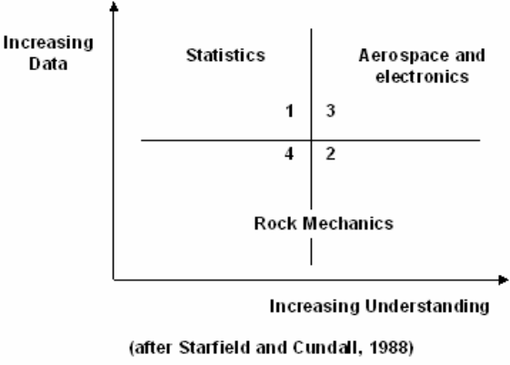
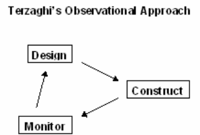
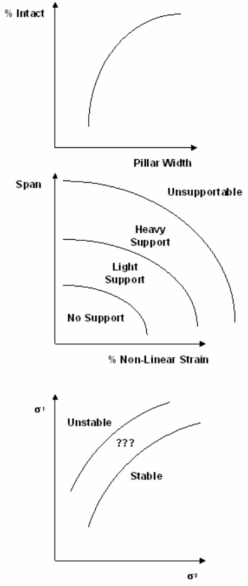
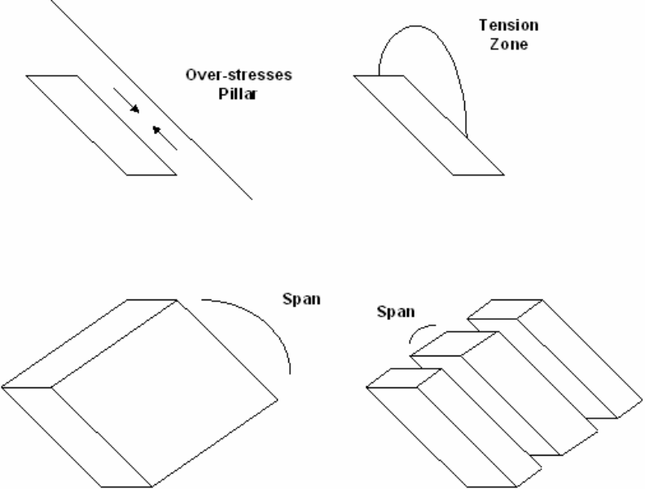
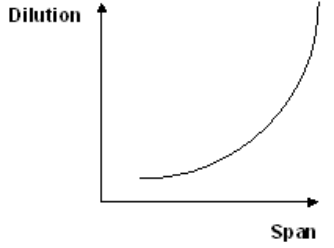
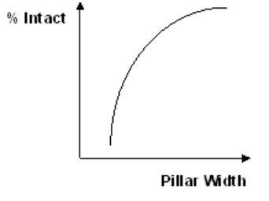
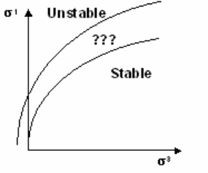
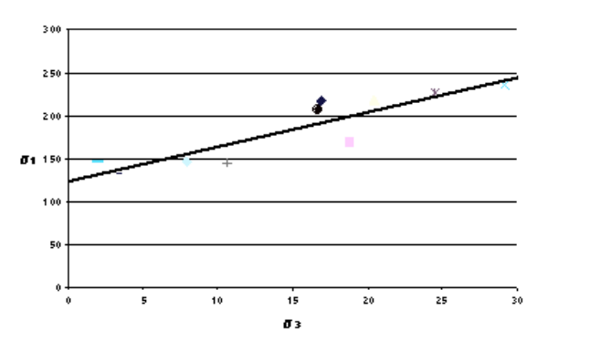

El objetivo sencillo del modelamiento numérico es predecir (con precisión y confiabilidad) cómo responderá el macizo rocoso a la minería. Se especifican las condiciones de carga y la geometría (que puede incluir diques, fallas, estratificación, etc.), se exige equilibrio y continuidad, se supone que se aplica elasticidad y/o no linealidad y luego se resuelven estas ecuaciones para obtener los esfuerzos, deformaciones, desplazamientos, etc. en todo el macizo rocoso.

Al examinar los resultados del análisis de esfuerzos, es posible identificar, por ejemplo, los lugares sobreesforzados o en fluencia. Se puede determinar qué lugares requieren soporte y qué tipo de soporte es adecuado, etc.

El objetivo final es saber qué problemas cabe esperar, así como cuándo y dónde se producirán. Esto permite comparar diseños y secuencias mineras alternativos, y desarrollar estrategias para enfrentar los problemas cuando se produzcan. Se evitan interrupciones inesperadas de la producción. Permite establecer valores de diseño concretos para los requerimientos de soporte, anchos específicos de pilares, alturas aceptables de caserones, etc. En resumen, proporciona una herramienta que le ayuda a diseñar su mina. Si bien el modelamiento numérico es razonablemente sencillo, interpretar los resultados es un desafío mucho mayor. El modelamiento numérico para predecir el comportamiento del macizo rocoso no es una ciencia exacta. Siempre habrá características del macizo rocoso que no se anticipen o no se comprendan.

La siguiente cita de Starfield y Cundall (1988) sugiere varias razones por las que esto es así.

_Los modelos de mecánica de rocas pertenecen a la clase de los "problemas con datos limitados": rara vez se sabe lo suficiente sobre las características y el comportamiento del macizo rocoso como para modelarlo sin ambigüedad. De ello se deduce que no es posible utilizar los modelos en mecánica de rocas de la manera convencional (como en la ingeniería eléctrica o aeroespacial) y que es necesario adoptar una metodología distintiva y adecuada para el modelamiento en mecánica de rocas._

A menudo los problemas están mal planteados, lo que dificulta la interpretación de los resultados y genera la persistente duda de si se ha modelado o no el problema correcto. El diseño del modelo debe estar guiado por las preguntas que el modelo debe responder, más que por los detalles del sistema que se modela. Esto ayuda a simplificar y controlar el modelo.

Un modelo es una simplificación de la realidad, no una imitación de ella. Es una herramienta intelectual que debe diseñarse o elegirse para una tarea específica. El problema fundamental es la cuestión de la resolución. Uno teme simplificar demasiado el problema.

Es inútil esperar alguna vez disponer de datos suficientes para modelar macizos rocosos de la manera convencional (como en la ingeniería eléctrica o aeroespacial). A medida que se incluye más y más detalle, se pierde el control intelectual del modelo, que se vuelve menos eficaz en lugar de más.

#### ¿Cuál es el enfoque convencional para aplicar el modelamiento numérico al diseño minero?

En la mayoría de las demás disciplinas de ingeniería (ingeniería eléctrica o aeroespacial), el modelamiento numérico se basa normalmente en predecir la respuesta a partir de propiedades de los materiales medidas en laboratorio. Esto suele funcionar bien si los materiales, la geometría y las condiciones de carga se conocen bien.

En cambio, el método convencional para aplicar el modelamiento numérico al diseño minero se basa en el "enfoque observacional de diseño de Terzaghi".

Inicialmente (es decir, antes de la minería) se pueden realizar estudios paramétricos. Se pueden comparar diseños alternativos e identificar los factores importantes que afectan la estabilidad. Puede descubrir que ciertas orientaciones son más favorables que otras o que ciertas secuencias son mejores opciones que otras. Puede hacer una estimación general del costo-beneficio de aumentar la producción frente al aumento de los requerimientos de mantención y soporte.

Saber qué tipo de problemas cabe esperar y qué lugares son especialmente susceptibles es sin duda información útil, ya que permite desarrollar estrategias para enfrentar los problemas si se producen y cuando se produzcan. Pero si desea utilizar el modelamiento para establecer valores de diseño concretos para los requerimientos de soporte, anchos específicos de pilares, alturas aceptables de caserones y costos reales, necesita tener confianza en la precisión de sus predicciones.

Por ejemplo, no tendría sentido especificar que un pilar tenga 1,2 m de ancho a partir de una predicción del modelo si no tuviera idea de cuán confiable es esa predicción. Nunca permitiría que el personal transitara bajo una visera basándose en resultados del modelamiento que indicaran que es segura, a menos que también confiara en que las predicciones son confiables.

Es fundamentalmente necesario conocer la confiabilidad de una predicción para evaluar el riesgo y fundamentar las decisiones de costo-beneficio.

Vale la pena detenerse un momento a reflexionar sobre esta afirmación. No se me ocurre ningún ejemplo en que las predicciones de confiabilidad desconocida tengan algún valor. Puede admitir que la confiabilidad de su predicción es baja y que sus predicciones podrían tener un error de ±100%; o bien puede tener pruebas que demuestren que la confiabilidad de su predicción es muy alta y que su error es inferior a ±10%. Cualquier persona en un puesto de toma de decisiones necesita saberlo para poder ponderarlo en sus consideraciones de costo-beneficio.

Considere estas dos preguntas:

Si tuviera pruebas demostrables de que las predicciones del modelo son confiables en un 99% (error de ±1%), ¿por qué no las usaría?

Si tuviera pruebas demostrables de que las predicciones del modelo son confiables en un 1% (error de ±99%), ¿por qué las usaría?

¡El meollo del asunto es realmente la confiabilidad! Debemos saber cuán confiables son nuestras predicciones o no tendremos nada (Wiles 2006 y Wiles 2007).

Entonces, ¿cómo se obtienen diseños confiables? La solución a este problema es el mismo enfoque de diseño, probado y comprobado, que utilizan todos los ingenieros. El procedimiento utilizado para establecer la confiabilidad se denomina "enfoque observacional de diseño de Terzaghi" (Terzaghi y Peck, 1967):

- Decidir algún tipo de diseño minero inicial: estudios paramétricos.

- Comenzar a minar.

- Monitorear la respuesta del macizo rocoso, normalmente de forma visual.

- Rediseñar en función del comportamiento observado: calibración del modelo.

Este proceso constituye la calibración del modelo. Usemos o no el modelamiento, este es básicamente el enfoque que todos utilizamos para diseñar nuestras minas.

_El diseño basado en los supuestos más desfavorables es inevitablemente antieconómico, pero ningún otro procedimiento ofrece al diseñador, antes de la construcción, la garantía de que la estructura soportada por el suelo no desarrollará defectos imprevistos. Sin embargo, si el proyecto permite modificar el diseño durante la construcción, pueden lograrse importantes ahorros diseñando sobre la base de las posibilidades más probables en lugar de las más desfavorables. Los vacíos en la información disponible se llenan diseñando durante la construcción, y el diseño se modifica de acuerdo con los hallazgos. Esta base de diseño puede denominarse procedimiento observacional._

_Para utilizar el procedimiento observacional en la ingeniería de movimiento de tierras, deben cumplirse dos requisitos. En primer lugar, la presencia y las características generales de las zonas débiles deben revelarse mediante los resultados de la exploración del subsuelo antes de la construcción. En segundo lugar, deben adoptarse disposiciones especiales para obtener información cuantitativa sobre las características indeseables de estas zonas durante la construcción, antes de que sea demasiado tarde para modificar el diseño de acuerdo con los hallazgos. Estos requisitos no pudieron cumplirse hasta que se comprendió claramente la mecánica de la interacción entre el suelo y el agua y se desarrollaron medios de observación adecuados. Según la naturaleza del proyecto, los datos necesarios para aplicar el procedimiento observacional se obtienen midiendo presiones de poros y niveles piezométricos; cargas y esfuerzos; desplazamientos horizontales, verticales y angulares; y caudales de filtración._

Aunque este texto es antiguo, las ideas son sólidas. Aplicar estas ideas a la predicción de la respuesta del macizo rocoso mediante modelamiento numérico conduce a las siguientes recomendaciones:

1) Antes de comenzar, asegúrese de tener muy claro por qué construye un modelo y qué preguntas intenta responder. Plantee hipótesis sobre los posibles resultados del modelamiento y las decisiones que se tomarán en consecuencia. Si no puede tomar estas decisiones antes de modelar, probablemente tampoco podrá tomarlas después. Algunos ejemplos de cómo abordar esto son:

   - El ancho del pilar se seleccionará en función de un máximo de 50% de fluencia en la sección transversal del pilar.

   - El relleno debe completarse antes de que se prediga una dilución del 10%.

   - Será necesario reacondicionar el terreno cuando las deformaciones no lineales superen el 1% de deformación unitaria.

   - Se producirá inestabilidad del terreno a largo plazo cuando el sobreesfuerzo elástico supere 1,6 veces la resistencia.

- 2) Utilice el modelo en la etapa más temprana posible del proyecto para generar tanto datos como comprensión. A menudo los modelos pueden ayudarle a entender lo que está ocurriendo.

3) Busque la mecánica que controla el problema. Intente identificar los mecanismos importantes, los modos de deformación y los modos de falla probables. Utilice el modelo para realizar "experimentos numéricos" que aclaren ideas contradictorias sobre lo que ocurre en terreno. Algunos ejemplos de mecánicas de control son:

- La fluencia por compresión del pilar de la caja techo, formado entre los caserones y la falla de la caja techo, es la causa de la dilución.

- La falta de confinamiento de la caja techo es la causa de la dilución.

- Una luz excesiva es la causa de la dilución.

4) Utilice el modelo más simple posible que permita que se produzcan los mecanismos importantes (2D, 3D, elástico, plástico, fallas, agua, calor, dinámica, etc.). Implemente este modelo y verifique que concuerde con sus expectativas; si no es así, identifique la debilidad (en el modelo o en sus expectativas) y realice los ajustes necesarios.

- Aunque el análisis bidimensional puede ser aplicable al inicio de la minería con razones de extracción muy bajas y al final de la minería con razones de extracción muy altas, normalmente es necesario un análisis tridimensional.

- El deslizamiento en una falla débil puede dominar la redistribución de esfuerzos, lo que exige el uso de simulaciones de deslizamiento de fallas.

- La fluencia de los pilares puede ser responsable de una redistribución significativa de esfuerzos, lo que exige el uso de análisis no lineales.

5) Una vez que haya aprendido todo lo posible de los modelos simples, puede ejecutar modelos más complejos y detallados para mejorar la precisión y explorar los aspectos de la geología y de la respuesta del macizo rocoso que se omitieron en los modelos simples.

6) Desarrolle tendencias simples a partir de los resultados para usarlas con fines de diseño. Evalúe la sensibilidad de estas tendencias a los distintos parámetros supuestos en el modelo. La estadística puede ser útil aquí para definir la confiabilidad de las predicciones. Algunas tendencias útiles que podrían presentarse son:

- Volumen de dilución en función de la luz.

- Porcentaje del pilar intacto en función del ancho del pilar.

· Estabilidad del terreno en función del estado de esfuerzos predicho.

7) Monitoree la respuesta del macizo rocoso a medida que avanza la excavación. Verifique que la respuesta observada concuerde suficientemente con los resultados predichos. Vuelva a modelar cuando sea necesario, a medida que avancen la nueva información y la comprensión de la mecánica. ¿Qué tan bien funciona este enfoque?

El valor de este enfoque es que, a medida que avanza la minería, usted aprende cuán confiable (o poco confiable) es su modelo. Tenga en cuenta que tradicionalmente las observaciones de la respuesta del macizo rocoso se realizan de forma visual y a menudo se complementan con instrumentos escasamente distribuidos. Al observar la respuesta del macizo rocoso, con el tiempo literalmente llega a ver cuándo funciona el modelo y cuándo no. Aprende qué características deben incluirse en el modelo (por ejemplo, planos de falla, litología, condiciones de carga, etc.). No solo aprende a usar el modelo para predecir la respuesta del macizo rocoso, sino que también gana confianza en las predicciones y reconoce las situaciones en las que las predicciones del modelo son dudosas.

En resumen, aprende cuán confiables (o poco confiables) son sus predicciones.

Una vez establecida la confiabilidad, está en condiciones de afinar su diseño. Un modelo bien calibrado le permite vislumbrar el futuro: predecir cómo responderá el macizo rocoso.

Cuando se aplica correctamente, este procedimiento es extremadamente valioso. Puede recortar pilares y modificar el diseño con confianza, dejando mineral solo donde es necesario. Evita interrupciones inesperadas de la producción. Puede minar con confianza.

Para reforzar este concepto, consideremos un ejemplo real: múltiples fallas violentas de pilares ocurridas durante varios años de minería. Para cada falla, se ejecutó un modelo numérico para determinar el estado de esfuerzos en el momento y el lugar de la falla. Si graficamos todas estas predicciones de esfuerzo en un sistema de ejes s1 frente a s3, obtenemos lo siguiente:

Esta figura muestra que existe una fuerte correlación entre el estado de esfuerzos en el momento de cada falla y un criterio de resistencia lineal. El coeficiente de correlación de estos datos es 0,90. Digámoslo de otra manera. Si calcula la diferencia entre el estado de esfuerzos de cada pilar y la recta de mejor ajuste y luego toma la media de estos errores, encontrará que el error medio en la predicción de s1 es de aproximadamente 17 MPa. Esto da un coeficiente de variación de solo ±9%.

Es evidente que, en este ejemplo concreto, este enfoque puede funcionar muy bien: el estado de esfuerzos predicho por el modelamiento numérico es un predictor muy confiable del momento y el lugar de las fallas de pilares. Ciertamente, no se esperaría que fallaran pilares con estados de esfuerzo muy por debajo de la recta de mejor ajuste (más de 17 MPa). Asimismo, se esperaría que los pilares muy por encima (más de 17 MPa) de la recta de mejor ajuste hubieran fallado en alguna etapa de minado anterior.

Vale la pena preguntarse si esto es realmente una aplicación del enfoque observacional de diseño de Terzaghi. De hecho, sí lo es. Durante los años de este estudio, los operadores de la mina probaron muchas modificaciones distintas del diseño. Los cambios que probaron estuvieron guiados por el tipo de respuesta que observaron en interior mina. Inicialmente descubrieron que, aunque no podían evitar las fallas de pilares, sí podían ejercer un control considerable sobre el momento de la secuencia de minado en que se producían. Finalmente descubrieron que, aplicando acondicionamiento del terreno, podían desencadenar las fallas de pilares en los momentos que más les convenían.

Implementación del modelamiento en el proceso de diseño minero

#### ¿Cuáles son las deficiencias de este enfoque?

Este enfoque presenta algunas deficiencias importantes. En primer lugar, se necesitan muchas iteraciones del ciclo minar/monitorear/rediseñar para saber cuán confiables son las predicciones del modelo. Esto requiere tiempo, personal y una dedicación continua (muchas visitas a interior mina). Monitorear la respuesta del macizo rocoso no es una tarea trivial. Pueden pasar varios años antes de establecer la confiabilidad con cierta seguridad. Solo usted puede decidir si el esfuerzo se justifica, es decir, si vale la pena llevarlo a cabo.

Hay otras limitaciones menos evidentes. Puede haber rasgos geológicos que no puedan caracterizarse adecuadamente para el modelamiento. Por ejemplo, a menudo los detalles de la ubicación, la forma, la extensión y el estado de diversas fallas no se conocen lo suficiente como para incluirlos con precisión en un modelo numérico. Excluir dichos rasgos puede invalidar los resultados del modelo. Mediante la aplicación correcta del enfoque observacional de diseño de Terzaghi, puede llegar a establecer que las predicciones del modelo no son confiables y quedar ante una situación impredecible (al menos impredecible en lo que respecta a su modelo actual). "Geología que entra, geología que sale."

Por último, si las condiciones locales, como los esfuerzos premineros, la litología o el diaclasamiento, varían rápidamente de un lugar a otro, puede resultar poco práctico monitorear con la resolución suficiente para identificar los efectos de estos rasgos cambiantes. Existen ejemplos de modelamiento en los que se han considerado estas condiciones cambiantes. Los análisis de esfuerzos resultantes produjeron predicciones con una concordancia notable con las deformaciones observadas. Al menos en estos casos, esto demuestra que la variabilidad de los resultados se debe a condiciones locales cambiantes y no a errores del modelo.

Este tipo de variación normalmente no se considera y se manifiesta como una gran dispersión en las predicciones, lo que reduce su confiabilidad.

Si bien el enfoque observacional de Terzaghi es sólido, puede que solo sirva para demostrar la falta de confiabilidad que realmente se tiene.

Evidentemente, nos gustaría encontrar una forma de sortear estos problemas:

- Nos gustaría acortar el ciclo de calibración.

- También nos gustaría poder caracterizar los rasgos geológicos lo suficientemente bien como para incorporarlos al modelamiento numérico.

- Por último, nos gustaría reducir la dispersión y desarrollar un modelo de alta confiabilidad.

¿Cómo vamos a superar estas deficiencias? Una línea de investigación prometedora es la integración del modelamiento numérico con el monitoreo sísmico: Map3Di.
