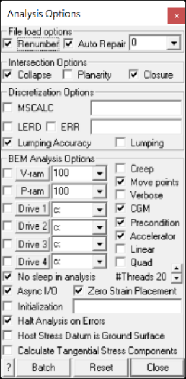

Configura opciones que controlan diversas operaciones del programa.

#### File Load Options:

Analysis > Options > Renumber Renumera las superficies para que el volumen sea positivo (durante la carga del archivo). Analysis > Options > Auto Repair Intenta reparar el modelo rellenando vacíos, eliminando duplicados, etc. (durante la carga del archivo).

#### Intersection Options:

Analysis > Options > Collapse Fusiona superficies adyacentes (durante el análisis de intersecciones).

Analysis > Options > Planarity Subdivide cuadriláteros no planos en triángulos (durante el análisis de intersecciones).

Analysis > Options > Closure Realiza la verificación de cierre y traslape, y resuelve las intersecciones booleanas (durante el análisis de intersecciones).

#### Discretization Options:

Analysis > Options > MSCALC Calcula resultados en puntos definidos por el usuario (durante el análisis BEM de Map3D).

Analysis > Options > LERD Calcula la tasa de liberación de energía y la rigidez del sistema de carga (durante el análisis BEM de Map3D).

Analysis > Options > ERR Calcula la tasa de liberación de energía y la rigidez del sistema de carga (durante el análisis BEM de Map3D).

Analysis > Options > Lumping Accuracy

Analysis > Options > Lumping Precalcula el tamaño de la matriz de coeficientes (durante el análisis de discretización).

#### Map3D BEM Analysis Options:

Analysis > Options > V-ram Almacena parte de la matriz de coeficientes en RAM virtual (durante el análisis BEM de Map3D).

Analysis > Options > P-ram Almacena parte de la matriz de coeficientes en RAM física (durante el análisis BEM de Map3D). Analysis > Options > Drive 1 Especifica las unidades de trabajo primarias para la matriz de coeficientes (durante el análisis BEM de Map3D).

Analysis > Options > Drive 2 Especifica la unidad de trabajo secundaria para la matriz de coeficientes (durante el análisis BEM de Map3D).

Analysis > Options > Drive 3 Especifica la tercera unidad de trabajo para la matriz de coeficientes (durante el análisis BEM de Map3D).

Analysis > Options > Drive 4 Especifica la cuarta unidad de trabajo para la matriz de coeficientes (durante el análisis BEM de Map3D).

Analysis > Options > Creep Realiza un análisis de fluencia elasto-visco-plástica.

Analysis > Options > Move Points Mueve los puntos de campo que están muy cerca de las superficies de borde (durante el análisis BEM de Map3D).

Analysis > Options > Verbose Escribe todos los vectores de solución y los resultados de los puntos de campo en el archivo de registro (durante el análisis BEM de Map3D).

Analysis > Options > CGM Usa el solucionador de gradiente conjugado (durante el análisis BEM de Map3D).

Analysis > Options > Precondition Precondiciona la matriz (durante el análisis BEM de Map3D). Analysis > Options > Accelerate Usa el acelerador de matriz (durante el análisis BEM de Map3D). Analysis > Options > Linear Usa elementos de borde de orden superior (durante el análisis BEM de Map3D).

Analysis > Options > Quad Usa elementos de borde de orden superior (durante el análisis BEM de Map3D).

Analysis > Options > Threads = 8  indica el número de hilos activos actualmente.

Analysis > Options > Nosleep in analysis Usa las rutinas de E/S asíncrona de Windows (durante el análisis BEM de Map3D).

Analysis > Options > Async I/O Usa las rutinas de E/S asíncrona de Windows (durante el análisis BEM de Map3D).

Analysis > Options > Zero Strain Placement Cuando se asigna un nuevo material a un bloque con CAD > Edit > Entity Properties, estos materiales se inicializan con el estado de esfuerzos especificado en CAD > Properties > Material Properties.

Analysis > Options > Initialization Inicializa el modelo para que el análisis continúe desde donde terminó un análisis anterior.

Analysis > Options > Halt on Errors Inicializa el modelo para que el análisis continúe desde donde terminó un análisis anterior.

Analysis > Options > Host Stress Datum is Ground Surface Trata el datum como la superficie del terreno, de modo que a las superficies ubicadas sobre el datum se les asigna un estado de esfuerzos nulo.

Analysis > Options > Calculate Tangential Stress Components En los análisis elásticos, los esfuerzos tangenciales no se calculan a menos que se soliciten. Esto se debe a que no son necesarios para el proceso de solución y requieren tiempo de análisis adicional. Estos valores se calculan por defecto durante el análisis plástico.

#### Miscellaneous Options:

Analysis > Options > Batch Configura la cola de lotes de análisis.

Analysis > Options > Reset
