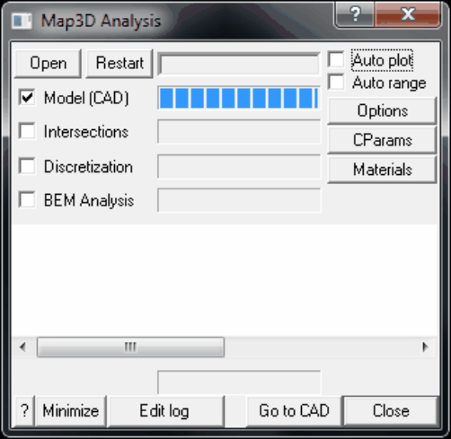

Abre el cuadro de diálogo Map3D Analysis, que controla todas las funciones de análisis de esfuerzos.

Analysis > Open Carga un modelo desde un archivo.

Analysis > Restart Reinicia un análisis que fue abortado o interrumpido por un corte de energía o una falla del sistema operativo.

Analysis > Model (CAD) Carga un modelo desde un archivo.

Analysis > Intersections Realiza el análisis de contactos e intersecciones.

Analysis > Discretization Discretización de bloques y grillas.

Analysis > BEM Analysis Análisis BEM de Map3D.

Analysis > Auto Plot Grafica automáticamente las componentes de superficie seleccionadas a medida que avanza el análisis BEM de Map3D.

Analysis > Auto Range Modifica automáticamente el rango de contornos a medida que avanza el análisis BEM de Map3D.

Analysis > Options Configura opciones que controlan diversas operaciones del programa.

Analysis > Cparams Modifica los parámetros de control del análisis durante el análisis.

Analysis > Materials Modifica las propiedades de los materiales durante el análisis.

Analysis > Minimize Minimiza la visualización gráfica durante el análisis.

Analysis > Edit log Edita el archivo de registro. El archivo de registro es una grabación de todos los mensajes escritos en la ventana de mensajes.

Analysis > Go to CAD Pasa a la etapa de construcción y edición del modelo.

Analysis > Close Cierra el cuadro de diálogo.

Analysis > Spawn Results Inicia otra instancia de Map3D y carga los resultados de la primera etapa de explotación. Esto es útil para ver los resultados de las etapas ya completadas mientras se analizan las etapas siguientes.

Analysis > Suspend Suspende o pausa el análisis en ejecución.

Analysis > Resume Reanuda el análisis suspendido.
