## 5.5.1.1 Bloque

Construye un bloque de tipo FF (Fictitious Force) completamente tridimensional. Se usan para excavaciones 3D, zonas de material alterno (zonas mineralizadas o diques) y zonas rellenadas. Las superficies del bloque se subdividirán en elementos de borde en una etapa posterior del programa. En Map3D Non-Linear, estas zonas pueden fluir y comportarse de forma no lineal.

Se pueden combinar varios bloques para crear formas 3D complejas. La rutina FFLoop ( CAD > Build > FF Loop) se puede usar para extruir una serie de bloques FF 3D a partir de un plano de piso o una sección, y se puede usar para interpolar entre varios planos de piso o secciones.

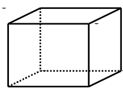

Al iniciar la rutina se le pide que seleccione los primeros 4 vértices que definen un lado (p. ej., la base) de un bloque de 6 caras. Una vez ingresados estos, se le piden 4 vértices adicionales (vértices 5, 6, 7 y 8) que definen el lado opuesto del bloque (p. ej., el techo).

Los vértices se pueden ordenar en sentido horario o antihorario, siempre que la base y el techo se ingresen en el mismo orden, con los vértices del lado superior 5, 6, 7 y 8 ubicados directamente sobre los vértices del lado inferior 1, 2, 3 y 4.

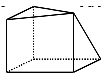

Cualquiera de los vértices se puede repetir para definir formas de 3 lados y cuñas.

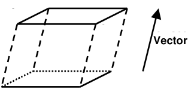

Una vez definida la base (vértices 1, 2, 3 y 4), los vértices restantes (5, 6, 7 y 8) se pueden generar mediante desplazamiento o extrusión

#### CAD > Build > Offset Remaining

Las coordenadas de los vértices se pueden escribir desde el teclado

#### CAD > Build > Enter Point

seleccionar mediante dibujo a mano alzada, tomar de otras entidades (otros bloques o líneas de construcción) o digitalizar

#### CAD > Digitizer Setup > Activate

Hay una gran variedad de herramientas de dibujo para ayudar a seleccionar visualmente puntos del modelo

#### CAD > Snap

Los vértices se pueden deseleccionar con

#### CAD > Build > Undo Point

Los vértices se pueden volver a seleccionar con

#### CAD > Build > Redo Point

El bloque se considera completo cuando se ingresa el octavo vértice o cuando el usuario selecciona

Al completar la construcción del bloque se le pedirá que ingrese las propiedades del bloque. Esto permite especificar diversos parámetros, entre ellos el color del bloque y la secuencia de explotación.

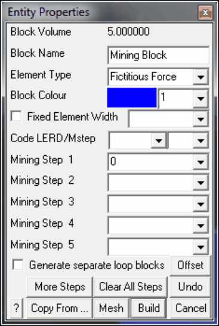

Block Volume - muestra el volumen del bloque.

Block Name - especifica un nombre descriptivo para el bloque.

Element Type - especifica el tipo de elemento de borde que se usará para el bloque.

- Fictitious Force - los elementos FF deben usarse para elementos tridimensionales como excavaciones, zonas de material alterno, caserones rellenados, etc.

- Displacement Discontinuity - los elementos DD deben usarse para excavaciones tabulares, fracturas y planos de falla.

- Los elementos inactivos se pueden usar para mostrar elementos que se incluyen solo con fines de visualización y que no se usarán en el análisis de esfuerzos propiamente tal.

Block Colour - especifica el número de color que se usará para mostrar el bloque.

Especifica el número de color que se asignará a cada botón. Hay un total de 10 colores disponibles para la visualización. Se numeran respectivamente

del 1 al 10, del 11 al 20, del 21 al 30, etc.,

de modo que se muestra el mismo color para los números

1, 11, 21..., 2, 22, 32..., 3, 23, 33..., etc.

Fixed Element Width - especifica el ancho de elemento definido por el usuario.

Este parámetro se puede usar para forzar una discretización uniforme en las entidades seleccionadas. Se debe tener extremo cuidado al especificar este valor, ya que un valor pequeño puede llevar fácilmente a un tamaño de problema enorme.

En general, esta opción no debe usarse (desmarcada) y la discretización debe dejarse a cargo de los parámetros _AL_ y _AG_ . Estos últimos concentran elementos solo donde se solicitan resultados del análisis, optimizando así el uso de elementos y minimizando el tamaño del problema. Para una discusión adicional, vea

#### CAD > Properties Control Parameters

Este parámetro también se puede usar para evitar generar superficies con lados mayores que este valor durante el análisis de intersecciones. Ninguna superficie cuyo largo de lado supere esta dimensión será colapsada

#### Analysis > Options > Collapse

Durante el proceso de discretización, toda superficie cuyo largo de lado supere esta dimensión se subdividirá para evitar superficies con lados mayores que este valor.

Para un ejemplo del uso de este parámetro, vea Tabular Mining Example

Matl_Code LERD/MStep - especifica el código de material que se sustituirá en el bloque para el cálculo de LERD/LSS.

El primer recuadro es para el código de material.

El segundo recuadro sirve para especificar el número de la etapa de explotación en que se hará el cálculo. Si este recuadro se deja en blanco, el cálculo de LERD se hará para todas las etapas.

#### Analysis > Options > LERD/LSS.

- Mining Step n - especifica el código de material que se usará para este bloque en la etapa de explotación n. En el ejemplo anterior, el bloque no existe en la etapa 1, tiene insertado el material n.º 2 (mineral) en la etapa 2, se excava en la etapa 3 (el código de material 0 significa excavar) y, por último, en la etapa 4 se inserta el material n.º 5 (relleno). Cuando se usa un número de material positivo, el material se coloca en el bloque con el estado de esfuerzos inicial especificado y luego se le permite deformarse según las propiedades elásticas/plásticas definidas para ese número de material. Cuando se usa un número de material negativo, el material se coloca en el bloque con el estado de esfuerzos inicial especificado, pero el estado de esfuerzos se mantiene en esos valores independientemente de las deformaciones, lo que entrega una condición de borde de esfuerzos.

More Steps - permite especificar etapas de explotación adicionales.

Clear All Steps - borra todas las etapas de explotación (1-100).

Undo - deselecciona el último punto ingresado y vuelve a la rutina de construcción del bloque

#### CAD > Build > Undo Point

Copy From… - permite seleccionar otro bloque desde el cual copiar las propiedades de la entidad.

Mesh - construye el bloque con las superficies subdivididas en partes más pequeñas según el espaciamiento de grilla del bloque especificado.

Build - completa la construcción del bloque e ingresa el bloque en la base de datos del modelo.

Una vez completada esta operación, tiene una última oportunidad de deshacerla y eliminar este bloque de la base de datos del modelo seleccionando

#### CAD > Build > Undo Build

Cancel aborta la construcción del bloque.

Tenga en cuenta que es posible crear bloques de volumen cero, por ejemplo, especificando un vector de desplazamiento de largo cero. Esto permite a los usuarios construir superficies FF individuales si lo desean. Aunque está permitido, no se recomienda, ya que puede dar lugar a volúmenes no cerrados.

Los bloques FF se pueden colapsar en planos DD en cualquier momento simplemente cambiando el tipo de elemento

#### CAD > Edit > Entity Properties

En este caso, la base del bloque (el lado definido por los vértices 1, 2, 3 y 4) se convertirá en el plano DD y se descartarán el resto de los lados del bloque.

Notes:

Se deben usar distintos números de color para representar agrupaciones lógicas de bloques (p. ej., para distintos niveles, secciones o unidades lógicas de explotación, como desarrollo, caserones, etc.). Estos colores los puede definir el usuario

#### Tools > Custom Colours

Todos los bloques con el mismo número de color serán combinados automáticamente por Map3D en formas complejas únicas.

Como es fácil activar y desactivar la visualización de números de color de bloque específicos

#### View > Hide Block Colours

esto ofrece un método eficiente para trabajar con datos de modelos complejos.

Para una discusión sobre los aspectos de la construcción de modelos, vea:

#### Model Building and Editing

Para tutoriales de construcción de modelos, vea:

#### Model Building Tutorials

Al presionar la barra espaciadora se activa automáticamente la última función de construcción que se usó.

## 5.5.1.2 FF Loop

Construye bloques de tipo FF (Fictitious Force) completamente tridimensionales. Se usan para excavaciones 3D, zonas de material alterno (zonas mineralizadas o diques) y zonas rellenadas. Las superficies del bloque se subdividirán en elementos de borde en una etapa posterior del programa. En Map3D Non-Linear, estas zonas pueden fluir y comportarse de forma no lineal.

Se pueden encontrar algunos ejemplos que demuestran esta rutina en Model Building Tutorials. Vea en particular

- Video demo of FFLoop model building with multiple loops

- Video demo of FFLoop model simplification using slicing

- FFLoop Drift Example

- FFLoop Stope Example

- Bulk Mining Example

#### FFLoops

Al iniciar la rutina se le pide que seleccione los vértices que definen el perímetro de una serie de plantas o secciones. El sentido en que se recorre cada lazo no es relevante. Se pueden definir simultáneamente tantos lazos como se desee. El número de puntos no tiene que ser el mismo en cada lazo. Los puntos inicial y final de cada lazo (p. ej., los puntos 1 y 11 en el primer lazo, y los puntos 12 y 22 en el segundo) deben estar en la misma ubicación para definir una serie de lazos cerrados.

#### Snap > Trace

Se pueden seleccionar puntos individuales de uno en uno, o se pueden seleccionar todos los puntos a lo largo de un segmento de línea de construcción con la función de snap CAD > Snap > Trace CLoop.

#### Snap > Win

Se pueden seleccionar puntos individuales de uno en uno, o se pueden seleccionar todos los puntos a lo largo de varias líneas de construcción con la función de snap CAD > Snap > Window.

#### Close

La rutina FFLoop se considera completa cuando se cumple una de las dos condiciones siguientes:

- el usuario selecciona por tercera vez el último punto del lazo (es decir, el punto n.º 22)

- CAD > Build > FFLoop

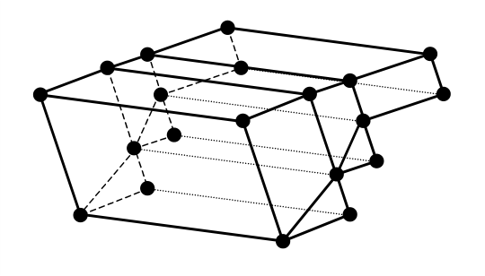

Luego los lazos se subdividirán en una serie de elementos FF de 3 o 4 lados. Estas superficies se subdividirán en elementos de borde en una etapa posterior del programa. La rutina que realiza esta subdivisión busca vértices cercanos entre sí, por lo que el usuario debe cuidar de definir el lazo de modo que las conexiones sean directas. En el ejemplo anterior se recomienda seleccionar o generar los puntos 4 y 5.

#### Guide Lines

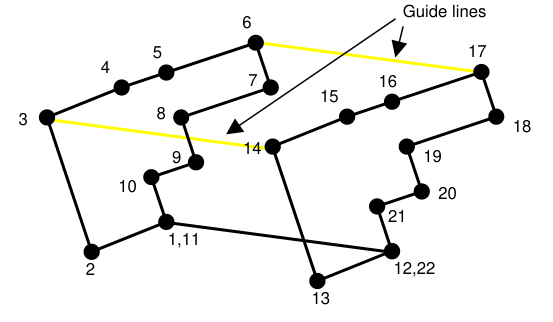

Para formas más complejas se pueden definir líneas guía (mostradas en amarillo) que obligan a subdividir los lados a lo largo de ellas. Estas se definen simplemente como líneas de construcción. Para un ejemplo, vea [https://www.map3d.com/ffloop.htm](https://www.map3d.com/ffloop.htm). Las líneas guía no deben intersectarse ni cruzarse entre sí.

#### Extrusion using Offset

Una vez ingresado el primer lazo cerrado, los puntos restantes se pueden generar desplazando los puntos restantes con CAD > Build > Offset Remaining

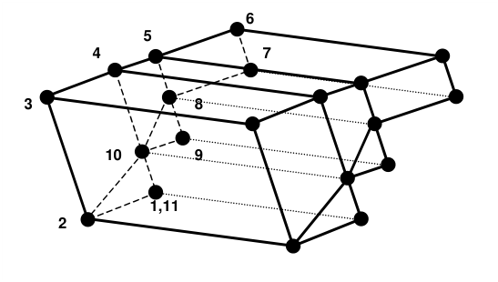

#### Miscellaneous

Las coordenadas de los vértices se pueden escribir desde el teclado

#### CAD > Build > Enter Point

seleccionar mediante dibujo a mano alzada, tomar de otras entidades (otros bloques o líneas de construcción) o digitalizar

#### CAD > Digitizer Setup > Activate

Hay una gran variedad de herramientas de dibujo para ayudar a seleccionar visualmente puntos del modelo

#### CAD > Snap

Los vértices se pueden deseleccionar con

#### CAD > Build > Undo Point

Los vértices se pueden volver a seleccionar con

#### CAD > Build > Redo Point

Al completar la construcción del bloque se le pedirá que ingrese las propiedades del bloque. Esto permite especificar diversos parámetros, entre ellos el color del bloque y la secuencia de explotación.

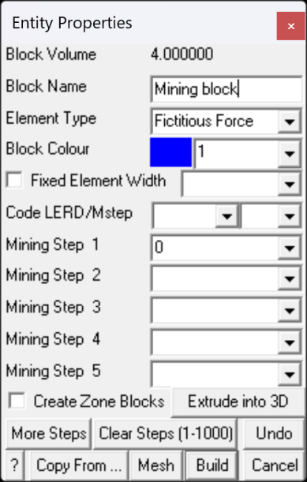

Block Volume - muestra el volumen del bloque.

Block Name - especifica un nombre descriptivo para el bloque.

Element Type - especifica el tipo de elemento de borde que se usará para el bloque.

- Fictitious Force - los elementos FF deben usarse para elementos tridimensionales como excavaciones, zonas de material alterno, caserones rellenados, etc.

- Displacement Discontinuity - los elementos DD deben usarse para excavaciones tabulares, fracturas y planos de falla.

- Los elementos inactivos se pueden usar para mostrar elementos que se incluyen solo con fines de visualización y que no se usarán en el análisis de esfuerzos propiamente tal.

Block Colour - especifica el número de color que se usará para mostrar el bloque.

Especifica el número de color que se asignará a cada botón. Hay un total de 10 colores disponibles para la visualización. Se numeran respectivamente

del 1 al 10, del 11 al 20, del 21 al 30, etc.,

de modo que se muestra el mismo color para los números

1, 11, 21..., 2, 22, 32..., 3, 23, 33..., etc.

Fixed Element Width - especifica el ancho de elemento definido por el usuario.

Este parámetro se puede usar para forzar una discretización uniforme en las entidades seleccionadas. Se debe tener extremo cuidado al especificar este valor, ya que un valor pequeño puede llevar fácilmente a un tamaño de problema enorme.

En general, esta opción no debe usarse (desmarcada) y la discretización debe dejarse a cargo de los parámetros _AL_ y _AG_ . Estos últimos concentran elementos solo donde se solicitan resultados del análisis, optimizando así el uso de elementos y minimizando el tamaño del problema. Para una discusión adicional, vea

#### CAD > Properties Control Parameters

Este parámetro también se puede usar para evitar generar superficies con lados mayores que este valor durante el análisis de intersecciones. Ninguna superficie cuyo largo de lado supere esta dimensión será colapsada

#### Analysis > Options > Collapse

Durante el proceso de discretización, toda superficie cuyo largo de lado supere esta dimensión se subdividirá para evitar superficies con lados mayores que este valor.

Para un ejemplo del uso de este parámetro, vea Tabular Mining Example

Matl_Code LERD/MStep - especifica el código de material que se sustituirá en el bloque para el cálculo de LERD/LSS.

El primer recuadro es para el código de material.

El segundo recuadro sirve para especificar el número de la etapa de explotación en que se hará el cálculo. Si este recuadro se deja en blanco, el cálculo de LERD se hará para todas las etapas.

#### Analysis > Options > LERD/LSS.

- Mining Step n - especifica el código de material que se usará para este bloque en la etapa de explotación n. En el ejemplo anterior, el bloque no existe en la etapa 1, tiene insertado el material n.º 2 (mineral) en la etapa 2, se excava en la etapa 3 (el código de material 0 significa excavar) y, por último, en la etapa 4 se inserta el material n.º 5 (relleno). Cuando se usa un número de material positivo, el material se coloca en el bloque con el estado de esfuerzos inicial especificado y luego se le permite deformarse según las propiedades elásticas/plásticas definidas para ese número de material. Cuando se usa un número de material negativo, el material se coloca en el bloque con el estado de esfuerzos inicial especificado, pero el estado de esfuerzos se mantiene en esos valores independientemente de las deformaciones, lo que entrega una condición de borde de esfuerzos.

Create Zone Blocks - si está construyendo bloques de varios lazos, puede especificar si se crearán o no interfaces entre cada bloque, de modo que cada uno se pueda tratar como una unidad de explotación independiente. A cada una de estas subsecciones se le asignará un número de color distinto para facilitar ocultarlas o mostrarlas al visualizar con Hide Block Colours. Si no especifica esta opción, se creará un único bloque grande.

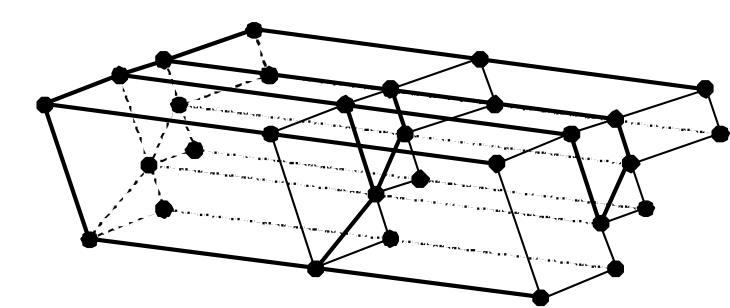

Extrude into 3D - permite desplazar un lazo plano para extruir el bloque en una forma 3D. Esta operación también se puede hacer con Extrude/Offset Remaining.

More Steps - permite especificar etapas de explotación adicionales.

Clear All Steps - borra todas las etapas de explotación (1-1000).

Undo - deselecciona el último punto ingresado y vuelve a la rutina de construcción del bloque

#### CAD > Build > Undo Point

Copy From… - permite seleccionar otro bloque desde el cual copiar las propiedades de la entidad.

Mesh - construye el bloque con las superficies subdivididas en partes más pequeñas según el espaciamiento de grilla del bloque especificado.

Build - completa la construcción del bloque e ingresa el bloque en la base de datos del modelo.

Una vez completada esta operación, tiene una última oportunidad de deshacerla y eliminar este bloque de la base de datos del modelo seleccionando

#### CAD > Build > Undo Build

Cancel aborta la construcción del bloque.

Tenga en cuenta que es posible crear bloques de volumen cero, por ejemplo, especificando un vector de desplazamiento de largo cero. Esto permite a los usuarios construir superficies FF individuales si lo desean. Aunque está permitido, no se recomienda, ya que puede dar lugar a volúmenes no cerrados.

Los bloques FF se pueden colapsar en planos DD en cualquier momento simplemente cambiando el tipo de elemento

#### CAD > Edit > Entity Properties

En este caso, la base del bloque (el lado definido por los vértices 1, 2, 3 y 4) se convertirá en el plano DD y se descartarán el resto de los lados del bloque.

Notes:

Se deben usar distintos números de color para representar agrupaciones lógicas de bloques (p. ej., para distintos niveles, secciones o unidades lógicas de explotación, como desarrollo, caserones, etc.). Estos colores los puede definir el usuario

#### Tools > Custom Colours

Todos los bloques con el mismo número de color serán combinados automáticamente por Map3D en formas complejas únicas.

Como es fácil activar y desactivar la visualización de números de color de bloque específicos

#### View > Hide Block Colours

esto ofrece un método eficiente para trabajar con datos de modelos complejos.

Para una discusión sobre los aspectos de la construcción de modelos, vea:

#### Model Building and Editing

Para tutoriales de construcción de modelos, vea:

#### Model Building Tutorials

Al presionar la barra espaciadora se activa automáticamente la última función de construcción que se usó.

## 5.5.1.3 DD Loop

Construye bloques de tipo DD (Displacement Discontinuity). Se usan para explotación tabular, vetas delgadas o planos de falla. En todas las versiones de Map3D, estas zonas pueden fluir y comportarse de forma no lineal. Se pueden combinar varios DD para crear formas complejas con desplazamientos y ondulaciones.

Se pueden encontrar algunos ejemplos que demuestran esta rutina en Model Building Tutorials. Vea en particular

- Video demo of DDLoop model building with sub-parallel lines

- Video demo of DDLoop model building with interior loops

- DDLoop Pillar Example

- Tabular Mining Example

#### DDLoop

Al iniciar la rutina se le pide que seleccione una serie de lazos que definen el perímetro de las zonas deseadas. El sentido en que se recorre cada lazo no es relevante. Los puntos inicial y final de cada lazo (p. ej., los puntos 1 y 11, o 12 y 22) deben estar en la misma ubicación para definir lazos cerrados.

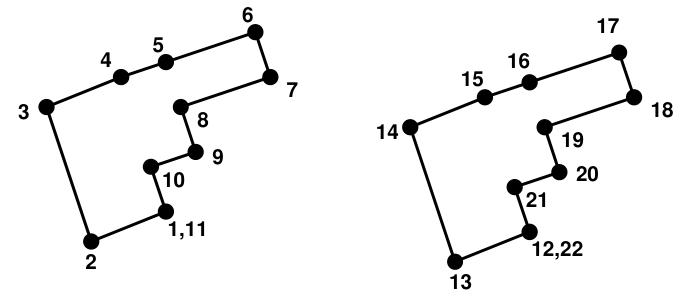

#### Snap > Trace

Se pueden seleccionar puntos individuales de uno en uno, o se pueden seleccionar todos los puntos a lo largo de un segmento de línea de construcción con la función de snap CAD > Snap > Trace CLoop.

#### Snap > Win

Se pueden seleccionar puntos individuales de uno en uno, o se pueden seleccionar todos los puntos a lo largo de varias líneas de construcción con la función de snap CAD > Snap > Window.

#### Close

La rutina DDLoop se considera completa cuando se cumple una de las dos condiciones siguientes:

- el usuario selecciona por tercera vez el último punto del lazo (es decir, el punto n.º 12,22)

- CAD > Build > DDLoop

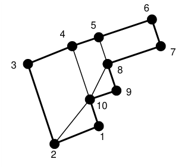

Luego los lazos se subdividirán en una serie de elementos DD de 3 o 4 lados. Estas superficies se subdividirán en elementos de borde en una etapa posterior del programa. La rutina que realiza esta subdivisión busca vértices cercanos entre sí, por lo que el usuario debe cuidar de definir el lazo de modo que las conexiones sean directas. En el ejemplo anterior se recomienda seleccionar o generar los puntos 4 y 5.

La función de construcción Mesh (vea más abajo) se puede usar para construir el bloque con las superficies subdivididas en partes más pequeñas según el espaciamiento de grilla del bloque especificado. Esta rutina genera los puntos interiores necesarios para mantener elementos de buena forma.

#### Guide Lines

Se pueden trazar varias zonas interiores simultáneamente definiendo líneas guía (mostradas en amarillo).

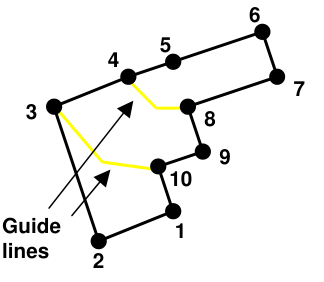

Estas se definen simplemente como líneas de construcción. Para un ejemplo, vea [https://www.map3d.com/t.htm](https://www.map3d.com/t.htm). Las líneas guía deben atravesar el lazo perimetral de borde a borde. Se pueden definir varias líneas guía que se intersecten entre sí, definiendo así varias zonas.

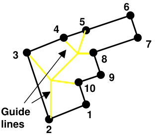

#### Interior Zones

Se pueden definir varias zonas interiores (p. ej., pilares) trazando su periferia, como se muestra a continuación. El sentido en que se recorre la zona interior no es relevante. Se pueden definir de esta forma tantas zonas interiores como se desee.

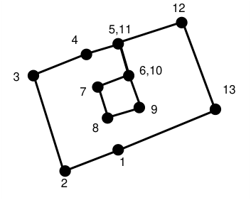

Alternativamente, estas zonas interiores se pueden construir cómodamente trazando el perímetro exterior ( CAD > Snap > Trace CLoop) y usando líneas guía para definir las formas interiores deseadas.

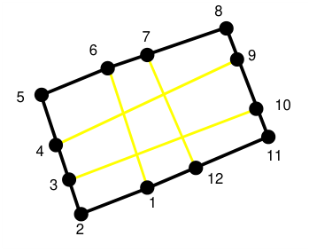

Create Zone Blocks - si está construyendo planos DD de varios lazos, puede especificar si se crearán o no interfaces entre cada subsección, de modo que cada una se pueda tratar como un grupo independiente de DDPlanes. A cada una de estas subsecciones se le asignará un número de color distinto para facilitar ocultarlas o mostrarlas al visualizar con Hide Block Colours. Si no especifica esta opción, se creará un único grupo grande de DDPlanes.

#### Extrusion using Offset

Una vez ingresados al menos dos puntos, los puntos restantes se pueden generar desplazando los puntos restantes con CAD > Build > Offset Remaining

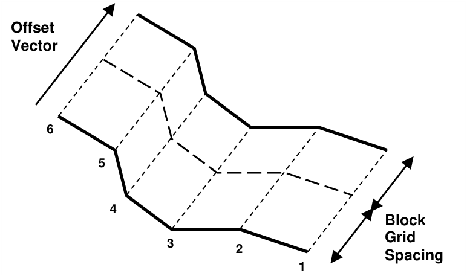

Tenga en cuenta también que los elementos DD se pueden extruir a zonas FF simplemente cambiando el tipo de elemento de DD a FF.

#### Miscellaneous

Las coordenadas de los vértices se pueden escribir desde el teclado

#### CAD > Build > Enter Point

seleccionar mediante dibujo a mano alzada, tomar de otras entidades (otros bloques o líneas de construcción) o digitalizar

#### CAD > Digitizer Setup > Activate

Hay una gran variedad de herramientas de dibujo para ayudar a seleccionar visualmente puntos del modelo

#### CAD > Snap

Los vértices se pueden deseleccionar con

#### CAD > Build > Undo Point

Los vértices se pueden volver a seleccionar con

#### CAD > Build > Redo Point

Al completar la construcción del bloque se le pedirá que ingrese las propiedades del bloque. Esto permite especificar diversos parámetros, entre ellos el color del bloque y la secuencia de explotación.

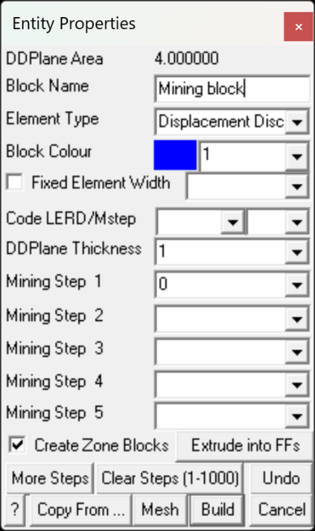

DDPlane Area - muestra el área combinada de todos los DDPlanes incluidos en el DDLoop.

Block Name - especifica un nombre descriptivo para el bloque.

Element Type - especifica el tipo de elemento de borde que se usará para el bloque.

- Displacement Discontinuity - los elementos de tipo DD deben usarse para excavaciones tabulares, fracturas y planos de falla.

- Fictitious Force - se deben usar elementos de tipo FF para elementos tridimensionales como excavaciones, zonas de material alterno, caserones rellenados, etc.

- Los elementos inactivos se pueden usar para mostrar elementos que se incluyen solo con fines de visualización y que no se usarán en el análisis de esfuerzos propiamente tal.

Block Colour - especifica el número de color que se usará para mostrar el bloque.

Especifica el número de color que se asignará a cada botón. Hay un total de 10 colores disponibles para la visualización. Se numeran respectivamente

del 1 al 10, del 11 al 20, del 21 al 30, etc.,

de modo que se muestra el mismo color para los números

1, 11, 21..., 2, 22, 32..., 3, 23, 33..., etc.

Fixed Element Width - especifica el ancho de elemento definido por el usuario.

Este parámetro se puede usar para forzar una discretización uniforme en las entidades seleccionadas. Se debe tener extremo cuidado al especificar este valor, ya que un valor pequeño puede llevar fácilmente a un tamaño de problema enorme.

En general, esta opción no debe usarse (desmarcada) y la discretización debe dejarse a cargo de los parámetros _AL_ y _AG_ . Estos últimos concentran elementos solo donde se solicitan resultados del análisis, optimizando así el uso de elementos y minimizando el tamaño del problema. Para una discusión adicional, vea

#### CAD > Properties Control Parameters

Este parámetro también se puede usar para evitar generar superficies con lados mayores que este valor durante el análisis de intersecciones. Ninguna superficie cuyo largo de lado supere esta dimensión será colapsada

#### Analysis > Options > Collapse

Durante el proceso de discretización, toda superficie cuyo largo de lado supere esta dimensión se subdividirá para evitar superficies con lados mayores que este valor.

Para un ejemplo del uso de este parámetro, vea Tabular Mining Example

Matl_Code LERD/MStep - especifica el código de material que se sustituirá en el bloque para el cálculo de LERD/LSS.

El primer recuadro es para el código de material.

El segundo recuadro sirve para especificar el número de la etapa de explotación en que se hará el cálculo. Si este recuadro se deja en blanco, el cálculo de LERD se hará para todas las etapas.

#### Analysis > Options > LERD/LSS.

#### Analysis > Options > LERD/LSS

DDPlane Thickness - especifica el espesor del material insertado en el elemento DD (es decir, arcilla de falla, ancho de veta, ancho de explotación o altura de pilar).

El desplazamiento normal (cierre) de la estructura cuando está rellena quedará limitado a este espesor. Además, el desplazamiento normal (cierre) y el desplazamiento de corte (ride) se dividen por el espesor para determinar la deformación que ocurre en el material de relleno

Fault-Gouge in DD planes

Backfill-Hyperbolic in DD planes Equilibrated-Gouge in DD planes

Mohr-Coulomb in DD planes

Este parámetro debe especificarse en las mismas unidades usadas para especificar las coordenadas (p. ej., metros o pies).

- Mining Step n - especifica el código de material que se usará para este bloque en la etapa de explotación n. En el ejemplo anterior, el bloque no existe en la etapa 1, tiene insertado el material n.º 2 (mineral) en la etapa 2, se excava en la etapa 3 (el código de material 0 significa excavar) y, por último, en la etapa 4 se inserta el material n.º 5 (relleno). Cuando se usa un número de material positivo, el material se coloca en el bloque con el estado de esfuerzos inicial especificado y luego se le permite deformarse según las propiedades elásticas/plásticas definidas para ese número de material. Cuando se usa un número de material negativo, el material se coloca en el bloque con el estado de esfuerzos inicial especificado, pero el estado de esfuerzos se mantiene en esos valores independientemente de las deformaciones, lo que entrega una condición de borde de esfuerzos.

Extrude into FFs - permite extruir un plano DD en un bloque FF. Se le pedirá el vector de extrusión

More Steps - permite especificar etapas de explotación adicionales.

Clear All Steps - borra todas las etapas de explotación (1-1000).

Undo - deselecciona el último punto ingresado y vuelve a la rutina de construcción del bloque

#### CAD > Build > Undo Point

Copy From… - permite seleccionar otro bloque desde el cual copiar las propiedades de la entidad.

Mesh - construye el bloque con las superficies subdivididas en partes más pequeñas según el espaciamiento de grilla del bloque especificado. Esta rutina genera los puntos interiores necesarios para mantener elementos de buena forma.

Build - completa la construcción del bloque e ingresa el bloque en la base de datos del modelo.

Una vez completada esta operación, tiene una última oportunidad de deshacerla y eliminar este bloque de la base de datos del modelo seleccionando

#### CAD > Build > Undo Build

Cancel aborta la construcción del bloque.

Tenga en cuenta que es posible crear bloques de volumen cero, por ejemplo, especificando un vector de desplazamiento de largo cero. Esto permite a los usuarios construir superficies FF individuales si lo desean. Aunque está permitido, no se recomienda, ya que puede dar lugar a volúmenes no cerrados.

Los bloques DD se pueden extruir en bloques FF 3D en cualquier momento simplemente cambiando el tipo de elemento

#### CAD > Edit > Entity Properties

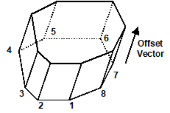

En este caso, los vértices 1 a 8 definen la base del bloque. El techo y los lados se generan automáticamente durante el proceso de extrusión.

Tenga en cuenta que es posible crear bloques de volumen cero, por ejemplo, especificando un vector de desplazamiento de largo cero. Esto permite a los usuarios construir superficies FF individuales si lo desean. Aunque está permitido, no se recomienda, ya que puede dar lugar a volúmenes no cerrados.

Notes:

Se deben usar distintos números de color para representar agrupaciones lógicas de bloques (p. ej., para distintos niveles, secciones o unidades lógicas de explotación, como desarrollo, caserones, etc.). Estos colores los puede definir el usuario

#### Tools > Custom Colours

Todos los bloques con el mismo número de color serán combinados automáticamente por Map3D en formas complejas únicas.

Como es fácil activar y desactivar la visualización de números de color de bloque específicos

#### View > Hide Block Colours

esto ofrece un método eficiente para trabajar con datos de modelos complejos.

Para una discusión sobre los aspectos de la construcción de modelos, vea:

#### Model Building and Editing

Para tutoriales de construcción de modelos, vea:

#### Model Building Tutorials

Al presionar la barra espaciadora se activa automáticamente la última función de construcción que se usó.

## 5.5.1.4 Tunnel

Construye un túnel (bloque de tipo FF - Fictitious Force). Se usa para construir un túnel 3D extruyendo una sección transversal a lo largo de la trayectoria del túnel. Las superficies del túnel se subdividirán en elementos de borde en una etapa posterior del programa.

#### Tunnel

La construcción del túnel se realiza en tres etapas:

- 1) Seleccionar el perfil del túnel;

- 2) Seleccionar el punto de referencia del túnel;

- 3) Seleccionar la trayectoria/el trazado del túnel.

**Stage 1 - Tunnel Profile**

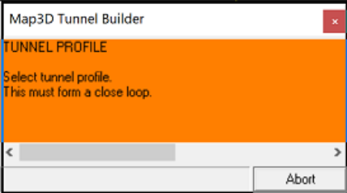

Al iniciar la rutina se le pide que seleccione un perfil de túnel:

- este debe formar un lazo cerrado

- se puede construir con cualquier orientación deseada (x-y, y-z, x-z o cualquier orientación definida por el usuario) `o` tenga en cuenta que, si el perfil se construye en el plano x-y, la dirección y se usará como hacia arriba `o` en cambio, si el perfil se construye en el plano y-z o x-z, la dirección z se usará como hacia arriba

- al seleccionarlo, tenga en cuenta que este perfil de túnel se extruirá alejándose de su punto de vista (como indican las flechas rojas a continuación)

- se puede seleccionar como una serie de puntos, de forma similar a como se seleccionan las líneas de construcción CAD > Build > Construction Lines

- alternativamente, se puede seleccionar una forma predefinida con líneas de construcción usando, por ejemplo, CAD > Snap > Trace CLoop

- durante la selección del perfil se pueden usar todas las funciones de snap y de construcción, incluida CAD > Build > Offset Remaining

Aquí se muestra un perfil de túnel en verde. Las flechas rojas indican la dirección en que se extruirá el túnel durante la etapa 3 - trayectoria/trazado del túnel.

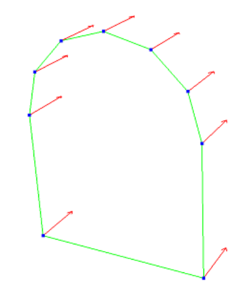

Map3D detectará un perfil de túnel completo cuando se cierre el lazo. Luego se le dirigirá a la etapa 2 - punto de referencia del túnel.

**Stage 2 - Tunnel Reference Point**

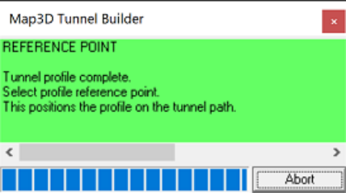

El punto de referencia del túnel representa la ubicación del perfil del túnel que se usará para ubicar el perfil sobre la trayectoria/el trazado del túnel.

A continuación, se ha seleccionado como punto de referencia la esquina inferior derecha.

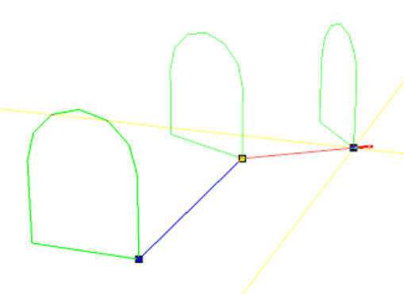

Al seleccionar el punto de referencia, se le dirigirá a la etapa 3 - trayectoria/trazado del túnel.

Tenga en cuenta que, si se selecciona un punto de referencia equivocado, simplemente deshaga la selección con CAD > Build > Undo Build o presionando la tecla Escape.

**Stage 3 - Tunnel Path/Layout**

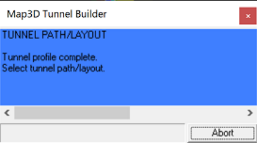

Ahora se puede seleccionar la trayectoria/el trazado del túnel:

- el perfil seleccionado antes se extruirá a lo largo de la trayectoria/del trazado

- la trayectoria/el trazado se puede seleccionar de forma similar a como se seleccionan las líneas de construcción CAD > Build > Construction Lines

- alternativamente, la trayectoria/el trazado se puede seleccionar a lo largo de un conjunto de líneas de construcción predefinidas

- se aceptan lazos de túnel cerrados

- se aceptan trayectorias de túnel inclinadas

- durante la selección del perfil se pueden usar todas las funciones de snap y de construcción, incluida CAD > Build > Offset Remaining

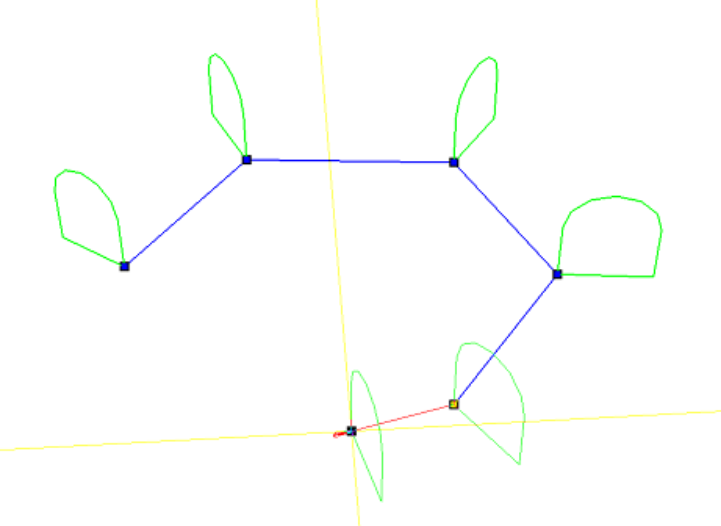

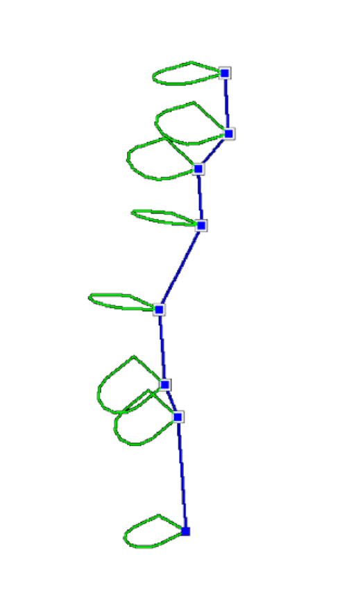

Arriba, a la izquierda, los dos primeros puntos de la trayectoria se eligieron en el plano horizontal (con inclinación o descenso menor de 45°); por lo tanto, el túnel se extruye como una galería horizontal con la sección orientada verticalmente, como se muestra. A la derecha, los dos primeros puntos de la trayectoria se eligen en el plano vertical (con inclinación o descenso mayor de 45°); por lo tanto, el túnel se extruye como un pique vertical con la sección orientada casi horizontalmente, como se muestra.

La trayectoria/el trazado del túnel se considera completo cuando se cumple una de las dos condiciones siguientes:

- el usuario selecciona por segunda vez el último punto

- CAD > Build > Tunnel

Al completarse, el túnel se construirá como se muestra a continuación.

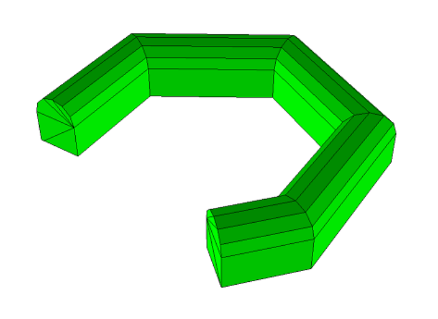

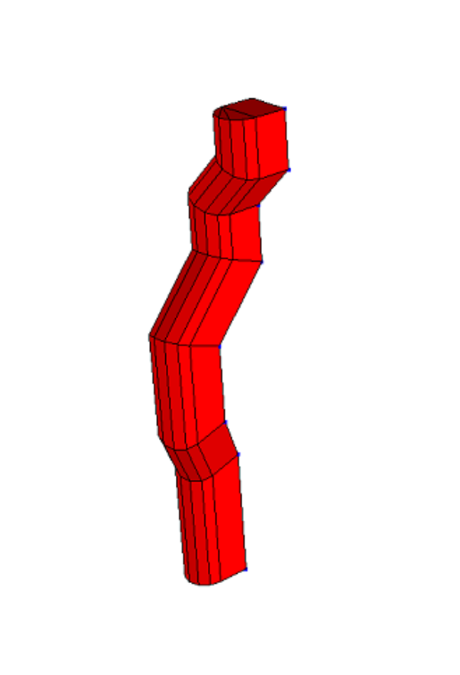

#### Miscellaneous

Las coordenadas de los vértices se pueden escribir desde el teclado

#### CAD > Build > Enter Point

seleccionar mediante dibujo a mano alzada, tomar de otras entidades (otros bloques o líneas de construcción) o digitalizar

#### CAD > Digitizer Setup > Activate

Hay una gran variedad de herramientas de dibujo para ayudar a seleccionar visualmente puntos del modelo

#### CAD > Snap

Los vértices se pueden deseleccionar con

#### CAD > Build > Undo Point

Los vértices se pueden volver a seleccionar con

#### CAD > Build > Redo Point

Al completar la construcción del bloque se le pedirá que ingrese las propiedades del bloque. Esto permite especificar diversos parámetros, entre ellos el color del bloque y la secuencia de explotación.

Block Volume - muestra el volumen del bloque.

Block Name - especifica un nombre descriptivo para el bloque.

Element Type - especifica el tipo de elemento de borde que se usará para el bloque.

- Fictitious Force - los elementos FF deben usarse para elementos tridimensionales como excavaciones, zonas de material alterno, caserones rellenados, etc.

- Los elementos inactivos se pueden usar para mostrar elementos que se incluyen solo con fines de visualización y que no se usarán en el análisis de esfuerzos propiamente tal.

Block Colour - especifica el número de color que se usará para mostrar el bloque.

Especifica el número de color que se asignará a cada botón. Hay un total de 10 colores disponibles para la visualización. Se numeran respectivamente

del 1 al 10, del 11 al 20, del 21 al 30, etc.,

de modo que se muestra el mismo color para los números

1, 11, 21..., 2, 22, 32..., 3, 23, 33..., etc.

Fixed Element Width - especifica el ancho de elemento definido por el usuario.

Este parámetro se puede usar para forzar una discretización uniforme en las entidades seleccionadas. Se debe tener extremo cuidado al especificar este valor, ya que un valor pequeño puede llevar fácilmente a un tamaño de problema enorme.

En general, esta opción no debe usarse (desmarcada) y la discretización debe dejarse a cargo de los parámetros _AL_ y _AG_ . Estos últimos concentran elementos solo donde se solicitan resultados del análisis, optimizando así el uso de elementos y minimizando el tamaño del problema. Para una discusión adicional, vea

#### CAD > Properties Control Parameters

Este parámetro también se puede usar para evitar generar superficies con lados mayores que este valor durante el análisis de intersecciones. Ninguna superficie cuyo largo de lado supere esta dimensión será colapsada

#### Analysis > Options > Collapse

Durante el proceso de discretización, toda superficie cuyo largo de lado supere esta dimensión se subdividirá para evitar superficies con lados mayores que este valor.

Para un ejemplo del uso de este parámetro, vea Tabular Mining Example

Matl_Code LERD/MStep - especifica el código de material que se sustituirá en el bloque para el cálculo de LERD/LSS.

El primer recuadro es para el código de material.

El segundo recuadro sirve para especificar el número de la etapa de explotación en que se hará el cálculo. Si este recuadro se deja en blanco, el cálculo de LERD se hará para todas las etapas.

#### Analysis > Options > LERD/LSS.

- Mining Step n - especifica el código de material que se usará para este bloque en la etapa de explotación n. En el ejemplo anterior, el bloque no existe en la etapa 1, tiene insertado el material n.º 2 (mineral) en la etapa 2, se excava en la etapa 3 (el código de material 0 significa excavar) y, por último, en la etapa 4 se inserta el material n.º 5 (relleno). Cuando se usa un número de material positivo, el material se coloca en el bloque con el estado de esfuerzos inicial especificado y luego se le permite deformarse según las propiedades elásticas/plásticas definidas para ese número de material. Cuando se usa un número de material negativo, el material se coloca en el bloque con el estado de esfuerzos inicial especificado, pero el estado de esfuerzos se mantiene en esos valores independientemente de las deformaciones, lo que entrega una condición de borde de esfuerzos.

Generate Separate Loop Blocks - puede especificar si se crearán o no interfaces entre cada bloque, de modo que cada uno se pueda tratar como una unidad de explotación independiente (como se muestra a continuación). Si no especifica esta opción, se creará un único bloque grande.

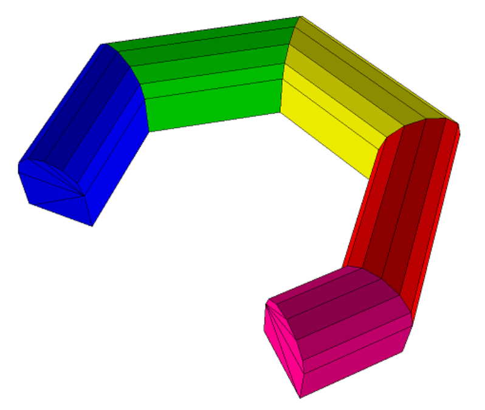

More Steps - permite especificar etapas de explotación adicionales.

Clear All Steps - borra todas las etapas de explotación (1-100).

Undo - deselecciona el último punto ingresado y vuelve a la rutina de construcción del túnel

#### CAD > Build > Undo Point

Copy From… - permite seleccionar otro bloque desde el cual copiar las propiedades de la entidad.

Mesh - construye el bloque con las superficies subdivididas en partes más pequeñas según el espaciamiento de grilla del bloque especificado.

Build - completa la construcción del bloque e ingresa el bloque en la base de datos del modelo.

Una vez completada esta operación, tiene una última oportunidad de deshacerla y eliminar este bloque de la base de datos del modelo seleccionando

#### CAD > Build > Undo Build

Cancel aborta la construcción del bloque.

Notes:

Se deben usar distintos números de color para representar agrupaciones lógicas de bloques (p. ej., para distintos niveles, secciones o unidades lógicas de explotación, como desarrollo, caserones, etc.). Estos colores los puede definir el usuario

#### Tools > Custom Colours

Todos los bloques con el mismo número de color serán combinados automáticamente por Map3D en formas complejas únicas.

Como es fácil activar y desactivar la visualización de números de color de bloque específicos

#### View > Hide Block Colours

esto ofrece un método eficiente para trabajar con datos de modelos complejos.

Para una discusión sobre los aspectos de la construcción de modelos, vea:

#### Model Building and Editing

Para tutoriales de construcción de modelos, vea:

#### Model Building Tutorials

Al presionar la barra espaciadora se activa automáticamente la última función de construcción que se usó.

## 5.5.1.5 Grid Plane

Construye un plano de grilla. Los resultados del análisis (esfuerzos, deformaciones y desplazamientos) se calculan sobre estos planos de grilla. Cada plano de grilla se subdividirá en una etapa posterior del programa.

Esta función usa la misma funcionalidad de construcción que CAD > Build > DDLoop

Tenga en cuenta que las grillas lineales se pueden crear con

CAD > Build > Grid Line.

Al iniciar la rutina se le pide que seleccione un lazo cerrado de vértices que definen el perímetro del plano de grilla. El plano de grilla se considera completo cuando el último vértice seleccionado coincide con el primero o cuando el usuario selecciona el botón de la barra de herramientas para construir GPlane

CAD > Build > Grid Plane

**Snap > Trace**

Se pueden seleccionar puntos individuales de uno en uno, o se pueden seleccionar todos los puntos a lo largo de un segmento de línea de construcción con la función de snap CAD > Snap > Trace CLoop.

#### Snap > Win

Se pueden seleccionar puntos individuales de uno en uno, o se pueden seleccionar todos los puntos a lo largo de varias líneas de construcción con la función de snap CAD > Snap > Window.

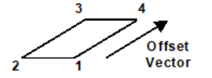

Una vez ingresados al menos dos puntos, los puntos restantes se pueden generar mediante desplazamiento

#### CAD > Build > Offset Remaining

Las coordenadas de los vértices se pueden escribir desde el teclado

#### CAD > Build > Enter Point

seleccionar mediante dibujo a mano alzada, tomar de otras entidades (otros bloques o líneas de construcción) o digitalizar

#### CAD > Digitizer Setup > Activate

Hay una gran variedad de herramientas de dibujo para ayudar a seleccionar visualmente puntos del modelo

#### CAD > Snap

Los vértices se pueden deseleccionar con

#### CAD > Build > Undo Point

Los vértices se pueden volver a seleccionar con

#### CAD > Build > Redo Point

Al completar la construcción del plano de grilla se le pedirá que ingrese las propiedades. Esto permite especificar un nombre para el plano de grilla.

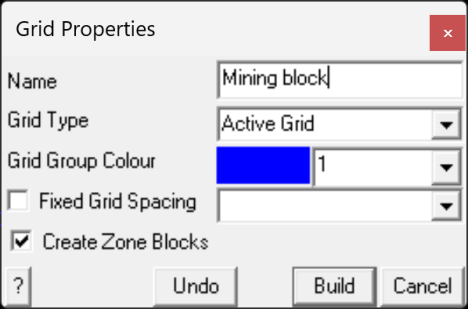

Name - especifica un nombre descriptivo para la grilla.

Grid Type - especifica si desea que la grilla esté activa (usada en el análisis de esfuerzos) o inactiva (no usada en el análisis de esfuerzos).

Fixed Grid Spacing - especifica el espaciamiento de grilla definido por el usuario.

Este parámetro se puede usar para forzar una discretización uniforme en las grillas seleccionadas. Se debe tener extremo cuidado al especificar este valor, ya que un valor pequeño puede llevar fácilmente a un tamaño de problema enorme.

En general, esta opción no debe usarse (desmarcada) y la discretización debe dejarse a cargo del parámetro _AG_ . Este último concentra elementos solo donde se solicitan resultados del análisis, optimizando así el uso de elementos y minimizando el tamaño del problema.

#### CAD > Properties Control Parameters

Create Zone Blocks - si está construyendo planos de grilla de varios lazos, puede especificar si se crearán o no interfaces entre cada subsección, de modo que cada una se pueda tratar como un grupo independiente de GPlanes. A cada una de estas subsecciones se le asignará un número de color distinto para facilitar ocultarlas o mostrarlas al visualizar con Hide Grid Colours. Si no especifica esta opción, se creará un único grupo grande de GPlanes.

Undo - deselecciona el último punto ingresado y vuelve a la rutina de construcción de la grilla

#### CAD > Build > Undo Point

Build - completa la construcción de la grilla e ingresa el bloque en la base de datos del modelo.

Una vez completada esta operación, tiene una última oportunidad de deshacerla y eliminar esta grilla de la base de datos del modelo seleccionando

#### CAD > Build > Undo Build

Cancel - aborta la construcción de la grilla.

Para ejemplos del uso de planos de grilla de puntos de campo, vea:

#### Model Building Tutorials

Al presionar la barra espaciadora se activa automáticamente la última función de construcción que se usó.

## 5.5.1.6 Grid Line

Construye una línea de grilla. Los resultados del análisis (esfuerzos, deformaciones y desplazamientos) se calculan sobre estas líneas de grilla. Cada línea de grilla se subdividirá en una etapa posterior del programa.

#### CAD > Build > Construction Lines

Esta función usa la misma funcionalidad de construcción que

#### CAD > Build > Grid Plane.

Tenga en cuenta que los planos de grilla se pueden crear con

**2**

**1**

Al iniciar la rutina se le pide que seleccione varios vértices que definen puntos a lo largo de la línea de grilla.

La línea de grilla se considera completa cuando el último vértice se selecciona dos veces o cuando el usuario selecciona

CAD > Build > Grid Line

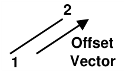

Una vez ingresado el primer punto, el punto restante se puede generar mediante desplazamiento

#### CAD > Build > Offset Remaining

Las coordenadas de los vértices se pueden escribir desde el teclado

#### CAD > Build > Enter Point

seleccionar mediante dibujo a mano alzada, tomar de otras entidades (otros bloques o líneas de construcción) o digitalizar

#### CAD > Digitizer Setup > Activate

Hay una gran variedad de herramientas de dibujo para ayudar a seleccionar visualmente puntos del modelo

#### CAD > Snap

Los vértices se pueden deseleccionar con

#### CAD > Build > Undo Point

Los vértices se pueden volver a seleccionar con

#### CAD > Build > Redo Point

Al completar la construcción del plano de grilla se le pedirá que ingrese las propiedades. Esto permite especificar un nombre para la línea de grilla.

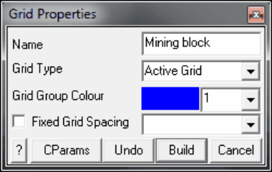

Name - especifica un nombre descriptivo para la grilla.

Grid Type - especifica si desea que la grilla esté activa (usada en el análisis de esfuerzos) o inactiva (no usada en el análisis de esfuerzos).

Fixed Grid Spacing - especifica el espaciamiento de grilla definido por el usuario.

Este parámetro se puede usar para forzar una discretización uniforme en las grillas seleccionadas. Se debe tener extremo cuidado al especificar este valor, ya que un valor pequeño puede llevar fácilmente a un tamaño de problema enorme.

En general, esta opción no debe usarse (desmarcada) y la discretización debe dejarse a cargo del parámetro _AG_ . Este último concentra elementos solo donde se solicitan resultados del análisis, optimizando así el uso de elementos y minimizando el tamaño del problema.

#### CAD > Properties Control Parameters

Undo - deselecciona el último punto ingresado y vuelve a la rutina de construcción de la grilla

#### CAD > Build > Undo Point

Build - completa la construcción de la grilla e ingresa el bloque en la base de datos del modelo.

Una vez completada esta operación, tiene una última oportunidad de deshacerla y eliminar esta grilla de la base de datos del modelo seleccionando

#### CAD > Build > Undo Build

Cancel - aborta la construcción de la grilla.

Para ejemplos del uso de planos de grilla de puntos de campo, vea:

#### Model Building Tutorials

Al presionar la barra espaciadora se activa automáticamente la última función de construcción que se usó.

## 5.5.1.7 Construction Lines

Construye líneas de construcción. Estas representan los contornos de explotación y se usan como ayuda para construir el modelo. Las líneas de construcción generalmente se digitalizan a partir de planos o se importan desde otros paquetes CAD.

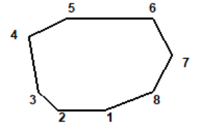

Al iniciar la rutina se le pide que seleccione una serie de vértices que definen el perímetro de la zona deseada. La línea de construcción se considera completa cuando se repite el primer vértice o cuando el usuario selecciona

CAD > Build > Construction Lines

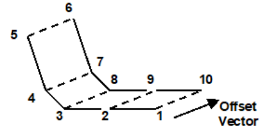

Una vez ingresados al menos dos puntos, los puntos restantes se pueden generar mediante desplazamiento

#### CAD > Build > Offset Remaining

Las coordenadas de los vértices se pueden escribir desde el teclado

#### CAD > Build > Enter Point

seleccionar mediante dibujo a mano alzada, tomar de otras entidades (otros bloques o líneas de construcción) o digitalizar

#### CAD > Digitizer Setup > Activate

Hay una gran variedad de herramientas de dibujo para ayudar a seleccionar visualmente puntos del modelo

#### CAD > Snap

Los vértices se pueden deseleccionar con

#### CAD > Build > Undo Point

Los vértices se pueden volver a seleccionar con

#### CAD > Build > Redo Point

Al completar la construcción del bloque se le pedirá que ingrese las propiedades. Esto permite especificar el color de la línea de construcción.

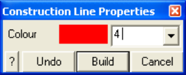

Colour - especifica el número de color que se usará para mostrar la línea de construcción. Hay un total de 10 colores disponibles para la visualización. Se numeran respectivamente

del 1 al 10, del 11 al 20, del 21 al 30, etc.,

de modo que se muestra el mismo color para los números

1, 11, 21..., 2, 22, 32..., 3, 23, 33..., etc.

Undo - deselecciona el último punto ingresado y vuelve a la rutina de construcción de la línea de construcción.

#### CAD > Build > Undo Point

Build - completa la construcción de la grilla e ingresa el bloque en la base de datos del modelo.

Una vez completada esta operación, tiene una última oportunidad de deshacerla y eliminar esta grilla de la base de datos del modelo seleccionando

#### CAD > Build > Undo Build

Cancel - aborta la construcción de la línea.

Notes

Se deben usar distintos números de color para representar agrupaciones lógicas de líneas de construcción (p. ej., para distintos niveles, secciones o unidades lógicas de explotación, como desarrollo, caserones, etc.). Estos colores los puede definir el usuario

#### Tools > Custom Colours

Como es fácil activar y desactivar la visualización de números de color de línea de construcción específicos

#### View > Hide Block Colours

esto ofrece un método eficiente para trabajar con datos de líneas de construcción complejos.

Para ejemplos del uso de líneas de construcción en la construcción de modelos, vea:

#### Model Building Tutorials

Al presionar la barra espaciadora se activa automáticamente la última función de construcción que se usó.

## 5.5.1.8 Enter Point

Las coordenadas de los vértices se pueden escribir desde el teclado durante la construcción de las siguientes entidades:

#### CAD > Build > Block

CAD > Build > FF Loop

CAD > Build > DD Loop

CAD > Build > Tunnel

CAD > Build > Grid Plane

#### CAD > Build > Grid Line

#### CAD > Build > Construction Lines

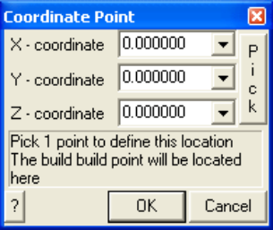

X, Y and Z – coordinate especifican las coordenadas del punto.

Pick - activa la cruz del cursor para seleccionar de forma interactiva el punto desde el modelo.

Para ayudar a seleccionar visualmente puntos del modelo, están disponibles todas las funciones de snap.

#### CAD > Snap

Una vez seleccionado, las coordenadas del punto se muestran en el cuadro de diálogo.

## 5.5.1.9 Extrude/Offset Remaining

Extruye una entidad construida parcialmente para ayudar a generar los puntos restantes durante la construcción de las siguientes entidades:

#### CAD > Build > Block

CAD > Build > FF Loop

CAD > Build > DD Loop

CAD > Build > Tunnel

CAD > Build > Grid Plane

CAD > Build > Grid Line

#### CAD > Build > Construction Lines

X, Y and Z – offset especifican las componentes del vector de desplazamiento. Todas las entidades seleccionadas se moverán esta cantidad.

Pick - activa la cruz del cursor para seleccionar de forma interactiva el vector de desplazamiento desde el modelo. Esto requiere seleccionar dos puntos para definir este vector.

Length, Plunge and Direction - especifican las componentes del vector de desplazamiento. Todas las entidades seleccionadas se moverán esta cantidad.

Norm - activa el cursor para seleccionar de forma interactiva una superficie a la cual hacer normal el vector de desplazamiento. Esto requiere seleccionar dos puntos para definir este vector. Una vez seleccionado, las componentes del vector de desplazamiento se muestran en el cuadro de diálogo.

Para ayudar a seleccionar visualmente puntos del modelo, están disponibles todas las funciones de snap.

#### CAD > Snap

Una vez seleccionado, las componentes del vector de desplazamiento se muestran en el cuadro de diálogo.

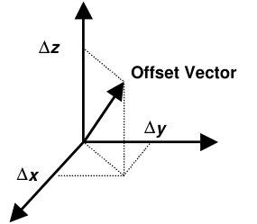

Por ejemplo, si ha construido la base de un bloque 3D (puntos 1, 2, 3 y 4) y desea generar los puntos restantes (5, 6, 7 y 8) a un metro de elevación sobre la base, simplemente ingresaría el vector de desplazamiento como (0,0,1).

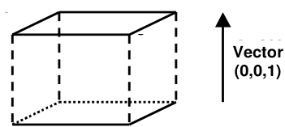

Tenga en cuenta que es posible crear bloques de volumen cero, por ejemplo, especificando un vector de desplazamiento de largo cero. Esto permite a los usuarios construir superficies FF individuales si lo desean. Aunque está permitido, no se recomienda, ya que puede dar lugar a volúmenes no cerrados.

## 5.5.1.10 Undo Point

Durante la construcción de un bloque, los puntos se seleccionan en secuencia. Esto permite deseleccionar puntos durante la construcción de las siguientes entidades:

CAD > Build > Block

CAD > Build > FF Loop

CAD > Build > DD Loop

CAD > Build > Tunnel

CAD > Build > Grid Plane

CAD > Build > Grid Line

CAD > Build > Construction Lines

Cualquier punto deseleccionado se puede volver a seleccionar con

#### CAD > Build > Redo Point

Una vez completada la construcción del bloque, puede deshacerla y eliminar este bloque de la base de datos del modelo seleccionando (se admiten 10 niveles de deshacer/rehacer)

#### CAD > Build > Undo Build

Luego puede rehacer la construcción del bloque. Esto permite repetir cualquier operación de mallado de prueba.

CAD > Build > Undo Redo

## 5.5.1.11 Redo Point

Durante la construcción de un bloque, los puntos se seleccionan en secuencia. Esto permite volver a seleccionar cualquier punto que se haya deseleccionado durante la construcción de las siguientes entidades:

CAD > Build > Block

CAD > Build > FF Loop

CAD > Build > DD Loop

CAD > Build > Tunnel

CAD > Build > Grid Plane

CAD > Build > Grid Line

CAD > Build > Construction Lines

Los puntos se pueden deseleccionar con

#### CAD > Build > Undo Point

Una vez completada la construcción del bloque, puede deshacerla y eliminar este bloque de la base de datos del modelo seleccionando (se admiten 10 niveles de deshacer/rehacer)

#### CAD > Build > Undo Build

Luego puede rehacer la construcción del bloque. Esto permite repetir cualquier operación de mallado de prueba.

CAD > Build > Undo Redo

## 5.5.1.12 Undo Build

Durante la construcción de un bloque, los puntos se seleccionan en secuencia. Esto permite deseleccionar puntos durante la construcción de las siguientes entidades:

CAD > Build > Block

CAD > Build > FF Loop

CAD > Build > DD Loop

CAD > Build > Tunnel

CAD > Build > Grid Plane

CAD > Build > Grid Line

CAD > Build > Construction Lines

Cualquier punto deseleccionado se puede volver a seleccionar con

#### CAD > Build > Redo Point

Una vez completada la construcción del bloque, puede deshacerla y eliminar este bloque de la base de datos del modelo seleccionando (se admiten 10 niveles de deshacer/rehacer)

#### CAD > Build > Undo Build

Luego puede rehacer la construcción del bloque. Esto permite repetir cualquier operación de mallado de prueba.

CAD > Build > Undo Redo

## 5.5.1.13 Redo Build

Durante la construcción de un bloque, los puntos se seleccionan en secuencia. Esto permite volver a seleccionar cualquier punto que se haya deseleccionado durante la construcción de las siguientes entidades:

CAD > Build > Block

CAD > Build > FF Loop

CAD > Build > DD Loop

CAD > Build > Tunnel

CAD > Build > Grid Plane

CAD > Build > Grid Line

CAD > Build > Construction Lines

Los puntos se pueden deseleccionar con

CAD > Build > Undo Point

Una vez completada la construcción del bloque, puede deshacerla y eliminar este bloque de la base de datos del modelo seleccionando (se admiten 10 niveles de deshacer/rehacer)

#### CAD > Build > Undo Build

Luego puede rehacer la construcción del bloque. Esto permite repetir cualquier operación de mallado de prueba.

CAD > Build > Undo Redo
