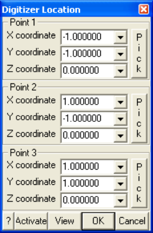

Configura el digitalizador.

El plano de digitalización se escala, ubica y orienta de forma única especificando 3 puntos en el dibujo que se va a digitalizar.

El procedimiento es el siguiente:

1. seleccione 3 puntos en el dibujo,

2. ingrese las coordenadas de cada punto,

3. luego seleccione los puntos con el cursor del digitalizador.

4. Pick activa el cursor del digitalizador para permitir la selección de cada punto.

CAD > Digitizer > Activate activa o desactiva el digitalizador para seleccionar puntos de un dibujo. Este botón puede colocarse en la barra de herramientas CAD con Tools > CAD Toolbar > Configure.

View: reposiciona la vista para que pueda ver el plano del digitalizador superpuesto al modelo.

Se admite cualquier digitalizador que pueda configurarse para controlar los movimientos del cursor en modo absoluto (es decir, con una correspondencia uno a uno entre el movimiento del digitalizador y la posición del cursor). La mayoría de los digitalizadores nuevos incluyen sus propios controladores que ofrecen esta compatibilidad. Una alternativa es usar el siguiente software, compatible con la mayoría de los digitalizadores:

Virtual Tablet Interface Digitizer Technology Company 16541 Redmond Way, Suite 195C Redmond, Washington USA 98052 Tel: 206 868 3246 Fax: 206 885 7704
