## 5.5.4.1 Propiedades de entidades

Edita el tipo de bloque, el color, la secuencia de explotación, etc.

Esta rutina se puede iniciar seleccionando el botón o simplemente haciendo clic derecho sobre cualquier entidad. Al iniciar esta rutina, primero se le pedirá que arme una lista de las entidades que desea editar

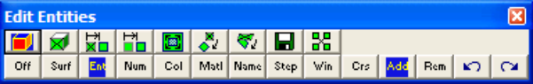

- Si Tools > Shift-key Selection está marcada, debe mantener presionada la tecla Shift para hacer selecciones múltiples.

- Por defecto, las entidades seleccionadas se agregan a la lista; sin embargo, si mantiene presionada la tecla Ctrl, las entidades seleccionadas se quitarán de la lista.

- Mientras mantiene presionada la tecla Shift o Ctrl, puede arrastrar para abrir una ventana de cruce.

- El uso de esta barra de herramientas se detalla en Build A List of Entities for Editing

- Al presionar la barra espaciadora se activa automáticamente la última función de edición que se usó.

- Al mantener presionada la tecla Alt mientras hace clic derecho, se repite automáticamente la última función de edición que se usó.

Una vez seleccionadas las entidades deseadas, puede elegir cualquiera de los botones de edición:

CAD > Edit > Entity Properties Edit block type, colour, mining sequence, CAD > Edit > Erase Entities Erase selected entities, CAD > Edit > Move Entities Move selected entities, CAD > Edit > Copy Entities Copy selected entities, CAD > Edit > Scale Entities Scale selected entities, CAD > Edit > Rotate Azimuth Rotate the azimuth of selected entities, CAD > Edit > Rotate Dip Rotate the dip of selected entities,

CAD > Edit > Dump to File Dump selected entities to a file,

CAD > Edit > Group Group selected entities into a single block,

- hacer doble clic sobre cualquier vértice para ejecutar la función resaltada,

- hacer clic derecho para ver una lista de opciones.

Si alguno de los campos del cuadro de diálogo dice "Variable", es porque algunos de los bloques seleccionados tienen propiedades distintas en ese campo. Si desea dejar estas propiedades como están (es decir, distintas para cada bloque), deje el campo como "Variable". Si desea cambiar el valor de ese campo para todos los bloques seleccionados, ingrese el valor deseado.

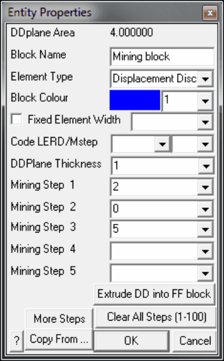

Block Volume - si ha seleccionado solo bloques FF, se mostrará el volumen total combinado de los bloques. Si ha seleccionado solo bloques FF, se mostrará el volumen total combinado de los bloques.

DDPlane Area - si ha seleccionado solo bloques DD, muestra el área combinada de todos los DDPlanes incluidos en el DDLoop.

Block Name - especifica un nombre descriptivo para el bloque.

Element Type - especifica el tipo de elemento de borde que se usará para el bloque.

- Displacement Discontinuity - los elementos de tipo DD deben usarse para excavaciones tabulares, fracturas y planos de falla.

- Fictitious Force - los elementos de tipo FF deben usarse para elementos tridimensionales como excavaciones, zonas de material alterno, caserones rellenados, etc.

- Los elementos inactivos se pueden usar para mostrar elementos que se incluyen solo con fines de visualización y que no se usarán en el análisis de esfuerzos propiamente tal.

- Tenga en cuenta que los elementos de tipo DD se pueden convertir en GPlanes.

Block Colour - especifica el número de color que se usará para mostrar el bloque.

- Especifica el número de color que se asignará a cada botón. Hay un total de 10 colores disponibles para la visualización. Se numeran respectivamente

- del 1 al 10,

del 11 al 20,

del 21 al 30, etc.,

- de modo que se muestra el mismo color para los números 1, 11, 21...,

- 2, 22, 32...,

- 3, 23, 33..., etc.

Fixed Element Width - especifica el ancho de elemento definido por el usuario.

- Este parámetro se puede usar para forzar una discretización uniforme en las entidades seleccionadas. Se debe tener extremo cuidado al especificar este valor, ya que un valor pequeño puede llevar fácilmente a un tamaño de problema enorme.

- En general, esta opción no debe usarse (desmarcada) y la discretización debe dejarse a cargo de los parámetros _AL_ y _AG_ . Estos últimos concentran elementos solo donde se solicitan resultados del análisis, optimizando así el uso de elementos y minimizando el tamaño del problema. Para una discusión adicional, vea

CAD > Properties Control Parameters

- Este parámetro también se puede usar para evitar generar superficies con lados mayores que este valor durante el análisis de intersecciones. Ninguna superficie cuyo largo de lado supere esta dimensión será colapsada

#### Analysis > Options > Collapse

- Durante el proceso de discretización, toda superficie cuyo largo de lado supere esta dimensión se subdividirá para evitar superficies con lados mayores que este valor.

- Para un ejemplo del uso de este parámetro, vea Tabular Mining Example

Matl_Code LERD/MStep - especifica el código de material que se sustituirá en el bloque para el cálculo de LERD/LSS.

El primer recuadro es para el código de material.

El segundo recuadro sirve para especificar el número de la etapa de explotación en que se hará el cálculo. Si este recuadro se deja en blanco, el cálculo de LERD se hará para todas las etapas.

#### Analysis > Options > LERD/LSS.

DDPlane Thickness - especifica el espesor del material insertado en el elemento DD (es decir, arcilla de falla, ancho de veta, ancho de explotación o altura de pilar).

- El desplazamiento normal (cierre) de la estructura cuando está rellena quedará limitado a este espesor. Además, el desplazamiento normal (cierre) y el desplazamiento de corte (ride) se dividen por el espesor para determinar la deformación que ocurre en el material de relleno

Mohr-Coulomb in DD planes

Fault-Gouge in DD planes Backfill-Hyperbolic in DD planes

- Este parámetro debe especificarse en las mismas unidades usadas para especificar las coordenadas (p. ej., metros o pies).

Mining Step n - especifica el código de material que se usará para este bloque en la etapa de explotación n.

- En el ejemplo anterior, el bloque no existe en la etapa 1, tiene insertado el material n.º 2 (mineral) en la etapa 2, se excava en la etapa 3 (el código de material 0 significa excavar) y, por último, en la etapa 4 se inserta el material n.º 5 (relleno).

- Cuando se usa un número de material positivo, el material se coloca en el bloque con el estado de esfuerzos inicial especificado y luego se le permite deformarse según las propiedades elásticas/plásticas definidas para ese número de material.

- Cuando se usa un número de material negativo, el material se coloca en el bloque con el estado de esfuerzos inicial especificado, pero el estado de esfuerzos se mantiene en esos valores independientemente de las deformaciones, lo que entrega una condición de borde de esfuerzos.

Extrude DD into FF blocks - permite extruir un plano DD en un bloque FF. Se le pedirá el vector de extrusión

More Steps - permite especificar etapas de explotación adicionales.

Clear All Steps - borra todas las etapas de explotación (1-100).

Copy From… - permite seleccionar otro bloque desde el cual copiar las propiedades de la entidad.

OK - completa la edición de los bloques y modifica las propiedades que se hayan cambiado.

Cancel - aborta la edición de bloques.

Una vez completada cualquier operación de edición, tiene una oportunidad de deshacer las modificaciones seleccionando

#### Undo

También puede restaurar el mismo conjunto de selección y modificar nuevamente el mismo conjunto de entidades seleccionando

#### Redo

Los bloques DD se pueden extruir en bloques FF 3D simplemente cambiando el tipo de elemento de Displacement Discontinuity a Fictitious Force.

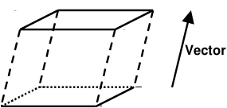

En este caso, los vértices 1 a 4 definen la base del bloque. El techo y los lados se generan automáticamente durante el proceso de extrusión. Los bloques FF se pueden colapsar en planos DD cambiando el tipo de elemento de Fictitious Force a Displacement Discontinuity. En este caso, la base del bloque (el lado definido por los vértices 1, 2, 3 y 4) se convertirá en el plano DD y se descartarán el resto de los lados del bloque.

Tenga en cuenta que es posible crear bloques de volumen cero, por ejemplo, especificando un vector de desplazamiento de largo cero. Esto permite a los usuarios construir superficies FF individuales si lo desean. Aunque está permitido, no se recomienda, ya que puede dar lugar a volúmenes no cerrados.

Notas

Se deben usar distintos números de color para representar agrupaciones lógicas de bloques (p. ej., para distintos niveles, secciones o unidades lógicas de explotación, como desarrollo, caserones, etc.). Estos colores los puede definir el usuario

#### Tools > Custom Colours

Todos los bloques con el mismo número de color serán combinados automáticamente por Map3D en formas complejas únicas.

Como es fácil activar y desactivar la visualización de números de color de bloque específicos

#### View > Hide Block Colours

esto ofrece un método eficiente para trabajar con datos de modelos complejos.

Puede ajustar el tiempo de doble clic con

#### Tools > Double Click Time

Para una discusión sobre los aspectos de la construcción de modelos, vea:

#### Model Building and Editing

Para tutoriales de construcción de modelos, vea:

Model Building Tutorials

## 5.5.4.2 Borrar entidades

Borra las entidades seleccionadas.

Esta rutina se puede iniciar seleccionando el botón o simplemente haciendo clic derecho sobre cualquier entidad. Al iniciar esta rutina, primero se le pedirá que arme una lista de las entidades que desea editar

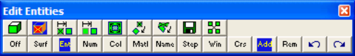

- Si Tools > Shift-key Selection está marcada, debe mantener presionada la tecla Shift para hacer selecciones múltiples.

- Por defecto, las entidades seleccionadas se agregan a la lista; sin embargo, si mantiene presionada la tecla Ctrl, las entidades seleccionadas se quitarán de la lista.

- Mientras mantiene presionada la tecla Shift o Ctrl, puede arrastrar para abrir una ventana de cruce.

- El uso de esta barra de herramientas se detalla en Build A List of Entities for Editing

- Al presionar la barra espaciadora se activa automáticamente la última función de edición que se usó.

- Al mantener presionada la tecla Alt mientras hace clic derecho, se repite automáticamente la última función de edición que se usó.

Una vez seleccionadas las entidades deseadas, puede elegir cualquiera de los botones de edición:

CAD > Edit > Entity Properties Edit block type, colour, mining sequence, CAD > Edit > Erase Entities Erase selected entities, CAD > Edit > Move Entities Move selected entities, CAD > Edit > Copy Entities Copy selected entities,

CAD > Edit > Scale Entities Scale selected entities,

CAD > Edit > Rotate Azimuth Rotate the azimuth of selected entities, CAD > Edit > Rotate Dip Rotate the dip of selected entities, CAD > Edit > Dump to File Dump selected entities to a file,

CAD > Edit > Group Group selected entities into a single block,

- hacer doble clic sobre cualquier vértice para ejecutar la función resaltada,

- hacer clic derecho para ver una lista de opciones.

Una vez completada cualquier operación de edición, tiene una oportunidad de deshacer las modificaciones seleccionando

#### Undo

También puede restaurar el mismo conjunto de selección y modificar nuevamente el mismo conjunto de entidades seleccionando

#### Redo

Puede ajustar el tiempo de doble clic con

Tools > Double Click Time

## 5.5.4.3 Mover entidades

Mueve las entidades seleccionadas.

Esta rutina se puede iniciar seleccionando el botón o simplemente haciendo clic derecho sobre cualquier entidad. Al iniciar esta rutina, primero se le pedirá que arme una lista de las entidades que desea editar

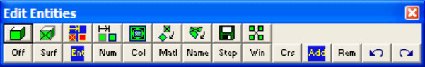

- Si Tools > Shift-key Selection está marcada, debe mantener presionada la tecla Shift para hacer selecciones múltiples.

- Por defecto, las entidades seleccionadas se agregan a la lista; sin embargo, si mantiene presionada la tecla Ctrl, las entidades seleccionadas se quitarán de la lista.

- Mientras mantiene presionada la tecla Shift o Ctrl, puede arrastrar para abrir una ventana de cruce.

- El uso de esta barra de herramientas se detalla en Build A List of Entities for Editing

- Al presionar la barra espaciadora se activa automáticamente la última función de edición que se usó.

- Al mantener presionada la tecla Alt mientras hace clic derecho, se repite automáticamente la última función de edición que se usó.

Una vez seleccionadas las entidades deseadas, puede elegir cualquiera de los botones de edición:

CAD > Edit > Entity Properties Edit block type, colour, mining sequence, CAD > Edit > Erase Entities Erase selected entities, CAD > Edit > Move Entities Move selected entities, CAD > Edit > Copy Entities Copy selected entities,

CAD > Edit > Scale Entities Scale selected entities, CAD > Edit > Rotate Azimuth Rotate the azimuth of selected entities, CAD > Edit > Rotate Dip Rotate the dip of selected entities, CAD > Edit > Dump to File Dump selected entities to a file, CAD > Edit > Group Group selected entities into a single block,

- hacer doble clic sobre cualquier vértice para ejecutar la función resaltada,

- hacer clic derecho para ver una lista de opciones.

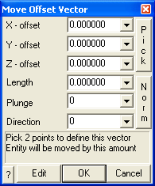

X, Y and Z – offset especifican las componentes del vector de desplazamiento. Todas las entidades seleccionadas se moverán esta cantidad.

Pick - activa la cruz del cursor para seleccionar de forma interactiva el vector de desplazamiento desde el modelo. Esto requiere seleccionar dos puntos para definir este vector.

Length, Plunge and Direction - especifican las componentes del vector de desplazamiento. Todas las entidades seleccionadas se moverán esta cantidad.

Norm - activa el cursor para seleccionar de forma interactiva una superficie a la cual hacer normal el vector de desplazamiento.

Para ayudar a seleccionar visualmente puntos del modelo, están disponibles todas las funciones de snap.

#### CAD > Snap

Una vez seleccionado, las componentes del vector de desplazamiento se muestran en el cuadro de diálogo.

Edit - completa la edición e invoca la edición de las propiedades de entidad de los bloques seleccionados.

OK - completa la edición del vector de desplazamiento y mueve los bloques seleccionados.

Cancel - aborta el movimiento de entidades.

Una vez completada cualquier operación de edición, tiene una oportunidad de deshacer las modificaciones seleccionando

#### Undo

También puede restaurar el mismo conjunto de selección y modificar nuevamente el mismo conjunto de entidades seleccionando

#### Redo

Puede ajustar el tiempo de doble clic con

Tools > Double Click Time

## 5.5.4.4 Copiar entidades

Copia las entidades seleccionadas.

Esta rutina se puede iniciar seleccionando el botón o simplemente haciendo clic derecho sobre cualquier entidad. Al iniciar esta rutina, primero se le pedirá que arme una lista de las entidades que desea editar

- Si Tools > Shift-key Selection está marcada, debe mantener presionada la tecla Shift para hacer selecciones múltiples.

- Por defecto, las entidades seleccionadas se agregan a la lista; sin embargo, si mantiene presionada la tecla Ctrl, las entidades seleccionadas se quitarán de la lista.

- Mientras mantiene presionada la tecla Shift o Ctrl, puede arrastrar para abrir una ventana de cruce.

- El uso de esta barra de herramientas se detalla en Build A List of Entities for Editing

- Al presionar la barra espaciadora se activa automáticamente la última función de edición que se usó.

- Al mantener presionada la tecla Alt mientras hace clic derecho, se repite automáticamente la última función de edición que se usó.

Una vez seleccionadas las entidades deseadas, puede elegir cualquiera de los botones de edición:

CAD > Edit > Entity Properties Edit block type, colour, mining sequence, CAD > Edit > Erase Entities Erase selected entities, CAD > Edit > Move Entities Move selected entities, CAD > Edit > Copy Entities Copy selected entities, CAD > Edit > Scale Entities Scale selected entities, CAD > Edit > Rotate Azimuth Rotate the azimuth of selected entities, CAD > Edit > Rotate Dip Rotate the dip of selected entities, CAD > Edit > Dump to File Dump selected entities to a file, CAD > Edit > Group Group selected entities into a single block,

- hacer doble clic sobre cualquier vértice para ejecutar la función resaltada,

- hacer clic derecho para ver una lista de opciones.

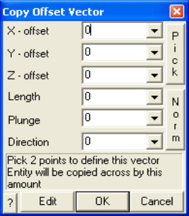

X, Y and Z – offset especifican las componentes del vector de desplazamiento. Todas las entidades seleccionadas se copiarán a la ubicación especificada por este desplazamiento.

Pick - activa la cruz del cursor para seleccionar de forma interactiva el vector de desplazamiento desde el modelo. Esto requiere seleccionar dos puntos para definir este vector.

Length, Plunge and Direction - especifican las componentes del vector de desplazamiento. Todas las entidades seleccionadas se copiarán a la ubicación especificada por este desplazamiento.

Norm - activa el cursor para seleccionar de forma interactiva una superficie a la cual hacer normal el vector de desplazamiento.

Para ayudar a seleccionar visualmente puntos del modelo, están disponibles todas las funciones de snap.

#### CAD > Snap

Una vez seleccionado, las componentes del vector de desplazamiento se muestran en el cuadro de diálogo.

Edit - completa la edición e invoca la edición de las propiedades de entidad de los bloques seleccionados.

OK - completa la edición del vector de desplazamiento y mueve los bloques seleccionados.

Cancel - aborta el movimiento de entidades.

Una vez completada cualquier operación de edición, tiene una oportunidad de deshacer las modificaciones seleccionando

#### Undo

También puede restaurar el mismo conjunto de selección y modificar nuevamente el mismo conjunto de entidades seleccionando

#### Redo

Puede ajustar el tiempo de doble clic con

Tools > Double Click Time

## 5.5.4.5 Escalar entidades

Escala las entidades seleccionadas.

Esta rutina se puede iniciar seleccionando el botón o simplemente haciendo clic derecho sobre cualquier entidad. Al iniciar esta rutina, primero se le pedirá que arme una lista de las entidades que desea editar

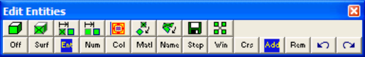

- Si Tools > Shift-key Selection está marcada, debe mantener presionada la tecla Shift para hacer selecciones múltiples.

- Por defecto, las entidades seleccionadas se agregan a la lista; sin embargo, si mantiene presionada la tecla Ctrl, las entidades seleccionadas se quitarán de la lista.

- Mientras mantiene presionada la tecla Shift o Ctrl, puede arrastrar para abrir una ventana de cruce.

- El uso de esta barra de herramientas se detalla en Build A List of Entities for Editing

- Al presionar la barra espaciadora se activa automáticamente la última función de edición que se usó.

- Al mantener presionada la tecla Alt mientras hace clic derecho, se repite automáticamente la última función de edición que se usó.

Una vez seleccionadas las entidades deseadas, puede elegir cualquiera de los botones de edición:

CAD > Edit > Entity Properties Edit block type, colour, mining sequence, CAD > Edit > Erase Entities Erase selected entities, CAD > Edit > Move Entities Move selected entities, CAD > Edit > Copy Entities Copy selected entities, CAD > Edit > Scale Entities Scale selected entities,

CAD > Edit > Rotate Azimuth Rotate the azimuth of selected entities, CAD > Edit > Rotate Dip Rotate the dip of selected entities, CAD > Edit > Dump to File Dump selected entities to a file, CAD > Edit > Group Group selected entities into a single block,

- hacer doble clic sobre cualquier vértice para ejecutar la función resaltada,

- hacer clic derecho para ver una lista de opciones.

X, Y and Z – coordinates especifican las coordenadas del centro de escalado. Durante el escalado, este punto permanece fijo. Todos los demás puntos se mueven para lograr el escalado deseado.

Pick - activa la cruz del cursor para seleccionar de forma interactiva el centro de rotación desde el modelo.

Para ayudar a seleccionar visualmente puntos del modelo, están disponibles todas las funciones de snap.

CAD > Snap

Una vez seleccionado, las componentes del centro de escalado se muestran en el cuadro de diálogo.

Centroid - calcula el centro de todas las entidades seleccionadas.

OK - completa la edición de las coordenadas y le pide los factores de escala.

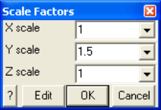

X, Y and Z - scale especifica la cantidad por la cual se escalarán las entidades. A continuación, el bloque se escala 1.5 veces en la dirección y.

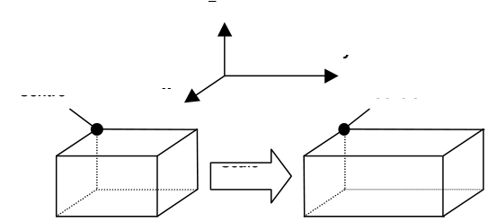

Edit - completa la edición e invoca la edición de las propiedades de entidad de los bloques seleccionados.

OK - completa la edición de los factores de escala y escala las entidades seleccionadas.

Cancel - aborta el escalado de entidades.

Una vez completada cualquier operación de edición, tiene una oportunidad de deshacer las modificaciones seleccionando

#### Undo

También puede restaurar el mismo conjunto de selección y modificar nuevamente el mismo conjunto de entidades seleccionando

Redo

Puede ajustar el tiempo de doble clic con

Tools > Double Click Time

## 5.5.4.6 Rotar azimut

Rota el azimut de las entidades seleccionadas.

Esta rutina se puede iniciar seleccionando el botón o simplemente haciendo clic derecho sobre cualquier entidad. Al iniciar esta rutina, primero se le pedirá que arme una lista de las entidades que desea editar

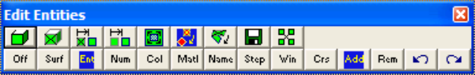

- Si Tools > Shift-key Selection está marcada, debe mantener presionada la tecla Shift para hacer selecciones múltiples.

- Por defecto, las entidades seleccionadas se agregan a la lista; sin embargo, si mantiene presionada la tecla Ctrl, las entidades seleccionadas se quitarán de la lista.

- Mientras mantiene presionada la tecla Shift o Ctrl, puede arrastrar para abrir una ventana de cruce.

- El uso de esta barra de herramientas se detalla en Build A List of Entities for Editing

- Al presionar la barra espaciadora se activa automáticamente la última función de edición que se usó.

- Al mantener presionada la tecla Alt mientras hace clic derecho, se repite automáticamente la última función de edición que se usó.

Una vez seleccionadas las entidades deseadas, puede elegir cualquiera de los botones de edición:

CAD > Edit > Entity Properties Edit block type, colour, mining sequence, CAD > Edit > Erase Entities Erase selected entities, CAD > Edit > Move Entities Move selected entities, CAD > Edit > Copy Entities Copy selected entities, CAD > Edit > Scale Entities Scale selected entities, CAD > Edit > Rotate Azimuth Rotate the azimuth of selected entities, CAD > Edit > Rotate Dip Rotate the dip of selected entities, CAD > Edit > Dump to File Dump selected entities to a file, CAD > Edit > Group Group selected entities into a single block,

- hacer doble clic sobre cualquier vértice para ejecutar la función resaltada,

- hacer clic derecho para ver una lista de opciones.

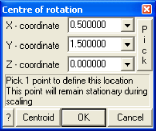

X, Y and Z – coordinates especifican las coordenadas del centro de rotación.

Pick - activa la cruz del cursor para seleccionar de forma interactiva el centro de rotación desde el modelo.

Para ayudar a seleccionar visualmente puntos del modelo, están disponibles todas las funciones de snap.

#### CAD > Snap

Una vez seleccionado, las componentes del centro de escalado se muestran en el cuadro de diálogo.

Centroid - calcula el centro de todas las entidades seleccionadas.

OK - completa la edición de las coordenadas y le pide los factores de escala.

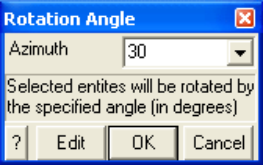

- Azimuth - especifica el ángulo (en grados) en el que desea rotar las entidades seleccionadas. · La rotación se realiza en el plano X-Y, por lo que todas las líneas verticales permanecen verticales.

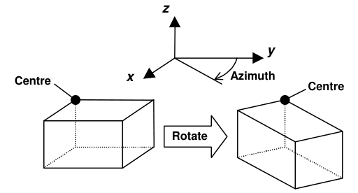

Edit - completa la edición e invoca la edición de las propiedades de entidad de los bloques seleccionados.

OK - completa la edición del azimut y rota las entidades seleccionadas.

Cancel - aborta la rotación de entidades.

Una vez completada cualquier operación de edición, tiene una oportunidad de deshacer las modificaciones seleccionando

Undo

También puede restaurar el mismo conjunto de selección y modificar nuevamente el mismo conjunto de entidades seleccionando

Redo

Puede ajustar el tiempo de doble clic con

Tools > Double Click Time

## 5.5.4.7 Rotar manteo

Rota el manteo de las entidades seleccionadas.

Esta rutina se puede iniciar seleccionando el botón o simplemente haciendo clic derecho sobre cualquier entidad. Al iniciar esta rutina, primero se le pedirá que arme una lista de las entidades que desea editar

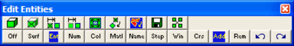

- Si Tools > Shift-key Selection está marcada, debe mantener presionada la tecla Shift para hacer selecciones múltiples.

- Por defecto, las entidades seleccionadas se agregan a la lista; sin embargo, si mantiene presionada la tecla Ctrl, las entidades seleccionadas se quitarán de la lista.

- Mientras mantiene presionada la tecla Shift o Ctrl, puede arrastrar para abrir una ventana de cruce.

- El uso de esta barra de herramientas se detalla en Build A List of Entities for Editing

- Al presionar la barra espaciadora se activa automáticamente la última función de edición que se usó.

- Al mantener presionada la tecla Alt mientras hace clic derecho, se repite automáticamente la última función de edición que se usó.

Una vez seleccionadas las entidades deseadas, puede elegir cualquiera de los botones de edición:

CAD > Edit > Entity Properties Edit block type, colour, mining sequence, CAD > Edit > Erase Entities Erase selected entities, CAD > Edit > Move Entities Move selected entities, CAD > Edit > Copy Entities Copy selected entities, CAD > Edit > Scale Entities Scale selected entities, CAD > Edit > Rotate Azimuth Rotate the azimuth of selected entities, CAD > Edit > Rotate Dip Rotate the dip of selected entities,

CAD > Edit > Slice Entities Slice selected entities,

CAD > Edit > Dump to File Dump selected entities to a file, CAD > Edit > Group Group selected entities into a single block,

- hacer doble clic sobre cualquier vértice para ejecutar la función resaltada,

- hacer clic derecho para ver una lista de opciones.

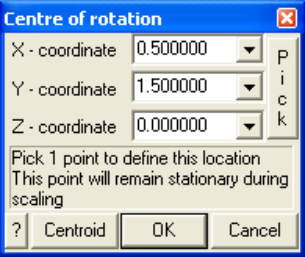

X, Y and Z – coordinates especifican las coordenadas del centro de rotación.

Pick - activa la cruz del cursor para seleccionar de forma interactiva el centro de rotación desde el modelo.

Para ayudar a seleccionar visualmente puntos del modelo, están disponibles todas las funciones de snap.

#### CAD > Snap

Una vez seleccionado, las componentes del centro de escalado se muestran en el cuadro de diálogo.

Centroid - calcula el centro de todas las entidades seleccionadas.

OK - completa la edición de las coordenadas y le pide los factores de escala.

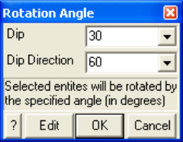

Dip - especifica el ángulo (en grados) en el que desea rotar las entidades seleccionadas.

Dip Direction - especifica el azimut (en grados) en el que debe ocurrir el manteo. La dirección de manteo está a 90° del rumbo del plano de manteo.

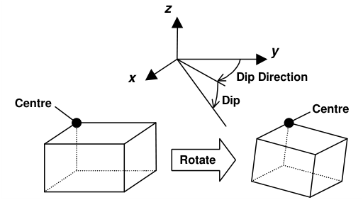

Edit - completa la edición e invoca la edición de las propiedades de entidad de los bloques seleccionados.

OK - completa la edición del manteo y de la dirección de manteo y rota las entidades seleccionadas.

Cancel - aborta la rotación de entidades.

Una vez completada cualquier operación de edición, tiene una oportunidad de deshacer las modificaciones seleccionando

#### Undo

También puede restaurar el mismo conjunto de selección y modificar nuevamente el mismo conjunto de entidades seleccionando

#### Redo

Puede ajustar el tiempo de doble clic con

#### Tools > Double Click Time

## 5.5.4.8 Cortar entidades

Corta entidades.

Se pueden cortar todas las entidades, incluidos bloques FF, planos DD, planos de grilla, líneas de grilla y líneas de construcción.

Video Demo of Model_Simplification_Using_Slicing

Esta rutina se puede iniciar seleccionando el botón o simplemente haciendo clic derecho sobre cualquier entidad. Al iniciar esta rutina, primero se le pedirá que arme una lista de las entidades que desea editar

- Si Tools > Shift-key Selection está marcada, debe mantener presionada la tecla Shift para hacer selecciones múltiples.

- Por defecto, las entidades seleccionadas se agregan a la lista; sin embargo, si mantiene presionada la tecla Ctrl, las entidades seleccionadas se quitarán de la lista.

- Mientras mantiene presionada la tecla Shift o Ctrl, puede arrastrar para abrir una ventana de cruce.

- El uso de esta barra de herramientas se detalla en Build A List of Entities for Editing

- Al presionar la barra espaciadora se activa automáticamente la última función de edición que se usó.

- Al mantener presionada la tecla Alt mientras hace clic derecho, se repite automáticamente la última función de edición que se usó.

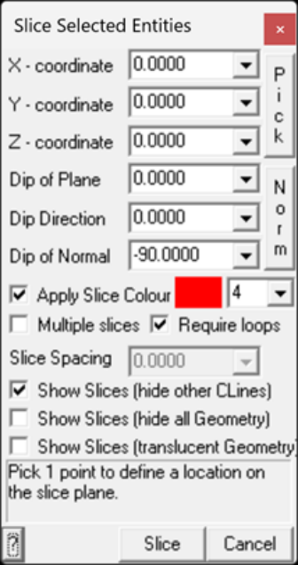

X, Y and Z – coordinate especifican un punto del plano de corte.

Pick - activa la cruz del cursor para seleccionar el punto de forma interactiva.

Dip of Plane, Dip Direction and Normal - especifican la orientación del plano de corte.

Norm - activa el cursor para seleccionar de forma interactiva una superficie a la cual hacer paralelo el plano de corte. El manteo y la dirección de manteo del plano se fijarán normales a la superficie seleccionada.

Apply Slice Colour - cuando está marcada, especifica el número de color que se asignará a las CLines creadas durante el corte; de lo contrario, se usará el color del objeto que se corta.

Multiple Slices - especifica que se crearán varios cortes con el espaciamiento de corte indicado.

Require Loops - los cortes pueden ser líneas simples o, opcionalmente, formar lazos cerrados.

Slice Spacing - especifica el espaciamiento opcional para varios cortes.

Show Slices (hide other CLines) - ocultará automáticamente todas las CLines preexistentes y mostrará los cortes de CLine recién creados.

Slice Spacing (hide all Geometry) - ocultará automáticamente toda la geometría preexistente y mostrará los cortes de CLine recién creados.

Slice Spacing (translucent Geometry) - pondrá automáticamente toda la geometría preexistente en modo translúcido y mostrará los cortes de CLine recién creados.

- Hay varias opciones de "View > Hide" disponibles para controlar la visualización de las distintas entidades, entre ellas:

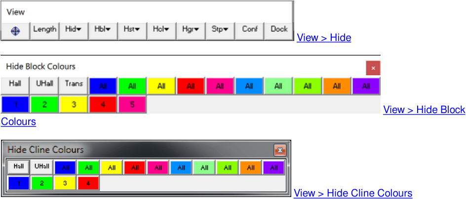

Para ayudar a seleccionar visualmente puntos del modelo, están disponibles todas las funciones de snap.

#### CAD > Snap

Una vez seleccionado, las componentes del vector de desplazamiento se muestran en el cuadro de diálogo.

Slice - ejecuta la operación de corte para los bloques seleccionados.

Cancel - aborta el corte de entidades.

Una vez completada cualquier operación de edición, tiene una oportunidad de deshacer las modificaciones seleccionando

Undo

También puede restaurar el mismo conjunto de selección y modificar nuevamente el mismo conjunto de entidades seleccionando

Redo

Puede ajustar el tiempo de doble clic con

Tools > Double Click Time

## 5.5.4.9 Volcar a archivo

Vuelca las entidades seleccionadas a un archivo.

Esta rutina se puede iniciar seleccionando el botón o simplemente haciendo clic derecho sobre cualquier entidad. Al iniciar esta rutina, primero se le pedirá que arme una lista de las entidades que desea volcar

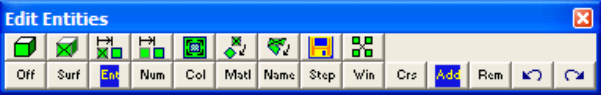

- Si Tools > Shift-key Selection está marcada, debe mantener presionada la tecla Shift para hacer selecciones múltiples.

- Por defecto, las entidades seleccionadas se agregan a la lista; sin embargo, si mantiene presionada la tecla Ctrl, las entidades seleccionadas se quitarán de la lista.

- Mientras mantiene presionada la tecla Shift o Ctrl, puede arrastrar para abrir una ventana de cruce.

- El uso de esta barra de herramientas se detalla en Build A List of Entities for Editing

- Al presionar la barra espaciadora se activa automáticamente la última función de edición que se usó.

- Al mantener presionada la tecla Alt mientras hace clic derecho, se repite automáticamente la última función de edición que se usó.

Una vez seleccionadas las entidades deseadas, puede elegir cualquiera de los botones de edición:

CAD > Edit > Entity Properties Edit block type, colour, mining sequence, CAD > Edit > Erase Entities Erase selected entities, CAD > Edit > Move Entities Move selected entities, CAD > Edit > Copy Entities Copy selected entities, CAD > Edit > Scale Entities Scale selected entities, CAD > Edit > Rotate Azimuth Rotate the azimuth of selected entities, CAD > Edit > Rotate Dip Rotate the dip of selected entities, CAD > Edit > Dump to File Dump selected entities to a file,

CAD > Edit > Group Group selected entities into a single block,

- hacer doble clic sobre cualquier vértice para ejecutar la función resaltada,

- hacer clic derecho para ver una lista de opciones.

Puede ajustar el tiempo de doble clic con

Tools > Double Click Time

## 5.5.4.10 Agrupar entidades

Agrupa las entidades seleccionadas en un solo bloque. Esta es una opción avanzada que solo deben usar usuarios con experiencia.

A veces puede ser necesario borrar o construir superficies individuales y luego agruparlas para formar un solo bloque. Esta función agrupa entidades para formar un bloque cerrado continuo a partir de superficies individuales. Tenga en cuenta que, al usar esta operación, el usuario debe asegurarse de que las superficies agrupadas formen una envolvente cerrada y continua, sin superficies internas. La presencia de superficies internas puede causar errores.

La función de agrupar se implementó para permitir a usuarios avanzados borrar algunos elementos de superficie y reconstruirlos. También es útil para unir superficies provenientes de paquetes CAD. Tenga en cuenta que el usuario debe asegurarse de que no haya superficies internas y de que las superficies que agrupa formen realmente una envolvente cerrada y continua.

Esta rutina se puede iniciar seleccionando el botón o simplemente haciendo clic derecho sobre cualquier entidad. Al iniciar esta rutina, primero se le pedirá que arme una lista de las entidades que desea agrupar

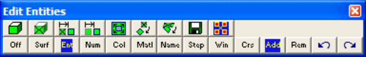

- Si Tools > Shift-key Selection está marcada, debe mantener presionada la tecla Shift para hacer selecciones múltiples.

- Por defecto, las entidades seleccionadas se agregan a la lista; sin embargo, si mantiene presionada la tecla Ctrl, las entidades seleccionadas se quitarán de la lista.

- Mientras mantiene presionada la tecla Shift o Ctrl, puede arrastrar para abrir una ventana de cruce.

- El uso de esta barra de herramientas se detalla en Build A List of Entities for Editing

- Al presionar la barra espaciadora se activa automáticamente la última función de edición que se usó.

- Al mantener presionada la tecla Alt mientras hace clic derecho, se repite automáticamente la última función de edición que se usó.

Una vez seleccionadas las entidades deseadas, puede elegir cualquiera de los botones de edición:

CAD > Edit > Entity Properties Edit block type, colour, mining sequence, CAD > Edit > Erase Entities Erase selected entities, CAD > Edit > Move Entities Move selected entities, CAD > Edit > Copy Entities Copy selected entities, CAD > Edit > Scale Entities Scale selected entities, CAD > Edit > Rotate Azimuth Rotate the azimuth of selected entities, CAD > Edit > Rotate Dip Rotate the dip of selected entities,

CAD > Edit > Dump to File Dump selected entities to a file,

CAD > Edit > Group Group selected entities into a single block,

- hacer doble clic sobre cualquier vértice para ejecutar la función resaltada,

- hacer clic derecho para ver una lista de opciones.

Si alguno de los campos del cuadro de diálogo dice "Variable", es porque algunas de las superficies seleccionadas tienen propiedades distintas en ese campo. Para agrupar las entidades seleccionadas en un solo bloque, todas las superficies deben tener la misma configuración en todos los campos. Use CAD > Edit > Entity Properties para lograrlo.

Una vez completada cualquier operación de edición, tiene una oportunidad de deshacer las modificaciones seleccionando

#### Undo

También puede restaurar el mismo conjunto de selección y modificar nuevamente el mismo conjunto de entidades seleccionando

#### Redo

Puede ajustar el tiempo de doble clic con

#### Tools > Double Click Time

## 5.5.4.11 Estirar vértices

Agrega un desplazamiento a los vértices seleccionados.

Esta rutina se puede iniciar seleccionando el botón o simplemente haciendo clic derecho sobre cualquier vértice. Al iniciar esta rutina, primero se le pedirá que arme una lista de los vértices que desea estirar

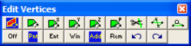

- Si Tools > Shift-key Selection está marcada, debe mantener presionada la tecla Shift para hacer selecciones múltiples.

- Por defecto, las entidades seleccionadas se agregan a la lista; sin embargo, si mantiene presionada la tecla Ctrl, las entidades seleccionadas se quitarán de la lista.

- Mientras mantiene presionada la tecla Shift o Ctrl, puede arrastrar para abrir una ventana de cruce.

- El uso de esta barra de herramientas se detalla en Build A List of Vertices for Editing

- Al presionar la barra espaciadora se activa automáticamente la última función de edición que se usó.

- Al mantener presionada la tecla Alt mientras hace clic derecho, se repite automáticamente la última función de edición que se usó.

Una vez seleccionadas las entidades deseadas, puede elegir cualquiera de los botones de edición:

CAD > Edit > Stretch Vertices CAD > Edit > Move Vertices to Point CAD > Edit > Move Vertices to X CAD > Edit > Move Vertices to Y CAD > Edit > Move Vertices to Z CAD > Edit > Move Vertices to Plane CAD > Edit > Subdivide Construction Lines CAD > Edit > Smooth Construction Lines CAD > Edit > Remove Construction Vertex

- hacer doble clic sobre cualquier vértice para ejecutar la función resaltada,

- hacer clic derecho para ver una lista de opciones.

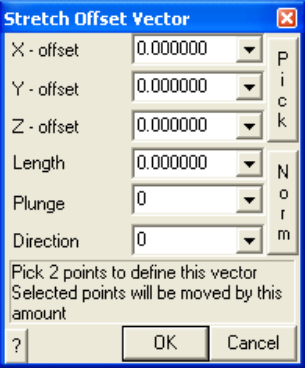

X, Y and Z – offset especifican las componentes del vector de estiramiento.

- Todos los vértices seleccionados se moverán a la ubicación especificada por este desplazamiento.

- Esto requiere seleccionar dos puntos para definir este vector.

- Una vez seleccionado, las componentes del vector de desplazamiento se muestran en el cuadro de diálogo.

Pick activa la cruz del cursor para seleccionar de forma interactiva el vector de desplazamiento desde el modelo. Esto requiere seleccionar dos puntos para definir este vector.

Length, Plunge and Direction - especifican las componentes del vector de desplazamiento. Todos los vértices seleccionados se moverán esta cantidad.

Norm - activa el cursor para seleccionar de forma interactiva una superficie a la cual hacer normal el vector de desplazamiento.

Para ayudar a seleccionar visualmente puntos del modelo, están disponibles todas las funciones de snap.

#### CAD > Snap

Una vez seleccionado, las componentes del vector de desplazamiento se muestran en el cuadro de diálogo.

OK - completa la edición del vector de desplazamiento y estira los vértices seleccionados.

Cancel - aborta el estiramiento de vértices.

Una vez completada cualquier operación de edición, tiene una oportunidad de deshacer las modificaciones seleccionando

#### Undo

También puede restaurar el mismo conjunto de selección y modificar nuevamente el mismo conjunto de entidades seleccionando

#### Redo

Puede ajustar el tiempo de doble clic con

#### Tools > Double Click Time

## 5.5.4.12 Mover vértices a un punto

Mueve los vértices seleccionados a un punto.

Esta rutina se puede iniciar seleccionando el botón o simplemente haciendo clic derecho sobre cualquier vértice. Al iniciar esta rutina, primero se le pedirá que arme una lista de los vértices que desea mover.

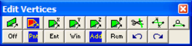

- Si Tools > Shift-key Selection está marcada, debe mantener presionada la tecla Shift para hacer selecciones múltiples.

- Por defecto, las entidades seleccionadas se agregan a la lista; sin embargo, si mantiene presionada la tecla Ctrl, las entidades seleccionadas se quitarán de la lista.

- Mientras mantiene presionada la tecla Shift o Ctrl, puede arrastrar para abrir una ventana de cruce.

- El uso de esta barra de herramientas se detalla en Build A List of Vertices for Editing

- Al presionar la barra espaciadora se activa automáticamente la última función de edición que se usó.

- Al mantener presionada la tecla Alt mientras hace clic derecho, se repite automáticamente la última función de edición que se usó.

Una vez seleccionadas las entidades deseadas, puede elegir cualquiera de los botones de edición:

CAD > Edit > Stretch Vertices CAD > Edit > Move Vertices to Point CAD > Edit > Move Vertices to X CAD > Edit > Move Vertices to Y CAD > Edit > Move Vertices to Z CAD > Edit > Move Vertices to Plane CAD > Edit > Subdivide Construction Lines CAD > Edit > Smooth Construction Lines CAD > Edit > Remove Construction Vertex

- hacer doble clic sobre cualquier vértice para ejecutar la función resaltada,

- hacer clic derecho para ver una lista de opciones.

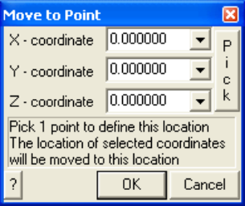

X, Y and Z – coordinate especifican las coordenadas del punto. Todos los vértices seleccionados se moverán a este punto.

Pick - activa la cruz del cursor para seleccionar de forma interactiva el punto desde el modelo.

Para ayudar a seleccionar visualmente puntos del modelo, están disponibles todas las funciones de snap.

#### CAD > Snap

Una vez seleccionado, las componentes del vector de desplazamiento se muestran en el cuadro de diálogo.

OK - completa la edición del vector de desplazamiento y estira los vértices seleccionados.

Cancel - aborta el estiramiento de vértices.

Una vez completada cualquier operación de edición, tiene una oportunidad de deshacer las modificaciones seleccionando

#### Undo

También puede restaurar el mismo conjunto de selección y modificar nuevamente el mismo conjunto de entidades seleccionando

Redo

Puede ajustar el tiempo de doble clic con

#### Tools > Double Click Time

## 5.5.4.13 Mover vértices a X

Mueve la coordenada X de los vértices seleccionados.

Esta rutina se puede iniciar seleccionando el botón o simplemente haciendo clic derecho sobre cualquier vértice. Al iniciar esta rutina, primero se le pedirá que arme una lista de los vértices que desea mover.

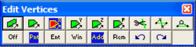

- Si Tools > Shift-key Selection está marcada, debe mantener presionada la tecla Shift para hacer selecciones múltiples.

- Por defecto, las entidades seleccionadas se agregan a la lista; sin embargo, si mantiene presionada la tecla Ctrl, las entidades seleccionadas se quitarán de la lista.

- Mientras mantiene presionada la tecla Shift o Ctrl, puede arrastrar para abrir una ventana de cruce.

- El uso de esta barra de herramientas se detalla en Build A List of Vertices for Editing

- Al presionar la barra espaciadora se activa automáticamente la última función de edición que se usó.

- Al mantener presionada la tecla Alt mientras hace clic derecho, se repite automáticamente la última función de edición que se usó.

Una vez seleccionadas las entidades deseadas, puede elegir cualquiera de los botones de edición:

CAD > Edit > Stretch Vertices CAD > Edit > Move Vertices to Point CAD > Edit > Move Vertices to X CAD > Edit > Move Vertices to Y CAD > Edit > Move Vertices to Z

CAD > Edit > Move Vertices to Plane

CAD > Edit > Subdivide Construction Lines CAD > Edit > Smooth Construction Lines

CAD > Edit > Remove Construction Vertex

- hacer doble clic sobre cualquier vértice para ejecutar la función resaltada,

- hacer clic derecho para ver una lista de opciones.

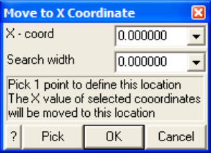

X – coordinate especifica la coordenada X del punto. La coordenada X de todos los vértices seleccionados (es decir, los vértices de la lista) se moverá a este valor.

Search width todas las coordenadas que estén a una distancia igual al ancho de búsqueda del valor de la coordenada x especificado se moverán, aunque no estén en la lista.

Pick activa la cruz del cursor para seleccionar de forma interactiva el punto desde el modelo. Para ayudar a seleccionar visualmente puntos del modelo, están disponibles todas las funciones de snap

Para ayudar a seleccionar visualmente puntos del modelo, están disponibles todas las funciones de snap.

#### CAD > Snap

Una vez seleccionado, las componentes del vector de desplazamiento se muestran en el cuadro de diálogo.

OK - completa la edición del vector de desplazamiento y estira los vértices seleccionados.

Cancel - aborta el estiramiento de vértices.

Una vez completada cualquier operación de edición, tiene una oportunidad de deshacer las modificaciones seleccionando

#### Undo

También puede restaurar el mismo conjunto de selección y modificar nuevamente el mismo conjunto de entidades seleccionando

#### Redo

Puede ajustar el tiempo de doble clic con

#### Tools > Double Click Time

## 5.5.4.14 Mover vértices a Y

Mueve la coordenada Y de los vértices seleccionados.

Esta rutina se puede iniciar seleccionando el botón o simplemente haciendo clic derecho sobre cualquier vértice. Al iniciar esta rutina, primero se le pedirá que arme una lista de los vértices que desea mover.

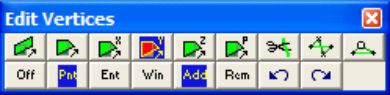

- Si Tools > Shift-key Selection está marcada, debe mantener presionada la tecla Shift para hacer selecciones múltiples.

- Por defecto, las entidades seleccionadas se agregan a la lista; sin embargo, si mantiene presionada la tecla Ctrl, las entidades seleccionadas se quitarán de la lista.

- Mientras mantiene presionada la tecla Shift o Ctrl, puede arrastrar para abrir una ventana de cruce.

- El uso de esta barra de herramientas se detalla en Build A List of Vertices for Editing

- Al presionar la barra espaciadora se activa automáticamente la última función de edición que se usó.

- Al mantener presionada la tecla Alt mientras hace clic derecho, se repite automáticamente la última función de edición que se usó.

Una vez seleccionadas las entidades deseadas, puede elegir cualquiera de los botones de edición:

CAD > Edit > Stretch Vertices CAD > Edit > Move Vertices to Point CAD > Edit > Move Vertices to X CAD > Edit > Move Vertices to Y CAD > Edit > Move Vertices to Z CAD > Edit > Move Vertices to Plane CAD > Edit > Subdivide Construction Lines CAD > Edit > Smooth Construction Lines CAD > Edit > Remove Construction Vertex

- hacer doble clic sobre cualquier vértice para ejecutar la función resaltada,

- hacer clic derecho para ver una lista de opciones.

Y – coordinate especifica la coordenada Y del punto. La coordenada Y de todos los vértices seleccionados (es decir, los vértices de la lista) se moverá a este valor.

Search width todas las coordenadas que estén a una distancia igual al ancho de búsqueda del valor de la coordenada y especificado se moverán, aunque no estén en la lista.

Pick activa la cruz del cursor para seleccionar de forma interactiva el punto desde el modelo. Para ayudar a seleccionar visualmente puntos del modelo, están disponibles todas las funciones de snap

Para ayudar a seleccionar visualmente puntos del modelo, están disponibles todas las funciones de snap.

#### CAD > Snap

Una vez seleccionado, las componentes del vector de desplazamiento se muestran en el cuadro de diálogo.

OK - completa la edición del vector de desplazamiento y estira los vértices seleccionados.

Cancel - aborta el estiramiento de vértices.

Una vez completada cualquier operación de edición, tiene una oportunidad de deshacer las modificaciones seleccionando

#### Undo

También puede restaurar el mismo conjunto de selección y modificar nuevamente el mismo conjunto de entidades seleccionando

Redo

Puede ajustar el tiempo de doble clic con

Tools > Double Click Time

## 5.5.4.15 Mover vértices a Z

Mueve la coordenada Z de los vértices seleccionados.

Esta rutina se puede iniciar seleccionando el botón o simplemente haciendo clic derecho sobre cualquier vértice. Al iniciar esta rutina, primero se le pedirá que arme una lista de los vértices que desea mover.

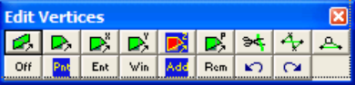

- Si Tools > Shift-key Selection está marcada, debe mantener presionada la tecla Shift para hacer selecciones múltiples.

- Por defecto, las entidades seleccionadas se agregan a la lista; sin embargo, si mantiene presionada la tecla Ctrl, las entidades seleccionadas se quitarán de la lista.

- Mientras mantiene presionada la tecla Shift o Ctrl, puede arrastrar para abrir una ventana de cruce.

- El uso de esta barra de herramientas se detalla en Build A List of Vertices for Editing

- Al presionar la barra espaciadora se activa automáticamente la última función de edición que se usó.

- Al mantener presionada la tecla Alt mientras hace clic derecho, se repite automáticamente la última función de edición que se usó.

Una vez seleccionadas las entidades deseadas, puede elegir cualquiera de los botones de edición:

CAD > Edit > Stretch Vertices CAD > Edit > Move Vertices to Point CAD > Edit > Move Vertices to X CAD > Edit > Move Vertices to Y

CAD > Edit > Move Vertices to Z

CAD > Edit > Move Vertices to Plane

CAD > Edit > Subdivide Construction Lines

CAD > Edit > Smooth Construction Lines

CAD > Edit > Remove Construction Vertex

- hacer doble clic sobre cualquier vértice para ejecutar la función resaltada,

- hacer clic derecho para ver una lista de opciones.

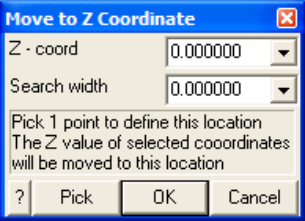

Z – coordinate especifica la coordenada Z del punto. La coordenada Z de todos los vértices seleccionados (es decir, los vértices de la lista) se moverá a este valor.

Search width todas las coordenadas que estén a una distancia igual al ancho de búsqueda del valor de la coordenada z especificado se moverán, aunque no estén en la lista.

Pick activa la cruz del cursor para seleccionar de forma interactiva el punto desde el modelo. Para ayudar a seleccionar visualmente puntos del modelo, están disponibles todas las funciones de snap

Para ayudar a seleccionar visualmente puntos del modelo, están disponibles todas las funciones de snap.

#### CAD > Snap

Una vez seleccionado, las componentes del vector de desplazamiento se muestran en el cuadro de diálogo.

OK - completa la edición del vector de desplazamiento y estira los vértices seleccionados.

Cancel - aborta el estiramiento de vértices.

Una vez completada cualquier operación de edición, tiene una oportunidad de deshacer las modificaciones seleccionando

#### Undo

También puede restaurar el mismo conjunto de selección y modificar nuevamente el mismo conjunto de entidades seleccionando

#### Redo

Puede ajustar el tiempo de doble clic con

#### Tools > Double Click Time

## 5.5.4.16 Mover vértices a un plano

Mueve los vértices seleccionados a un plano. Los vértices se mueven en la dirección normal al plano (o en una dirección especificada por el usuario).

Esta rutina se puede iniciar seleccionando el botón o simplemente haciendo clic derecho sobre cualquier vértice. Al iniciar esta rutina, primero se le pedirá que arme una lista de los vértices que desea mover.

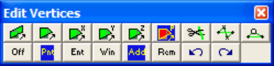

- Si Tools > Shift-key Selection está marcada, debe mantener presionada la tecla Shift para hacer selecciones múltiples.

- Por defecto, las entidades seleccionadas se agregan a la lista; sin embargo, si mantiene presionada la tecla Ctrl, las entidades seleccionadas se quitarán de la lista.

- Mientras mantiene presionada la tecla Shift o Ctrl, puede arrastrar para abrir una ventana de cruce.

- El uso de esta barra de herramientas se detalla en Build A List of Vertices for Editing

- Al presionar la barra espaciadora se activa automáticamente la última función de edición que se usó.

- Al mantener presionada la tecla Alt mientras hace clic derecho, se repite automáticamente la última función de edición que se usó.

Una vez seleccionadas las entidades deseadas, puede elegir cualquiera de los botones de edición:

CAD > Edit > Stretch Vertices CAD > Edit > Move Vertices to Point CAD > Edit > Move Vertices to X CAD > Edit > Move Vertices to Y CAD > Edit > Move Vertices to Z CAD > Edit > Move Vertices to Plane CAD > Edit > Subdivide Construction Lines CAD > Edit > Smooth Construction Lines CAD > Edit > Remove Construction Vertex

- hacer doble clic sobre cualquier vértice para ejecutar la función resaltada,

- hacer clic derecho para ver una lista de opciones.

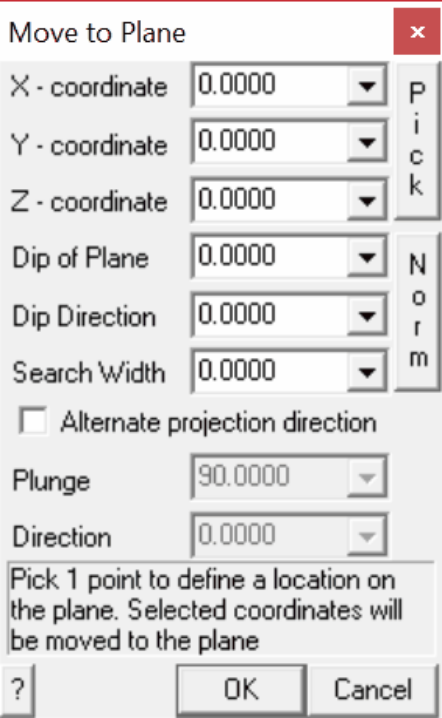

X Y Z – coordinate especifican las coordenadas de cualquier punto del plano.

Pick activa la cruz del cursor para seleccionar de forma interactiva, desde el modelo, las coordenadas x y z del punto del plano. Para ayudar a seleccionar visualmente puntos del modelo, están disponibles todas las funciones de snap

Dip of Plane especifica el manteo del plano (positivo hacia abajo, en grados).

Dip Direction especifica el azimut del vector de manteo (grados).

Norm - activa el cursor para seleccionar de forma interactiva una superficie a la cual hacer paralelo el plano. El manteo y la dirección de manteo del plano se fijarán normales a la superficie seleccionada.

Search width todas las coordenadas que estén a una distancia igual al ancho de búsqueda del plano especificado se moverán, aunque no estén en la lista.

Alternate projection direction - si no está marcada, todos los puntos se proyectarán sobre el plano seleccionado en la dirección normal al plano. Si está marcada, el usuario puede especificar la dirección de proyección que desee.

Plunge - dirección de proyección especificada por el usuario.

Direction - dirección de proyección especificada por el usuario.

Para ayudar a seleccionar visualmente puntos del modelo, están disponibles todas las funciones de snap.

#### CAD > Snap

Una vez seleccionado, las componentes del vector de desplazamiento se muestran en el cuadro de diálogo.

OK - completa la edición del vector de desplazamiento y estira los vértices seleccionados.

Cancel - aborta el estiramiento de vértices.

Una vez completada cualquier operación de edición, tiene una oportunidad de deshacer las modificaciones seleccionando

#### Undo

También puede restaurar el mismo conjunto de selección y modificar nuevamente el mismo conjunto de entidades seleccionando

Redo

Puede ajustar el tiempo de doble clic con

Tools > Double Click Time

## 5.5.4.17 Subdividir aristas

#### CAD > Edit > Remove

Inserta vértices en las aristas de bloques o de líneas de construcción (vea también Construction Vertex).

Esta rutina se puede iniciar seleccionando el botón o simplemente haciendo clic derecho sobre cualquier arista. Al iniciar esta rutina, primero se le pedirá que arme una lista de las ubicaciones donde desea insertar vértices.

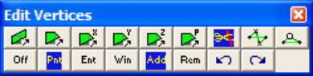

- Si Tools > Shift-key Selection está marcada, debe mantener presionada la tecla Shift para hacer selecciones múltiples.

- Por defecto, las entidades seleccionadas se agregan a la lista; sin embargo, si mantiene presionada la tecla Ctrl, las entidades seleccionadas se quitarán de la lista.

- Mientras mantiene presionada la tecla Shift o Ctrl, puede arrastrar para abrir una ventana de cruce.

- El uso de esta barra de herramientas se detalla en Build A List of Vertices for Editing

- Al presionar la barra espaciadora se activa automáticamente la última función de edición que se usó.

- Al mantener presionada la tecla Alt mientras hace clic derecho, se repite automáticamente la última función de edición que se usó.

Una vez seleccionadas las entidades deseadas, puede elegir cualquiera de los botones de edición:

CAD > Edit > Stretch Vertices CAD > Edit > Move Vertices to Point CAD > Edit > Move Vertices to X CAD > Edit > Move Vertices to Y

#### CAD > Edit > Move Vertices to Z

CAD > Edit > Move Vertices to Plane

CAD > Edit > Subdivide Construction Lines

CAD > Edit > Smooth Construction Lines

CAD > Edit > Remove Construction Vertex

- hacer doble clic sobre cualquier vértice para ejecutar la función resaltada,

- hacer clic derecho para ver una lista de opciones.

Una vez completada cualquier operación de edición, tiene una oportunidad de deshacer las modificaciones seleccionando

#### Undo

También puede restaurar el mismo conjunto de selección y modificar nuevamente el mismo conjunto de entidades seleccionando

#### Redo

Puede ajustar el tiempo de doble clic con

#### Tools > Double Click Time

Notas:

- La ubicación de todos los puntos a lo largo de las líneas de construcción se puede ver definiendo el parámetro View > Render > Cline dot radius.

- Antes de usar esta función de suavizado de trazado, las líneas de construcción deben depurarse con la función CAD > Pack and Renumber Clines.

- Puede ajustar el tiempo de doble clic con Tools > Double Click Time.

## 5.5.4.18 Suavizar líneas de construcción

Suaviza las líneas de construcción eliminando vértices de esquina (vea también Construction Vertex).

#### CAD > Edit > Remove

Esta rutina se puede iniciar seleccionando el botón o simplemente haciendo clic derecho sobre cualquier vértice. Al iniciar esta rutina, primero se le pedirá que arme una lista de los vértices que desea suavizar.

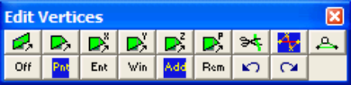

- Si Tools > Shift-key Selection está marcada, debe mantener presionada la tecla Shift para hacer selecciones múltiples.

- Por defecto, las entidades seleccionadas se agregan a la lista; sin embargo, si mantiene presionada la tecla Ctrl, las entidades seleccionadas se quitarán de la lista.

- Mientras mantiene presionada la tecla Shift o Ctrl, puede arrastrar para abrir una ventana de cruce.

- El uso de esta barra de herramientas se detalla en Build A List of Vertices for Editing

- Al presionar la barra espaciadora se activa automáticamente la última función de edición que se usó.

- Al mantener presionada la tecla Alt mientras hace clic derecho, se repite automáticamente la última función de edición que se usó.

Una vez seleccionadas las entidades deseadas, puede elegir cualquiera de los botones de edición:

CAD > Edit > Stretch Vertices

CAD > Edit > Move Vertices to Point CAD > Edit > Move Vertices to X CAD > Edit > Move Vertices to Y CAD > Edit > Move Vertices to Z CAD > Edit > Move Vertices to Plane CAD > Edit > Subdivide Construction Lines CAD > Edit > Smooth Construction Lines CAD > Edit > Remove Construction Vertex

- hacer doble clic sobre cualquier vértice para ejecutar la función resaltada,

- hacer clic derecho para ver una lista de opciones.

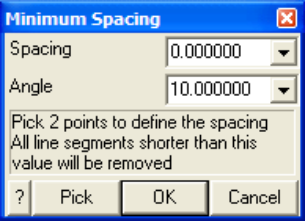

El valor de Spacing limita el espacio mínimo entre puntos. Por ejemplo, si Spacing se especificó como 2 m y el largo del trazado entre los puntos 4 y 5 de la figura siguiente era de 1.5 m, el punto 4 se eliminaría y se reemplazaría por una línea recta entre los puntos 3 y 5.

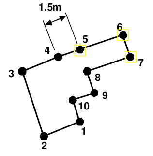

Un valor cero para este parámetro indica que no se usará.

El valor de Angle limita el ángulo mínimo entre segmentos de línea sucesivos. Por ejemplo, si Angle se especificó como 10° y la dirección del segmento de línea 3-4 difería en 7° de la dirección del

segmento de línea 4-5 de la figura siguiente, el punto 4 se eliminaría y se reemplazaría por una línea recta entre los puntos 3 y 5.

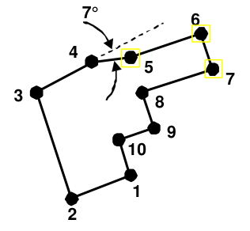

Un valor cero para este parámetro indica que no se usará.

OK - completa la edición del vector de desplazamiento y estira los vértices seleccionados.

Cancel - aborta el estiramiento de vértices.

Una vez completada cualquier operación de edición, tiene una oportunidad de deshacer las modificaciones seleccionando

#### Undo

También puede restaurar el mismo conjunto de selección y modificar nuevamente el mismo conjunto de entidades seleccionando

#### Redo

Puede ajustar el tiempo de doble clic con

#### Tools > Double Click Time

Notas:

- La ubicación de todos los puntos a lo largo de las líneas de construcción se puede ver definiendo el parámetro View > Render > Cline dot radius.

- Antes de usar esta función de suavizado de trazado, las líneas de construcción deben depurarse con la función CAD > Pack and Renumber Clines.

- Puede ajustar el tiempo de doble clic con Tools > Double Click Time.

## 5.5.4.19 Eliminar vértice de línea de construcción

Suaviza las líneas de construcción eliminando vértices de esquina individuales (vea también Construction Lines).

#### CAD > Edit > Smooth

Esta rutina se puede iniciar seleccionando el botón o simplemente haciendo clic derecho sobre cualquier vértice. Al iniciar esta rutina, primero se le pedirá que arme una lista de los vértices que desea eliminar.

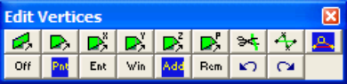

- Si Tools > Shift-key Selection está marcada, debe mantener presionada la tecla Shift para hacer selecciones múltiples.

- Por defecto, las entidades seleccionadas se agregan a la lista; sin embargo, si mantiene presionada la tecla Ctrl, las entidades seleccionadas se quitarán de la lista.

- Mientras mantiene presionada la tecla Shift o Ctrl, puede arrastrar para abrir una ventana de cruce.

- El uso de esta barra de herramientas se detalla en Build A List of Vertices for Editing

- Al presionar la barra espaciadora se activa automáticamente la última función de edición que se usó.

- Al mantener presionada la tecla Alt mientras hace clic derecho, se repite automáticamente la última función de edición que se usó.

Una vez seleccionadas las entidades deseadas, puede elegir cualquiera de los botones de edición:

CAD > Edit > Stretch Vertices CAD > Edit > Move Vertices to Point CAD > Edit > Move Vertices to X CAD > Edit > Move Vertices to Y CAD > Edit > Move Vertices to Z CAD > Edit > Move Vertices to Plane CAD > Edit > Subdivide Construction Lines CAD > Edit > Smooth Construction Lines CAD > Edit > Remove Construction Vertex

- hacer doble clic sobre cualquier vértice para ejecutar la función resaltada,

- hacer clic derecho para ver una lista de opciones.

Una vez completada cualquier operación de edición, tiene una oportunidad de deshacer las modificaciones seleccionando

#### Undo

También puede restaurar el mismo conjunto de selección y modificar nuevamente el mismo conjunto de entidades seleccionando

#### Redo

Puede ajustar el tiempo de doble clic con

#### Tools > Double Click Time

Notas:

- La ubicación de todos los puntos a lo largo de las líneas de construcción se puede ver definiendo el parámetro View > Render > Cline dot radius.

- Antes de usar esta función de suavizado de trazado, las líneas de construcción deben depurarse con la función CAD > Pack and Renumber Clines.

- Puede ajustar el tiempo de doble clic con Tools > Double Click Time.
