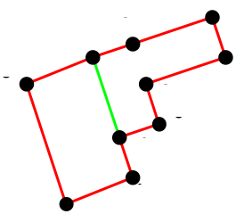

Compacta y renumera todas las líneas de construcción.

Los puntos de coordenadas muy cercanos entre sí se fusionan. Los vértices de líneas de construcción que comparten la misma ubicación usarán el mismo número de punto de coordenadas y, por lo tanto, se moverán juntos en cualquier operación de edición de coordenadas (Cad > Edit). Esta función es útil para eliminar pequeños espacios y traslapes entre líneas de construcción adyacentes.

Todos los segmentos de líneas de construcción del mismo color que sea posible enlazar se unirán para formar líneas continuas entre puntos de intersección.

**6**

En este ejemplo se formarán 3 segmentos de línea, compuestos por las siguientes agrupaciones de puntos

- Segmento de línea 1:  10, 1, 2, 3, 4.

- Segmento de línea 2:  4, 5, 6, 7, 8, 9, 10.

- Segmento de línea 3:  4, 10.

Al iniciar esta función se le pedirá que especifique un radio de búsqueda para la compactación

Radius: este valor se usa para fusionar puntos cercanos entre sí. Un valor cero para este parámetro indica que no se usará; en su lugar, Map3D fusionará los puntos que estén dentro de un radio de búsqueda de 1/1000 de la longitud de la arista respecto de la línea. Se debe tener extremo cuidado al especificar un valor distinto de cero para este parámetro, ya que los valores grandes pueden causar más problemas de los que resuelven al fusionar demasiados puntos.

Los números de coordenadas no usados se eliminan de la lista de coordenadas.

Esta función se debe usar antes de usar la función CAD > Edit > Smooth Construction lines.

Esta función se debe usar antes de usar la función CAD > Snap > Trace Cline Snap.

Las líneas de construcción se pueden descompactar con la función CAD > Unpack Clines.
