## 5.5.2.1 Ninguno

Desactiva el snap. No se muestra ninguna caja de selección en la intersección de la cruz del cursor.

Los puntos se seleccionarán en la ubicación indicada por la cruz del cursor. Este modo es útil para el dibujo a mano alzada o la digitalización. Al digitalizar, los tres valores de coordenadas se obtienen a escala del dibujo. Sin embargo, en el dibujo a mano alzada solo se pueden ubicar dos de las coordenadas y la tercera debe provenir de la base de snap

CAD > Snap > Cursor/Grid Base

Esta es la configuración recomendada durante la digitalización.

## 5.5.2.2 Arista más cercana

Se ajusta a la arista más cercana.

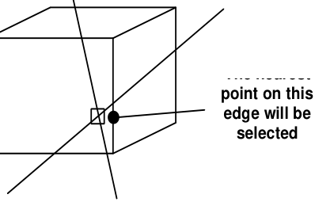

Si la caja de selección está sobre el vértice de una entidad, se seleccionará ese vértice.

En caso contrario, se seleccionará el punto más cercano de la arista más cercana.

La caja de selección debe estar sobre una entidad o una línea de construcción.

## 5.5.2.3 Vértice más cercano

Se ajusta al vértice más cercano.

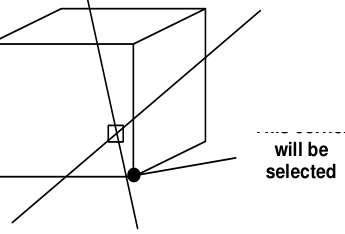

Se seleccionará el vértice más cercano a la caja de selección.

La caja de selección debe estar sobre una entidad o una línea de construcción.

## 5.5.2.4 Superficie más cercana

Se ajusta sobre la superficie.

Si la caja de selección está sobre el vértice de una entidad, se seleccionará ese vértice.

Si la caja de selección está sobre una arista, se seleccionará el punto más cercano de esa arista.

En caso contrario, se seleccionará el punto más cercano de la superficie.

La caja de selección debe estar sobre una entidad o una línea de construcción.

## 5.5.2.5 Punto medio de línea

Se ajusta al punto medio de la arista seleccionada.

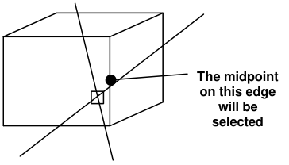

Si la caja de selección está sobre el vértice de una entidad, se seleccionará ese vértice.

En caso contrario, se seleccionará el punto medio de la arista más cercana.

La caja de selección debe estar sobre una entidad o una línea de construcción.

## 5.5.2.6 Snap tangente

Fuerza el cursor a ser tangente a la arista seleccionada.

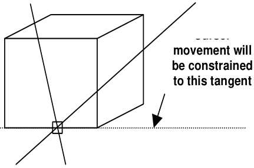

Se seleccionará la arista más cercana a la caja de selección. La caja de selección debe estar sobre una entidad o una línea de construcción.

Una vez seleccionada, todo movimiento del cursor quedará restringido a la tangente definida por la arista seleccionada. Ahora se pueden seleccionar puntos en cualquier lugar a lo largo de esta tangente.

Una vez seleccionado un punto, el snap tangente se cancela automáticamente. El snap tangente se puede cancelar en cualquier momento presionando la tecla Escape (Esc) o haciendo clic derecho con el mouse.

Para seleccionar puntos a intervalos regulares a lo largo de la línea tangente, el snap tangente se puede usar junto con cualquiera de:

CAD > Snap > Grid Snap Ajuste a una grilla rectangular.

CAD > Snap > X-Gird Snap Ajuste a la arista seleccionada con un espaciamiento regular de grilla en X.

CAD > Snap > Y-Grid Snap Ajuste a la arista seleccionada con un espaciamiento regular de grilla en Y.

CAD > Snap > Z-Grid Snap Ajuste a la arista seleccionada con un espaciamiento regular de grilla en Z.

## 5.5.2.7 Snap de intersección

Se ajusta a la intersección de la arista seleccionada y una tangente.

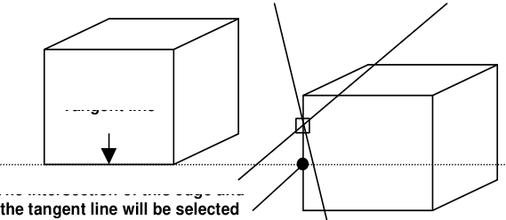

Como esta función opera en 3D completo, la tangente puede pasar por encima o por debajo de la arista seleccionada y no intersectarla realmente. En ese caso se elegirá el punto de la arista seleccionada más cercano a la línea tangente.

Esta convención debe destacarse. El punto de intersección no se seleccionará sobre la línea tangente: se seleccionará sobre la línea de intersección.

Usar esta función es un proceso de dos pasos. Al hacer clic en el botón Intersect Snap se le pedirá lo siguiente:

1. Primero seleccione una línea tangente.

2. Luego seleccione la arista con la que desea intersectar la tangente. El punto se seleccionará sobre esta línea.

Se seleccionará la arista más cercana a la caja de selección.

La caja de selección debe estar sobre una entidad o una línea de construcción.

Esta función se puede usar para ubicar puntos en la intersección de la tangente y la proyección de la arista seleccionada.

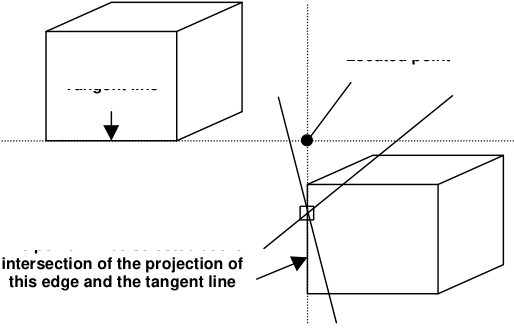

Una vez seleccionado un punto, el snap de intersección se cancela automáticamente. El snap de intersección se puede cancelar en cualquier momento presionando la tecla Escape (Esc) o haciendo clic derecho con el mouse.

Para un ejemplo del uso del snap de intersección en la construcción de modelos, vea

Tabular Mining

## 5.5.2.8 Snap de trazado de línea de construcción

Se ajusta a vértices seleccionados a lo largo de un segmento de línea de construcción. Este modo de snap se puede usar como método rápido para construir DDLoops ( CAD > Build > DDLoop), FFLoops ( CAD > Build >

FFLoop), túneles ( CAD > Build > Tunnel y CAD > Build > GPlanes).

Para usar este modo de snap, basta seleccionar los puntos inicial y final a lo largo del segmento de línea de construcción deseado y todos los puntos intermedios se seleccionarán automáticamente. Por ejemplo, si selecciona los puntos 4 y 9, los puntos 5, 6, 7 y 8 se seleccionarán automáticamente. Tenga en cuenta que si selecciona el mismo punto dos veces, se seleccionará el lazo completo.

**6**

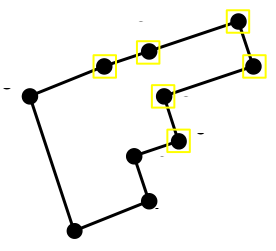

Notas:

La ubicación de todos los puntos a lo largo de las líneas de construcción se puede ver definiendo el parámetro View > Render > Cline dot radius.

Antes de usar este modo de snap de trazado, las líneas de construcción deben depurarse con la función CAD > Pack and Renumber Clines.

La función CAD > Edit > Smooth Construction Lines también se puede usar para ayudar a depurar las líneas de construcción.

## 5.5.2.9 Snap de trazado de lazo de construcción

Se ajusta a todos los vértices a lo largo de un segmento de línea de construcción. Este modo de snap se puede usar como método rápido para construir DDLoops ( CAD > Build > DDLoop), FFLoops ( CAD > Build > FFLoop), túneles ( CAD > Build > Tunnel y CAD > Build > GPlanes).

Para usar este modo de snap, basta seleccionar un solo punto del segmento de línea de construcción deseado y todos los puntos de esa línea se seleccionarán automáticamente. Por ejemplo, si selecciona el punto 4, los puntos 5, 6, 7, 8, 1, 2 y 3 se seleccionarán automáticamente.

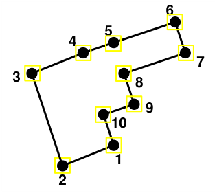

Notas:

La ubicación de todos los puntos a lo largo de las líneas de construcción se puede ver definiendo el parámetro View > Render > Cline dot radius.

Antes de usar este modo de snap de trazado, las líneas de construcción deben depurarse con la función CAD > Pack and Renumber Clines.

La función CAD > Edit > Smooth Construction Lines también se puede usar para ayudar a depurar las líneas de construcción.

## 5.5.2.10 Ventana de puntos

Selecciona vértices mediante una ventana.

Este modo de snap se puede usar como método rápido para construir DDLoops ( CAD > Build > DDLoop), FFLoops ( CAD > Build > FFLoop), túneles ( CAD > Build > Tunnel), CLines ( CAD >

Build > CLines) y GLines ( CAD > Build > GLines).

Aunque este modo de snap se usa con mayor frecuencia para seleccionar varios puntos a lo largo de CLines, los vértices pueden ubicarse en todos los tipos de elementos, incluidos: elementos FF, elementos DD, GPlanes, GLines y CLines.

- Video Demo of FFLoop Model Building

- Video Demo of DDLoop model buiding

- Video Demo of Model_Simplification_Using_Slicing

En la figura anterior, si selecciona uno o más puntos antes de seleccionar una ventana, los puntos de la ventana se agregarán a los puntos existentes, comenzando por el punto previamente seleccionado más cercano. Por ejemplo, si seleccionara el punto 3 antes de seleccionar una ventana y luego usara una ventana que incluya los puntos 4, 5 y 6, se agregarían esos puntos en ese orden.

Alternativamente, si seleccionara el punto 3 antes de seleccionar una ventana y luego usara una ventana que incluya los puntos 1, 2 y 10, se agregarían esos puntos en el orden 2, 1 y luego 10.

En la figura anterior, si no selecciona ningún punto antes de seleccionar una ventana, los puntos de la ventana se seleccionarán comenzando por ubicaciones lo más distantes posible entre sí.

Por ejemplo, si seleccionara una ventana sobre todos los puntos, como los puntos 2 y 6 son los más distantes entre sí, los puntos se seleccionarían como 2, 3, 4, 5, 6, 7, 8, 9, 10, 1, 2.

Como este ejemplo forma un lazo cerrado, los puntos se seleccionan como tal.

CAD > Build > DDLoop).

Esto forma un lazo adecuado para la construcción de un DDLoop (

En la figura anterior, si selecciona el punto 1 antes de seleccionar una ventana y luego usa una ventana que incluya todos los puntos, todos los puntos se seleccionarán como se muestra: 1, 2, 3, 4, 5, 6, 7, 8, 9, 10, 11, 1, 12, 13, 14, 15, 16, 17, 18, 19, 20, 21, 22, 12.

Esto forma dos lazos adecuados para la construcción de un FFLoop ( CAD > Build > FFLoop). Alternativamente, si seleccionara el punto 3 antes de seleccionar una ventana y luego usara una ventana que incluya los puntos 1, 2 y 10, se agregarían esos puntos en el orden 2, 1 y luego 10.

Notas:

La ubicación de todos los puntos a lo largo de las líneas de construcción se puede ver definiendo el parámetro View > Render > Cline dot radius.

Antes de usar este modo de snap de trazado, las líneas de construcción deben depurarse con la función CAD > Pack and Renumber Clines.

La función CAD > Edit > Smooth Construction Lines también se puede usar para ayudar a depurar las líneas de construcción.

## 5.5.2.11 Snap a grilla rectangular

Se ajusta a una grilla rectangular. No se muestra ninguna caja de selección en la intersección de la cruz del cursor.

Todo movimiento del cursor quedará restringido a los puntos de la grilla.

La grilla se puede orientar en los planos X-Y, Y-Z o X-Z, con el espaciamiento y la ubicación que se desee. Para configurar estos parámetros, use

CAD > Snap > Cursor/Grid Setup configura el espaciamiento y la orientación del cursor/grilla.

Para un ejemplo del uso del modo de snap a grilla en la construcción de modelos, vea

Freehand Sketching - Room and Pillar.

## 5.5.2.12 Snap a grilla circular

Se ajusta a una grilla cilíndrica. No se muestra ninguna caja de selección en la intersección de la cruz del cursor.

Todo movimiento del cursor quedará restringido a los puntos de la grilla.

La grilla se puede orientar en los planos X-Y, Y-Z o X-Z, con el espaciamiento y la ubicación que se desee. Para configurar estos parámetros, use

CAD > Snap > Cursor/Grid Setup configura el espaciamiento y la orientación del cursor/grilla.

## 5.5.2.13 Snap a grilla X

Se ajusta a un espaciamiento de grilla en x.

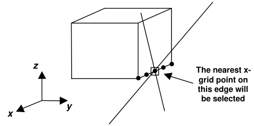

Si la caja de selección está sobre el vértice de una entidad, se seleccionará ese vértice.

En caso contrario, se seleccionará el punto más cercano, al espaciamiento de grilla en x, de la arista más cercana.

La caja de selección debe estar sobre una entidad o una línea de construcción.

Como los valores de la coordenada x quedan restringidos al espaciamiento de grilla X prescrito, los valores de las coordenadas y y z se calculan a partir de la ecuación de la línea seleccionada.

El espaciamiento y la ubicación de la grilla se definen haciendo clic por segunda vez en el botón X-Grid Snap o usando

CAD > Snap > Cursor/Grid Setup configura el espaciamiento y la orientación del cursor/grilla.

El snap a grilla X se puede usar junto con cualquiera de:

CAD > Snap > None Desactiva el snap.

CAD > Snap > Edge Ajuste a la arista más cercana.

CAD > Snap > Tangent Snap Fuerza el cursor a ser tangente a la arista seleccionada.

## 5.5.2.14 Snap a grilla Y

Se ajusta a un espaciamiento de grilla en y.

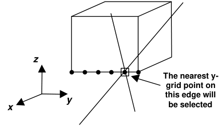

Si la caja de selección está sobre el vértice de una entidad, se seleccionará ese vértice.

En caso contrario, se seleccionará el punto más cercano, al espaciamiento de grilla en y, de la arista más cercana.

La caja de selección debe estar sobre una entidad o una línea de construcción.

Como los valores de la coordenada y quedan restringidos al espaciamiento de grilla en y prescrito, los valores de las coordenadas x y z se calculan a partir de la ecuación de la línea seleccionada.

El espaciamiento y la ubicación de la grilla se definen haciendo clic por segunda vez en el botón Y-Grid Snap o usando

CAD > Snap > Cursor/Grid Setup configura el espaciamiento y la orientación del cursor/grilla.

El snap a grilla Y se puede usar junto con cualquiera de:

CAD > Snap > None Desactiva el snap.

CAD > Snap > Edge Ajuste a la arista más cercana.

CAD > Snap > Tangent Snap Fuerza el cursor a ser tangente a la arista seleccionada.

## 5.5.2.15 Snap a grilla Z

Se ajusta a un espaciamiento de grilla en z.

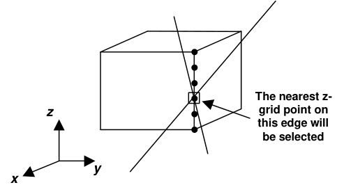

Si la caja de selección está sobre el vértice de una entidad, se seleccionará ese vértice.

En caso contrario, se seleccionará el punto más cercano, al espaciamiento de grilla en y, de la arista más cercana.

La caja de selección debe estar sobre una entidad o una línea de construcción.

Como los valores de la coordenada z quedan restringidos al espaciamiento de grilla Z prescrito, los valores de las coordenadas x e y se calculan a partir de la ecuación de la línea seleccionada.

El espaciamiento y la ubicación de la grilla se definen haciendo clic por segunda vez en el botón Z-Grid Snap o usando

CAD > Snap > Cursor/Grid Setup configura el espaciamiento y la orientación del cursor/grilla.

El snap a grilla Z se puede usar junto con cualquiera de:

CAD > Snap > None Desactiva el snap.

CAD > Snap > Edge Ajuste a la arista más cercana.

CAD > Snap > Tangent Snap Fuerza el cursor a ser tangente a la arista seleccionada.

## 5.5.2.16 Configuración del cursor/grilla

Configura la ubicación, el espaciamiento y la orientación del cursor/grilla.

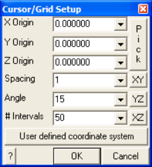

X, Y and Z Origin - especifica las coordenadas del centro de la grilla.

Pick - activa la cruz del cursor para seleccionar de forma interactiva la base del cursor/grilla desde el

modelo.

Spacing - especifica la distancia entre los puntos de la grilla.

Angle - especifica el ángulo (en grados) entre los radios de la grilla cilíndrica.

#### Intervals - especifica el número de puntos de la grilla que se mostrarán.

CAD > Snap > XY Cursor - restringe la cruz del cursor y la grilla de snap al plano X-Y.

CAD > Snap > YZ Cursor - restringe la cruz del cursor y la grilla de snap al plano Y-Z.

CAD > Snap > XZ Cursor - restringe la cruz del cursor y la grilla de snap al plano X-Z.

CAD > Snap > User defined Cursor - restringe la cruz del cursor y la grilla de snap al plano definido por el usuario.

El sistema de coordenadas definido por el usuario solo está activo con el snap a grilla rectangular y circular ( CAD > Snap > Grid Snap y CAD > Snap > Cylinder Snap).

El plano definido por el usuario se especifica mediante su manteo (j), su dirección de manteo (J) y su ángulo de cabeceo (a), de modo que:

- Pnt on X - El eje x local ( _x'_ ) se define a lo largo del rumbo del plano. Con esta función se puede seleccionar un punto sobre este eje.

- Pnt on Y - El eje y local ( _y'_ ) se define según el manteo. Con esta función se puede seleccionar un punto sobre este eje.

- El eje z local es perpendicular al plano.

- Norm - activa el cursor para seleccionar de forma interactiva una superficie a la cual hacer paralelo el plano UCS local. El manteo y la dirección de manteo del plano se fijarán normales a la superficie seleccionada.

- Rake - permite rotar X' en torno al eje z local.

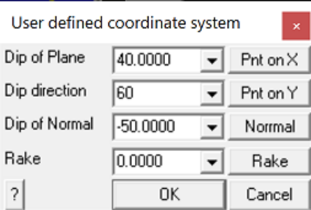

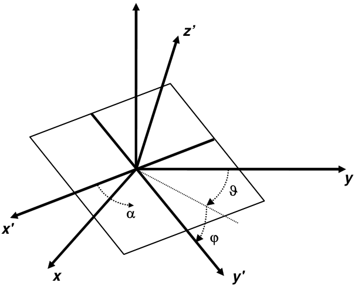

Para un ejemplo del uso del modo de snap a grilla en la construcción de modelos, vea Freehand Sketching - Room and Pillar.
