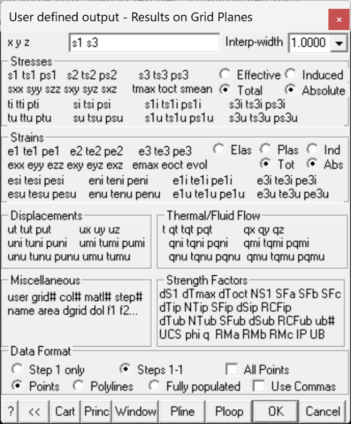
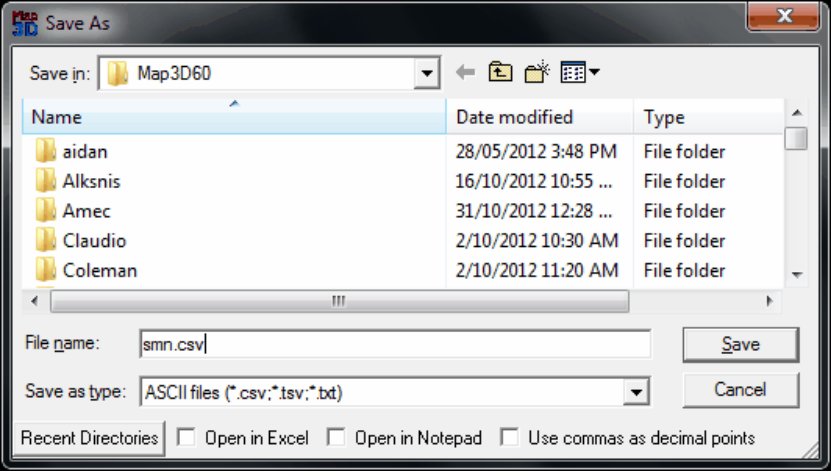
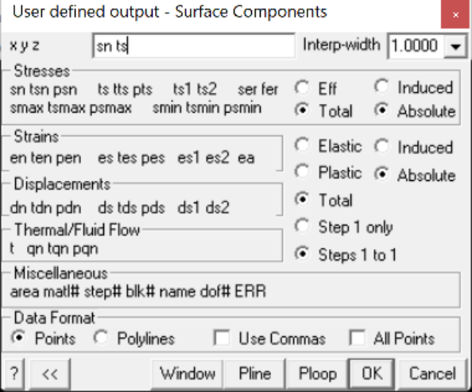
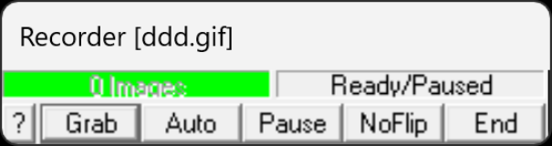

## 5.1.23.1 Copiar pantalla al portapapeles

Vuelca un mapa de bits de la pantalla al portapapeles de Windows. Esta imagen se puede pegar en otras aplicaciones.

Como normalmente el fondo de la pantalla es negro y los contornos de los elementos son blancos, es posible que desee seleccionar

File > Output > Copy Screen (B&W flipped)

para intercambiar estos dos colores.

## 5.1.23.2 Copiar pantalla (B&N invertido)

Vuelca un mapa de bits de la pantalla a un archivo PNG (Portable Network Graphics - *.PNG), GIF (Compuserve Graphics Interchange Format) o BMP (mapa de bits independiente del dispositivo de Windows *.BMP), con los colores del fondo de la pantalla y de los contornos de los elementos intercambiados. Este archivo se puede cargar en otro software para presentar e imprimir informes.

Para más detalles, vea

File > Output > PNG, GIF or BMP image

## 5.1.23.3 Imagen de pantalla PNG, GIF, JPEG, BMP o TIFF

Vuelca un mapa de bits de la pantalla a un archivo PNG (Portable Network Graphics - *.PNG), GIF (CompuServe Graphics Interchange Format), BMP (mapa de bits independiente del dispositivo de Windows *.BMP) o TIFF (tagged image file format). Este archivo se puede cargar en otro software para presentar e imprimir informes.

Como normalmente el fondo de la pantalla es negro y los contornos de los elementos son blancos, es posible que desee seleccionar

File > Output > PNG, GIF, JPEG, BMP or TIFF (B&W flipped)

para intercambiar estos dos colores.

Estos archivos se pueden mostrar con File > Image Viewer

El formato BMP es un formato de archivo gráfico con amplia compatibilidad (la mayoría de los navegadores web, procesadores de texto y programas de dibujo). La principal ventaja del formato BMP es que admite todos los colores mostrados. Lamentablemente, como no hay compresión, estos archivos pueden ser muy grandes (1 MB o más cada uno).

El formato PNG es un formato de archivo gráfico con amplia compatibilidad (la mayoría de los navegadores web, procesadores de texto y programas de dibujo). Las principales ventajas del formato PNG son su excelente compresión sin pérdidas (normalmente 1% del tamaño de un archivo BMP) y que admite todos los colores mostrados. Para detalles sobre animación, vea File > Output > Image Recorder.

El formato GIF es el formato de archivo gráfico de mayor compatibilidad. Las principales ventajas del formato GIF son su excelente compresión sin pérdidas (normalmente 1% del tamaño de un archivo BMP) y su capacidad de animación. Lamentablemente, GIF solo admite 256 colores de visualización. Dependiendo de lo que se muestre, Map3D puede usar hasta 512 colores, por lo que GIF puede no reproducir las imágenes de pantalla en todos sus colores

El formato GIF se ha implementado usando la especificación Versión 89a ©1987,1988,1989,1990 Copyright CompuServe Incorporated, Columbus, Ohio.

Este software usa la biblioteca de imágenes de código abierto FreeImage. Vea [http://freeimage.sourceforge.net](http://freeimage.sourceforge.net) para más detalles. FreeImage se usa bajo la (GNU GPL o FIPL), versión (versión de la licencia).

## 5.1.23.4 PNG, GIF, JPEG, BMP o TIFF (B&N invertido)

Vuelca un mapa de bits de la pantalla a un archivo PNG (Portable Network Graphics - *.PNG), GIF (Compuserve Graphics Interchange Format) o BMP (mapa de bits independiente del dispositivo de Windows *.BMP), con los colores del fondo de la pantalla y de los contornos de los elementos intercambiados. Este archivo se puede cargar en otro software para presentar e imprimir informes.

Para más detalles, vea

File > Output > PNG, JPEG, GIF, BMP or TIFF image

## 5.1.23.5 Imagen de pantalla DXF

Vuelca una imagen de la pantalla a un archivo (*.DXF) en formato de intercambio de dibujos de AutoCAD. Es un formato vectorial que se puede importar en muchos paquetes de software para renderizado posterior.

## 5.1.23.6 Imagen de pantalla PNT

Vuelca una imagen de la pantalla a un archivo (*.PNT), un archivo de datos ASCII universal con la extensión ".PNT". El formato PNT es útil para intercambiar datos brutos de modelos con otro software CAD. Es un formato vectorial que se puede importar en muchos paquetes de software para renderizado posterior.

## 5.1.23.7 Imagen de pantalla OBJ

Vuelca una imagen de la pantalla a un archivo (*.OBJ) en formato Wavefront. Es útil para intercambiar datos de modelos con otro software CAD y de modelamiento de realidad virtual. Es un formato vectorial que se puede importar en muchos paquetes de software para renderizado posterior.

## 5.1.23.8 Imagen de pantalla WRL

Vuelca una imagen de la pantalla a un archivo (*.WRL) en formato VRML. VRML es útil para intercambiar datos de modelos con otro software CAD y de modelamiento de realidad virtual. Es un formato vectorial que se puede importar en muchos paquetes de software para renderizado posterior.

## 5.1.23.9 Imagen de pantalla 3D-PDF

Vuelca una imagen de la pantalla a un archivo en formato PDF (3D). El PDF 3D se puede ver en 3D completo con Adobe Reader.

## 5.1.23.10 Componentes de grilla seleccionadas

Vuelca las componentes de grilla seleccionadas a un archivo de texto (*.txt) en un formato controlado por el usuario.

Por defecto se vuelcan todos los puntos de todas las grillas. Si desea volcar solo un conjunto seleccionado de puntos, use la función de ventana que se define más abajo.

Una vez seleccionados los datos deseados y presionado OK, se le pedirá un nombre de archivo para guardar los datos. Puede seleccionar CSV (datos separados/delimitados por comas), TSV (datos separados/delimitados por tabulaciones) o TXT (datos separados/delimitados por espacios). También puede especificar que el archivo se abra automáticamente en Excel o en el Bloc de notas (Notepad). Tenga en cuenta que no se deben usar archivos CSV con comas como separador decimal.

#### Stresses:

s1 ts1 ps1 esfuerzo principal mayor s1, su rumbo y su inclinación (plunge).

s2 ts2 ps2 esfuerzo principal intermedio s2, su rumbo y su inclinación.

s3 ts3 ps3 esfuerzo principal menor s3, su rumbo y su inclinación. sxx syy szz sxy syz sxz componentes cartesianas del esfuerzo. tmax esfuerzo de corte máximo tmax = ½ ( s1 - s3 ) toct esfuerzo de corte octaédrico toct = ¹/3 [( s1 - s2 )² + ( s2 - s3 )² +( s3 - s1 )²]½ smean esfuerzo medio smean = ¹/3 ( s1 + s2 + s3 )

ti tti pti esfuerzo de corte máximo en el plano de la grilla, su rumbo y su inclinación. si tsi psi esfuerzo normal en el plano de la grilla, su rumbo y su inclinación. s1i ts1i ps1i esfuerzo máximo tangencial al plano de la grilla, su rumbo y su inclinación. s3i ts3i ps3i esfuerzo mínimo tangencial al plano de la grilla, su rumbo y su inclinación. tu ttu ptu esfuerzo de corte máximo en el plano ubicuo, su rumbo y su inclinación. su tsu psu esfuerzo normal al plano ubicuo, su rumbo y su inclinación. s1u ts1u ps1u esfuerzo máximo tangencial al plano ubicuo, su rumbo y su inclinación. s3u ts3u ps3u esfuerzo mínimo tangencial al plano ubicuo, su rumbo y su inclinación. La orientación del plano ubicuo se especifica en

Plot > Strength Factors > Ubiquitous Parameters

Effective/Total componentes del esfuerzo efectivo o del esfuerzo total. Estas opciones solo se usan en Map3D Thermal-Fluid Flow, ya que este código permite calcular distribuciones de presión de poros en régimen permanente. Induced/Absolute El esfuerzo inducido es el esfuerzo sin la contribución del esfuerzo previo a la explotación. Representa el cambio de esfuerzo desde la condición previa a la explotación. El esfuerzo absoluto es el esfuerzo que incluye la contribución del esfuerzo previo a la explotación.

#### Strains:

e1 te1 pe1 deformación principal mayor e1, su rumbo y su inclinación. e2 te2 pe2 deformación principal intermedia e2, su rumbo y su inclinación.

e3 te3 pe3 deformación principal menor e3, su rumbo y su inclinación. exx eyy ezz exy eyz exz componentes cartesianas de la deformación. emax deformación de corte máxima emax = ½ ( e1 - e3 ) eoct deformación de corte octaédrica eoct = ¹/3 [( e1 - e2 )² + ( e2 - e3 )² +( e3 - e1 )²]½ evol deformación volumétrica evol = ( e1 + e2 + e3 ) esi tesi pesi deformación de corte máxima en el plano de la grilla, su rumbo y su inclinación. eni teni peni deformación normal en el plano de la grilla, su rumbo y su inclinación. e1i te1i pe1i deformación máxima tangencial al plano de la grilla, su rumbo y su inclinación. e3i te3i pe3i deformación mínima tangencial al plano de la grilla, su rumbo y su inclinación. esu tesu pesu deformación de corte máxima en el plano ubicuo, su rumbo y su inclinación. enu tenu penu deformación normal al plano ubicuo, su rumbo y su inclinación. e1u te1u pe1u deformación máxima tangencial al plano ubicuo, su rumbo y su inclinación. e3u te3u pe3u deformación mínima tangencial al plano ubicuo, su rumbo y su inclinación. Elastic/Plastic/Total componentes de la deformación elástica, plástica o total. Estas opciones solo se usan en Map3D Non-Linear, ya que este código permite calcular deformaciones no lineales. Induced/Absolute La deformación inducida es la deformación sin la contribución previa a la explotación. Representa el cambio de deformación desde la condición previa a la explotación. La deformación absoluta es la deformación que incluye la contribución de la deformación previa a la explotación.

#### Displacements:

ut tut put desplazamiento total, su rumbo y su inclinación. ux uy uz componentes cartesianas del desplazamiento. uni tuni puni desplazamiento normal al plano de la grilla, su rumbo y su inclinación. umi tumi pumi desplazamiento máximo tangencial al plano de la grilla, su rumbo y su inclinación. unu tunu punu desplazamiento normal al plano ubicuo, su rumbo y su inclinación. umu tumu pumu desplazamiento máximo tangencial al plano ubicuo, su rumbo y su inclinación.

#### Flow:

t temperatura/carga hidráulica.

qt tqt pqt flujo total, su rumbo y su inclinación. qx qy qz componentes cartesianas del flujo. qni tqni pqni desplazamiento normal al plano de la grilla, su rumbo y su inclinación. qmi tqmi pqmi desplazamiento máximo tangencial al plano de la grilla, su rumbo y su inclinación. qnu tqnu pqnu desplazamiento normal al plano ubicuo, su rumbo y su inclinación. qmu tqmu pqmu desplazamiento máximo tangencial al plano ubicuo, su rumbo y su inclinación.

#### Strength:

- ds1 esfuerzo principal mayor en exceso Ds1 = s1 - ( _UCS_ + _q_ s3 )

- dtmax esfuerzo de corte máximo en exceso Dtmax = ½(s1 - s3) - [ _UCS_ + ½(s1+s3) ( _q_ -1) ]/( _q_ +1) = [s1 - ( _UCS_ + _q_ s3) ]/( _q_ +1)

- dtoct esfuerzo de corte octaédrico en exceso Dtoct = toct - [ _UCS_ + ( _q_ –1) smean ] Ö(2) /( _q_ +2)

- NS1 probabilidad usando la distribución normal N(Ds1 /std)

- SFA Resistencia/Esfuerzo se puede determinar como ( _UCS_ + _q_ s3 )/ s1

- SFB Resistencia/Esfuerzo se puede determinar como ( _UCS_ + _q_ s3 - s3 )/(s1 - s3)

- SFC Resistencia/Esfuerzo se puede determinar como [ _UCS_ + ½(s1+s3) ( _q_ -1) ]/[ ½(s1 - s3)( _q_ +1) ]

- dTip esfuerzo de corte en el plano, en exceso Dtip = tip - [ Cohesion + sip tan(j) ]

- NTip probabilidad usando la distribución normal N(Dtip /std)

- SFip Resistencia/Esfuerzo se puede determinar como [ Cohesion + sip tan(j) ] / tip

- dSip esfuerzo en la pared en el plano, en exceso Dsip = [ 3 s1i - s3i ] - UCS

- RCFip factor de condición de la roca (Rock Condition Factor) para el esfuerzo en la pared en el plano RCFip = [ 3 s1i - s3i ]/UCS

- dTub esfuerzo de corte en el plano ubicuo, en exceso Dtub

- NTub probabilidad usando la distribución normal N(Dtub /std)

- SFub Resistencia/Esfuerzo se puede determinar como [ Cohesion + sub tan(j) ] / tub

- dSub esfuerzo en la pared en el plano ub, en exceso Dsub = [ 3 s1ub - s3ub ] - UCS

- RCFub factor de condición de la roca para el esfuerzo en la pared en el plano ub RCFip = [ 3 s1ub - s3ub ]/UCS

- UB# Grafica el número del sistema UB (1, 2 o 3) que tiene el mayor valor de Dtub

- _UCS phi q_ Parámetros de resistencia de Mohr-Coulomb definidos con Plot > Strength Factors > Rockmass Strength Parameters; tenga en cuenta que estos parámetros solo están definidos si se ha especificado el criterio de resistencia de Mohr-Coulomb o de Druker-Prager

- _sc_ Parámetro de resistencia de Hoek-Brown definido con Plot > Strength Factors > Rockmass Strength Parameters; tenga en cuenta que este parámetro solo está definido si se ha especificado el criterio de resistencia de Hoek-Brown

#### Miscellaneous:

user Valor definido por el usuario.

grid# el número de la grilla en la que se ubica el punto. matl# el número del material dentro del cual se ubica el punto. El material de la roca de caja (host) es el material número 1. En problemas donde se usan varios materiales, los resultados pueden calcularse en una zona de material alterno.

step# el número de la etapa de explotación. name el nombre de la grilla. area el área de la celda de grilla adyacente al punto seleccionado. dgrid distancia a la superficie más cercana desde cada punto de la grilla. dol distancia a la grilla más cercana _Dgrid_ dividida por el espaciamiento de la grilla _Lgrid_ . f1 f2... parámetros de material definidos por el usuario. Se pueden definir con Plot > Properties > Material Properties > User defined Parameters.

#### Data Format:

Los datos de puntos se escribirán como una serie de puntos, con un punto por línea:

- x1 y1 z1 values1 x2 y2 z2 values2 x3 y3 z3 values3 x4 y4 z4 values4

donde xi yi zi representan las coordenadas de cada punto,

valuesi representa los valores de la lista de componentes seleccionadas por el usuario en cada punto. Los valores definidos por el usuario se listarán como una línea de comentario (es decir, una línea que comienza con un asterisco "*") al inicio del archivo.

Los datos de polilíneas se escribirán como una serie de polilíneas en formato de archivo PNT

- x1 y1 z1 3 values1 x2 y2 z2 2 values2 x3 y3 z3 2 values3 x4 y4 z4 2 values4

donde xi yi zi representan las coordenadas de cada punto,

- 3 indica que este punto es el comienzo de una nueva línea,

- 2 indica que este punto es la continuación de la misma línea,

valuesi representa los valores de la lista de componentes seleccionadas por el usuario en cada vértice de la polilínea. Los valores definidos por el usuario se listarán como una línea de comentario (es decir, una línea que comienza con un asterisco "*") al inicio del archivo.

Fully Populated: los datos se escribirán de modo que todos queden sobre una grilla de tamaño regular.

Use Commas: los datos se escribirán con comas en lugar de puntos decimales.

#### Other:

&lt;&lt;    para reducir el cuadro de diálogo a tamaño pequeño

>>    para ampliar el cuadro de diálogo a tamaño grande Cartesian   configura la salida de las componentes cartesianas del esfuerzo. Principal   configura la salida de las componentes del esfuerzo principal. Window   activa una ventana de selección gráfica.

- Se le pedirá que seleccione las dos esquinas de la ventana haciendo un solo clic con el mouse en cada una.

- Solo se incluirán en el volcado los puntos de grilla contenidos dentro de la ventana.

- Si no usa esta función, se vuelcan todos los puntos de todas las grillas.

- Para ver la ubicación de los puntos de contorno reales, active la visualización de trayectorias (Plot > Options > Trajectories). Los puntos de contorno se ubican donde se dibujan las trayectorias.

Polyline   activa un polígono de selección gráfico. Se le pedirá que seleccione una serie de vértices para definir un polígono, haciendo un solo clic con el mouse en cada uno:

- Debe mantener presionada la tecla Shift mientras selecciona estos puntos.

- Si define una forma poligonal cerrada, se incluirán los puntos de contorno encerrados en el polígono.

- Si define una forma poligonal abierta, se incluirá una serie de puntos a lo largo de la polilínea.

- Para ver la ubicación de los puntos de contorno reales, active la visualización de trayectorias (Plot > Options > Trajectories). Los puntos de contorno se ubican donde se dibujan las trayectorias.

- Se pueden definir ventanas rectangulares simples manteniendo presionada la tecla Shift y arrastrando para abrir una ventana (igual que con el botón Window).

## 5.1.23.11 Componentes de superficie seleccionadas

Vuelca las componentes de superficie seleccionadas a un archivo de texto (*.txt) en un formato controlado por el usuario.

Por defecto se vuelcan todos los puntos de todas las superficies. Si desea volcar solo un conjunto seleccionado de puntos, use la función de ventana que se define más abajo.

Una vez seleccionados los datos deseados y presionado OK, se le pedirá un nombre de archivo para guardar los datos. Puede seleccionar CSV (datos separados/delimitados por comas), TSV (datos separados/delimitados por tabulaciones) o TXT (datos separados/delimitados por espacios).

También puede especificar que el archivo se abra automáticamente en Excel o en el Bloc de notas (Notepad). Tenga en cuenta que no se deben usar archivos CSV con comas como separador decimal.

#### Stresses:

sn tsn psn esfuerzo normal a la superficie, su rumbo y su inclinación.

ts tts pts esfuerzo de corte máximo en el plano de la superficie, su rumbo y su inclinación. ts1 ts2   componentes del esfuerzo de corte en el plano de la superficie. ts1 es paralela al primer lado (es decir, el lado definido por x1 y1 z1 – x2 y2 z2). ts2 es perpendicular a ts1 en la dirección del segundo lado (es decir, el lado definido por x2 y2 z2 – x3 y3 z3).

ser error de esfuerzo superficial. Los solucionadores iterativos funcionan determinando el error en la solución actual de cada ecuación simultánea y luego reduciendo estos errores mediante un proceso de aproximaciones sucesivas. Este parámetro indica el error de cada una de las ecuaciones.

fer error del criterio de falla. Este parámetro solo se usa en análisis de fluencia no lineal (incluidos el deslizamiento de fallas y la no linealidad de materiales 3D). Este parámetro siempre debe ser cercano a cero, a menos que se haya especificado alguna viscosidad y el problema se vuelva no lineal. En este último caso, la fluencia viscosa puede permitir estados de esfuerzo por encima del criterio de falla, lo que indica una falta de equilibrio estático. Este parámetro indica el esfuerzo viscoso de cada una de las ecuaciones.

smax tsmax psmax esfuerzo tangencial máximo, su rumbo y su inclinación. smin tsmin psmin esfuerzo tangencial mínimo, su rumbo y su inclinación. Effective/Total – componentes del esfuerzo efectivo o del esfuerzo total. Estas opciones solo se usan en Map3D Thermal-Fluid Flow, ya que este código permite calcular distribuciones de presión de poros en régimen permanente.

#### Strains:

en ten pen deformación en la dirección normal a la superficie, su rumbo y su inclinación. Este parámetro solo se usa en planos DD y se calcula como el desplazamiento normal (cierre) dividido por el espesor. es tes pes deformación de corte máxima en el plano de la superficie, su rumbo y su inclinación. Este parámetro solo se usa en planos DD y se calcula como el desplazamiento de corte (ride) dividido por el espesor. es1 es2   componentes de la deformación de corte en el plano de la superficie. es1 es paralela al primer lado (es decir, el lado definido por x1 y1 z1 – x2 y2 z2). es2 es perpendicular a es1 en la dirección del segundo lado (es decir, el lado definido por x2 y2 z2 – x3 y3 z3).

#### Displacements:

dn tdn pdn desplazamiento normal (cierre) en la dirección normal a la superficie, su rumbo y su inclinación. Este parámetro solo se usa en planos DD. Tenga en cuenta que se puede especificar el valor elástico, plástico o total.

ds tds pds desplazamiento de corte máximo (ride) en el plano de la superficie, su rumbo y su inclinación. Este parámetro solo se usa en planos DD. Tenga en cuenta que se puede especificar el valor elástico, plástico o total.

ds1 ds2   componentes del desplazamiento de corte (ride) en el plano de la superficie. ds1 es paralela al primer lado (es decir, el lado definido por x1 y1 z1 – x2 y2 z2). ds2 es perpendicular a ds1 en la dirección del segundo lado (es decir, el lado definido por x2 y2 z2 – x3 y3 z3). Elastic/Plastic/Total componentes de la deformación/desplazamiento elástico, plástico o total. Estas opciones solo se usan para planos DD.

#### Miscellaneous:

area   el área de la superficie. matl# el número del material asignado a la superficie. step# el número de la etapa de explotación. blk#   el número de bloque. name   el nombre de la superficie del bloque. dof#   el número del grado de libertad.

#### Data Format

Los datos de puntos se escribirán como una serie de puntos, con un punto por línea.

x1 y1 z1 values1 x2 y2 z2 values2 x3 y3 z3 values3 x4 y4 z4 values4

donde xi yi zi representan las coordenadas de cada punto,

valuesi representa los valores de la lista de componentes seleccionadas por el usuario en cada punto. Los valores definidos por el usuario se listarán como una línea de comentario (es decir, una línea que comienza con un asterisco "*") al inicio del archivo.

Los datos de polilíneas se escribirán como una serie de polilíneas en formato de archivo PNT x1 y1 z1 3 values1 x2 y2 z2 2 values2 x3 y3 z3 2 values3 x4 y4 z4 2 values4

donde xi yi zi representan las coordenadas de cada punto,

3 indica que este punto es el comienzo de una nueva línea,

2 indica que este punto es la continuación de la misma línea,

valuesi representa los valores de la lista de componentes seleccionadas por el usuario en cada vértice de la polilínea. Los valores definidos por el usuario se listarán como una línea de comentario (es decir, una línea que comienza con un asterisco "*") al inicio del archivo.

Si no se seleccionó el análisis BEM lineal (Analysis > Options > Linear), valuesi solo están disponibles en los centros de los elementos y, por lo tanto, solo se entregarán para el primer punto. Si se seleccionó el análisis BEM lineal, los valores están disponibles en cada vértice y, por lo tanto, se entregarán para todos los puntos.

#### Other

&lt;&lt;    para reducir el cuadro de diálogo a tamaño pequeño >>    para ampliar el cuadro de diálogo a tamaño grande Window   activa una ventana de selección gráfica.

- Se le pedirá que seleccione las dos esquinas de la ventana haciendo un solo clic con el mouse en cada una.

- Solo se incluirán en el volcado los puntos de grilla contenidos dentro de la ventana.

- Si no usa esta función, se vuelcan todos los puntos de todas las grillas.

- Para ver la ubicación de los puntos de contorno reales, active la visualización de trayectorias (Plot > Options > Trajectories). Los puntos de contorno se ubican donde se dibujan las trayectorias.

Polyline   activa un polígono de selección gráfico. Se le pedirá que seleccione una serie de vértices para definir un polígono, haciendo un solo clic con el mouse en cada uno:

- Debe mantener presionada la tecla Shift mientras selecciona estos puntos.

- Si define una forma poligonal cerrada, se incluirán los puntos de contorno encerrados en el polígono.

- Si define una forma poligonal abierta, se incluirá una serie de puntos a lo largo de la polilínea.

- Para ver la ubicación de los puntos de contorno reales, active la visualización de trayectorias (Plot > Options > Trajectories). Los puntos de contorno se ubican donde se dibujan las trayectorias.

- Se pueden definir ventanas rectangulares simples manteniendo presionada la tecla Shift y arrastrando para abrir una ventana (igual que con el botón Window).

Use Commas: los datos se escribirán con comas en lugar de puntos decimales.

## 5.1.23.12 Grabador de TIFF/GIF animado

Graba varias imágenes secuenciales en archivos PNG, GIF, BMP o TIFF individuales.

Muchos programas de presentación permiten construir animaciones simples mostrando una secuencia de imágenes. El grabador de imágenes de Map3D permite grabar varios volcados de pantalla en archivos PNG, GIF, BMP o TIFF individuales.

El grabador de TIFF/GIF animado guarda varias imágenes en un mismo archivo TIFF o GIF. Estas imágenes se pueden reproducir con un visor de imágenes capaz de mostrar TIFF o GIF animados (como el Map3D Image Viewer, la mayoría de los navegadores de internet, el Visor de fotos de Windows, etc.).

El Image Recorder crea varias imágenes en archivos separados. Una vez que seleccione File > Output > Image Recorder, se le pedirá que especifique un nombre de archivo para guardar la animación. Los nombres de los archivos de imagen se generarán agregando el número de imagen al nombre de archivo que especifique (p. ej., name0001.png, name0002.png, name0003.png ...).

El cuadro de diálogo del grabador entrega información sobre la animación actual y permite controlar la grabación y especificar las opciones de animación.

Se muestra el número actual de imágenes de la animación junto con el estado del grabador. Los distintos estados incluyen:

Ready/Paused – el archivo de animación está abierto y listo para grabar. Presione Grab o Auto para agregar una imagen.

Capturing Image – se está agregando una imagen a la animación.

Ready/Auto Capture - las imágenes mostradas se agregarán automáticamente a la animación a medida que actualiza la pantalla.

Recorder Off – el archivo de animación está cerrado y no está listo para grabar.

Grab – agrega a la animación la imagen que se muestra actualmente.

Auto – agrega automáticamente a la animación las imágenes mostradas a medida que actualiza la pantalla. Esto incluye todas las operaciones de rotación, traslación y graficación que realice.

Pause – deshabilita el modo automático.

Flipped/NoFlip – alterna el fondo y el primer plano (normalmente negro y blanco), que se invertirán.

End – detiene el grabador y cierra el archivo de animación.

#### Notes:

Se pueden agregar imágenes adicionales a una secuencia de imágenes existente marcando File > Output > Image Recorder > Append Images al seleccionar el nombre de archivo de la secuencia de animación.

Las operaciones de rotación y traslación se pueden repetir automáticamente escribiendo n# antes de seleccionar la operación. Por ejemplo, para producir una visualización animada de un gráfico de esfuerzos, especifique lo siguiente

Plot > Options > Persist

Plot > Stress > Sigma:1

View > Rotation Increment > 10

Seleccione el botón Auto

Escriba 35#

Seleccione rotar a la derecha (ya sea desde la barra de herramientas de rotación o con la tecla Page Down).

Se creará una serie de archivos numerados de name001 a name036. Estos se pueden importar en software de presentación para animarlos y mostrarlos.

Los contornos de esfuerzo que cambian a medida que avanza la explotación se pueden mostrar capturando una serie de gráficos a medida que se avanza la etapa de explotación.
