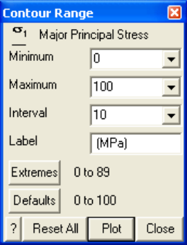

Especifica el rango de contornos (mínimo, máximo, intervalo...) del contorno graficado actualmente. Esta rutina se puede iniciar seleccionando el botón o simplemente haciendo clic derecho sobre cualquier contorno.

**abe u te a**

Arriba, el rango de contornos se muestra en orientación horizontal. Esto se puede cambiar a orientación vertical marcando Plot Options > Vertical Legend.

Minimum: especifica el valor inferior del rango de contornos.

Maximum: especifica el valor superior del rango de contornos.

Interval: especifica el intervalo de contornos. El intervalo puede ser mayor que 1/10 del máximo menos el mínimo, pero no menor.

Label: especifica la etiqueta del contorno.

Extremes: indica los extremos inferior y superior detectados para este parámetro. Al seleccionar este botón, el rango de contornos se ajusta a estos valores.

Defaults: indica el rango de contornos inferior y superior por defecto para este parámetro. Al seleccionar este botón, el rango de contornos se ajusta a estos valores.

Reset All: restablece los rangos de todos los parámetros de graficación a sus valores por defecto.

Plot: regenera el gráfico de contornos.

El mínimo del rango de contornos no tiene que ser necesariamente menor que el máximo. Por ejemplo, al graficar contornos de factores de resistencia, puede ser conveniente fijar el mínimo en 2 y el máximo en 1, de modo que los factores de resistencia cercanos a uno se muestren en color rojo.
