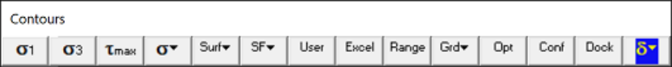
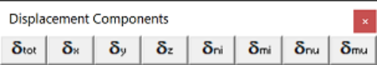
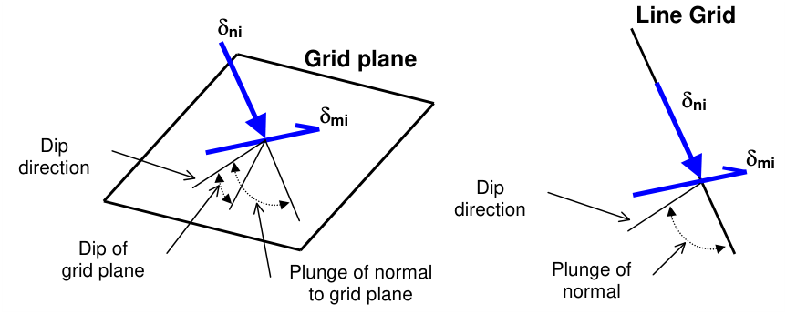
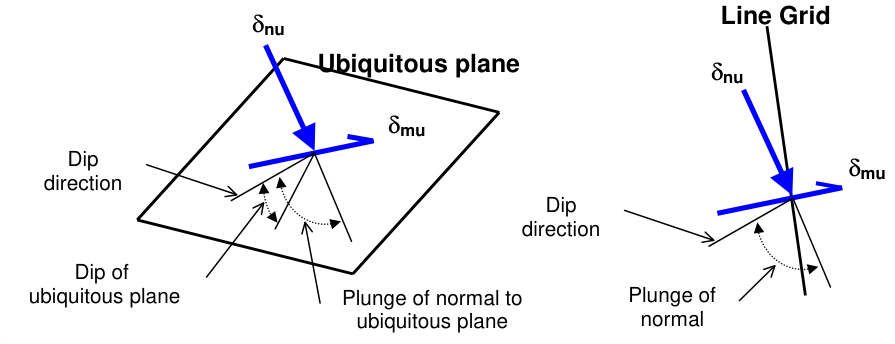

## 5.3.3.1 Desplazamiento total

Genera contornos de los desplazamientos.

Se puede acceder a estas componentes mediante la barra de herramientas Displacement Components, como se indica a continuación:

Esta barra de herramientas se puede cambiar a orientación vertical arrastrándola contra el borde derecho o izquierdo de la ventana principal.

Se puede volver a la orientación horizontal arrastrándola contra el borde superior o inferior de la ventana principal.

Al seleccionar el botón de la barra de herramientas Contours se activa la barra de herramientas Displacement Components. Puede agregar este botón a la barra de herramientas Contours con el botón de configuración.

Esta barra de herramientas ofrece acceso rápido a las componentes del desplazamiento.

Plot > Displacement > dtotal = ( dx² + dy² + dz² )½ Desplazamiento total   genera contornos del desplazamiento total Plot > Displacement > dx Desplazamiento X   genera contornos de la componente x del desplazamiento Plot > Displacement > dy Desplazamiento Y   genera contornos de la componente y del desplazamiento Plot > Displacement > dz Desplazamiento Z   genera contornos de la componente z del desplazamiento

Para calcular los desplazamientos en el plano, el estado de desplazamiento en cada punto del plano de la grilla se reorienta para determinar el desplazamiento máximo paralelo al plano de la grilla y el desplazamiento normal al plano. Tenga en cuenta que dni está orientado normal al plano de la grilla y paralelo a la dirección de una grilla lineal.

Plot > Displacement > dni Normal en el plano   genera contornos de la componente del desplazamiento normal al plano de la grilla.

Plot > Displacement > dmi Máximo en el plano   genera contornos del desplazamiento máximo tangencial al plano de la grilla.

Para calcular los desplazamientos del plano ubicuo n.º 1, el estado de desplazamiento en cada punto del plano de la grilla se reorienta para determinar el desplazamiento máximo paralelo al plano ubicuo n.º 1 y el desplazamiento normal al plano. Tenga en cuenta que dmi no está orientado normal al plano de la grilla.

Plot > Displacement > dnu Normal al plano ubicuo   genera contornos de la componente del desplazamiento normal al plano ubicuo.

Plot > Displacement > dmu Máximo en el plano ubicuo   genera contornos del desplazamiento máximo tangencial al plano ubicuo.

- la dirección de manteo se mide positiva en sentido horario desde el eje y.

- el manteo del plano se mide positivo hacia abajo desde la horizontal (es decir, la dirección de manteo).

- la inclinación de la normal se mide positiva hacia abajo (es decir, negativa hacia arriba) desde la horizontal.

Notas:

La barra de herramientas de desplazamiento solo se puede activar después de la etapa de construcción del modelo (CAD)

Etapas de análisis de Map3D.

La orientación del plano de corte ubicuo se define con

Plot > Strength Factors > Ubiquitous Parameters

El rango de contornos se define con

#### Plot > Range

Esta componente se puede agregar a la barra de herramientas de contornos si se desea

Tools > Configure Contouring Toolbar > Displacement

Puede resultar útil agregar el botón

More Displacement Components

a la barra de herramientas de contornos para acceder rápidamente a todas las componentes del desplazamiento.
