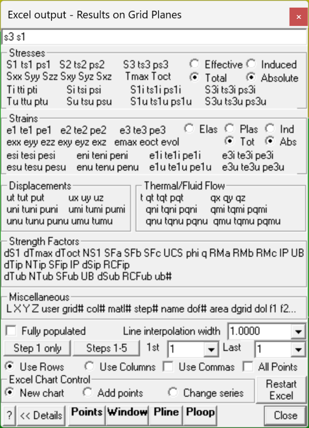

Grafica en Excel las componentes de grilla especificadas.

Debe contornear los resultados de grilla para poder seleccionarlos en el gráfico de Excel (p. ej., Plot > Stress > s1 Major Principal Stress).

El primer parámetro se usará como eje x del gráfico (es decir, la abscisa). Los parámetros adicionales definirán los ejes y del gráfico (es decir, las series u ordenadas). Se pueden especificar varios parámetros para los ejes y.

Se pueden crear dos tipos de gráficos en Excel:

- puntos de contorno seleccionados.

- una serie de puntos a lo largo de una polilínea.

Si grafica "s3 s1", "si ti" o "su tu", Map3D entregará información sobre la recta de mejor ajuste (mediante regresión lineal), incluyendo:

- Intercepto

- Pendiente

- ángulo de fricción

- desviación estándar

- coeficiente de variación

Fully populated   Especifica que todos los puntos de contorno faltantes se generarán por interpolación.

- Esta opción se aplica solo a la graficación de puntos de contorno seleccionados (Points, Window y Polyline cerrada).

- Esta opción no se aplica a la graficación sobre una polilínea abierta.

- Map3D calcula los resultados en una grilla de baja densidad para ahorrar tiempo de análisis.

- Para ver la ubicación de los puntos de contorno reales, active la visualización de trayectorias (Plot > Options > Trajectories).

- Con esta opción desmarcada, solo se incluirán en el gráfico los puntos de contorno reales.

- Con esta opción marcada, se incluirán en el gráfico todos los puntos de contorno faltantes.

Line interpolation width   Especifica el espaciamiento deseado con el que se generarán puntos de contorno por interpolación.

- Esta opción se aplica solo a la graficación sobre una polilínea abierta.

- Esta opción no se aplica a la graficación de puntos de contorno seleccionados.

- Si Line interpolation width se fija en cero, solo se graficarán los extremos de la polilínea abierta.

- En caso contrario, se generarán puntos a lo largo de la polilínea por interpolación con el Line interpolation width especificado.

Step # only   Especifica que solo se volcarán los resultados de la etapa # (# es la etapa de explotación cargada que se muestra actualmente).

Steps 1-5   Especifica que se volcarán los resultados de todas las etapas.

   - Tenga en cuenta que esto puede tardar bastante en conjuntos de datos grandes, por lo que debe tener paciencia y esperar a que Map3D recorra todas las etapas.

- 1st/Last   Especifica que se volcarán los resultados de todas las etapas desde la primera (1st) hasta la última (Last), inclusive.

   - Tenga en cuenta que esto puede tardar bastante en conjuntos de datos grandes, por lo que debe tener paciencia y esperar a que Map3D recorra todas las etapas.

Use Commas   Especifica que los resultados volcados a Excel usarán comas en lugar de puntos decimales en el formato de los números.

Use Rows   Al volcar varias etapas de explotación (vea Steps 1-5 arriba), los resultados aparecerán en filas acumulativas.

Use Columns   Al volcar varias etapas de explotación (vea Steps 1-5 arriba), los resultados aparecerán en columnas acumulativas.

- Tenga en cuenta que conviene especificar All Points para asegurarse de que no falten puntos entre las filas correspondientes.

All Points   Especifica que se volcarán todos los puntos a Excel, incluidos los puntos dentro de excavaciones.

Restart Excel   Si Map3D pierde la comunicación con Excel, debe reiniciar Excel (Restart Excel) para restablecer la comunicación.

Points   activa la selección gráfica de puntos individuales.

- Se graficará el punto más cercano al punto seleccionado.

- Para ver la ubicación de los puntos de contorno reales, active la visualización de trayectorias (Plot > Options > Trajectories). Los puntos de contorno se ubican donde se dibujan las trayectorias.

Window   activa una ventana de selección rectangular.

- Se le pedirá que seleccione las dos esquinas de la ventana haciendo un solo clic con el mouse en cada una.

- Solo se incluirán en el gráfico los puntos de grilla contenidos dentro de la ventana.

- Para ver la ubicación de los puntos de contorno reales, active la visualización de trayectorias (Plot > Options > Trajectories). Los puntos de contorno se ubican donde se dibujan las trayectorias.

Pline (open)   activa un polígono de selección gráfico.

- Puede seleccionar dos puntos para definir un solo segmento de línea.

- Si mantiene presionada la tecla Shift, se pueden seleccionar varios segmentos de línea.

- Puede especificar el espaciamiento deseado con el que se generarán puntos de contorno por interpolación mediante el parámetro Line interpolation width.

- Puede resultar útil superponer una grilla regular sobre los contornos (Plot > Options > Grid Lines) para ayudar a seleccionar la ubicación de la polilínea.

- Si Line interpolation width se fija en cero, solo se graficarán los extremos de la polilínea abierta.

- Si define una polilínea abierta, se graficará una serie de puntos a lo largo de la polilínea.

- Si define una forma poligonal cerrada, se graficarán los puntos de contorno encerrados en el polígono.

Pline (closed)   activa un polígono de selección gráfico.

- Debe mantener presionada la tecla Shift para poder seleccionar varios segmentos de línea.

- Una forma poligonal cerrada se define cerrando la polilínea al seleccionar el punto inicial.

- Si define una forma poligonal cerrada, se graficarán los puntos de contorno encerrados en el polígono.

- Si define una polilínea abierta, se graficará una serie de puntos a lo largo de la polilínea.

- Para ver la ubicación de los puntos de contorno reales, active la visualización de trayectorias (Plot > Options > Trajectories). Los puntos de contorno se ubican donde se dibujan las trayectorias.

Ploop (closed)   es igual que Pline (closed), salvo que la polilínea se cerrará automáticamente para formar un lazo cerrado.

- Debe mantener presionada la tecla Shift para poder seleccionar varios segmentos de línea.

#### Excel Chart Control:

New chart - crea un nuevo gráfico de Excel.

Extend existing chart - agrega datos al gráfico de Excel existente. Todos los parámetros de graficación deben ser los mismos que se usaron anteriormente.

Change series - cambia o agrega nuevas series a un gráfico de Excel existente. Solo el primer parámetro de graficación debe ser el mismo. Se pueden especificar parámetros de graficación adicionales según se desee.

#### Stresses:

s1 ts1 ps1 esfuerzo principal mayor s1, su rumbo y su inclinación (plunge).

s2 ts2 ps2 esfuerzo principal intermedio s2, su rumbo y su inclinación. s3 ts3 ps3 esfuerzo principal menor s3, su rumbo y su inclinación. sxx syy szz sxy syz sxz componentes cartesianas del esfuerzo. tmax esfuerzo de corte máximo tmax = ½ ( s1 - s3 ) toct esfuerzo de corte octaédrico toct = ¹/3 [( s1 - s2 )² + ( s2 - s3 )² +( s3 - s1 )²]½ smean esfuerzo medio smean = ¹/3 ( s1 + s2 + s3 ) ti tti pti esfuerzo de corte máximo en el plano de la grilla, su rumbo y su inclinación. si tsi psi esfuerzo normal en el plano de la grilla, su rumbo y su inclinación. s1i ts1i ps1i esfuerzo máximo tangencial al plano de la grilla, su rumbo y su inclinación. s3i ts3i ps3i esfuerzo mínimo tangencial al plano de la grilla, su rumbo y su inclinación. tu ttu ptu esfuerzo de corte máximo en el plano ubicuo, su rumbo y su inclinación. su tsu psu esfuerzo normal al plano ubicuo, su rumbo y su inclinación. s1u ts1u ps1u esfuerzo máximo tangencial al plano ubicuo, su rumbo y su inclinación. s3u ts3u ps3u esfuerzo mínimo tangencial al plano ubicuo, su rumbo y su inclinación. La orientación del plano ubicuo se especifica en

Plot > Strength Factors > Ubiquitous Parameters

Effective/Total componentes del esfuerzo efectivo o del esfuerzo total. Estas opciones solo se usan en Map3D Thermal-Fluid Flow, ya que este código permite calcular distribuciones de presión de poros en régimen permanente. Induced/Absolute componentes del esfuerzo inducido o del esfuerzo absoluto (es decir, el esfuerzo sin la contribución del esfuerzo previo a la explotación).

#### Strains:

e1 te1 pe1 deformación principal mayor e1, su rumbo y su inclinación. e2 te2 pe2 deformación principal intermedia e2, su rumbo y su inclinación. e3 te3 pe3 deformación principal menor e3, su rumbo y su inclinación. exx eyy ezz exy eyz exz componentes cartesianas de la deformación. emax deformación de corte máxima emax = ½ ( e1 - e3 ) eoct deformación de corte octaédrica eoct = ¹/3 [( e1 - e2 )² + ( e2 - e3 )² +( e3 - e1 )²]½ evol deformación volumétrica evol = ( e1 + e2 + e3 ) esi tesi pesi deformación de corte máxima en el plano de la grilla, su rumbo y su inclinación. eni teni peni deformación normal en el plano de la grilla, su rumbo y su inclinación. e1i te1i pe1i deformación máxima tangencial al plano de la grilla, su rumbo y su inclinación. e3i te3i pe3i deformación mínima tangencial al plano de la grilla, su rumbo y su inclinación. esu tesu pesu deformación de corte máxima en el plano ubicuo, su rumbo y su inclinación. enu tenu penu deformación normal al plano ubicuo, su rumbo y su inclinación. e1u te1u pe1u deformación máxima tangencial al plano ubicuo, su rumbo y su inclinación. e3u te3u pe3u deformación mínima tangencial al plano ubicuo, su rumbo y su inclinación. Elastic/Plastic/Total componentes de la deformación elástica, plástica o total. Estas opciones solo se usan en Map3D Non-Linear, ya que este código permite calcular deformaciones no lineales. Induced/Absolute componentes de la deformación inducida o de la deformación absoluta (es decir, sin la contribución del esfuerzo previo a la explotación).

#### Displacements:

ut tut put desplazamiento total, su rumbo y su inclinación. ux uy uz componentes cartesianas del desplazamiento. uni tuni puni desplazamiento normal al plano de la grilla, su rumbo y su inclinación. umi tumi pumi desplazamiento máximo tangencial al plano de la grilla, su rumbo y su inclinación. unu tunu punu desplazamiento normal al plano ubicuo, su rumbo y su inclinación. umu tumu pumu desplazamiento máximo tangencial al plano ubicuo, su rumbo y su inclinación.

#### Flow:

t temperatura/carga hidráulica.

qt tqt pqt flujo total, su rumbo y su inclinación. qx qy qz componentes cartesianas del flujo. qni tqni pqni desplazamiento normal al plano de la grilla, su rumbo y su inclinación. qmi tqmi pqmi desplazamiento máximo tangencial al plano de la grilla, su rumbo y su inclinación. qnu tqnu pqnu desplazamiento normal al plano ubicuo, su rumbo y su inclinación. qmu tqmu pqmu desplazamiento máximo tangencial al plano ubicuo, su rumbo y su inclinación.

#### Strength:

· ds1 esfuerzo principal mayor en exceso Ds1 = s1 - ( _UCS_ + _q_ s3 )

- dtmax esfuerzo de corte máximo en exceso Dtmax = ½(s1 - s3) - [ _UCS_ + ½(s1+s3) ( _q_ -1) ]/( _q_ +1) = [s1 - ( _UCS_ + _q_ s3) ]/( _q_ +1)

- dtoct esfuerzo de corte octaédrico en exceso Dtoct = toct - [ _UCS_ + ( _q_ –1) smean ] Ö(2) /( _q_ +2)

- NS1 probabilidad usando la distribución normal N(Ds1 /std)

- SF-A Resistencia/Esfuerzo se puede determinar como ( _UCS_ + _q_ s3 )/ s1

- SF-B Resistencia/Esfuerzo se puede determinar como ( _UCS_ + _q_ s3 - s3 )/(s1 - s3)

- SF-C Resistencia/Esfuerzo se puede determinar como [ _UCS_ + ½(s1+s3) ( _q_ -1) ]/[ ½(s1 - s3)( _q_ +1) ]

- dTip esfuerzo de corte en el plano, en exceso Dtip = tip - [ Cohesion + sip tan(j) ]

- NTip probabilidad usando la distribución normal N(Dtip /std)

- SFip Resistencia/Esfuerzo se puede determinar como [ Cohesion + sip tan(j) ] / tip

- dSip esfuerzo en la pared en el plano, en exceso Dsip = [ 3 s1i - s3i ] - UCS

- RCFip factor de condición de la roca (Rock Condition Factor) para el esfuerzo en la pared en el plano RCFip = [ 3 s1i - s3i ]/UCS

- dTub esfuerzo de corte en el plano ubicuo, en exceso Dtub

- NTub probabilidad usando la distribución normal N(Dtub /std)

- SFub Resistencia/Esfuerzo se puede determinar como [ Cohesion + sub tan(j) ] / tub

- dSub esfuerzo en la pared en el plano ub, en exceso Dsub = [ 3 s1ub - s3ub ] - UCS

- RCFub factor de condición de la roca para el esfuerzo en la pared en el plano ub RCFip = [ 3 s1ub - s3ub ]/UCS

- UB# Grafica el número del sistema UB (1, 2 o 3) que tiene el mayor valor de Dtub

#### Miscellaneous:

L  longitud a lo largo de una línea. Use el comando Polyline para seleccionar la línea deseada.

X  valor de la coordenada. Y  valor de la coordenada. Z  valor de la coordenada. user valor definido por el usuario.

grid# el número de la grilla en la que se ubica el punto. col# el número de color asignado a la grilla en la que se ubica el punto.

matl# el número del material dentro del cual se ubica el punto. El material de la roca de caja (host) es el material número 1. En problemas donde se usan varios materiales, los resultados pueden calcularse en una zona de material alterno.

step# el número de la etapa de explotación. name el nombre asignado a la grilla en la que se ubica el punto.

dof#   un número único que especifica la ubicación de almacenamiento del punto en la base de datos de Map3D. area el área del segmento asociado al punto seleccionado en el GPlane. dgrid distancia a la superficie más cercana desde cada punto de la grilla. dol distancia a la grilla más cercana _Dgrid_ dividida por el espaciamiento de la grilla _Lgrid_ .

f1 f2... parámetros de material definidos por el usuario. Se pueden definir con Plot > Properties > Material Properties > User defined Parameters.
