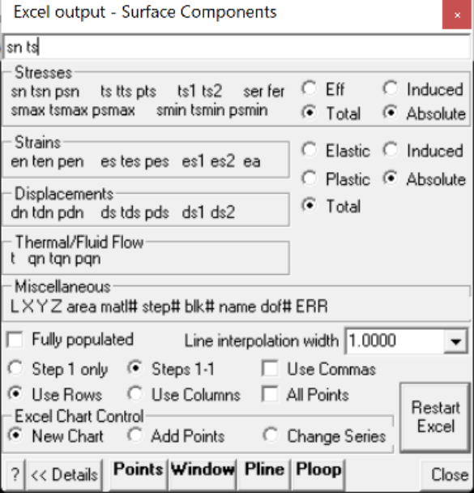

Grafica en Excel las componentes de superficie especificadas.

Debe contornear los resultados de superficie para poder seleccionarlos en el gráfico de Excel (p. ej., Plot > Surface Components > Ts Shear Stress).

El primer parámetro se usará como eje x del gráfico (es decir, la abscisa). Los parámetros adicionales definirán los ejes y del gráfico (es decir, las series u ordenadas). Se pueden especificar varios parámetros para los ejes y.

Se pueden crear dos tipos de gráficos en Excel:

- puntos de contorno seleccionados.

- una serie de puntos a lo largo de una polilínea.

La graficación en Excel a través de Map3D se realiza mediante el complemento Map3D.xla

- Esta rutina se carga automáticamente cuando Map3D inicia Excel.

- Debe permitir que esta macro se ejecute para que funcionen las rutinas de graficación de Map3D.

Fully populated   Especifica que todos los puntos de contorno faltantes se generarán por interpolación.

- Esta opción se aplica solo a la graficación de puntos de contorno seleccionados (Points, Window y Polyline cerrada).

- Esta opción no se aplica a la graficación sobre una polilínea abierta.

- Map3D calcula los resultados en una grilla de baja densidad para ahorrar tiempo de análisis.

- Para ver la ubicación de los puntos de contorno reales, active la visualización de trayectorias (Plot > Options > Trajectories).

- Con esta opción desmarcada, solo se incluirán en el gráfico los puntos de contorno reales.

- Con esta opción marcada, se incluirán en el gráfico todos los puntos de contorno faltantes.

Line interpolation width   Especifica el espaciamiento deseado con el que se generarán puntos de contorno por interpolación.

- Esta opción se aplica solo a la graficación sobre una polilínea abierta.

- Esta opción no se aplica a la graficación de puntos de contorno seleccionados.

- Si Line interpolation width se fija en cero, solo se graficarán los extremos de la polilínea abierta.

- En caso contrario, se generarán puntos a lo largo de la polilínea por interpolación con el Line interpolation width especificado.

Step # only   Especifica que solo se volcarán los resultados de la etapa # (# es la etapa de explotación cargada que se muestra actualmente).

Steps 1-5   Especifica que se volcarán los resultados de todas las etapas.

- Tenga en cuenta que esto puede tardar bastante en conjuntos de datos grandes, por lo que debe tener paciencia y esperar a que Map3D recorra todas las etapas.

Use Commas   Especifica que los resultados volcados a Excel usarán comas en lugar de puntos decimales en el formato de los números.

Restart Excel   Si Map3D pierde la comunicación con Excel, debe reiniciar Excel (Restart Excel) para restablecer la comunicación.

Points   activa la selección gráfica de puntos individuales.

- Se graficará el punto más cercano al punto seleccionado.

- Para ver la ubicación de los puntos de contorno reales, active la visualización de trayectorias (Plot > Options > Trajectories). Los puntos de contorno se ubican donde se dibujan las trayectorias.

Window   activa una ventana de selección rectangular.

- Se le pedirá que seleccione las dos esquinas de la ventana haciendo un solo clic con el mouse en cada una.

- Solo se incluirán en el gráfico los puntos de grilla contenidos dentro de la ventana.

- Para ver la ubicación de los puntos de contorno reales, active la visualización de trayectorias (Plot > Options > Trajectories). Los puntos de contorno se ubican donde se dibujan las trayectorias.

Polyline (closed)   activa un polígono de selección gráfico.

- Debe mantener presionada la tecla Shift para poder seleccionar varios segmentos de línea.

- Una forma poligonal cerrada se define cerrando la polilínea al seleccionar el punto inicial.

- Si define una forma poligonal cerrada, se graficarán los puntos de contorno encerrados en el polígono.

- Si define una polilínea abierta, se graficará una serie de puntos a lo largo de la polilínea.

- Para ver la ubicación de los puntos de contorno reales, active la visualización de trayectorias (Plot > Options > Trajectories). Los puntos de contorno se ubican donde se dibujan las trayectorias.

Polyline (open)   activa un polígono de selección gráfico.

- Puede seleccionar dos puntos para definir un solo segmento de línea.

- Si mantiene presionada la tecla Shift, se pueden seleccionar varios segmentos de línea.

- Puede especificar el espaciamiento deseado con el que se generarán puntos de contorno por interpolación mediante el parámetro Line interpolation width.

- Puede resultar útil superponer una grilla regular sobre los contornos (View > Render > Grid Lines) para ayudar a seleccionar la ubicación de la polilínea.

- Si Line interpolation width se fija en cero, solo se graficarán los extremos de la polilínea abierta.

- Si define una polilínea abierta, se graficará una serie de puntos a lo largo de la polilínea.

- Si define una forma poligonal cerrada, se graficarán los puntos de contorno encerrados en el polígono.

#### Excel Chart Control:

New chart - crea un nuevo gráfico de Excel.

Extend existing chart - agrega datos al gráfico de Excel existente. Todos los parámetros de graficación deben ser los mismos que se usaron anteriormente.

Change series - cambia o agrega nuevas series a un gráfico de Excel existente. Solo el primer parámetro de graficación debe ser el mismo. Se pueden especificar parámetros de graficación adicionales según se desee.

#### Stresses:

sn tsn psn esfuerzo normal a la superficie, su rumbo y su inclinación (plunge).

ts tts pts esfuerzo de corte máximo en el plano de la superficie, su rumbo y su inclinación. ts1 ts2   componentes del esfuerzo de corte en el plano de la superficie. ts1 es paralela al primer lado (es decir, el lado definido por x1 y1 z1 – x2 y2 z2). ts2 es perpendicular a ts1 en la dirección del segundo lado (es decir, el lado definido por x2 y2 z2 – x3 y3 z3).

ser error de esfuerzo superficial. Los solucionadores iterativos funcionan determinando el error en la solución actual de cada ecuación simultánea y luego reduciendo estos errores mediante un proceso de aproximaciones sucesivas. Este parámetro indica el error de cada una de las ecuaciones.

fer error del criterio de falla. Este parámetro solo se usa en análisis de fluencia no lineal (incluidos el deslizamiento de fallas y la no linealidad de materiales 3D). Este parámetro siempre debe ser cercano a cero, a menos que se haya especificado alguna viscosidad y el problema se vuelva no lineal. En este último caso, la fluencia viscosa puede permitir estados de esfuerzo por encima del criterio de falla, lo que indica una falta de equilibrio estático. Este parámetro indica el esfuerzo viscoso de cada una de las ecuaciones.

smax tsmax psmax esfuerzo tangencial máximo, su rumbo y su inclinación. smin tsmin psmin esfuerzo tangencial mínimo, su rumbo y su inclinación. Effective/Total – componentes del esfuerzo efectivo o del esfuerzo total. Estas opciones solo se usan en Map3D Thermal-Fluid Flow, ya que este código permite calcular distribuciones de presión de poros en régimen permanente. Induced/Absolute componentes del esfuerzo inducido o del esfuerzo absoluto (es decir, el esfuerzo sin la contribución del esfuerzo previo a la explotación).

#### Strains:

en ten pen deformación en la dirección normal a la superficie, su rumbo y su inclinación. Este parámetro solo se usa en planos DD y se calcula como el desplazamiento normal (cierre) dividido por el espesor. es tes pes deformación de corte máxima en el plano de la superficie, su rumbo y su inclinación. Este parámetro solo se usa en planos DD y se calcula como el desplazamiento de corte (ride) dividido por el espesor.

es1 es2   componentes de la deformación de corte en el plano de la superficie. es1 es paralela al primer lado (es decir, el lado definido por x1 y1 z1 – x2 y2 z2). es2 es perpendicular a es1 en la dirección del segundo lado (es decir, el lado definido por x2 y2 z2 – x3 y3 z3).

Elastic/Plastic/Total componentes de la deformación elástica, plástica o total. Estas opciones se usan para planos DD en Map3D Fault-Slip y también en Map3D Non-Linear, ya que este código permite calcular deformaciones no lineales.

Induced/Absolute componentes de la deformación inducida o de la deformación absoluta (es decir, sin la contribución del esfuerzo previo a la explotación).

#### Displacements:

dn tdn pdn desplazamiento normal (cierre) en la dirección normal a la superficie, su rumbo y su inclinación. Este parámetro solo se usa en planos DD. Tenga en cuenta que se puede especificar el valor elástico, plástico o total.

ds tds pds desplazamiento de corte máximo (ride) en el plano de la superficie, su rumbo y su inclinación. Este parámetro solo se usa en planos DD. Tenga en cuenta que se puede especificar el valor elástico, plástico o total.

ds1 ds2   componentes del desplazamiento de corte (ride) en el plano de la superficie. ds1 es paralela al primer lado (es decir, el lado definido por x1 y1 z1 – x2 y2 z2). ds2 es perpendicular a ds1 en la dirección del segundo lado (es decir, el lado definido por x2 y2 z2 – x3 y3 z3).

#### Miscellaneous:

L  longitud a lo largo de una línea. Use el comando Polyline para seleccionar la línea deseada. X  valor de la coordenada. Y  valor de la coordenada. Z  valor de la coordenada. area   el área de la superficie. matl# el número del material asignado a la superficie. step# el número de la etapa de explotación. blk#   el número de bloque. name el nombre del bloque. dof#   el número del grado de libertad. ERR   gráfico de la tasa de liberación de energía.
