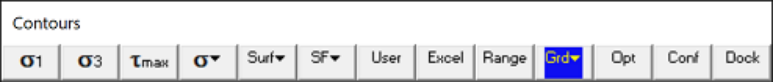
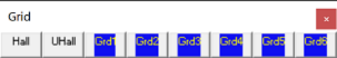

Selecciona una grilla de puntos de campo para visualizarla.

Esta rutina puede iniciarse haciendo clic en el botón de la barra de herramientas de contornos

Esta barra de herramientas puede cambiarse a orientación vertical arrastrándola contra el borde derecho o izquierdo de la ventana principal.

Puede volver a la orientación horizontal arrastrándola contra el borde superior o inferior de la ventana principal.

Los resultados del análisis (esfuerzos, deformaciones y desplazamientos) pueden representarse mediante contornos sobre las superficies de los elementos y sobre las grillas de puntos de campo.

Con OpenGL activado (Tools > OpenGL), pueden mostrarse todas las grillas a la vez. Sin OpenGL, solo pueden mostrarse dos grillas a la vez.

Hide All: oculta todas las grillas.

Unhide All: muestra todas las grillas.

El usuario puede construir varios planos de grilla de puntos de campo con

CAD > Build > Grid Plane

CAD > Build > Grid Line

Si lo desea, pueden colocarse botones individuales de selección de grilla en la barra de herramientas de vista con

Tools > View Toolbar Configure
