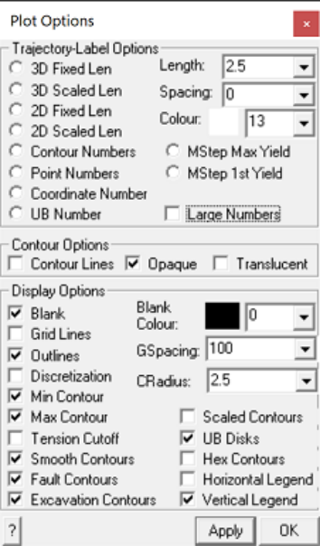

Configura las opciones del gráfico de contornos.

Esta rutina se puede iniciar seleccionando el botón o simplemente haciendo clic derecho sobre cualquier contorno.

Esta barra de herramientas se puede cambiar a orientación vertical arrastrándola contra el borde derecho o izquierdo de la ventana principal.

Se puede volver a la orientación horizontal arrastrándola contra el borde superior o inferior de la ventana principal.

#### Trajectory-Label Options:

- 3D Fixed Length – muestra indicadores de orientación 3D de largo fijo.

El indicador se construye como un vector 3D con una punta de flecha en el extremo que apunta alejándose de usted (es decir, hacia el interior de la pantalla). Esto permite determinar si el vector se inclina alejándose o acercándose a usted. Los vectores que aparecen como puntos apuntan directamente hacia el interior o el exterior de la pantalla.

Si orienta la vista de modo que mire a lo largo del borde de una grilla, verá los vectores sobresaliendo hacia adentro y hacia afuera del plano de contornos.

El largo de los vectores se define con el parámetro TLength:.

La densidad de los vectores se define con el parámetro TSpacing:.

- 3D Scaled Length – muestra indicadores de orientación 3D de largo escalado.

El indicador se construye como se describió arriba.

El largo de los vectores se escala según la magnitud del esfuerzo, de modo que si la magnitud es igual al mínimo del rango de contornos, el vector se dibuja con largo cero. Si la magnitud es igual al máximo del rango de contornos, el vector se dibuja con el largo especificado por el parámetro TLength:.

- 2D Fixed Length – muestra indicadores de orientación 2D de largo fijo.

El indicador se construye como una proyección 2D del vector 3D real, en el plano de la grilla.

El largo de los vectores se define con el parámetro TLength:.

La densidad de los vectores se define con el parámetro TSpacing:.

- 2D Scaled Length – muestra indicadores de orientación 2D de largo escalado.

El indicador se construye como se describió arriba.

El indicador se construye como una proyección 2D del vector 3D real, en el plano de la grilla.

El largo de los vectores se escala según la magnitud del esfuerzo, de modo que si la magnitud es igual al mínimo del rango de contornos, el vector se dibuja con largo cero. Si la magnitud es igual al máximo del rango de contornos, el vector se dibuja con el largo especificado por el parámetro TLength:.

- Contour Numbers – muestra números de contorno sobre los contornos. El número corresponde a la magnitud del contorno en cada punto.

- Point Numbers – muestra números de punto sobre los contornos. El número corresponde al número de registro de cada punto.

- Coordinate Numbers – muestra números de coordenadas sobre los contornos. El número corresponde a las coordenadas x,y,z de cada punto.

- UB Number – muestra sobre los contornos el número del sistema de diaclasas ubicuas (1, 2 o 3) con el máximo esfuerzo de corte en exceso. Vea Ubiquitous Parameters

- MStep Max Yield – muestra la etapa en la que ocurre el máximo esfuerzo en exceso. Vea Accumulated Damage

- MStep 1st Yield – muestra la etapa en la que ocurre la primera fluencia. Vea Accumulated Damage

- Large Numbers – muestra los números en tamaño grande o pequeño.

- Length – define el largo con que se dibujarán los indicadores de orientación. Si define este parámetro demasiado pequeño, los vectores de trayectoria serán demasiado pequeños para verse. Si lo define demasiado grande, los vectores de trayectoria se superpondrán y la visualización será confusa.

- Spacing – define el espaciamiento entre indicadores de orientación o números adyacentes. Si define este parámetro en cero, las trayectorias se dibujarán en todos los puntos de la grilla. En grillas muy finamente discretizadas, los vectores de trayectoria pueden quedar demasiado concentrados y ser difíciles de distinguir. Valores mayores de este parámetro harán que se dibujen menos símbolos de trayectoria.

- Colour – define el color con que se dibujan las trayectorias.

#### Contour Options:

- Contour Lines – dibuja líneas entre los colores de los contornos. Estas líneas ayudan a resaltar el límite entre distintos intervalos de contorno y son especialmente útiles para presentaciones en blanco y negro.

- Opaque – dibuja los contornos con colores opacos. Si esta opción y la opción translúcida están ambas desmarcadas, solo se dibujarán líneas de contorno (es decir, sin contornos de color).

- Translucent - dibuja los contornos con colores translúcidos. Si esta opción y la opción opaca están ambas desmarcadas, solo se dibujarán líneas de contorno (es decir, sin contornos de color).

#### Display Options:

- Blank – cuando está marcada, los contornos se ocultan donde el plano de la grilla atraviesa bloques de excavación. Esto es útil para identificar la extensión de las excavaciones cuando se han ocultado partes del modelo. También es útil para generar secciones 2D, ya que la ubicación de las excavaciones queda claramente visible.

Blank Colour: - define el color usado para el ocultamiento.

Grid Lines – los contornos se dibujan con líneas a intervalos regulares de la grilla. El intervalo deseado se define con el parámetro Spacing:.

Outlines – se dibujan contornos alrededor de los bordes de la grilla. Al usar varias grillas puede que no desee ver estos contornos.

Discretization – la discretización de la grilla se superpone a los contornos.

Min Contour – cuando no está marcada, no se dibujan los contornos por debajo del mínimo del rango de contornos. Esto es útil para mostrar contornos en los que solo importa la parte superior del rango.

Por ejemplo, al mostrar componentes de deformación no lineal o esfuerzos en exceso, a menudo es útil que solo sean visibles las partes de los contornos distintas de cero.

Si el parámetro deseado tiene un valor negativo, simplemente intercambie el máximo y el mínimo del rango de contornos o grafique el valor absoluto del parámetro.

Max Contour – cuando no está marcada, no se dibujan los contornos por encima del máximo del rango de contornos.

- Tension Cutoff Symbol – cuando está marcada, se graficará un símbolo especial de tracción en todos los lugares donde el estado de esfuerzos esté por debajo del límite de tracción especificado. Esta opción solo se usa en los gráficos de factores de resistencia.

- Smooth Contours – si no ha marcado la opción de análisis lineal, los resultados solo se calculan en el centro de cada elemento de borde y los gráficos de contornos de valores superficiales se verán muy cuadriculados. Esta opción suaviza estos contornos para facilitar la interpretación.

Si ha marcado la opción de análisis lineal, los resultados se calculan en las esquinas de los elementos. Como no se requiere suavizado, esta opción se ignora.

Esta opción no tiene efecto sobre los gráficos de grillas.

Fault contours – se dibujan contornos sobre las superficies de falla. Estas son superficies DD con tipo de material arcilla de falla (fault-gouge).

Excavation contours – se dibujan contornos sobre las superficies de excavación. Estas son superficies FF o DD con tipo de material 0.

Scalled Contours – muestra los contornos como una superficie topográfica.

La altura normal al plano se escala según la magnitud del esfuerzo, de modo que si la magnitud es igual al mínimo del rango de contornos, la altura se dibuja con largo cero. Si la magnitud es igual al máximo del rango de contornos, el vector se dibuja con el largo especificado por el parámetro CRadius:.

En el caso de grillas lineales, se escala el radio del tubo.

UB disks – alterna la visualización del gráfico de contornos plano o de discos que representan la orientación del plano UB. Para más información, vea UB-Plane Parameters.

Hex contours – en la versión Visco-Plastic de Map3D, esto habilita la visualización de valores calculados en nodos internos.

Horizontal Legend - orienta horizontalmente la leyenda de intervalos de contorno.

Vertical Banner - orienta verticalmente la leyenda de intervalos de contorno.

GSpacing: - define el intervalo de la grilla.

CRadius - define el radio para el contorneo de grillas lineales.

#### Miscellaneous:

Apply – regenera el gráfico de contornos.
