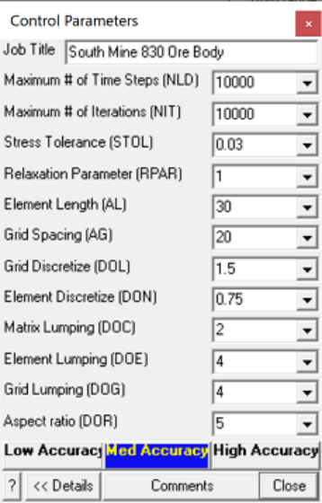
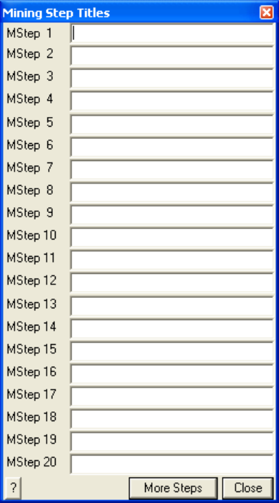

## 5.3.12.1 Parámetros de control

Especificación de los parámetros de control del análisis.

**Job Title** - especifica un título descriptivo del proyecto.

**Maximum # of Time Steps (** **_NLD_ )** - especifica el número máximo de pasos que se usarán durante el análisis. Este parámetro solo es relevante si se realiza un análisis de fluencia no lineal

#### Analysis > Options > Creep

en el que limita el número real de pasos de tiempo.

Si se supera este parámetro, el programa se detiene y se le pide al usuario instrucciones sobre cómo proceder. Este parámetro se puede modificar durante la solución.

A menos que el usuario tenga algún motivo especial para limitar el número de pasos de tiempo, este parámetro debe fijarse en un número arbitrariamente grande.

**Maximum # of Iterations (** **_NIT_ )** - especifica el número máximo de iteraciones que se usarán durante la solución de la matriz.

Si se supera este parámetro, el programa se detiene y se le pide al usuario instrucciones sobre cómo proceder. Este parámetro se puede modificar durante la solución.

A menos que el usuario tenga algún motivo especial para limitar el número de pasos de tiempo, este parámetro debe fijarse en un número arbitrariamente grande.

**Stress Tolerance (** **_STOL_ )** - especifica la precisión requerida de la solución de la matriz.

Durante la solución de la matriz, la precisión mejora sucesivamente con cada iteración. Cuando el error máximo de esfuerzo cae por debajo de este valor, se puede considerar que la matriz está resuelta.

El valor sugerido para este parámetro es 0.1% del estado de esfuerzos de campo lejano a la profundidad de interés. _STOL_ debe especificarse en las mismas unidades que el estado de esfuerzos de campo lejano (p. ej., MPa o psi).

**Relaxation Parameter (** **_RPAR_ )** - especifica el valor máximo de relajación que se usará durante la solución de la matriz.

Durante la solución de la matriz, el programa modifica continuamente el parámetro de relajación para intentar lograr la convergencia con el menor número posible de iteraciones. Este parámetro limita el valor máximo que se usará.

Se recomienda el valor 1.2 para problemas bien condicionados. Para problemas mal condicionados se debe usar un valor de 0.8.

**Element Length (** **_AL_ )** - especifica el largo mínimo de elemento.

Durante el proceso de discretización, todas las superficies del modelo (superficies de bloques FF y planos DD) se subdividen en elementos de borde con longitud de lado

_Lelem = Delem/DON_

donde Map3D determina _Delem_ como la menor distancia entre superficies adyacentes del modelo. Como en algunos lugares la distancia _Delem_ puede ser cero, se debe especificar la longitud mínima de lado de elemento _AL_.

_AL_ debe fijarse igual al doble del ancho del pilar o caserón más pequeño. Se deben usar las mismas unidades empleadas para especificar las coordenadas (p. ej., metros o pies).

Una vez completada la discretización, la distancia _Delem_ se puede graficar con

Plot > Miscellaneous > Delem distance to nearest element on surfaces.

Tenga en cuenta que, si se desea, este comportamiento se puede anular elemento por elemento especificando el ancho máximo de cada elemento

#### CAD > Edit > Entity Properties > Maximum Width

Esto permite a los usuarios forzar una discretización fina y uniforme en las superficies de zonas donde no hay planos de grilla.

**Grid Spacing (** **_AG_ )** - especifica el espaciamiento mínimo de grilla.

Durante el proceso de discretización, todas las grillas de puntos de campo y las superficies del modelo se subdividen en elementos con longitud de lado

_Lgrid = Dgrid/DOL_

donde Map3D determina _Dgrid_ como la menor distancia entre las superficies del modelo y los planos de grilla. Como en algunos lugares la distancia _Dgrid_ puede ser cero, se debe especificar el espaciamiento mínimo de grilla _AG_. Este mismo proceso se usa para discretizar las superficies del modelo (superficies de bloques FF y planos DD) que están cerca de grillas de puntos de campo.

_AG_ debe fijarse igual a la dimensión más pequeña de interés. Por ejemplo, si el usuario necesita ver la distribución de esfuerzos a través de un pilar de 2 m de ancho, un valor de _AG_ de 0.5 daría una cantidad suficiente de puntos de campo para un contorneo preciso. Se deben usar las mismas unidades empleadas para especificar las coordenadas (p. ej., metros o pies).

Una vez completada la discretización, la distancia _Dgrid_ se puede graficar sobre las superficies del modelo con

Plot > Surface Components > Dgird distance to nearest grid

o sobre las grillas con

Plot > Miscellaneous > Delem distance to nearest element on grids.

Tenga en cuenta que, si se desea, este comportamiento se puede anular grilla por grilla especificando el espaciamiento máximo de cada grilla

#### CAD > Edit > Entity Properties > Maximum Width

Esto permite a los usuarios forzar una discretización fina y uniforme en las grillas.

**Grid Discretize (** **_DOL_ ) -** especifica la razón deseada entre distancia y largo de elemento, usada para determinar el espaciamiento de grilla a partir de

_Lgrid = Dgrid/DOL_

donde Map3D determina _Dgrid_ como la menor distancia entre las superficies del modelo y los planos de grilla.

Un valor de _DOL_ de 1.0 es generalmente adecuado y se puede esperar que entregue soluciones con 10-20% de error. Si se requiere mayor precisión, un valor de _DOL_ de 2.0 debería dar 5-10% de error. Use un valor de 4.0 para menos de 5% de error. Aunque valores mayores de _DOL_ generan más elementos de borde y, por lo tanto, tiempos de ejecución más largos, esto es necesario para obtener mayor precisión.

Una vez completada la discretización, la razón _Dgrid/Lelem_ se puede graficar sobre las superficies del modelo con

Plot > Miscellaneous > Dgrid/Lelem _DOL_ ratio on surfaces

o la razón _Dgrid/Lgrid_ sobre las grillas con

Plot > Miscellaneous > Dgrid/Lgrid _DOL_ ratio on grids.

**Element Discretize (** **_DON_ ) -** especifica la razón deseada entre distancia y largo de elemento, usada para determinar la longitud de lado del elemento

_Lelem = Delem/DON_

donde _Delem_ representa la distancia a la superficie más cercana del modelo.

Un valor de _DON_ de 0.5 es generalmente adecuado para todos los problemas, excepto aquellos con excavaciones o pilares muy angostos. En este último caso se recomienda un valor de _DON_ de 1.0. Aunque valores mayores de _DON_ generan más elementos de borde y, por lo tanto, tiempos de ejecución más largos, esto es necesario para obtener un problema bien condicionado y resoluble en el caso de excavaciones o pilares muy angostos.

Una vez completada la discretización, la razón _Delem/Lelem_ se puede graficar con

Plot > Miscellaneous > Delem/Lelem _DON_ ratio on surfaces.

**Matrix Lumping (** **_DOC_ ) -** especifica la razón deseada entre distancia y largo de elemento. Durante el ensamblaje de la matriz, todos los elementos que caben dentro de la dimensión

#### _Delem/DOC_

se agruparán (lumping). _Delem_ representa la distancia a la superficie más cercana del modelo.

Al igual que para _DOL_ , un valor de _DOC_ de 1.0 es generalmente adecuado y se puede esperar que entregue soluciones con 10-20% de error. Si se requiere mayor precisión, un valor de _DOC_ de 2.0 debería dar 5-10% de error. Use un valor de 4.0 para menos de 5% de error. Aunque valores mayores de _DOC_ generan matrices de coeficientes más grandes y, por lo tanto, tiempos de ejecución más largos, esto es necesario para obtener mayor precisión.

Una vez completada la discretización, la distancia _Delem_ se puede graficar con

Plot > Miscellaneous > Delem distance to nearest element on surfaces.

**Element Lumping (** **_DOE_ ) -** especifica la razón deseada entre distancia y largo de elemento. Durante el ensamblaje de la grilla, todos los elementos que caben dentro de la dimensión

#### _Dgrid/DOE_

se agruparán (lumping). _Dgrid_ representa la distancia a la superficie de grilla de puntos de campo más cercana.

Un valor de _DOE_ de 2.0 es generalmente adecuado y se puede esperar que entregue soluciones con 10-20% de error. Si se requiere mayor precisión, un valor de _DOE_ de 4.0 debería dar 5-10% de error. Use un valor de 8.0 para menos de 5% de error. Aunque valores mayores de _DOE_ alargan los tiempos de ejecución, esto es necesario para obtener mayor precisión.

Una vez completada la discretización, la distancia _Dgrid_ se puede graficar sobre las grillas con

Plot > Miscellaneous > Delem distance to nearest element on grids.

**Grid Lumping (** **_DOG_ ) -** especifica la razón deseada entre distancia y largo de elemento. Durante el ensamblaje de la grilla, todos los puntos de grilla que caben dentro de la dimensión

#### _Dgrid/DOG_

se agruparán (lumping). _Dgrid_ representa la distancia a la superficie de grilla de puntos de campo más cercana.

Un valor de _DOG_ de 2.0 es generalmente adecuado y se puede esperar que entregue soluciones con 10-20% de error. Si se requiere mayor precisión, un valor de _DOG_ de 4.0 debería dar 5-10% de error. Use un valor de 8.0 para menos de 5% de error. Aunque valores mayores de _DOG_ alargan los tiempos de ejecución, esto es necesario para obtener mayor precisión.

Una vez completada la discretización, la distancia _Dgrid_ se puede graficar sobre las grillas con

Plot > Miscellaneous > Delem distance to nearest element on grids.

**Aspect Ratio (** **_DOR_ ) -** especifica la razón de aspecto deseada de los elementos. Se recomienda un valor de _DOR_ de 5.0 para todos los problemas, excepto cuando el usuario desea subdividir elementos angostos en formas más uniformes.

Fija _DON_ =0.5, _DOL=DOC_ =1, _DOE=DOG_ =2 para 10-20% de error. Fija _DON_ =0.5, _DOL=DOC_ =2, _DOE=DOG_ =4 para 5-10% de error. Fija _DON_ =1, _DOL=DOC_ =4, _DOE=DOG_ =8 para &lt; 5% de error.

**Comments -** permite especificar comentarios que se guardarán con la corrida.

#### Summary:

- _STOL_ debe fijarse igual a 0.1% del estado de esfuerzos de campo lejano a la profundidad de interés. Use las mismas unidades que el estado de esfuerzos de campo lejano (p. ej., MPa o psi).

- _AL_ debe fijarse igual al doble del ancho del pilar o caserón más pequeño. Use las mismas unidades empleadas para especificar las coordenadas (p. ej., metros o pies).

- _AG_ debe fijarse igual a la dimensión más pequeña de interés. Use las mismas unidades empleadas para especificar las coordenadas (p. ej., metros o pies).

- Los elementos se discretizan con una longitud de lado igual al menor valor entre _Delem/DON_ y _Dgrid/DOL_ , de modo que no puede ser menor que _AL_ ni mayor que el ancho máximo.

- Las grillas se discretizan con un espaciamiento determinado a partir de _Dgrid/DOL_ , de modo que no puede ser menor que _AG_ ni mayor que el espaciamiento máximo.

- Durante el ensamblaje de la matriz, todos los elementos que caben dentro de la dimensión _Delem/DOC_ se agruparán (lumping).

- Durante el ensamblaje de la grilla, todos los elementos que caben dentro de la dimensión _Dgrid/DOE_ se agruparán (lumping).

- Durante el ensamblaje de la grilla, todos los puntos de grilla que caben dentro de la dimensión _Dgrid/DOG_ se agruparán (lumping).

#### Notes:

Para una discusión más detallada sobre la discretización y el agrupamiento (lumping), vea

- Discretization and Lumping.

## 5.3.12.2 Títulos de etapas de explotación

Especificación de un título descriptivo para cada etapa de explotación.

## 5.3.12.3 Propiedades de materiales

Especificación de las propiedades de los materiales.

Aparecerán varios cuadros de diálogo distintos según el tipo de material seleccionado: Mohr-Coulomb, Hoek-Brown, Drucker-Prager, Backfill Hyperbolic y None.

Mohr-Coulomb en bloques FF 3D se puede usar como regla de flujo para el comportamiento no lineal de materiales en Map3D Non-Linear y Map3D Visco-Plastic. También se puede usar como criterio de falla en bloques FF 3D o en el material de la roca de caja (host) en Map3D Fault-Slip.

Hoek-Brown en bloques FF 3D se puede usar como criterio de falla en bloques FF 3D o en el material de la roca de caja en Map3D Fault-Slip.

Drucker-Prager en bloques FF 3D se puede usar como criterio de falla en bloques FF 3D o en el material de la roca de caja en Map3D Fault-Slip.

Fault-Gouge en planos DD se puede usar como regla de flujo en planos DD en Map3D Fault-Slip, Map3D Non-Linear o Map3D Visco-Plastic.

Equilibrated-Gouge en planos DD se puede usar como regla de flujo en planos DD en Map3D Fault-Slip, Map3D Non-Linear o Map3D Visco-Plastic.

Yielding-Pillar en planos DD se puede usar como regla de flujo en planos DD en Map3D Fault-Slip, Map3D Non-Linear o Map3D Visco-Plastic.

Hyperbolic-Backfill en planos DD se puede usar como regla de flujo en planos DD en Map3D Fault-Slip, Map3D Non-Linear o Map3D Visco-Plastic.

Quadratic-Backfill en planos DD se puede usar como regla de flujo en planos DD en Map3D Fault-Slip, Map3D Non-Linear o Map3D Visco-Plastic.

Softened Material en bloques FF 3D o planos DD se puede usar para ablandar un material elástico y simular la fluencia del terreno y los efectos de redistribución de esfuerzos resultantes.

Stress State especifica el estado de esfuerzos previo a la explotación.

En los análisis elásticos, el criterio de falla se usa solo para el cálculo de factores de resistencia y para los gráficos de contornos, y no afecta los resultados del análisis.

En los análisis no lineales (bloques FF 3D en Map3D Non-Linear, bloques FF 3D en Map3D Visco-Plastic y planos DD en Map3D Fault-Slip), el criterio de falla se usa como regla de flujo para controlar la fluencia y las deformaciones no lineales.

## 5.3.12.4 Configuración de Map3Di

Configura el análisis Map3Di.

Map3Di permite superponer efectos de carga de campo externos al modelo de Map3D. Para detalles sobre esta función, vea Map3Di.

Al verificar un archivo de carga Map3Di para su uso, se le pedirá que busque un nombre de archivo y una ubicación. Si la búsqueda tiene éxito, se verificará el archivo.

El archivo de carga Map3Di se especifica en formato de archivo de polilíneas. Para detalles sobre cómo generar un archivo de carga Map3Di, vea Contour Plane Options.

Las líneas de comentario deben comenzar con un asterisco "*" en la columna 1.

Los planos 2D se almacenan como una serie de polilíneas triangulares o cuadrangulares, de la siguiente forma:

x1 y1 z1 3 values1 x2 y2 z2 2 values2 x3 y3 z3 2 values3 x4 y4 z4 2 values4 ...

Los bloques 3D se almacenan como una serie de polilíneas tetraédricas o hexaédricas, de la siguiente forma:

x1 y1 z1 3 values1 x2 y2 z2 2 values2 x3 y3 z3 2 values3 x4 y4 z4 2 values4 x5 y5 z5 1 values5 x6 y6 z6 1 values6

x7 y7 z7 1 values7

x8 y8 z8 1 values8

donde **xi yi zi** representan las coordenadas de cada punto.

- 3 indica que este punto es el comienzo de una nueva polilínea.

- 2 indica que este punto forma parte de la base del bloque.

- 1 indica que este punto forma parte del techo del bloque. Este elemento solo se usa para la definición de formas de bloques 3D.

Se especifican polilíneas adicionales repitiendo la secuencia (es decir, iniciando una nueva polilínea con el número **3** ).

Cualquiera de los puntos se puede repetir u omitir para especificar lados triangulares o tetraedros.

- valuesi especifica la magnitud de la carga de campo en el centro o en cada vértice. Si solo se especifica values1 (es decir, values2 … se dejan en blanco), ese valor se aplica de manera uniforme sobre toda la entidad.

- Si se especifican valuesi para todos los vértices, la carga de campo se aplica según una distribución polinómica de orden superior.

Para triángulos de superficie 2D se usa una distribución lineal

_a_ + _b x_ + _c y_

Para cuadriláteros 2D se usa la siguiente distribución

_a_ + _b x_ + _c y_ + _d x y_

Para formas de bloques 3D se usan tantos términos de la distribución como sea posible

_a_ + _b x_ + _c y_ + _d z_ + _e x y_ + _f y z_ + _g z x_ + _h x y z_

Los efectos reales de la carga de campo se pueden especificar de varias formas.

#### 2D Planes

Los planos 2D definen una discontinuidad de desplazamiento con un desplazamiento normal (cierre) dn y un desplazamiento de corte (ride) ds especificados, de modo que valuesi se puede especificar como

dn ds o dn ds1 ds2

Si solo se especifican dn ds, el desplazamiento de corte (ride) se aplica paralelo al esfuerzo de corte máximo en el plano del plano 2D.

Si se especifican todos dn ds1 ds2, la componente del desplazamiento de corte (ride) ds1 se aplica paralela al primer lado (es decir, el lado definido por x1 y1 z1 – x2 y2 z2). ds2 se aplica perpendicular a ds1 en la dirección del segundo lado (es decir, el lado definido por x2 y2 z2 - x3 y3 z3).

El desplazamiento de corte (ride) y el desplazamiento normal (cierre) se especifican en unidades de desplazamiento (es decir, las mismas unidades en que se especifica la geometría (metros)).

El desplazamiento de corte (ride) y el desplazamiento normal (cierre) se pueden determinar a partir de mediciones in situ o de laboratorio de corte, cierre y/o apertura de grietas, o a partir de otro programa de modelamiento numérico, como un simulador de reservorios o de fracturamiento hidráulico. También se pueden estimar a partir de datos de monitoreo sísmico.

#### 3D Blocks

Los bloques 3D definen una zona con una deformación e especificada, ya sea como

e1 e2 e3 o exx eyy ezz exy eyz ezx

Si solo se especifican e1 e2 e3, estas deformaciones principales se aplican paralelas a los esfuerzos principales. Las deformaciones se usan para determinar el esfuerzo inicial s° mediante

s1° = [ ( _1-_ n) e1 + n ( e2 + e3 ) ] _E_ / [ ( _1+_ n) ( _1-2_ n) ] s2° = [ ( _1-_ n) e2 + n ( e3 + e1 ) ] _E_ / [ ( _1+_ n) ( _1-2_ n) ] s3° = [ ( _1-_ n) e3 + n ( e1 + e2 ) ] _E_ / [ ( _1+_ n) ( _1-2_ n) ]

Si se especifican todos exx eyy ezz exy eyz ezx, estas deformaciones se aplican como componentes cartesianas. Las deformaciones se usan para determinar el esfuerzo inicial s° mediante

sxx°  = [ ( _1-_ n) exx + n ( eyy + ezz ) ] _E_ / [ ( _1+_ n) ( _1-2_ n) ] syy° = [ ( _1-_ n) eyy + n ( ezz + exx ) ] _E_ / [ ( _1+_ n) ( _1-2_ n) ] szz°  = [ ( _1-_ n) ezz + n ( exx + eyy ) ] _E_ / [ ( _1+_ n) ( _1-2_ n) ] txy° = exy _E_ / ( _1+_ n) tyz° = eyz _E_ / ( _1+_ n) tzx° = ezx _E_ / ( _1+_ n)

Las deformaciones se especifican en unidades de deformación adimensionales (es decir, 0.001 equivale a 1000 microdeformaciones).

_E_ y n representan, respectivamente, el módulo de Young (a escala de macizo rocoso, de deformación) y el coeficiente de Poisson. Map3D determina automáticamente en qué material se ubica el vértice del bloque 3D y usa las propiedades del material correspondiente.

Las deformaciones se pueden determinar a partir de mediciones in situ o de laboratorio de temperatura o presión de fluidos, o a partir de otro programa de modelamiento numérico, como un código de análisis térmico. También se pueden estimar a partir de datos de monitoreo sísmico.

Las deformaciones que se deben aplicar se pueden determinar a partir de la temperatura mediante un coeficiente de expansión _A_ , donde el cambio de temperatura o el cambio de presión de fluidos (respecto del valor de fondo) induce los esfuerzos iniciales

s1° **=** s2° **=** s3° = _A_ D _T_

En problemas de flujo de fluidos, el coeficiente de expansión _A_ debe fijarse en la unidad (uno positivo) para medios saturados. En problemas térmicos, el coeficiente de expansión debe especificarse como una cantidad negativa dada por

_A_ = a _E /(1-2_ n _)_

donde a representa el coeficiente de expansión térmica (es decir, la expansividad lineal).

#### Notes

Esta función debe configurarse antes de realizar el análisis BEM de Map3D

Analysis > BEM Analysis.

CAD > Properties > Map3Di Setup > View permite ver los datos de Map3Di.

## 5.3.12.5 Información del modelo

Muestra el recuento actual de los siguientes parámetros del modelo:

- número de superficies usadas para definir la geometría,

- número de coordenadas usadas para definir las superficies,

- número de etapas de explotación.

Los siguientes parámetros solo se muestran una vez completado el análisis de discretización (Analysis > Discretization):

- número de elementos de borde,

- número de nodos de borde (solo se usa para elementos de orden superior (Analysis > Options > Linear),

- número de puntos de campo en las grillas definidas por el usuario.
