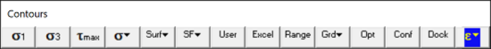
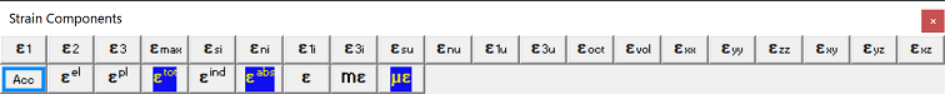
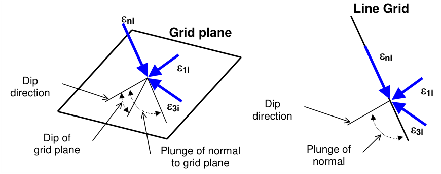
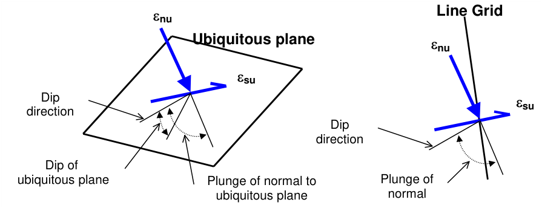
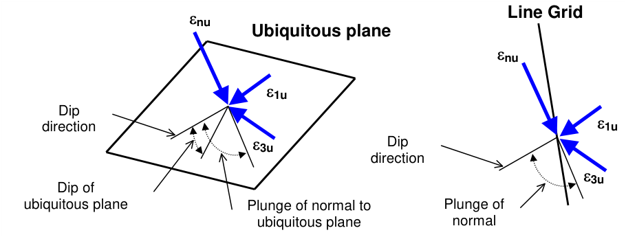

## 5.3.2.1 Deformación principal mayor

Genera contornos de las deformaciones principales mayor, intermedia y menor. Se puede acceder a estas componentes mediante la barra de herramientas Strain Components, como se indica a continuación:

Esta barra de herramientas se puede cambiar a orientación vertical arrastrándola contra el borde derecho o izquierdo de la ventana principal.

Se puede volver a la orientación horizontal arrastrándola contra el borde superior o inferior de la ventana principal.

Al seleccionar el botón de la barra de herramientas Contours se activa la barra de herramientas Stress Components.

Esta barra de herramientas se puede cambiar a orientación vertical arrastrándola contra el borde derecho o izquierdo de la ventana principal.

Se puede volver a la orientación horizontal arrastrándola contra el borde superior o inferior de la ventana principal.

Al seleccionar el botón de la barra de herramientas Contours se activa la barra de herramientas Strain Components.

Puede agregar este botón a la barra de herramientas Contours con el botón de configuración.

En el análisis elástico, el esfuerzo principal mayor se usa normalmente junto con el esfuerzo principal menor y el criterio de resistencia de Mohr-Coulomb o de Hoek-Brown para estimar el grado de daño por sobreesfuerzo. En cambio, en el análisis no lineal los esfuerzos nunca pueden superar la resistencia, a menos que se use algo de fluencia. En este último caso, la fluencia viscosa puede permitir estados de esfuerzo por encima del criterio de falla, lo que indica una falta de equilibrio estático. Por lo tanto, en el análisis no lineal normalmente se considera directamente la cantidad de deformación no lineal o la tasa de deformación predicha por el modelo

Mohr-Coulomb in 3D FF blocks

#### Accumulated Damage:

En el caso del análisis plástico, se puede activar la función de daño acumulado. Cuando Acc no está activada, se usa el valor actual de la deformación plástica. Cuando Acc está activada, el daño se registra desde la etapa 1 hasta la etapa actual a lo largo de toda la historia de carga del modelo, por lo que se grafica el peor caso (máximo) de deformación plástica.

Tenga en cuenta que se registran tanto la etapa en que ocurre la primera fluencia, MStep 1st Yield, como la etapa en que ocurre la deformación plástica máxima, MStep Max Yield, y ambas se pueden mostrar como etiquetas de trayectoria.

#### Strain Components:

Tenga en cuenta que hay tres componentes de deformación que se pueden contornear:

Plot > Strain > Value > Elastic Plot > Strain > Value > Plastic Plot > Strain > Value > Total

También hay dos formas distintas de presentar la deformación:

Plot > Strain > Value > Induced Strain Plot > Strain > Value > Absolute Strain

El rango de contornos se define con

#### Plot > Range

Cualquiera de estas componentes se puede agregar a la barra de herramientas de contornos si se desea

Tools > Configure Contouring Toolbar > Strain

Puede resultar útil agregar el botón

#### More Strain Components

a la barra de herramientas de contornos para acceder rápidamente a todas las componentes de deformación.

## 5.3.2.4 Deformación de corte máxima

Genera contornos de la deformación de corte máxima ½( e1 - e3 )

Se puede acceder a esta componente mediante la barra de herramientas Strain Components, como se indica a continuación:

Esta barra de herramientas se puede cambiar a orientación vertical arrastrándola contra el borde derecho o izquierdo de la ventana principal.

Se puede volver a la orientación horizontal arrastrándola contra el borde superior o inferior de la ventana principal.

Al seleccionar el botón de la barra de herramientas Contours se activa la barra de herramientas Stress Components.

Puede agregar este botón a la barra de herramientas Contours con el botón de configuración.

En el análisis elástico, el esfuerzo principal mayor se usa normalmente junto con el esfuerzo principal menor y el criterio de resistencia de Mohr-Coulomb o de Hoek-Brown para estimar el grado de daño por sobreesfuerzo. En cambio, en el análisis no lineal los esfuerzos nunca pueden superar la resistencia, a menos que se use algo de fluencia. En este último caso, la fluencia viscosa puede permitir estados de esfuerzo por encima del criterio de falla, lo que indica una falta de equilibrio estático. Por lo tanto, en el análisis no lineal normalmente se considera directamente la cantidad de deformación no lineal o la tasa de deformación predicha por el modelo

Mohr-Coulomb in 3D FF blocks

Tenga en cuenta que hay tres componentes de deformación que se pueden contornear:

Plot > Strain > Value > Elastic Plot > Strain > Value > Plastic Plot > Strain > Value > Total

También hay dos formas distintas de presentar la deformación:

Plot > Strain > Value > Induced Strain Plot > Strain > Value > Absolute Strain

El rango de contornos se define con

#### Plot > Range

Cualquiera de estas componentes se puede agregar a la barra de herramientas de contornos si se desea

Tools > Configure Contouring Toolbar > Strain

Puede resultar útil agregar el botón

#### More Strain Components

a la barra de herramientas de contornos para acceder rápidamente a todas las componentes de deformación.

## 5.3.2.5 Deformación de corte en el plano

Genera contornos de la deformación de corte máxima que actúa sobre el plano de la grilla y de la componente de la deformación normal al plano de la grilla o paralela a una grilla lineal.

Se puede acceder a estas componentes mediante la barra de herramientas Strain Components, como se indica a continuación:

Esta barra de herramientas se puede cambiar a orientación vertical arrastrándola contra el borde derecho o izquierdo de la ventana principal.

Se puede volver a la orientación horizontal arrastrándola contra el borde superior o inferior de la ventana principal.

Al seleccionar el botón de la barra de herramientas Contours se activa la barra de herramientas Stress Components.

Puede agregar este botón a la barra de herramientas Contours con el botón de configuración.

#### Plot > Grid Selection

Para calcular las deformaciones en el plano, el estado de deformación en cada punto del plano de la grilla se reorienta para determinar la deformación de corte máxima paralela al plano de la grilla y la deformación normal al plano. Tenga en cuenta que eip está orientada normal al plano de la grilla y paralela a la dirección de una grilla lineal.

- la dirección de manteo se mide positiva en sentido horario desde el eje y.

- el manteo del plano se mide positivo hacia abajo desde la horizontal (es decir, la dirección de manteo).

- la inclinación de la normal se mide positiva hacia abajo (es decir, negativa hacia arriba) desde la horizontal.

En el análisis elástico, el esfuerzo de corte máximo en el plano se usa normalmente junto con el esfuerzo normal en el plano y el criterio de resistencia de Mohr-Coulomb

Mohr-Coulomb in 3D FF blocks

para estimar el grado de daño por sobreesfuerzo. En cambio, en el análisis no lineal los esfuerzos nunca pueden superar la resistencia, a menos que se use algo de fluencia. En este último caso, la fluencia viscosa puede permitir estados de esfuerzo por encima del criterio de falla, lo que indica una falta de equilibrio estático. Por lo tanto, en el análisis no lineal normalmente se considera directamente la cantidad de deformación no lineal o la tasa de deformación predicha por el modelo

Mohr-Coulomb in DD planes

para estimar la magnitud del deslizamiento por sobreesfuerzo en una falla, un sistema de diaclasas o un plano de estratificación orientado de la misma forma que el plano de la grilla. Como estos parámetros dependen de la orientación, este criterio es representativo de la estabilidad de un macizo rocoso anisótropo.

Tenga en cuenta que hay tres componentes de deformación que se pueden contornear:

Plot > Strain > Value > Elastic Plot > Strain > Value > Plastic Plot > Strain > Value > Total

También hay dos formas distintas de presentar la deformación:

Plot > Strain > Value > Induced Strain Plot > Strain > Value > Absolute Strain

El rango de contornos se define con

#### Plot > Range

Cualquiera de estas componentes se puede agregar a la barra de herramientas de contornos si se desea

Tools > Configure Contouring Toolbar > Strain

Puede resultar útil agregar el botón

#### More Strain Components

a la barra de herramientas de contornos para acceder rápidamente a todas las componentes de deformación.

Temas relacionados:

Plot > Strain > e1i In-plane Maximum Plot > Strain > e3i In-plane Minimum Plot > Strain > esu Ubiquitous-plane Shear Plot > Strain > enu Ubiquitous-plane Normal

## 5.3.2.7 Deformación máxima en el plano

Genera contornos de las deformaciones máxima y mínima tangenciales al plano de grilla seleccionado actualmente o perpendiculares a una grilla lineal.

Se puede acceder a estas componentes mediante la barra de herramientas Strain Components, como se indica a continuación:

Esta barra de herramientas se puede cambiar a orientación vertical arrastrándola contra el borde derecho o izquierdo de la ventana principal.

Se puede volver a la orientación horizontal arrastrándola contra el borde superior o inferior de la ventana principal.

Al seleccionar el botón de la barra de herramientas Contours se activa la barra de herramientas Stress Components.

Puede agregar este botón a la barra de herramientas Contours con el botón de configuración.

#### Plot > Grid Selection

Para calcular las deformaciones máxima y mínima en el plano, se determinan las deformaciones tangenciales al plano de la grilla y luego se resuelven para obtener los valores máximo y mínimo. Tenga en cuenta que eni está orientada normal al plano de la grilla y paralela a la dirección de una grilla lineal. Tenga en cuenta también que eni, e1i y e3i son perpendiculares entre sí.

- la dirección de manteo se mide positiva en sentido horario desde el eje y.

- el manteo del plano se mide positivo hacia abajo desde la horizontal (es decir, la dirección de manteo).

- la inclinación de la normal se mide positiva hacia abajo (es decir, negativa hacia arriba) desde la horizontal.

Tenga en cuenta que hay tres componentes de deformación que se pueden contornear:

#### Plot > Strain > Value > Elastic

Plot > Strain > Value > Plastic Plot > Strain > Value > Total

También hay dos formas distintas de presentar la deformación:

Plot > Strain > Value > Induced Strain Plot > Strain > Value > Absolute Strain

El rango de contornos se define con

Plot > Range

Esta componente se puede agregar a la barra de herramientas de contornos si se desea

Tools > Configure Contouring Toolbar > Strain

Puede resultar útil agregar el botón

More Strain Components

a la barra de herramientas de contornos para acceder rápidamente a todas las componentes de deformación.

Temas relacionados:

Plot > Strain > esi In-plane Shear Plot > Strain > eni In-plane Normal Plot > Strain > e1u Ubiquitous-plane Maximum. Plot > Strain > e3u Ubiquitous-plane Minimum.

## 5.3.2.9 Deformación de corte en el plano ubicuo

Genera contornos de la deformación de corte máxima que actúa sobre el plano ubicuo n.º 1 y de la componente de la deformación normal a este plano.

Se puede acceder a estas componentes mediante la barra de herramientas Strain Components, como se indica a continuación:

Esta barra de herramientas se puede cambiar a orientación vertical arrastrándola contra el borde derecho o izquierdo de la ventana principal.

Se puede volver a la orientación horizontal arrastrándola contra el borde superior o inferior de la ventana principal.

Al seleccionar el botón de la barra de herramientas Contours se activa la barra de herramientas Stress Components.

Puede agregar este botón a la barra de herramientas Contours con el botón de configuración.

Para calcular las deformaciones ubicuas, el estado de deformación en cada punto del plano de la grilla se reorienta para determinar la deformación de corte máxima paralela al plano ubicuo y la deformación normal al plano ubicuo. Tenga en cuenta que enu está orientada normal al plano ubicuo y no es paralela a la dirección de una grilla lineal.

- la dirección de manteo se mide positiva en sentido horario desde el eje y.

- el manteo del plano se mide positivo hacia abajo desde la horizontal (es decir, la dirección de manteo).

- la inclinación de la normal se mide positiva hacia abajo (es decir, negativa hacia arriba) desde la horizontal.

La orientación del plano de corte ubicuo se define con

#### Plot > Strength Factors > Ubiquitous Parameters

Tenga en cuenta que hay tres componentes de deformación que se pueden contornear:

Plot > Strain > Value > Elastic Plot > Strain > Value > Plastic Plot > Strain > Value > Total

También hay dos formas distintas de presentar la deformación:

Plot > Strain > Value > Induced Strain Plot > Strain > Value > Absolute Strain

El rango de contornos se define con

#### Plot > Range

Esta componente se puede agregar a la barra de herramientas de contornos si se desea

Tools > Configure Contouring Toolbar > Strain

Puede resultar útil agregar el botón

#### More Strain Components

a la barra de herramientas de contornos para acceder rápidamente a todas las componentes de deformación.

Temas relacionados:

Plot > Strain > e1u Ubiquitous-plane Maximum. Plot > Strain > e3u Ubiquitous-plane Minimum. Plot > Strain > esi In-plane Shear Plot > Strain > eni In-plane Normal

## 5.3.2.11 Deformación máxima en el plano ubicuo

Genera contornos de las deformaciones máxima y mínima tangenciales al plano ubicuo n.º 1. Se puede acceder a estas componentes mediante la barra de herramientas Strain Components, como se indica a continuación:

Esta barra de herramientas se puede cambiar a orientación vertical arrastrándola contra el borde derecho o izquierdo de la ventana principal.

Se puede volver a la orientación horizontal arrastrándola contra el borde superior o inferior de la ventana principal.

Al seleccionar el botón de la barra de herramientas Contours se activa la barra de herramientas Stress Components.

Puede agregar este botón a la barra de herramientas Contours con el botón de configuración.

Para calcular las deformaciones ubicuas, el estado de deformación en cada punto del plano de la grilla se reorienta para determinar la deformación máxima y mínima paralelas al plano ubicuo. Tenga en cuenta que enu no está orientada normal al plano ubicuo y no es paralela a la dirección de una grilla lineal.

- la dirección de manteo se mide positiva en sentido horario desde el eje y.

- el manteo del plano se mide positivo hacia abajo desde la horizontal (es decir, la dirección de manteo).

- la inclinación de la normal se mide positiva hacia abajo (es decir, negativa hacia arriba) desde la horizontal.

La orientación del plano de corte ubicuo se define con

#### Plot > Strength Factors > Ubiquitous Parameters

Tenga en cuenta que hay tres componentes de deformación que se pueden contornear:

Plot > Strain > Value > Elastic Plot > Strain > Value > Plastic Plot > Strain > Value > Total

También hay dos formas distintas de presentar la deformación:

Plot > Strain > Value > Induced Strain Plot > Strain > Value > Absolute Strain

El rango de contornos se define con

#### Plot > Range

Esta componente se puede agregar a la barra de herramientas de contornos si se desea

Tools > Configure Contouring Toolbar > Strain

Puede resultar útil agregar el botón

#### More Strain Components

a la barra de herramientas de contornos para acceder rápidamente a todas las componentes de deformación.

Temas relacionados:

Plot > Strain > esi Ubiquitous-plane Shear

Plot > Strain > eni Ubiquitous-plane Normal

Plot > Strain > e1u In-plane Maximum.

Plot > Strain > e3u In-plane Minimum.

## 5.3.2.13 Deformación de corte octaédrica

Genera contornos de la deformación de corte octaédrica

eoct = ¹/3 [ (e1 - e2)² + (e2 - e3)² +(e3 - e1)² ]½

y de la deformación volumétrica

evvol = (e1 + e2 + e3)

Se puede acceder a estas componentes mediante la barra de herramientas Strain Components, como se indica a continuación:

Esta barra de herramientas se puede cambiar a orientación vertical arrastrándola contra el borde derecho o izquierdo de la ventana principal.

Se puede volver a la orientación horizontal arrastrándola contra el borde superior o inferior de la ventana principal.

Al seleccionar el botón de la barra de herramientas Contours se activa la barra de herramientas Stress Components.

Puede agregar este botón a la barra de herramientas Contours con el botón de configuración.

En el análisis elástico, el esfuerzo principal mayor se usa normalmente junto con el esfuerzo principal menor y el criterio de resistencia de Mohr-Coulomb o de Hoek-Brown para estimar el grado de daño por sobreesfuerzo.

En cambio, en el análisis no lineal los esfuerzos nunca pueden superar la resistencia, a menos que se use algo de fluencia. En este último caso, la fluencia viscosa puede permitir estados de esfuerzo por encima del criterio de falla, lo que indica una falta de equilibrio estático. Por lo tanto, en el análisis no lineal normalmente se considera directamente la cantidad de deformación no lineal o la tasa de deformación predicha por el modelo

Mohr-Coulomb in 3D FF blocks

Tenga en cuenta que hay tres componentes de deformación que se pueden contornear:

Plot > Strain > Value > Elastic Plot > Strain > Value > Plastic Plot > Strain > Value > Total

También hay dos formas distintas de presentar la deformación:

Plot > Strain > Value > Induced Strain Plot > Strain > Value > Absolute Strain

El rango de contornos se define con

#### Plot > Range

Esta componente se puede agregar a la barra de herramientas de contornos si se desea

Tools > Configure Contouring Toolbar > Strain

Puede resultar útil agregar el botón

#### More Strain Components

a la barra de herramientas de contornos para acceder rápidamente a todas las componentes de deformación.

## 5.3.2.15 Componente de deformación Exx

Genera contornos de las componentes cartesianas de la deformación. Se puede acceder a estas componentes mediante la barra de herramientas Strain Components, como se indica a continuación:

Esta barra de herramientas se puede cambiar a orientación vertical arrastrándola contra el borde derecho o izquierdo de la ventana principal.

Se puede volver a la orientación horizontal arrastrándola contra el borde superior o inferior de la ventana principal.

Al seleccionar el botón de la barra de herramientas Contours se activa la barra de herramientas Stress Components.

Puede agregar este botón a la barra de herramientas Contours con el botón de configuración.

Plot > Strain >  exx Cartesian Strain Component   deformación normal en la dirección del eje x Plot > Strain >  eyy Cartesian Strain Component   deformación normal en la dirección del eje y Plot > Strain >  ezz Cartesian Strain Component   deformación normal en la dirección del eje z Plot > Strain >  exy Cartesian Strain Component   deformación normal en la dirección del plano x-y Plot > Strain >  eyz Cartesian Strain Component   deformación normal en la dirección del plano y-z Plot > Strain >  exz Cartesian Strain Component   deformación normal en la dirección del plano x-z

Tenga en cuenta que hay tres componentes de deformación que se pueden contornear:

Plot > Strain > Value > Elastic Plot > Strain > Value > Plastic Plot > Strain > Value > Total

También hay dos formas distintas de presentar la deformación:

Plot > Strain > Value > Induced Strain Plot > Strain > Value > Absolute Strain

El rango de contornos se define con

#### Plot > Range

Esta componente se puede agregar a la barra de herramientas de contornos si se desea

Tools > Configure Contouring Toolbar > Strain

Puede resultar útil agregar el botón

More Strain Components

a la barra de herramientas de contornos para acceder rápidamente a todas las componentes de deformación.

## 5.3.2.21 Valor

5.3.2.21.1  Deformación elástica

Selecciona la componente de la deformación elástica, plástica o total. Se puede acceder a estas componentes mediante la barra de herramientas Strain Components, como se indica a continuación:

Esta barra de herramientas se puede cambiar a orientación vertical arrastrándola contra el borde derecho o izquierdo de la ventana principal.

Se puede volver a la orientación horizontal arrastrándola contra el borde superior o inferior de la ventana principal.

Al seleccionar el botón de la barra de herramientas Contours se activa la barra de herramientas Stress Components.

Puede agregar este botón a la barra de herramientas Contours con el botón de configuración.

Para más detalles, vea

Mohr-Coulomb in 3D FF blocks.

### 5.3.2.21.4 Deformación inducida

Grafica la componente de la deformación inducida o de la deformación absoluta.

Se puede acceder a esta componente mediante la barra de herramientas Strain Components, como se indica a continuación:

Esta barra de herramientas se puede cambiar a orientación vertical arrastrándola contra el borde derecho o izquierdo de la ventana principal.

Se puede volver a la orientación horizontal arrastrándola contra el borde superior o inferior de la ventana principal.

Al seleccionar el botón de la barra de herramientas Contours se activa la barra de herramientas Stress Components.

Puede agregar este botón a la barra de herramientas Contours con el botón de configuración.

La deformación inducida es la deformación sin la contribución de la deformación previa a la explotación. Representa el cambio de deformación desde la condición previa a la explotación.

La deformación absoluta es la deformación que incluye la contribución de la deformación previa a la explotación.

Vea también:

Plot > Stress > Value > Induced Strain Plot > Stress > Value > Absolute Strain

### 5.3.2.21.6 Deformación

Grafica la deformación:

- en unidades sin escalar (deformación/1),

- en milideformación (deformación/1000),

- en microdeformación (deformación/1000000).

Se puede acceder a esta componente mediante la barra de herramientas Strain Components, como se indica a continuación:

Esta barra de herramientas se puede cambiar a orientación vertical arrastrándola contra el borde derecho o izquierdo de la ventana principal.

Se puede volver a la orientación horizontal arrastrándola contra el borde superior o inferior de la ventana principal.

Al seleccionar el botón de la barra de herramientas Contours se activa la barra de herramientas Stress Components.

Puede agregar este botón a la barra de herramientas Contours con el botón de configuración.

