## 5.3.6.1 Parámetros del macizo rocoso

### 5.3.6.1.1 Parámetros de resistencia del macizo rocoso

Configura los parámetros de resistencia para generar gráficos de contornos de factores de resistencia en términos de las componentes del esfuerzo principal.

Se puede acceder a estas componentes mediante la barra de herramientas Strength Factor Components, como se indica a continuación:

Esta barra de herramientas se puede cambiar a orientación vertical arrastrándola contra el borde derecho o izquierdo de la ventana principal.

Se puede volver a la orientación horizontal arrastrándola contra el borde superior o inferior de la ventana principal.

Al seleccionar el botón de la barra de herramientas Contours se activa la barra de herramientas Strength Factor Components.

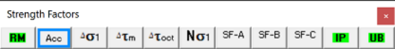

En el análisis elástico, los esfuerzos principales mayor y menor se pueden usar con los criterios de resistencia de Mohr-Coulomb, Hoek-Brown o Drucker-Prager para estimar el grado de daño por sobreesfuerzo. Como ninguno de los parámetros es sensible a la orientación, este criterio es representativo de la estabilidad de un macizo rocoso homogéneo.

En cambio, en el análisis no lineal los esfuerzos nunca pueden superar la resistencia, a menos que se use algo de fluencia. En este último caso, la fluencia viscosa puede permitir estados de esfuerzo por encima del criterio de falla, lo que indica una falta de equilibrio estático. Por lo tanto, en el análisis no lineal normalmente se considera directamente la cantidad de deformación no lineal o la tasa de deformación predicha por el modelo

Mohr-Coulomb in 3D FF blocks.

#### Mohr-Coulomb

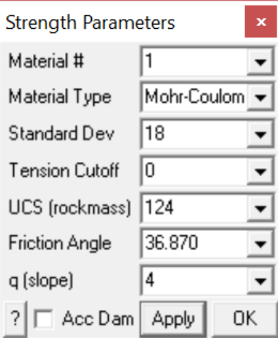

Material # especifica el número de material. El material n.º 1 representa el material de la roca de caja (host). Los demás números de material se usan para definir zonas de material alterno, como mineral, arcilla de falla (gouge), relleno, etc.

Standard Deviation especifica la incertidumbre del criterio de falla medido en la dirección s1.

Material Type especifica el tipo de material: Mohr-Coulomb, Hoek-Brown, Drucker-Prager o None.

Tension Cutoff, UCS, Friction Angle el criterio de Mohr-Coulomb define la resistencia en términos de esfuerzos principales de la siguiente forma:

#### Mohr-Coulomb

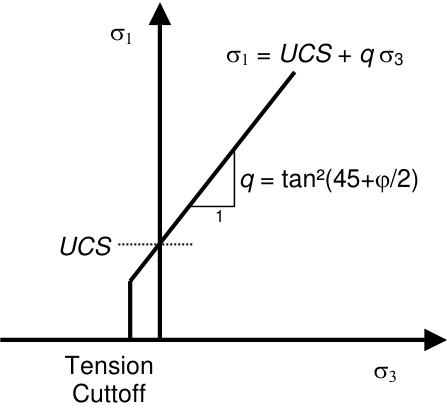

El límite de tracción (tension cutoff) y el UCS se especifican en unidades de esfuerzo (MPa o psi). El ángulo de fricción se especifica en grados.

Apply – regenera el gráfico de contornos.

Acc Dam – grafica el daño acumulado. Vea Accumulated Damage

#### Hoek-Brown

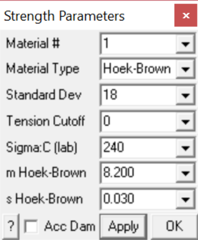

Material # especifica el número de material. El material n.º 1 representa el material de la roca de caja (host). Los demás números de material se usan para definir zonas de material alterno, como mineral, arcilla de falla (gouge), relleno, etc.

Material Type especifica el tipo de material: Mohr-Coulomb, Hoek-Brown, Drucker-Prager o None.

Standard Deviation especifica la incertidumbre del criterio de falla medido en la dirección s1 (especificada en unidades de esfuerzo, MPa o psi).

Tension Cutoff, Sigma:C, m and s el criterio de Hoek-Brown define la resistencia en términos de esfuerzos principales de la siguiente forma:

#### Hoek-Brown

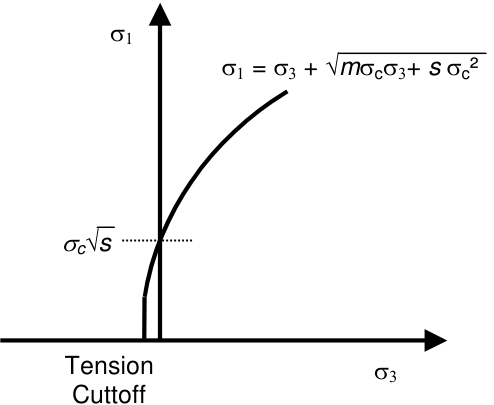

El límite de tracción (tension cutoff) y Sigma:C se especifican en unidades de esfuerzo (MPa o psi).

Apply – regenera el gráfico de contornos.

Acc Dam – grafica el daño acumulado. Vea Accumulated Damage

#### Drucker-Prager

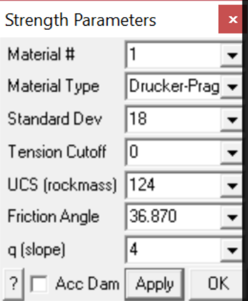

Material # especifica el número de material. El material n.º 1 representa el material de la roca de caja (host). Los demás números de material se usan para definir zonas de material alterno, como mineral, arcilla de falla (gouge), relleno, etc. Material Type especifica el tipo de material: Mohr-Coulomb, Hoek-Brown, Drucker-Prager o None.

Standard Deviation especifica la incertidumbre del criterio de falla medido en la dirección toct.

Tension Cutoff, UCS, Friction Angle el criterio de Drucker-Prager define la resistencia en términos de esfuerzos principales de la siguiente forma:

#### Drucker-Prager

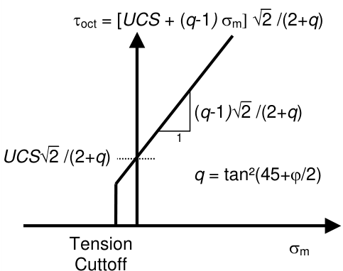

donde

toct = ¹/3 [(s1 - s2)² + (s2 - s3)² +(s3 - s1)²]½

smean = ¹/3 (s1 + s2 + s3)

El límite de tracción (tension cutoff) y el UCS se especifican en unidades de esfuerzo (MPa o psi). El ángulo de fricción se especifica en grados.

Tenga en cuenta que los parámetros de resistencia se han elegido de modo que el criterio se simplifique al criterio de Mohr-Coulomb cuando s2 es igual a s3.

Apply – regenera el gráfico de contornos.

Acc Dam – grafica el daño acumulado. Vea Accumulated Damage

#### Temas relacionados:

Plot > Strength Factor > Probability N-distribution

Plot > Strength Factor > SF-A - Strength/Stress Plot > Strength Factor > SF-B - Strength/Stress Plot > Strength Factors > SF-C - Strength/Stress Plot > Strength Factors > dS1 - Excess Stress Plot > Strength Factors > dTmax - Excess Stress

Plot > Strength Factors > dToct - Excess Stress

Plot > Strength Factors > In-plane Parameters

Plot > Strength Factors > Ubiquitous Parameters

### 5.3.6.1.2 Daño acumulado

Grafica el daño acumulado.

Se puede acceder a esta componente mediante la barra de herramientas Strength Factor Components, como se indica a continuación:

Esta barra de herramientas se puede cambiar a orientación vertical arrastrándola contra el borde derecho o izquierdo de la ventana principal.

Se puede volver a la orientación horizontal arrastrándola contra el borde superior o inferior de la ventana principal.

Al seleccionar el botón de la barra de herramientas Contours se activa la barra de herramientas Strength Factor Components.

Cuando Acc no está activada, se grafican el esfuerzo en exceso, la probabilidad de falla, el factor de resistencia y el RCF para los valores de esfuerzo actuales.

Cuando Acc está activada, el daño se registra desde la etapa 1 hasta la etapa actual a lo largo de toda la historia de carga del modelo, por lo que se grafica el peor caso del esfuerzo en exceso, la probabilidad de falla, el factor de resistencia o el RCF.

Esto permite usar los resultados del análisis elástico de esfuerzos de forma similar a la deformación acumulada en un modelo de plasticidad.

El registro del daño se realiza por separado para los 5 casos siguientes:

1. Falla del macizo rocoso (esfuerzo S1 en exceso, probabilidad, factor de resistencia) 2. Falla por corte en el plano (esfuerzo de corte en exceso, probabilidad, factor de resistencia) 3. Falla por corte en el plano ub (esfuerzo de corte en exceso, probabilidad, factor de resistencia)

4. Esfuerzo en la pared en el plano, en exceso (esfuerzo en exceso, RCF)

5. Esfuerzo en la pared en el plano ub, en exceso (esfuerzo en exceso, RCF)

Tenga en cuenta que se registran tanto la etapa en que ocurre la primera fluencia, MStep 1st Yield, como la etapa en que ocurre el máximo esfuerzo en exceso, MStep Max Yield, y ambas se pueden mostrar como etiquetas de trayectoria.

### 5.3.6.1.3 Esfuerzo S1 en exceso

Genera contornos del esfuerzo principal mayor en exceso y del factor de resistencia usando el método "A". Se puede acceder a estas componentes mediante la barra de herramientas Strength Factor Components, como se indica a continuación:

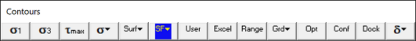

Esta barra de herramientas se puede cambiar a orientación vertical arrastrándola contra el borde derecho o izquierdo de la ventana principal.

Se puede volver a la orientación horizontal arrastrándola contra el borde superior o inferior de la ventana principal.

Al seleccionar el

botón de la barra de herramientas Contours se activa la barra de herramientas Strength Factor Components.

En el análisis elástico, los esfuerzos principales mayor y menor se pueden usar con los criterios de resistencia de Mohr-Coulomb o de Hoek-Brown

#### Plot > Strength Factors > Strength Parameters

para estimar el grado de daño por sobreesfuerzo. Como ninguno de los parámetros es sensible a la orientación, este criterio es representativo de la estabilidad de un macizo rocoso homogéneo.

En cambio, en el análisis no lineal los esfuerzos nunca pueden superar la resistencia, a menos que se use algo de fluencia. En este último caso, la fluencia viscosa puede permitir estados de esfuerzo por encima del criterio de falla, lo que indica una falta de equilibrio estático. Por lo tanto, en el análisis no lineal normalmente se considera directamente la cantidad de deformación no lineal o la tasa de deformación predicha por el modelo

Mohr-Coulomb in 3D FF blocks.

El método "A" supone que la trayectoria de esfuerzos hasta la falla se produce aumentando s1 sin pérdida de confinamiento. Esto es representativo de la falla de un pilar, donde s1 se considera la fuerza motriz.

#### Mohr-Coulomb

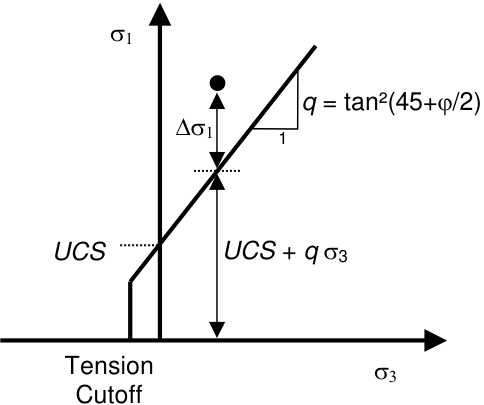

Plot > Strength Factors > SF-A   Strength/Stress se puede determinar como ( _UCS_ + _q_ s3 )/ s1 Plot > Strength Factors > SF/A   Stress/Strength se puede determinar como s1 / ( _UCS_ + _q_ s3 ) Plot > Strength Factors > Ds1   el esfuerzo en exceso se puede determinar como Ds1 = s1 - ( _UCS_ + _q_ s3 )

Plot > Strength Factors > N(Ds1 /std)   Probabilidad usando la distribución normal.

igual que en el método "B".

#### Hoek-Brown

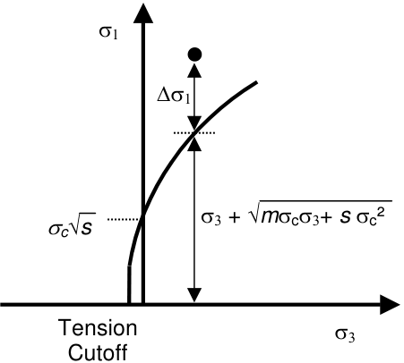

Plot > Strength Factors > SF-A   Strength/Stress se puede determinar como [ s3 + Ö( _m_ scs3 + _s_ sc²) ] / s1

Plot > Strength Factors > SF/A   Stress/Strength se puede determinar como s1 / [ s3 + Ö( _m_ scs3 + _s_ sc²) ]

Plot > Strength Factors > Ds1   el esfuerzo en exceso se puede determinar como Ds1 = s1 - [ s3 + Ö( _m_ scs3 + _s_ sc²) ]

Plot > Strength Factors > N(Ds1 /std)   Probabilidad usando la distribución normal.

igual que en el método "B".

Drucker-Prager solo se define con el método "C".

Los parámetros de resistencia se configuran con

Plot > Strength Factors > Strength Parameters

Temas relacionados:

Plot > Strength Factor > SF-B - Strength/Stress Plot > Strength Factors > SF-C - Strength/Stress Plot > Strength Factors > dTmax - Excess Stress Plot > Strength Factors > dToct - Excess Stress Plot > Strength Factors > In-plane Parameters Plot > Strength Factors > Ubiquitous Parameters

### 5.3.6.1.4 Esfuerzo Tmax en exceso

Genera contornos del esfuerzo de corte en exceso o del factor de resistencia usando el método "C". Se puede acceder a estas componentes mediante la barra de herramientas Strength Factor Components, como se indica a continuación:

Esta barra de herramientas se puede cambiar a orientación vertical arrastrándola contra el borde derecho o izquierdo de la ventana principal.

Se puede volver a la orientación horizontal arrastrándola contra el borde superior o inferior de la ventana principal.

Al seleccionar el botón de la barra de herramientas Contours se activa la barra de herramientas Strength Factor Components.

En el análisis elástico, los esfuerzos principales mayor y menor se pueden usar con los criterios de resistencia de Mohr-Coulomb o de Hoek-Brown

Plot > Strength Factors > Strength Parameters

para estimar el grado de daño por sobreesfuerzo. Como ninguno de los parámetros es sensible a la orientación, este criterio es representativo de la estabilidad de un macizo rocoso homogéneo.

En cambio, en el análisis no lineal los esfuerzos nunca pueden superar la resistencia, a menos que se use algo de fluencia. En este último caso, la fluencia viscosa puede permitir estados de esfuerzo por encima del criterio de falla, lo que indica una falta de equilibrio estático. Por lo tanto, en el análisis no lineal normalmente se considera directamente la cantidad de deformación no lineal o la tasa de deformación predicha por el modelo

Mohr-Coulomb in 3D FF blocks.

El método "C" supone que la trayectoria de esfuerzos hasta la falla se produce aumentando s1 con pérdida de confinamiento. Esto es representativo de la falla de un estribo (abutment), donde s1 - s3 se considera la fuerza motriz.

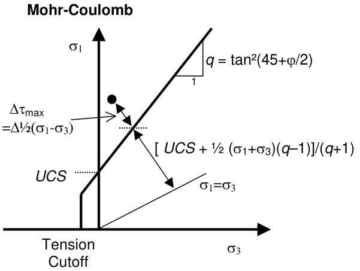

Plot > Strength Factors > SF-C   Strength/Stress se puede determinar como [ _UCS_ + ½(s1+s3) ( _q_ - 1) ]/[ ½(s1 - s3)( _q_ +1) ]

Plot > Strength Factors > SF/C   Stress/Strength se puede determinar como [ ½(s1 - s3)( _q_ +1) ]/ [ _UCS_ + ½(s1+s3) ( _q_ -1) ]

Plot > Strength Factors > Dtmax   el esfuerzo en exceso se puede determinar como

Dtmax = ½(s1 - s3) - [ _UCS_ + ½(s1+s3) ( _q_ -1) ]/( _q_ +1)

= [s1 - ( _UCS_ + _q_ s3) ]/( _q_ +1)

#### Hoek-Brown

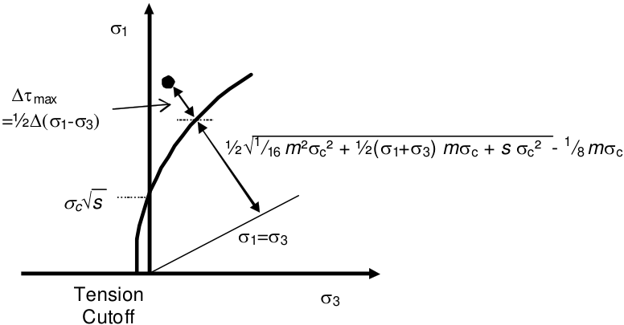

Plot > Strength Factors > SF-C   Strength/Stress se puede determinar como &#123; Ö[1 /16 _m_ ²sc² + ½(s1 + s3) _m_ sc + _s_ sc²] - ¼ _m_ sc&#125;/(s1 - s3)

Plot > Strength Factors > SF/C   Stress/Strength se puede determinar como (s1 - s3)/&#123; Ö[1 /16 _m_ ²sc² + ½(s1 + s3) _m_ sc + _s_ sc²] - ¼ _m_ sc &#125;

Plot > Strength Factors > Dtmax   el esfuerzo en exceso se puede determinar como

Dtmax = ½(s1 - s3) - ½&#123; Ö[1 /16 _m_ ²sc² + ½(s1 + s3) _m_ sc + _s_ sc²] - ¼ _m_ sc &#125;

#### Drucker-Prager

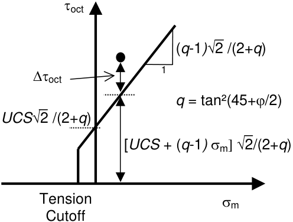

SF-C Strength/Stress   se puede determinar como [ _UCS_ + ( _q_ –1) smean ] Ö(2) /[ toct ( _q_ +2) ]

SF-C Stress/Strength   se puede determinar como toct /[ _UCS_ + ( _q_ –1) smean ] Ö(2) /( _q_ +2) Dtoct Excess   se puede determinar como toct - [ _UCS_ + ( _q_ –1) smean ] Ö(2) /( _q_ +2)

donde

_q_ = tan²(45+j/2) toct = ¹/3 Ö[( s1 - s2 )² + ( s2 - s3 )² +( s3 - s1 )²] smean = ¹/3 ( s1 + s2 + s3 )

Tenga en cuenta que los parámetros de resistencia se han elegido de modo que el criterio se simplifique al criterio de Mohr-Coulomb cuando s2 es igual a s3.

Los parámetros de resistencia se configuran con

Plot > Strength Factors > Strength Parameters

Temas relacionados:

Plot > Strength Factor > SF-A - Stress/Strength Plot > Strength Factors > SF-B - Stress/Strength Plot > Strength Factors > dS1 - Excess Stress Plot > Strength Factors > In-plane Parameters Plot > Strength Factors > Ubiquitous Parameters

5.3.6.1.6  NS1 Probabilidad normal

Genera contornos del esfuerzo principal mayor en exceso y del factor de resistencia usando el método "A". Se puede acceder a estas componentes mediante la barra de herramientas Strength Factor Components, como se indica a continuación:

Esta barra de herramientas se puede cambiar a orientación vertical arrastrándola contra el borde derecho o izquierdo de la ventana principal.

Se puede volver a la orientación horizontal arrastrándola contra el borde superior o inferior de la ventana principal.

Al seleccionar el botón de la barra de herramientas Contours se activa la barra de herramientas Strength Factor Components.

En el análisis elástico, los esfuerzos principales mayor y menor se pueden usar con los criterios de resistencia de Mohr-Coulomb o de Hoek-Brown

Plot > Strength Factors > Strength Parameters

para estimar el grado de daño por sobreesfuerzo. Como ninguno de los parámetros es sensible a la orientación, este criterio es representativo de la estabilidad de un macizo rocoso homogéneo.

En cambio, en el análisis no lineal los esfuerzos nunca pueden superar la resistencia, a menos que se use algo de fluencia. En este último caso, la fluencia viscosa puede permitir estados de esfuerzo por encima del criterio de falla, lo que indica una falta de equilibrio estático. Por lo tanto, en el análisis no lineal normalmente se considera directamente la cantidad de deformación no lineal o la tasa de deformación predicha por el modelo

Mohr-Coulomb in 3D FF blocks.

El método "A" supone que la trayectoria de esfuerzos hasta la falla se produce aumentando s1 sin pérdida de confinamiento. Esto es representativo de la falla de un pilar, donde s1 se considera la fuerza motriz.

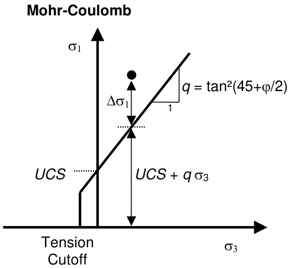

Plot > Strength Factors > SF-A   Strength/Stress se puede determinar como ( _UCS_ + _q_ s3 )/ s1 Plot > Strength Factors > SF/A   Stress/Strength se puede determinar como s1 / ( _UCS_ + _q_ s3 ) Plot > Strength Factors > Ds1   el esfuerzo en exceso se puede determinar como Ds1 = s1 - ( _UCS_ + _q_ s3 )

Plot > Strength Factors > N(Ds1 /std)   Probabilidad usando la distribución normal.

igual que en el método "B".

#### Hoek-Brown

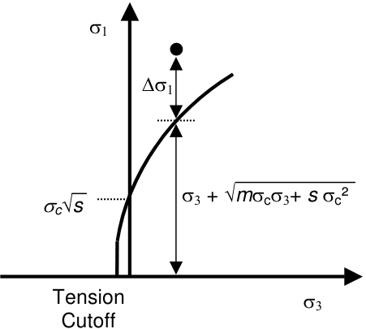

Plot > Strength Factors > SF-A   Strength/Stress se puede determinar como [ s3 + Ö( _m_ scs3 + _s_ sc²) ] / s1

Plot > Strength Factors > SF/A   Stress/Strength se puede determinar como s1 / [ s3 + Ö( _m_ scs3 + _s_ sc²) ]

Plot > Strength Factors > Ds1   el esfuerzo en exceso se puede determinar como Ds1 = s1 - [ s3 + Ö( _m_ scs3 + _s_ sc²) ]

Plot > Strength Factors > N(Ds1 /std)   Probabilidad usando la distribución normal.

igual que en el método "B".

Drucker-Prager solo se define con el método "C".

Los parámetros de resistencia se configuran con

Plot > Strength Factors > Strength Parameters

Temas relacionados:

Plot > Strength Factor > SF-B - Strength/Stress Plot > Strength Factors > SF-C - Strength/Stress Plot > Strength Factors > dTmax - Excess Stress Plot > Strength Factors > dToct - Excess Stress Plot > Strength Factors > In-plane Parameters Plot > Strength Factors > Ubiquitous Parameters

### 5.3.6.1.8 SF-B Resistencia/Esfuerzo

Genera contornos del esfuerzo principal mayor en exceso y del factor de resistencia usando el método "B". Se puede acceder a estas componentes mediante la barra de herramientas Strength Factor Components, como se indica a continuación:

Esta barra de herramientas se puede cambiar a orientación vertical arrastrándola contra el borde derecho o izquierdo de la ventana principal.

Se puede volver a la orientación horizontal arrastrándola contra el borde superior o inferior de la ventana principal.

Al seleccionar el

botón de la barra de herramientas Contours se activa la barra de herramientas Strength Factor Components.

En el análisis elástico, los esfuerzos principales mayor y menor se pueden usar con los criterios de resistencia de Mohr-Coulomb o de Hoek-Brown

#### Plot > Strength Factors > Strength Parameters

para estimar el grado de daño por sobreesfuerzo. Como ninguno de los parámetros es sensible a la orientación, este criterio es representativo de la estabilidad de un macizo rocoso homogéneo.

En cambio, en el análisis no lineal los esfuerzos nunca pueden superar la resistencia, a menos que se use algo de fluencia. En este último caso, la fluencia viscosa puede permitir estados de esfuerzo por encima del criterio de falla, lo que indica una falta de equilibrio estático. Por lo tanto, en el análisis no lineal normalmente se considera directamente la cantidad de deformación no lineal o la tasa de deformación predicha por el modelo

Mohr-Coulomb in 3D FF blocks.

El método "B" supone que la trayectoria de esfuerzos hasta la falla se produce aumentando s1 sin pérdida de confinamiento. Esto es representativo de la falla de un pilar, donde s1 - s3 se considera la fuerza motriz.

#### Mohr-Coulomb

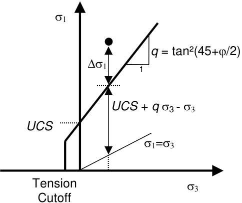

Plot > Strength Factors > SF-B   Strength/Stress se puede determinar como ( _UCS_ + _q_ s3 - s3 )/(s1 - s3)

Plot > Strength Factors > SF/B   Stress/Strength se puede determinar como (s1 - s3)/( _UCS_ + _q_ s3 - s3 )

Plot > Strength Factors > Ds1   el esfuerzo en exceso se puede determinar como Ds1 = s1 - ( _UCS_ + _q_ s3 )

Plot > Strength Factors > N(Ds1 /std)   Probabilidad usando la distribución normal.

igual que en el método "A".

#### Hoek-Brown

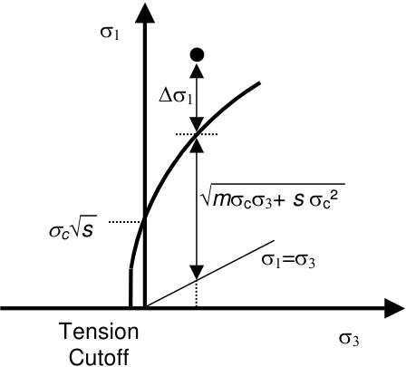

Plot > Strength Factors > SF-B   Strength/Stress se puede determinar como Ö( _m_ scs3 + _s_ sc²)/(s1 - s3) Plot > Strength Factors > SF/B   Stress/Strength se puede determinar como (s1 - s3)/Ö( _m_ scs3 + _s_ sc²) Plot > Strength Factors > Ds1   el esfuerzo en exceso se puede determinar como Ds1 = s1 - [ s3 + Ö( _m_ scs3 + _s_ sc²) ]

Plot > Strength Factors > N(Ds1 /std)   Probabilidad usando la distribución normal.

igual que en el método "A".

Drucker-Prager solo se define con el método "C".

Los parámetros de resistencia se configuran con

Plot > Strength Factors > Strength Parameters

Temas relacionados:

Plot > Strength Factor > SF-A - Strength/Stress Plot > Strength Factors > SF-C - Strength/Stress Plot > Strength Factors > dTmax - Excess Stress Plot > Strength Factors > dToct - Excess Stress Plot > Strength Factors > In-plane Parameters Plot > Strength Factors > Ubiquitous Parameters

### 5.3.6.1.9 SF-C Resistencia/Esfuerzo

Genera contornos del esfuerzo de corte en exceso o del factor de resistencia usando el método "C". Se puede acceder a estas componentes mediante la barra de herramientas Strength Factor Components, como se indica a continuación:

Esta barra de herramientas se puede cambiar a orientación vertical arrastrándola contra el borde derecho o izquierdo de la ventana principal.

Se puede volver a la orientación horizontal arrastrándola contra el borde superior o inferior de la ventana principal.

Al seleccionar el botón de la barra de herramientas Contours se activa la barra de herramientas Strength Factor Components.

En el análisis elástico, los esfuerzos principales mayor y menor se pueden usar con los criterios de resistencia de Mohr-Coulomb o de Hoek-Brown

#### Plot > Strength Factors > Strength Parameters

para estimar el grado de daño por sobreesfuerzo. Como ninguno de los parámetros es sensible a la orientación, este criterio es representativo de la estabilidad de un macizo rocoso homogéneo.

En cambio, en el análisis no lineal los esfuerzos nunca pueden superar la resistencia, a menos que se use algo de fluencia. En este último caso, la fluencia viscosa puede permitir estados de esfuerzo por encima del criterio de falla, lo que indica una falta de equilibrio estático. Por lo tanto, en el análisis no lineal normalmente se considera directamente la cantidad de deformación no lineal o la tasa de deformación predicha por el modelo

Mohr-Coulomb in 3D FF blocks.

El método "C" supone que la trayectoria de esfuerzos hasta la falla se produce aumentando s1 con pérdida de confinamiento. Esto es representativo de la falla de un estribo (abutment), donde s1 - s3 se considera la fuerza motriz.

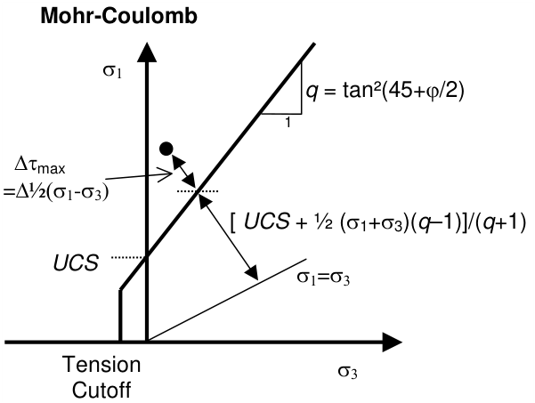

Plot > Strength Factors > SF-C   Strength/Stress se puede determinar como [ _UCS_ + ½(s1+s3) ( _q_ - 1) ]/[ ½(s1 - s3)( _q_ +1) ]

Plot > Strength Factors > SF/C   Stress/Strength se puede determinar como [ ½(s1 - s3)( _q_ +1) ]/ [ _UCS_ + ½(s1+s3) ( _q_ -1) ]

Plot > Strength Factors > Dtmax   el esfuerzo en exceso se puede determinar como

Dtmax = ½(s1 - s3) - [ _UCS_ + ½(s1+s3) ( _q_ -1) ]/( _q_ +1)

= [s1 - ( _UCS_ + _q_ s3) ]/( _q_ +1)

#### Hoek-Brown

Plot > Strength Factors > SF-C   Strength/Stress se puede determinar como &#123; Ö[1 /16 _m_ ²sc² + ½(s1 + s3) _m_ sc + _s_ sc²] - ¼ _m_ sc&#125;/(s1 - s3)

Plot > Strength Factors > SF/C   Stress/Strength se puede determinar como (s1 - s3)/&#123; Ö[1 /16 _m_ ²sc² + ½(s1 + s3) _m_ sc + _s_ sc²] - ¼ _m_ sc &#125;

Plot > Strength Factors > Dtmax   el esfuerzo en exceso se puede determinar como

Dtmax = ½(s1 - s3) - ½&#123; Ö[1 /16 _m_ ²sc² + ½(s1 + s3) _m_ sc + _s_ sc²] - ¼ _m_ sc &#125;

#### Drucker-Prager

SF-C Strength/Stress   se puede determinar como [ _UCS_ + ( _q_ –1) smean ] Ö(2) /[ toct ( _q_ +2) ]

SF-C Stress/Strength   se puede determinar como toct /[ _UCS_ + ( _q_ –1) smean ] Ö(2) /( _q_ +2) Dtoct Excess   se puede determinar como toct - [ _UCS_ + ( _q_ –1) smean ] Ö(2) /( _q_ +2)

donde

_q_ = tan²(45+j/2) toct = ¹/3 Ö[( s1 - s2 )² + ( s2 - s3 )² +( s3 - s1 )²] smean = ¹/3 ( s1 + s2 + s3 )

Tenga en cuenta que los parámetros de resistencia se han elegido de modo que el criterio se simplifique al criterio de Mohr-Coulomb cuando s2 es igual a s3.

Los parámetros de resistencia se configuran con

Plot > Strength Factors > Strength Parameters

Temas relacionados:

Plot > Strength Factor > SF-A - Stress/Strength Plot > Strength Factors > SF-B - Stress/Strength Plot > Strength Factors > dS1 - Excess Stress Plot > Strength Factors > In-plane Parameters Plot > Strength Factors > Ubiquitous Parameters

### 5.3.6.1.10 SF/A Esfuerzo/Resistencia

Genera contornos del esfuerzo principal mayor en exceso y del factor de resistencia usando el método "A". Se puede acceder a estas componentes mediante la barra de herramientas Strength Factor Components, como se indica a continuación:

Esta barra de herramientas se puede cambiar a orientación vertical arrastrándola contra el borde derecho o izquierdo de la ventana principal.

Se puede volver a la orientación horizontal arrastrándola contra el borde superior o inferior de la ventana principal.

Al seleccionar el botón de la barra de herramientas Contours se activa la barra de herramientas Strength Factor Components.

En el análisis elástico, los esfuerzos principales mayor y menor se pueden usar con los criterios de resistencia de Mohr-Coulomb o de Hoek-Brown

Plot > Strength Factors > Strength Parameters

para estimar el grado de daño por sobreesfuerzo. Como ninguno de los parámetros es sensible a la orientación, este criterio es representativo de la estabilidad de un macizo rocoso homogéneo.

En cambio, en el análisis no lineal los esfuerzos nunca pueden superar la resistencia, a menos que se use algo de fluencia. En este último caso, la fluencia viscosa puede permitir estados de esfuerzo por encima del criterio de falla, lo que indica una falta de equilibrio estático. Por lo tanto, en el análisis no lineal normalmente se considera directamente la cantidad de deformación no lineal o la tasa de deformación predicha por el modelo

Mohr-Coulomb in 3D FF blocks.

El método "A" supone que la trayectoria de esfuerzos hasta la falla se produce aumentando s1 sin pérdida de confinamiento. Esto es representativo de la falla de un pilar, donde s1 se considera la fuerza motriz.

Plot > Strength Factors > SF-A   Strength/Stress se puede determinar como ( _UCS_ + _q_ s3 )/ s1 Plot > Strength Factors > SF/A   Stress/Strength se puede determinar como s1 / ( _UCS_ + _q_ s3 ) Plot > Strength Factors > Ds1   el esfuerzo en exceso se puede determinar como Ds1 = s1 - ( _UCS_ + _q_ s3 )

Plot > Strength Factors > N(Ds1 /std)   Probabilidad usando la distribución normal.

igual que en el método "B".

#### Hoek-Brown

Plot > Strength Factors > SF-A   Strength/Stress se puede determinar como [ s3 + Ö( _m_ scs3 + _s_ sc²) ] / s1

Plot > Strength Factors > SF/A   Stress/Strength se puede determinar como s1 / [ s3 + Ö( _m_ scs3 + _s_ sc²) ]

Plot > Strength Factors > Ds1   el esfuerzo en exceso se puede determinar como Ds1 = s1 - [ s3 + Ö( _m_ scs3 + _s_ sc²) ]

Plot > Strength Factors > N(Ds1 /std)   Probabilidad usando la distribución normal.

igual que en el método "B".

Drucker-Prager solo se define con el método "C".

Los parámetros de resistencia se configuran con

Plot > Strength Factors > Strength Parameters

Temas relacionados:

Plot > Strength Factor > SF-B - Strength/Stress Plot > Strength Factors > SF-C - Strength/Stress Plot > Strength Factors > dTmax - Excess Stress Plot > Strength Factors > dToct - Excess Stress Plot > Strength Factors > In-plane Parameters Plot > Strength Factors > Ubiquitous Parameters

### 5.3.6.1.11 SF/B Esfuerzo/Resistencia

Genera contornos del esfuerzo principal mayor en exceso y del factor de resistencia usando el método "B". Se puede acceder a estas componentes mediante la barra de herramientas Strength Factor Components, como se indica a continuación:

Esta barra de herramientas se puede cambiar a orientación vertical arrastrándola contra el borde derecho o izquierdo de la ventana principal.

Se puede volver a la orientación horizontal arrastrándola contra el borde superior o inferior de la ventana principal.

Al seleccionar el

botón de la barra de herramientas Contours se activa la barra de herramientas Strength Factor Components.

En el análisis elástico, los esfuerzos principales mayor y menor se pueden usar con los criterios de resistencia de Mohr-Coulomb o de Hoek-Brown

#### Plot > Strength Factors > Strength Parameters

para estimar el grado de daño por sobreesfuerzo. Como ninguno de los parámetros es sensible a la orientación, este criterio es representativo de la estabilidad de un macizo rocoso homogéneo.

En cambio, en el análisis no lineal los esfuerzos nunca pueden superar la resistencia, a menos que se use algo de fluencia. En este último caso, la fluencia viscosa puede permitir estados de esfuerzo por encima del criterio de falla, lo que indica una falta de equilibrio estático. Por lo tanto, en el análisis no lineal normalmente se considera directamente la cantidad de deformación no lineal o la tasa de deformación predicha por el modelo

Mohr-Coulomb in 3D FF blocks.

El método "B" supone que la trayectoria de esfuerzos hasta la falla se produce aumentando s1 sin pérdida de confinamiento. Esto es representativo de la falla de un pilar, donde s1 - s3 se considera la fuerza motriz.

#### Mohr-Coulomb

Plot > Strength Factors > SF-B   Strength/Stress se puede determinar como ( _UCS_ + _q_ s3 - s3 )/(s1 - s3)

Plot > Strength Factors > SF/B   Stress/Strength se puede determinar como (s1 - s3)/( _UCS_ + _q_ s3 - s3 )

Plot > Strength Factors > Ds1   el esfuerzo en exceso se puede determinar como Ds1 = s1 - ( _UCS_ + _q_ s3 )

Plot > Strength Factors > N(Ds1 /std)   Probabilidad usando la distribución normal.

igual que en el método "A".

#### Hoek-Brown

Plot > Strength Factors > SF-B   Strength/Stress se puede determinar como Ö( _m_ scs3 + _s_ sc²)/(s1 - s3) Plot > Strength Factors > SF/B   Stress/Strength se puede determinar como (s1 - s3)/Ö( _m_ scs3 + _s_ sc²) Plot > Strength Factors > Ds1   el esfuerzo en exceso se puede determinar como Ds1 = s1 - [ s3 + Ö( _m_ scs3 + _s_ sc²) ]

Plot > Strength Factors > N(Ds1 /std)   Probabilidad usando la distribución normal.

igual que en el método "A".

Drucker-Prager solo se define con el método "C".

Los parámetros de resistencia se configuran con

Plot > Strength Factors > Strength Parameters

Temas relacionados:

Plot > Strength Factor > SF-A - Strength/Stress Plot > Strength Factors > SF-C - Strength/Stress Plot > Strength Factors > dTmax - Excess Stress Plot > Strength Factors > dToct - Excess Stress Plot > Strength Factors > In-plane Parameters Plot > Strength Factors > Ubiquitous Parameters

### 5.3.6.1.12 SF/C Esfuerzo/Resistencia

Genera contornos del esfuerzo de corte en exceso o del factor de resistencia usando el método "C". Se puede acceder a estas componentes mediante la barra de herramientas Strength Factor Components, como se indica a continuación:

Esta barra de herramientas se puede cambiar a orientación vertical arrastrándola contra el borde derecho o izquierdo de la ventana principal.

Se puede volver a la orientación horizontal arrastrándola contra el borde superior o inferior de la ventana principal.

Al seleccionar el botón de la barra de herramientas Contours se activa la barra de herramientas Strength Factor Components.

En el análisis elástico, los esfuerzos principales mayor y menor se pueden usar con los criterios de resistencia de Mohr-Coulomb o de Hoek-Brown

#### Plot > Strength Factors > Strength Parameters

para estimar el grado de daño por sobreesfuerzo. Como ninguno de los parámetros es sensible a la orientación, este criterio es representativo de la estabilidad de un macizo rocoso homogéneo.

En cambio, en el análisis no lineal los esfuerzos nunca pueden superar la resistencia, a menos que se use algo de fluencia. En este último caso, la fluencia viscosa puede permitir estados de esfuerzo por encima del criterio de falla, lo que indica una falta de equilibrio estático. Por lo tanto, en el análisis no lineal normalmente se considera directamente la cantidad de deformación no lineal o la tasa de deformación predicha por el modelo

Mohr-Coulomb in 3D FF blocks.

El método "C" supone que la trayectoria de esfuerzos hasta la falla se produce aumentando s1 con pérdida de confinamiento. Esto es representativo de la falla de un estribo (abutment), donde s1 - s3 se considera la fuerza motriz.

Plot > Strength Factors > SF-C   Strength/Stress se puede determinar como [ _UCS_ + ½(s1+s3) ( _q_ - 1) ]/[ ½(s1 - s3)( _q_ +1) ]

Plot > Strength Factors > SF/C   Stress/Strength se puede determinar como [ ½(s1 - s3)( _q_ +1) ]/ [ _UCS_ + ½(s1+s3) ( _q_ -1) ]

Plot > Strength Factors > Dtmax   el esfuerzo en exceso se puede determinar como

Dtmax = ½(s1 - s3) - [ _UCS_ + ½(s1+s3) ( _q_ -1) ]/( _q_ +1)

= [s1 - ( _UCS_ + _q_ s3) ]/( _q_ +1)

#### Hoek-Brown

Plot > Strength Factors > SF-C   Strength/Stress se puede determinar como &#123; Ö[1 /16 _m_ ²sc² + ½(s1 + s3) _m_ sc + _s_ sc²] - ¼ _m_ sc&#125;/(s1 - s3)

Plot > Strength Factors > SF/C   Stress/Strength se puede determinar como (s1 - s3)/&#123; Ö[1 /16 _m_ ²sc² + ½(s1 + s3) _m_ sc + _s_ sc²] - ¼ _m_ sc &#125;

Plot > Strength Factors > Dtmax   el esfuerzo en exceso se puede determinar como

Dtmax = ½(s1 - s3) - ½&#123; Ö[1 /16 _m_ ²sc² + ½(s1 + s3) _m_ sc + _s_ sc²] - ¼ _m_ sc &#125;

#### Drucker-Prager

SF-C Strength/Stress   se puede determinar como [ _UCS_ + ( _q_ –1) smean ] Ö(2) /[ toct ( _q_ +2) ]

SF-C Stress/Strength   se puede determinar como toct /[ _UCS_ + ( _q_ –1) smean ] Ö(2) /( _q_ +2) Dtoct Excess   se puede determinar como toct - [ _UCS_ + ( _q_ –1) smean ] Ö(2) /( _q_ +2)

donde

_q_ = tan²(45+j/2) toct = ¹/3 Ö[( s1 - s2 )² + ( s2 - s3 )² +( s3 - s1 )²] smean = ¹/3 ( s1 + s2 + s3 )

Tenga en cuenta que los parámetros de resistencia se han elegido de modo que el criterio se simplifique al criterio de Mohr-Coulomb cuando s2 es igual a s3.

Los parámetros de resistencia se configuran con

Plot > Strength Factors > Strength Parameters

Temas relacionados:

Plot > Strength Factor > SF-A - Stress/Strength Plot > Strength Factors > SF-B - Stress/Strength Plot > Strength Factors > dS1 - Excess Stress Plot > Strength Factors > In-plane Parameters Plot > Strength Factors > Ubiquitous Parameters

## 5.3.6.2 Parámetros en el plano

5.3.6.2.1  Parámetros en el plano

Configura los parámetros de resistencia para generar gráficos de contornos de factores de resistencia en términos de las componentes del esfuerzo en el plano.

Se puede acceder a estas componentes mediante la barra de herramientas Strength Factor Components, como se indica a continuación:

Esta barra de herramientas se puede cambiar a orientación vertical arrastrándola contra el borde derecho o izquierdo de la ventana principal.

Se puede volver a la orientación horizontal arrastrándola contra el borde superior o inferior de la ventana principal.

Al seleccionar el botón de la barra de herramientas Contours se activa la barra de herramientas Strength Factor Components.

Para calcular los esfuerzos de corte y normal en el plano, el estado de esfuerzos en cada punto del plano de la grilla se reorienta para determinar el esfuerzo de corte máximo paralelo al plano de la grilla y el esfuerzo normal al plano de la grilla.

En el análisis elástico, los esfuerzos máximos de corte y normal en el plano se pueden usar con el criterio de resistencia de Mohr-Coulomb para estimar la magnitud del deslizamiento por sobreesfuerzo en una falla, un sistema de diaclasas o un plano de estratificación orientado de la misma forma que el plano de la grilla. Como estos parámetros dependen de la orientación, este criterio es representativo de la estabilidad de un macizo rocoso anisótropo.

En cambio, en el análisis no lineal los esfuerzos nunca pueden superar la resistencia, a menos que se use algo de fluencia. En este último caso, la fluencia viscosa puede permitir estados de esfuerzo por encima del criterio de falla, lo que indica una falta de equilibrio estático. Por lo tanto, en el análisis no lineal normalmente se considera directamente la cantidad de deformación no lineal o la tasa de deformación predicha por el modelo

Mohr-Coulomb in DD planes Fault-Gouge in DD planes Backfill-Hyperbolic in DD planes

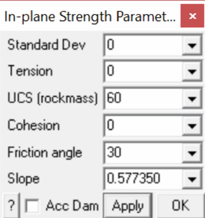

El criterio de Mohr-Coulomb define la resistencia al corte en términos del esfuerzo de corte y el esfuerzo normal de la siguiente forma:

#### Mohr-Coulomb

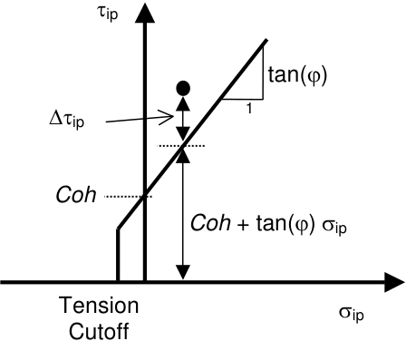

El límite de tracción (tension cutoff), el UCS y la cohesión se especifican en unidades de esfuerzo (MPa o psi).

El ángulo de fricción se especifica en grados.

Standard Deviation especifica la incertidumbre del criterio de falla medido en la dirección tip (especificada en unidades de esfuerzo, MPa o psi).

Acc Dam – grafica el daño acumulado. Vea Accumulated Damage

Apply – regenera el gráfico de contornos.

Temas relacionados:

Plot > Strength Factor > Probability N-distribution Plot > Strength Factor > SF-ip - Stress/Strength Plot > Strength Factors > SF-ub - Stress/Strength Plot > Strength Factors > dTip - Excess Stress Plot > Strength Factors > dTub - Excess Stress Plot > Strength Factors > Rockmass Strength Parameters Plot > Strength Factors > Ubiquitous Parameters

### 5.3.6.2.2 Daño acumulado

Grafica el daño acumulado.

Se puede acceder a esta componente mediante la barra de herramientas Strength Factor Components, como se indica a continuación:

Esta barra de herramientas se puede cambiar a orientación vertical arrastrándola contra el borde derecho o izquierdo de la ventana principal.

Se puede volver a la orientación horizontal arrastrándola contra el borde superior o inferior de la ventana principal.

Al seleccionar el botón de la barra de herramientas Contours se activa la barra de herramientas Strength Factor Components.

Cuando Acc no está activada, se grafican el esfuerzo en exceso, la probabilidad de falla, el factor de resistencia y el RCF para los valores de esfuerzo actuales.

Cuando Acc está activada, el daño se registra desde la etapa 1 hasta la etapa actual a lo largo de toda la historia de carga del modelo, por lo que se grafica el peor caso del esfuerzo en exceso, la probabilidad de falla, el factor de resistencia o el RCF.

Esto permite usar los resultados del análisis elástico de esfuerzos de forma similar a la deformación acumulada en un modelo de plasticidad.

El registro del daño se realiza por separado para los 5 casos siguientes:

1. Falla del macizo rocoso (esfuerzo S1 en exceso, probabilidad, factor de resistencia) 2. Falla por corte en el plano (esfuerzo de corte en exceso, probabilidad, factor de resistencia) 3. Falla por corte en el plano ub (esfuerzo de corte en exceso, probabilidad, factor de resistencia)

4. Esfuerzo en la pared en el plano, en exceso (esfuerzo en exceso, RCF)

5. Esfuerzo en la pared en el plano ub, en exceso (esfuerzo en exceso, RCF)

Tenga en cuenta que se registran tanto la etapa en que ocurre la primera fluencia, MStep 1st Yield, como la etapa en que ocurre el máximo esfuerzo en exceso, MStep Max Yield, y ambas se pueden mostrar como etiquetas de trayectoria.

### 5.3.6.2.3 Esfuerzo de corte en el plano, en exceso

Genera contornos de la resistencia al corte en el plano.

Se puede acceder a estas componentes mediante la barra de herramientas Strength Factor Components, como se indica a continuación:

Esta barra de herramientas se puede cambiar a orientación vertical arrastrándola contra el borde derecho o izquierdo de la ventana principal.

Se puede volver a la orientación horizontal arrastrándola contra el borde superior o inferior de la ventana principal.

Al seleccionar el

botón de la barra de herramientas Contours se activa la barra de herramientas Strength Factor Components.

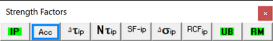

Para calcular los esfuerzos de corte y normal en el plano, el estado de esfuerzos en cada punto del plano de la grilla se reorienta para determinar el esfuerzo de corte máximo paralelo al plano de la grilla y el esfuerzo normal al plano de la grilla.

En el análisis elástico, los esfuerzos máximos de corte y normal en el plano se pueden usar con el criterio de resistencia de Mohr-Coulomb

#### Plot > Strength Factors > In-plane Parameters

para estimar la magnitud del deslizamiento por sobreesfuerzo en una falla, un sistema de diaclasas o un plano de estratificación orientado de la misma forma que el plano de la grilla. Como estos parámetros dependen de la orientación, este criterio es representativo de la estabilidad de un macizo rocoso anisótropo.

En cambio, en el análisis no lineal los esfuerzos nunca pueden superar la resistencia, a menos que se use algo de fluencia. En este último caso, la fluencia viscosa puede permitir estados de esfuerzo por encima del criterio de falla, lo que indica una falta de equilibrio estático. Por lo tanto, en el análisis no lineal normalmente se considera directamente la cantidad de deformación no lineal o la tasa de deformación predicha por el modelo

Mohr-Coulomb in DD planes

Fault-Gouge in DD planes

Backfill-Hyperbolic in DD planes

Aquí se supone que la trayectoria de esfuerzos hasta la falla se produce aumentando tip sin pérdida de confinamiento.

#### Mohr-Coulomb

SF-ip Strength/Stress   se puede determinar como [ Cohesion + sip tan(j) ] / tip SF-ip Stress/Strength   se puede determinar como tip / [ Cohesion + sip tan(j) ] dTip Excess   se puede determinar como Dtip = tip - [ Cohesion + sip tan(j) ]

NTip Probability   se puede determinar como N(Dtip /std)

Los parámetros de resistencia se configuran con

Plot > Strength Factors > In-plane Parameters

Temas relacionados:

Plot > Stress > Tip - In-plane Shear Plot > Stress > Sip - In-plane Normal Plot > Strength Factors > SF-ub Strength/Stress Plot > Strength Factors > dTub Excess

Plot > Strength Factors > NSub Probability

### 5.3.6.2.4 Esfuerzo en la pared en el plano, en exceso

Genera contornos de la resistencia al esfuerzo en la pared en el plano. Se puede acceder a estas componentes mediante la barra de herramientas Strength Factor Components, como se indica a continuación:

Esta barra de herramientas se puede cambiar a orientación vertical arrastrándola contra el borde derecho o izquierdo de la ventana principal.

Se puede volver a la orientación horizontal arrastrándola contra el borde superior o inferior de la ventana principal.

Al seleccionar el

botón de la barra de herramientas Contours se activa la barra de herramientas Strength Factor Components.

Para calcular el esfuerzo en la pared en el plano, el estado de esfuerzos en cada punto del plano de la grilla se reorienta para determinar los esfuerzos tangenciales máximo y mínimo paralelos al plano de la grilla.

El esfuerzo máximo en la pared para una excavación circular virtual orientada perpendicular al plano de la grilla se puede determinar entonces como [ 3 s1i - s3i ].

Tenga en cuenta que sip está orientado normal al plano de la grilla y paralelo a la dirección de una grilla lineal. Tenga en cuenta también que sip, s1i y s3i son perpendiculares entre sí.

- la dirección de manteo se mide positiva en sentido horario desde el eje y.

- el manteo del plano se mide positivo hacia abajo desde la horizontal (es decir, la dirección de manteo).

- la inclinación de la normal se mide positiva hacia abajo (es decir, negativa hacia arriba) desde la horizontal.

dSip Excess   se puede determinar como Dsip = [ 3 s1i - s3i ] - UCS

RCFip   se puede determinar como RCFip = [ 3 s1i - s3i ]/UCS

Los parámetros de resistencia se configuran con

Plot > Strength Factors > In-plane Parameters

Temas relacionados:

Plot > Stress > Tip - In-plane Shear Plot > Stress > Sip - In-plane Normal Plot > Stress > S1i - In-plane Maximum Plot > Stress > S3i - In-plane Minimum Plot > Strength Factors > SF-ub Strength/Stress Plot > Strength Factors > dTub Excess Plot > Strength Factors > dSub Excess Plot > Strength Factors > NSub Probability

### 5.3.6.2.6 NTip Probabilidad normal

Genera contornos de la resistencia al corte en el plano. Se puede acceder a estas componentes mediante la barra de herramientas Strength Factor Components, como se indica a continuación:

Esta barra de herramientas se puede cambiar a orientación vertical arrastrándola contra el borde derecho o izquierdo de la ventana principal.

Se puede volver a la orientación horizontal arrastrándola contra el borde superior o inferior de la ventana principal.

Al seleccionar el botón de la barra de herramientas Contours se activa la barra de herramientas Strength Factor Components.

Para calcular los esfuerzos de corte y normal en el plano, el estado de esfuerzos en cada punto del plano de la grilla se reorienta para determinar el esfuerzo de corte máximo paralelo al plano de la grilla y el esfuerzo normal al plano de la grilla.

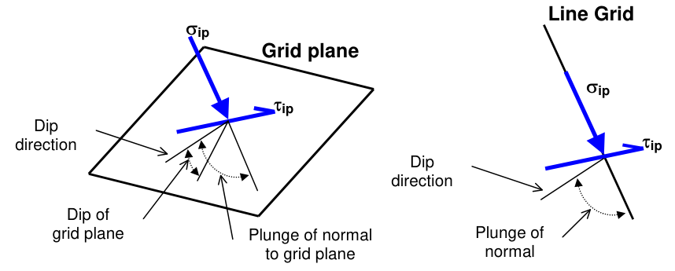

En el análisis elástico, los esfuerzos máximos de corte y normal en el plano se pueden usar con el criterio de resistencia de Mohr-Coulomb

#### Plot > Strength Factors > In-plane Parameters

para estimar la magnitud del deslizamiento por sobreesfuerzo en una falla, un sistema de diaclasas o un plano de estratificación orientado de la misma forma que el plano de la grilla. Como estos parámetros dependen de la orientación, este criterio es representativo de la estabilidad de un macizo rocoso anisótropo.

En cambio, en el análisis no lineal los esfuerzos nunca pueden superar la resistencia, a menos que se use algo de fluencia. En este último caso, la fluencia viscosa puede permitir estados de esfuerzo por encima del criterio de falla, lo que indica una falta de equilibrio estático. Por lo tanto, en el análisis no lineal normalmente se considera directamente la cantidad de deformación no lineal o la tasa de deformación predicha por el modelo

Mohr-Coulomb in DD planes

Fault-Gouge in DD planes

Backfill-Hyperbolic in DD planes

Aquí se supone que la trayectoria de esfuerzos hasta la falla se produce aumentando tip sin pérdida de confinamiento.

#### Mohr-Coulomb

SF-ip Strength/Stress   se puede determinar como [ Cohesion + sip tan(j) ] / tip SF-ip Stress/Strength   se puede determinar como tip / [ Cohesion + sip tan(j) ] dTip Excess   se puede determinar como Dtip = tip - [ Cohesion + sip tan(j) ]

NTip Probability   se puede determinar como N(Dtip /std)

Los parámetros de resistencia se configuran con

Plot > Strength Factors > In-plane Parameters

Temas relacionados:

Plot > Stress > Tip - In-plane Shear Plot > Stress > Sip - In-plane Normal Plot > Strength Factors > SF-ub Strength/Stress Plot > Strength Factors > dTub Excess

Plot > Strength Factors > NSub Probability

## 5.3.6.3 Parámetros del plano UB

5.3.6.3.1  Parámetros ubicuos

Configura los parámetros de resistencia para generar gráficos de contornos de factores de resistencia en términos de las componentes del esfuerzo en el plano ubicuo.

Se puede acceder a estas componentes mediante la barra de herramientas Strength Factor Components, como se indica a continuación:

Esta barra de herramientas se puede cambiar a orientación vertical arrastrándola contra el borde derecho o izquierdo de la ventana principal.

Se puede volver a la orientación horizontal arrastrándola contra el borde superior o inferior de la ventana principal.

Al seleccionar el

botón de la barra de herramientas Contours se activa la barra de herramientas Strength Factor Components.

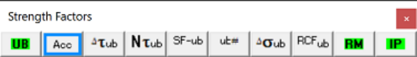

Para calcular los esfuerzos de corte y normal ubicuos, el estado de esfuerzos en cada punto del plano de la grilla se reorienta para determinar el esfuerzo de corte máximo paralelo al plano de corte ubicuo y el esfuerzo normal al plano de corte ubicuo.

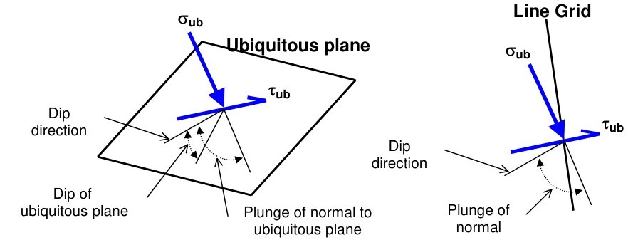

En el análisis elástico, los esfuerzos máximos de corte y normal en el plano ubicuo se pueden usar con el criterio de resistencia de Mohr-Coulomb para estimar la magnitud del deslizamiento por sobreesfuerzo en una falla, un sistema de diaclasas o un plano de estratificación con la orientación especificada. Como estos parámetros dependen de la orientación, este criterio es representativo de la estabilidad de un macizo rocoso anisótropo.

En cambio, en el análisis no lineal los esfuerzos nunca pueden superar la resistencia, a menos que se use algo de fluencia. En este último caso, la fluencia viscosa puede permitir estados de esfuerzo por encima del criterio de falla, lo que indica una falta de equilibrio estático. Por lo tanto, en el análisis no lineal normalmente se considera directamente la cantidad de deformación no lineal o la tasa de deformación predicha por el modelo

Mohr-Coulomb in DD planes

Fault-Gouge in DD planes

Backfill-Hyperbolic in DD planes

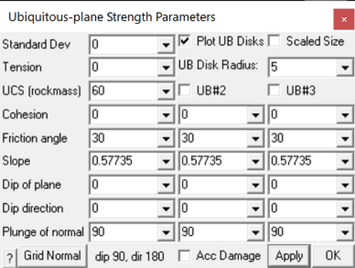

Cohesion y Friction Angle el criterio de Mohr-Coulomb define la resistencia en términos de esfuerzos principales de la siguiente forma:

#### Mohr-Coulomb

El límite de tracción (tension cutoff), el UCS y la cohesión se especifican en unidades de esfuerzo (MPa o psi). El ángulo de fricción se especifica en grados.

Standard Deviation especifica la incertidumbre del criterio de falla medido en la dirección tip (especificada en unidades de esfuerzo, MPa o psi).

Dip of plane – especifica el manteo del plano ubicuo (en grados). El manteo de la normal se ajusta automáticamente para reflejar los cambios en este valor.

Dip Direction – especifica la dirección de manteo del plano ubicuo (en grados).

Dip of Normal – especifica el manteo de la normal al plano ubicuo (en grados). El manteo del plano se ajusta automáticamente para reflejar los cambios en este valor.

Grid Normal – fija el plano ubicuo paralelo al plano de grilla seleccionado actualmente. En este caso, todos los resultados en el plano serán idénticos a los del plano ubicuo.

Acc Dam – grafica el daño acumulado. Vea Accumulated Damage

Plot UB DIsks – alterna la visualización del gráfico de contornos plano o de discos que representan la orientación del plano UB.

Scaled Size – escala el tamaño del disco UB según la magnitud.

UB DIsk Radius – especifica el radio de los discos UB.

Apply – regenera el gráfico de contornos.

UB#2 & UB#3 – activa los parámetros de resistencia para el plano ubicuo n.º 2 y/o n.º 3. Cuando está marcada, el

mínimo de todos los planos ubicuos activos se presenta para todos los parámetros de resistencia ( Plot > Strength Factor > Probability N-distribution, Plot > Strength Factors > SF-ub - Stress/Strength y Plot > Strength Factors > dTub - Excess Stress). Para determinar qué plano ubicuo tiene la resistencia mínima, puede graficar Plot > Strength Factors > UB# with minimum strength) o hacer clic izquierdo sobre un gráfico de parámetro de resistencia.

Temas relacionados:

Plot > Strength Factor > Probability N-distribution Plot > Strength Factors > SF-ub - Stress/Strength Plot > Strength Factor > SF-ip - Stress/Strength Plot > Strength Factors > dTub - Excess Stress Plot > Strength Factors > dTip - Excess Stress Plot > Strength Factors > UB# with minimum strength Plot > Strength Factors > Rockmass Strength Parameters

Plot > Strength Factors > In-plane Parameters

### 5.3.6.3.2 Daño acumulado

Grafica el daño acumulado. Se puede acceder a esta componente mediante la barra de herramientas Strength Factor Components, como se indica a continuación:

Esta barra de herramientas se puede cambiar a orientación vertical arrastrándola contra el borde derecho o izquierdo de la ventana principal.

Se puede volver a la orientación horizontal arrastrándola contra el borde superior o inferior de la ventana principal.

Al seleccionar el botón de la barra de herramientas Contours se activa la barra de herramientas Strength Factor Components.

Cuando Acc no está activada, se grafican el esfuerzo en exceso, la probabilidad de falla, el factor de resistencia y el RCF para los valores de esfuerzo actuales.

Cuando Acc está activada, el daño se registra desde la etapa 1 hasta la etapa actual a lo largo de toda la historia de carga del modelo, por lo que se grafica el peor caso del esfuerzo en exceso, la probabilidad de falla, el factor de resistencia o el RCF.

Esto permite usar los resultados del análisis elástico de esfuerzos de forma similar a la deformación acumulada en un modelo de plasticidad.

El registro del daño se realiza por separado para los 5 casos siguientes:

1. Falla del macizo rocoso (esfuerzo S1 en exceso, probabilidad, factor de resistencia) 2. Falla por corte en el plano (esfuerzo de corte en exceso, probabilidad, factor de resistencia) 3. Falla por corte en el plano ub (esfuerzo de corte en exceso, probabilidad, factor de resistencia)

4. Esfuerzo en la pared en el plano, en exceso (esfuerzo en exceso, RCF)

5. Esfuerzo en la pared en el plano ub, en exceso (esfuerzo en exceso, RCF)

Tenga en cuenta que se registran tanto la etapa en que ocurre la primera fluencia, MStep 1st Yield, como la etapa en que ocurre el máximo esfuerzo en exceso, MStep Max Yield, y ambas se pueden mostrar como etiquetas de trayectoria.

- 5.3.6.3.3  Esfuerzo de corte ubicuo, en exceso

Genera contornos de la resistencia al corte en el plano ubicuo. Se puede acceder a estas componentes mediante la barra de herramientas Strength Factor Components, como se indica a continuación:

Esta barra de herramientas se puede cambiar a orientación vertical arrastrándola contra el borde derecho o izquierdo de la ventana principal.

Se puede volver a la orientación horizontal arrastrándola contra el borde superior o inferior de la ventana principal.

Al seleccionar el botón de la barra de herramientas Contours se activa la barra de herramientas Strength Factor Components.

Para calcular los esfuerzos de corte y normal ubicuos, el estado de esfuerzos en cada punto del plano de la grilla se reorienta para determinar el esfuerzo de corte máximo paralelo al plano de corte ubicuo y el esfuerzo normal al plano de corte ubicuo.

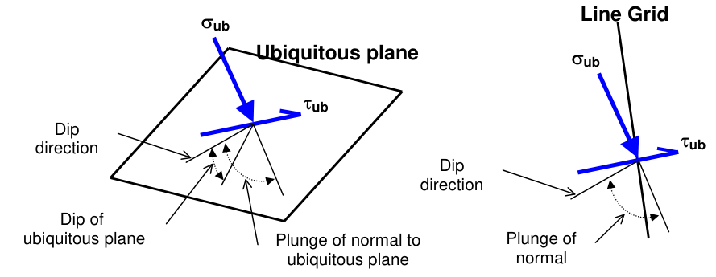

La orientación del plano de corte ubicuo se define con

#### Plot > Strength Factors > Ubiquitous Parameters

En el análisis elástico, los esfuerzos máximos de corte y normal en el plano ubicuo se pueden usar con el criterio de resistencia de Mohr-Coulomb para estimar la magnitud del deslizamiento por sobreesfuerzo en una falla, un sistema de diaclasas o un plano de estratificación con la orientación especificada. Como estos parámetros dependen de la orientación, este criterio es representativo de la estabilidad de un macizo rocoso anisótropo.

En cambio, en el análisis no lineal los esfuerzos nunca pueden superar la resistencia, a menos que se use algo de fluencia. En este último caso, la fluencia viscosa puede permitir estados de esfuerzo por encima del criterio de falla, lo que indica una falta de equilibrio estático. Por lo tanto, en el análisis no lineal normalmente se considera directamente la cantidad de deformación no lineal o la tasa de deformación predicha por el modelo

Mohr-Coulomb in DD planes

Fault-Gouge in DD planes

Backfill-Hyperbolic in DD planes

Aquí se supone que la trayectoria de esfuerzos hasta la falla se produce aumentando tub sin pérdida de confinamiento.

#### Mohr-Coulomb

SF-ub Strength/Stress   se puede determinar como [ Cohesion + sub tan(j) ] / tub SF-ub Stress/Strength   se puede determinar como tub / [ Cohesion + sub tan(j) ] dTub Excess   se puede determinar como Dtub = tub - [ Cohesion + sub tan(j) ] NTub Probability   se puede determinar como N(Dtub /std)

Los parámetros de resistencia se configuran con

Plot > Strength Factors > Ubiquitous Parameters

Temas relacionados:

Plot > Stress > Tub - Ubiquitous-plane Shear Plot > Stress > Sub - Ubiquitous-plane Normal Plot > Stress > S1u - Ubiquitous-plane Maximum Plot > Stress > S3u - Ubiquitous-plane Minimum Plot > Strength Factors > SF-ub Strength/Stress Plot > Strength Factors > dTip Excess Plot > Strength Factors > dSip Excess Plot > Strength Factors > NTip Probability

UB#2 & UB#3 – activa los parámetros de resistencia para el plano ubicuo n.º 2 y/o n.º 3. Cuando está marcada, el mínimo de todos los planos ubicuos activos se presenta para todos los parámetros de resistencia ( Plot > Strength Factor > Probability N-distribution, Plot > Strength Factors > SF-ub - Stress/Strength y

Plot > Strength Factors > dTub - Excess Stress). To determine which ubiquitous plane has the minimum strength you can plot Plot > Strength Factors > UB# with minimum strength) or left click on and strength parameter plot.

### 5.3.6.3.4 Esfuerzo en la pared del plano ubicuo, en exceso

Genera contornos de la resistencia al esfuerzo en la pared del plano ub.

Se puede acceder a estas componentes mediante la barra de herramientas Strength Factor Components, como se indica a continuación:

Esta barra de herramientas se puede cambiar a orientación vertical arrastrándola contra el borde derecho o izquierdo de la ventana principal.

Se puede volver a la orientación horizontal arrastrándola contra el borde superior o inferior de la ventana principal.

Al seleccionar el botón de la barra de herramientas Contours se activa la barra de herramientas Strength Factor Components.

Para calcular el esfuerzo en la pared del plano ub, el estado de esfuerzos en cada punto del plano de la grilla se reorienta para determinar los esfuerzos tangenciales máximo y mínimo paralelos al plano ub.

El esfuerzo máximo en la pared para una excavación circular virtual orientada perpendicular al plano ub se puede determinar entonces como [ 3 s1u - s3u ].

Tenga en cuenta que sub está orientado normal al plano ub. Tenga en cuenta también que sub, s1 y s3u son perpendiculares entre sí.

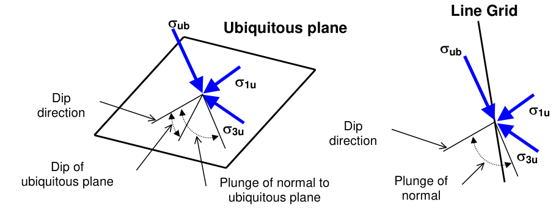

- la dirección de manteo se mide positiva en sentido horario desde el eje y.

- el manteo del plano se mide positivo hacia abajo desde la horizontal (es decir, la dirección de manteo).

- la inclinación de la normal se mide positiva hacia abajo (es decir, negativa hacia arriba) desde la horizontal.

dSub Excess   se puede determinar como Dsub = [ 3 s1u - s3u ] - UCS

RCFub   se puede determinar como RCFub = [ 3 s1u - s3u ]/UCS

La orientación del plano de corte ubicuo se define con

Plot > Strength Factors > Ubiquitous Parameters

Temas relacionados:

Plot > Stress > Tub - Ubiquitous-plane Shear Plot > Stress > Sub - Ubiquitous-plane Normal Plot > Stress > S1u - Ubiquitous-plane Maximum Plot > Stress > S3u - Ubiquitous-plane Minimum Plot > Strength Factors > SF-ub Strength/Stress Plot > Strength Factors > dTip Excess Plot > Strength Factors > dSip Excess Plot > Strength Factors > NTip Probability

### 5.3.6.3.6 NTub Probabilidad normal

Genera contornos de la resistencia al corte en el plano ubicuo. Se puede acceder a estas componentes mediante la barra de herramientas Strength Factor Components, como se indica a continuación:

Esta barra de herramientas se puede cambiar a orientación vertical arrastrándola contra el borde derecho o izquierdo de la ventana principal.

Se puede volver a la orientación horizontal arrastrándola contra el borde superior o inferior de la ventana principal.

Al seleccionar el botón de la barra de herramientas Contours se activa la barra de herramientas Strength Factor Components.

Para calcular los esfuerzos de corte y normal ubicuos, el estado de esfuerzos en cada punto del plano de la grilla se reorienta para determinar el esfuerzo de corte máximo paralelo al plano de corte ubicuo y el esfuerzo normal al plano de corte ubicuo.

La orientación del plano de corte ubicuo se define con

#### Plot > Strength Factors > Ubiquitous Parameters

En el análisis elástico, los esfuerzos máximos de corte y normal en el plano ubicuo se pueden usar con el criterio de resistencia de Mohr-Coulomb para estimar la magnitud del deslizamiento por sobreesfuerzo en una falla, un sistema de diaclasas o un plano de estratificación con la orientación especificada. Como estos parámetros dependen de la orientación, este criterio es representativo de la estabilidad de un macizo rocoso anisótropo.

En cambio, en el análisis no lineal los esfuerzos nunca pueden superar la resistencia, a menos que se use algo de fluencia. En este último caso, la fluencia viscosa puede permitir estados de esfuerzo por encima del criterio de falla, lo que indica una falta de equilibrio estático. Por lo tanto, en el análisis no lineal normalmente se considera directamente la cantidad de deformación no lineal o la tasa de deformación predicha por el modelo

Mohr-Coulomb in DD planes

Fault-Gouge in DD planes

Backfill-Hyperbolic in DD planes

Aquí se supone que la trayectoria de esfuerzos hasta la falla se produce aumentando tub sin pérdida de confinamiento.

#### Mohr-Coulomb

SF-ub Strength/Stress   se puede determinar como [ Cohesion + sub tan(j) ] / tub SF-ub Stress/Strength   se puede determinar como tub / [ Cohesion + sub tan(j) ] dTub Excess   se puede determinar como Dtub = tub - [ Cohesion + sub tan(j) ] NTub Probability   se puede determinar como N(Dtub /std)

Los parámetros de resistencia se configuran con

Plot > Strength Factors > Ubiquitous Parameters

Temas relacionados:

Plot > Stress > Tub - Ubiquitous-plane Shear Plot > Stress > Sub - Ubiquitous-plane Normal Plot > Stress > S1u - Ubiquitous-plane Maximum Plot > Stress > S3u - Ubiquitous-plane Minimum Plot > Strength Factors > SF-ub Strength/Stress Plot > Strength Factors > dTip Excess Plot > Strength Factors > dSip Excess Plot > Strength Factors > NTip Probability

UB#2 & UB#3 – activa los parámetros de resistencia para el plano ubicuo n.º 2 y/o n.º 3. Cuando está marcada, el mínimo de todos los planos ubicuos activos se presenta para todos los parámetros de resistencia ( Plot > Strength Factor > Probability N-distribution, Plot > Strength Factors > SF-ub - Stress/Strength y

Plot > Strength Factors > dTub - Excess Stress). To determine which ubiquitous plane has the minimum strength you can plot Plot > Strength Factors > UB# with minimum strength) or left click on and strength parameter plot.
