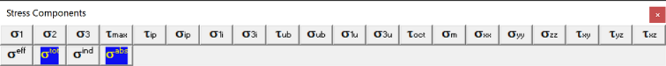
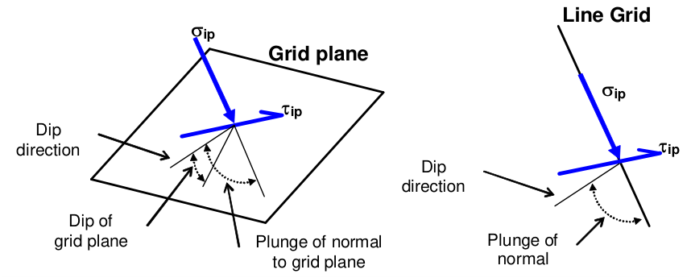
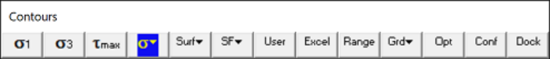
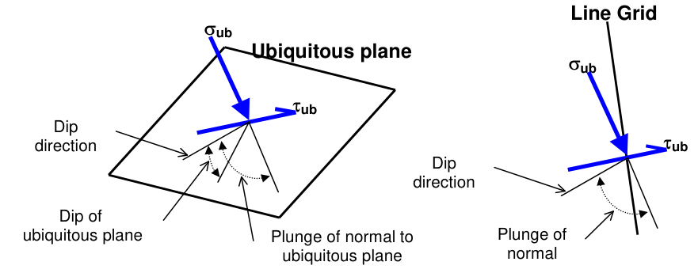
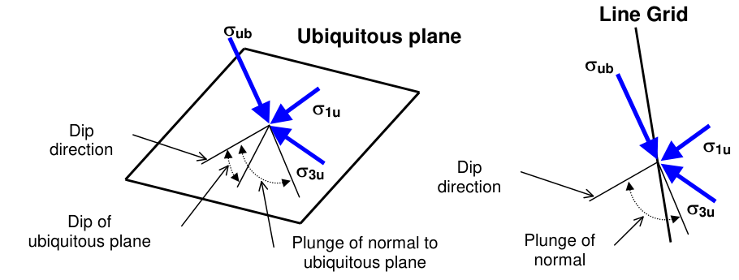

## 5.3.1.1 Esfuerzo principal mayor

Permite visualizar las componentes del esfuerzo principal s1 s2 s3. Se puede acceder a estas componentes mediante la barra de herramientas Stress Components, como se indica a continuación:

Esta barra de herramientas se puede cambiar a orientación vertical arrastrándola contra el borde derecho o izquierdo de la ventana principal.

Se puede volver a la orientación horizontal arrastrándola contra el borde superior o inferior de la ventana principal.

Al seleccionar el botón de la barra de herramientas Contours se activa la barra de herramientas Stress Components.

En el análisis elástico, el esfuerzo principal mayor se usa normalmente junto con el esfuerzo principal menor y el criterio de resistencia de Mohr-Coulomb o de Hoek-Brown

#### Plot > Strength Factors > Strength Parameters

para estimar el grado de daño en el macizo rocoso por sobreesfuerzo. Como ninguno de los parámetros es sensible a la orientación, este criterio es representativo de la estabilidad de un macizo rocoso homogéneo.

En cambio, en el análisis no lineal los esfuerzos nunca pueden superar la resistencia, a menos que se use algo de fluencia. En este último caso, la fluencia viscosa puede permitir estados de esfuerzo por encima del criterio de falla, lo que indica una falta de equilibrio estático. Por lo tanto, en el análisis no lineal normalmente se considera directamente la cantidad de deformación no lineal o la tasa de deformación predicha por el modelo

Mohr-Coulomb in 3D FF blocks.

El sobreesfuerzo se puede presentar de varias formas, entre ellas:

Plot > Strength Factor > SF-A Strength/Stress Plot > Strength Factor > SF-B Strength/Stress Plot > Strength Factors > SF-C Strength/Stress Plot > Strength Factors > dS1 Excess Stress Plot > Strength Factors > dTmax Excess Stress

El rango de contornos se define con

#### Plot > Range

Cualquiera de estas componentes se puede agregar a la barra de herramientas de contornos si se desea

Tools > Configure Contouring Toolbar > Stress

Puede resultar útil agregar el botón

#### More Stress Components

a la barra de herramientas de contornos para acceder rápidamente a todas las componentes de esfuerzo.

El esfuerzo principal intermedio se usa normalmente en el cálculo del esfuerzo de corte octaédrico

Plot > Stress > Toct Octahedral shear Stress

o del esfuerzo medio

Plot > Stress > Smean Mean Stress.

## 5.3.1.4 Esfuerzo de corte máximo

Permite visualizar la componente tmax=½(s1 - s3) del esfuerzo. Se puede acceder a esta componente mediante la barra de herramientas Stress Components, como se indica a continuación:

Esta barra de herramientas se puede cambiar a orientación vertical arrastrándola contra el borde derecho o izquierdo de la ventana principal.

Se puede volver a la orientación horizontal arrastrándola contra el borde superior o inferior de la ventana principal.

Al seleccionar el botón de la barra de herramientas Contours se activa la barra de herramientas Stress Components.

En el análisis elástico, el esfuerzo de corte máximo se usa normalmente junto con el esfuerzo principal menor y el criterio de resistencia de Mohr-Coulomb o de Hoek-Brown

#### Plot > Strength Factors > Strength Parameters

para estimar el grado de daño por sobreesfuerzo. Como ninguno de los parámetros es sensible a la orientación, este criterio es representativo de la estabilidad de un macizo rocoso homogéneo.

En cambio, en el análisis no lineal los esfuerzos nunca pueden superar la resistencia, a menos que se use algo de fluencia. En este último caso, la fluencia viscosa puede permitir estados de esfuerzo por encima del criterio de falla, lo que indica una falta de equilibrio estático. Por lo tanto, en el análisis no lineal normalmente se considera directamente la cantidad de deformación no lineal o la tasa de deformación predicha por el modelo

Mohr-Coulomb in 3D FF blocks.

El sobreesfuerzo se puede presentar de varias formas, entre ellas:

Plot > Strength Factor > SF-A Strength/Stress Plot > Strength Factor > SF-B Strength/Stress Plot > Strength Factors > SF-C Strength/Stress Plot > Strength Factors > dS1 Excess Stress Plot > Strength Factors > dTmax Excess Stress

El rango de contornos se define con

#### Plot > Range

Cualquiera de estas componentes se puede agregar a la barra de herramientas de contornos si se desea

Tools > Configure Contouring Toolbar > Stress

Puede resultar útil agregar el botón

#### More Stress Components

a la barra de herramientas de contornos para acceder rápidamente a todas las componentes de esfuerzo.

## 5.3.1.5 Esfuerzo de corte en el plano

Permite generar contornos del esfuerzo de corte máximo que actúa sobre el plano de la grilla y de la componente del esfuerzo normal al plano de la grilla o paralela a una grilla lineal. Se puede acceder a estas componentes mediante la barra de herramientas Stress Components, como se indica a continuación:

Esta barra de herramientas se puede cambiar a orientación vertical arrastrándola contra el borde derecho o izquierdo de la ventana principal.

Se puede volver a la orientación horizontal arrastrándola contra el borde superior o inferior de la ventana principal.

Al seleccionar el botón de la barra de herramientas Contours se activa la barra de herramientas Stress Components.

Para calcular los esfuerzos en el plano, el estado de esfuerzos en cada punto del plano de la grilla se reorienta para determinar el esfuerzo de corte máximo paralelo al plano de la grilla y el esfuerzo normal al plano. Tenga en cuenta que sip está orientado normal al plano de la grilla y paralelo a la dirección de una grilla lineal.

- la dirección de manteo se mide positiva en sentido horario desde el eje y.

- el manteo del plano se mide positivo hacia abajo desde la horizontal (es decir, la dirección de manteo).

- la inclinación de la normal se mide positiva hacia abajo (es decir, negativa hacia arriba) desde la horizontal.

En el análisis elástico, el esfuerzo de corte máximo en el plano se usa normalmente junto con el esfuerzo normal en el plano y el criterio de resistencia de Mohr-Coulomb

Plot > Strength Factors > In-plane Parameters

para estimar la magnitud del deslizamiento por sobreesfuerzo en una falla, un sistema de diaclasas o un plano de estratificación orientado de la misma forma que el plano de la grilla. Como estos parámetros dependen de la orientación, este criterio es representativo de la estabilidad de un macizo rocoso anisótropo.

En cambio, en el análisis no lineal los esfuerzos nunca pueden superar la resistencia, a menos que se use algo de fluencia. En este último caso, la fluencia viscosa puede permitir estados de esfuerzo por encima del criterio de falla, lo que indica una falta de equilibrio estático. Por lo tanto, en el análisis no lineal normalmente se considera directamente la cantidad de deformación no lineal o la tasa de deformación predicha por el modelo

Mohr-Coulomb in DD planes Fault-Gouge in DD planes Backfill-Hyperbolic in DD planes.

El sobreesfuerzo se puede presentar de varias formas, entre ellas:

Plot > Strength Factors > SF-ip Strength/Stress Plot > Strength Factors > dTip Excess Shear Stress

El rango de contornos se define con

#### Plot > Range

Cualquiera de estas componentes se puede agregar a la barra de herramientas de contornos si se desea

Tools > Configure Contouring Toolbar > Stress

Puede resultar útil agregar el botón

#### More Stress Components

a la barra de herramientas de contornos para acceder rápidamente a todas las componentes de esfuerzo.

Temas relacionados:

Plot > Stress > S1i In-plane Maximum Plot > Stress > S3i In-plane Minimum Plot > Stress > Tub Ubiquitous-plane Shear Plot > Stress > Sub Ubiquitous-plane Normal

## 5.3.1.7 Esfuerzo máximo en el plano

Permite generar contornos de los esfuerzos máximo y mínimo tangenciales al plano de grilla seleccionado actualmente o perpendiculares a una grilla lineal. Se puede acceder a estas componentes mediante la barra de herramientas Stress Components, como se indica a continuación:

Esta barra de herramientas se puede cambiar a orientación vertical arrastrándola contra el borde derecho o izquierdo de la ventana principal.

Se puede volver a la orientación horizontal arrastrándola contra el borde superior o inferior de la ventana principal.

Al seleccionar el botón de la barra de herramientas Contours se activa la barra de herramientas Stress Components.

Para calcular los esfuerzos máximo y mínimo en el plano, se determinan los esfuerzos tangenciales al plano de la grilla y luego se resuelven para obtener los valores máximo y mínimo. Tenga en cuenta que sip está orientado normal al plano de la grilla y paralelo a la dirección de una grilla lineal. Tenga en cuenta también que sip, s1i y s3i son perpendiculares entre sí.

- la dirección de manteo se mide positiva en sentido horario desde el eje y.

- el manteo del plano se mide positivo hacia abajo desde la horizontal (es decir, la dirección de manteo).

- la inclinación de la normal se mide positiva hacia abajo (es decir, negativa hacia arriba) desde la horizontal.

El rango de contornos se define con

#### Plot > Range

Esta componente se puede agregar a la barra de herramientas de contornos si se desea

#### Tools > Configure Contouring Toolbar > Stress

Puede resultar útil agregar el botón

#### More Stress Components

a la barra de herramientas de contornos para acceder rápidamente a todas las componentes de esfuerzo.

Temas relacionados:

Plot > Stress > Tip In-plane Shear Plot > Stress > Sip In-plane Normal Plot > Stress > S1u Ubiquitous-plane Maximum. Plot > Stress > S3u Ubiquitous-plane Minimum.

## 5.3.1.9 Esfuerzo de corte en el plano ubicuo

Permite generar contornos del esfuerzo de corte máximo que actúa sobre el plano ubicuo n.º 1 y de la componente del esfuerzo normal a este plano. Se puede acceder a estas componentes mediante la barra de herramientas Stress Components, como se indica a continuación:

Esta barra de herramientas se puede cambiar a orientación vertical arrastrándola contra el borde derecho o izquierdo de la ventana principal.

Se puede volver a la orientación horizontal arrastrándola contra el borde superior o inferior de la ventana principal.

Al seleccionar el botón de la barra de herramientas Contours se activa la barra de herramientas Stress Components.

Para calcular los esfuerzos ubicuos, el estado de esfuerzos en cada punto del plano de la grilla se reorienta para determinar el esfuerzo de corte máximo paralelo al plano ubicuo y el esfuerzo normal al plano ubicuo. Tenga en cuenta que sub está orientado normal al plano ubicuo y no es paralelo a la dirección de una grilla lineal.

- la dirección de manteo se mide positiva en sentido horario desde el eje y.

- el manteo del plano se mide positivo hacia abajo desde la horizontal (es decir, la dirección de manteo).

- la inclinación de la normal se mide positiva hacia abajo (es decir, negativa hacia arriba) desde la horizontal.

La orientación del plano de corte ubicuo se define con

#### Plot > Strength Factors > Ubiquitous Parameters

En el análisis elástico, el esfuerzo de corte máximo en el plano ubicuo se usa normalmente junto con el esfuerzo normal al plano ubicuo y el criterio de resistencia de Mohr-Coulomb

#### Plot > Strength Factors > Ubiquitous Parameters

para estimar la magnitud del deslizamiento por sobreesfuerzo en una falla, un sistema de diaclasas o un plano de estratificación con la orientación especificada. Como estos parámetros dependen de la orientación, este criterio es representativo de la estabilidad de un macizo rocoso anisótropo.

En cambio, en el análisis no lineal los esfuerzos nunca pueden superar la resistencia, a menos que se use algo de fluencia. En este último caso, la fluencia viscosa puede permitir estados de esfuerzo por encima del criterio de falla, lo que indica una falta de equilibrio estático. Por lo tanto, en el análisis no lineal normalmente se considera directamente la cantidad de deformación no lineal o la tasa de deformación predicha por el modelo

Mohr-Coulomb in DD planes Fault-Gouge in DD planes Backfill-Hyperbolic in DD planes.

El sobreesfuerzo se puede presentar de varias formas, entre ellas:

Plot > Strength Factors > SF-ub Strength/Stress. Plot > Strength Factors > dTub Excess Shear Stress.

El rango de contornos se define con

#### Plot > Range

Esta componente se puede agregar a la barra de herramientas de contornos si se desea

Tools > Configure Contouring Toolbar > Stress

Puede resultar útil agregar el botón

#### More Stress Components

a la barra de herramientas de contornos para acceder rápidamente a todas las componentes de esfuerzo.

Temas relacionados:

Plot > Stress > S1u Ubiquitous-plane Maximum Plot > Stress > S3u Ubiquitous-plane Minimum Plot > Stress > Tip In-plane Shear Plot > Stress > Sip In-plane Normal

La orientación del plano ubicuo se especifica en

Plot > Strength Factors > Ubiquitous Parameters

## 5.3.1.11 Esfuerzo máximo en el plano ubicuo

Permite generar contornos de los esfuerzos máximo y mínimo tangenciales al plano ubicuo n.º 1. Se puede acceder a estas componentes mediante la barra de herramientas Stress Components, como se indica a continuación:

Esta barra de herramientas se puede cambiar a orientación vertical arrastrándola contra el borde derecho o izquierdo de la ventana principal.

Se puede volver a la orientación horizontal arrastrándola contra el borde superior o inferior de la ventana principal.

Al seleccionar el botón de la barra de herramientas Contours se activa la barra de herramientas Stress Components.

Para calcular los esfuerzos máximo y mínimo en el plano ubicuo, se determinan los esfuerzos tangenciales al plano y luego se resuelven para obtener los valores máximo y mínimo. Tenga en cuenta que sub está orientado normal al plano ubicuo y no es paralelo a la dirección de una grilla lineal. Tenga en cuenta también que sub, s1u y s3u son perpendiculares entre sí.

- la dirección de manteo se mide positiva en sentido horario desde el eje y.

- el manteo del plano se mide positivo hacia abajo desde la horizontal (es decir, la dirección de manteo).

- la inclinación de la normal se mide positiva hacia abajo (es decir, negativa hacia arriba) desde la horizontal.

La orientación del plano de corte ubicuo se define con

Plot > Strength Factors > Ubiquitous Parameters

El rango de contornos se define con

#### Plot > Range

Esta componente se puede agregar a la barra de herramientas de contornos si se desea

#### Tools > Configure Contouring Toolbar > Stress

Puede resultar útil agregar el botón

#### More Stress Components

a la barra de herramientas de contornos para acceder rápidamente a todas las componentes de esfuerzo.

Temas relacionados:

Plot > Stress > Tub In-plane Shear Plot > Stress > Sub In-plane Normal Plot > Stress > S1i In-plane Maximum. Plot > Stress > S3i In-plane Minimum.

## 5.3.1.13 Esfuerzo de corte octaédrico

Genera contornos del esfuerzo de corte octaédrico

toct = ¹/3 [ (s1 - s2)² + (s2 - s3)² +(s3 - s1)² ]½

y del esfuerzo medio

smean = ¹/3 (s1 + s2 + s3)

Se puede acceder a estas componentes mediante la barra de herramientas Stress Components, como se indica a continuación:

Esta barra de herramientas se puede cambiar a orientación vertical arrastrándola contra el borde derecho o izquierdo de la ventana principal.

Se puede volver a la orientación horizontal arrastrándola contra el borde superior o inferior de la ventana principal.

Al seleccionar el botón de la barra de herramientas Contours se activa la barra de herramientas Stress Components.

En el análisis elástico, el esfuerzo de corte octaédrico se usa normalmente junto con el esfuerzo medio y el criterio de resistencia de Drucker-Prager

#### Plot > Strength Factors > Strength Parameters

para estimar el grado de daño por sobreesfuerzo. Como ninguno de los parámetros es sensible a la orientación, este criterio es representativo de la estabilidad de un macizo rocoso homogéneo.

En cambio, en el análisis no lineal los esfuerzos nunca pueden superar la resistencia, a menos que se use algo de fluencia. En este último caso, la fluencia viscosa puede permitir estados de esfuerzo por encima del criterio de falla, lo que indica una falta de equilibrio estático. Por lo tanto, en el análisis no lineal normalmente se considera directamente la cantidad de deformación no lineal o la tasa de deformación predicha por el modelo

Mohr-Coulomb in 3D FF blocks.

El sobreesfuerzo se puede presentar de varias formas, entre ellas:

Plot > Strength Factors > SF-C Strength/Stress Plot > Strength Factors > dToct Excess Stress Plot > Strength Factors > dS1 Excess Stress Plot > Strength Factors > dTmax Excess Stress

El rango de contornos se define con

#### Plot > Range

Cualquiera de estas componentes se puede agregar a la barra de herramientas de contornos si se desea

Tools > Configure Contouring Toolbar > Stress

Puede resultar útil agregar el botón

#### More Stress Components

a la barra de herramientas de contornos para acceder rápidamente a todas las componentes de esfuerzo.

## 5.3.1.15 Esfuerzo cartesiano Sxx

Genera contornos de las componentes cartesianas del esfuerzo. Se puede acceder a estas componentes mediante la barra de herramientas Stress Components, como se indica a continuación:

Esta barra de herramientas se puede cambiar a orientación vertical arrastrándola contra el borde derecho o izquierdo de la ventana principal.

Se puede volver a la orientación horizontal arrastrándola contra el borde superior o inferior de la ventana principal.

Al seleccionar el botón de la barra de herramientas Contours se activa la barra de herramientas Stress Components.

Plot > Stress > sxx Cartesian Stress Component   esfuerzo normal en la dirección del eje x. Plot > Stress > syy Cartesian Stress Component   esfuerzo normal en la dirección del eje y. Plot > Stress > szz Cartesian Stress Component   esfuerzo normal en la dirección del eje z. Plot > Stress > txy Cartesian Stress Component   esfuerzo de corte en el plano x-y. Plot > Stress > tyz Cartesian Stress Component   esfuerzo de corte en el plano y-z. Plot > Stress > tzx Cartesian Stress Component   esfuerzo de corte en el plano x-z.

El rango de contornos se define con

#### Plot > Range

Cualquiera de estas componentes se puede agregar a la barra de herramientas de contornos si se desea

Tools > Configure Contouring Toolbar > Stress

Puede resultar útil agregar el botón

#### More Stress Components

a la barra de herramientas de contornos para acceder rápidamente a todas las componentes de esfuerzo.

## 5.3.1.21 Valor

### 5.3.1.21.1 Esfuerzo efectivo

Selecciona la componente del esfuerzo efectivo o del esfuerzo total. Se puede acceder a estas componentes mediante la barra de herramientas Stress Components, como se indica a continuación:

Esta barra de herramientas se puede cambiar a orientación vertical arrastrándola contra el borde derecho o izquierdo de la ventana principal.

Se puede volver a la orientación horizontal arrastrándola contra el borde superior o inferior de la ventana principal.

Al seleccionar el botón de la barra de herramientas Contours se activa la barra de herramientas Stress Components.

El esfuerzo efectivo es el esfuerzo del esqueleto sólido (es decir, sin la componente de presión de poros). El esfuerzo total es el esfuerzo del esqueleto sólido más la presión de poros (o la componente térmica).

Esta opción solo se usa con Map3D Thermal-Fluid Flow, la versión de Map3D para análisis de esfuerzos térmicos/flujo de fluidos.

Para más detalles, vea Expansion Coefficient y Conductivity.

### 5.3.1.21.3 Esfuerzo inducido

Grafica la componente del esfuerzo inducido o del esfuerzo absoluto. Se puede acceder a estas componentes mediante la barra de herramientas Stress Components, como se indica a continuación:

Esta barra de herramientas se puede cambiar a orientación vertical arrastrándola contra el borde derecho o izquierdo de la ventana principal.

Se puede volver a la orientación horizontal arrastrándola contra el borde superior o inferior de la ventana principal.

Al seleccionar el botón de la barra de herramientas Contours se activa la barra de herramientas Stress Components.

El esfuerzo inducido es el esfuerzo sin la contribución del esfuerzo previo a la explotación. Representa el cambio de esfuerzo desde la condición previa a la explotación.

El esfuerzo absoluto es el esfuerzo que incluye la contribución del esfuerzo previo a la explotación.

Vea también:

Plot > Strain > Value > Induced Strain

Plot > Strain > Value > Absolute Strain
