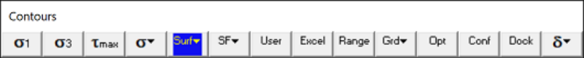
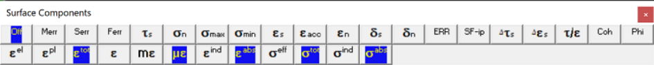
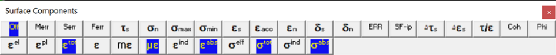
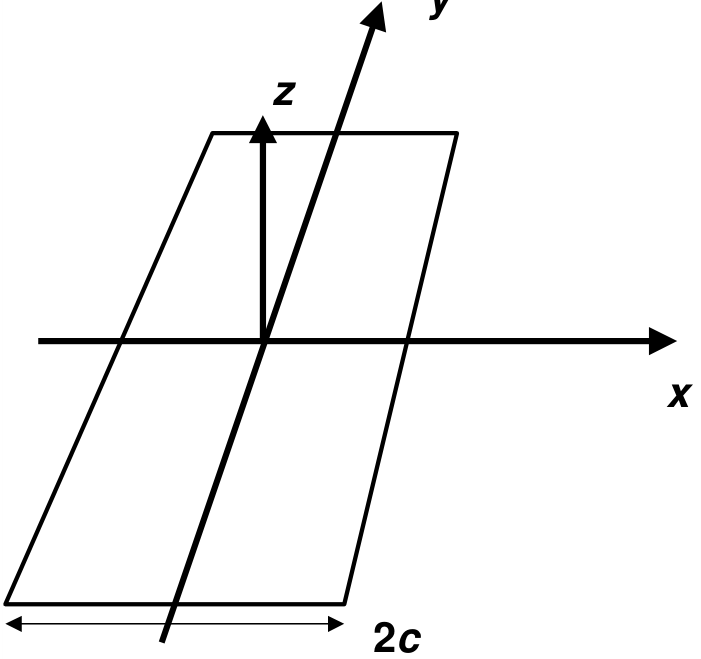
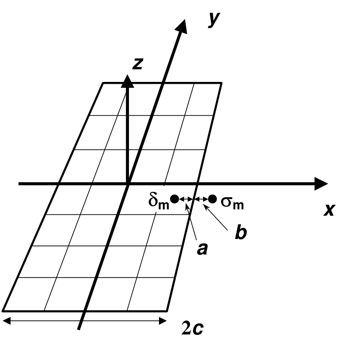
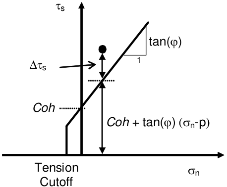

## 5.3.7.1 Contornos de superficie desactivados

Desactiva los contornos.

Se puede acceder a esta componente mediante la barra de herramientas Strength Factor Components, como se indica a continuación:

Esta barra de herramientas se puede cambiar a orientación vertical arrastrándola contra el borde derecho o izquierdo de la ventana principal.

Se puede volver a la orientación horizontal arrastrándola contra el borde superior o inferior de la ventana principal.

Al seleccionar el botón de la barra de herramientas Contours se activa la barra de herramientas Surface Components.

## 5.3.7.2 Serr Error de esfuerzo

Genera contornos del error de esfuerzo superficial.

Se puede acceder a estas componentes mediante la barra de herramientas Strength Factor Components, como se indica a continuación:

Esta barra de herramientas se puede cambiar a orientación vertical arrastrándola contra el borde derecho o izquierdo de la ventana principal.

Se puede volver a la orientación horizontal arrastrándola contra el borde superior o inferior de la ventana principal.

Al seleccionar el botón de la barra de herramientas Contours se activa la barra de herramientas Surface Components.

Durante la solución de la matriz, Map3D intenta resolver progresivamente las ecuaciones simultáneas almacenadas en la matriz de coeficientes, junto con cualquier otra ecuación que describa las zonas de material alterno, el deslizamiento de fallas, la fluencia, etc. El solucionador iterativo funciona determinando el error en la solución actual de cada ecuación simultánea (el error de esfuerzo superficial) y luego reduciendo estos errores mediante un proceso de aproximaciones sucesivas.

El Stress Error genera contornos del error de esfuerzo actual en todas las superficies.

El Maximum Stress Error genera contornos de las ubicaciones donde ocurren los errores de esfuerzo máximos.

Se supone que se ha obtenido una solución convergente cuando el error máximo de esfuerzo superficial y el error máximo del criterio de falla se reducen por debajo de la tolerancia de esfuerzo STOL especificada por el usuario

Analysis > CParams

#### Related Topics:

Plot > Surface Components > Ferr - Failure Error

Analysis Dialog

## 5.3.7.3 Ferr Error de falla

Genera contornos del error del criterio de falla superficial.

Se puede acceder a esta componente mediante la barra de herramientas Strength Factor Components, como se indica a continuación:

Esta barra de herramientas se puede cambiar a orientación vertical arrastrándola contra el borde derecho o izquierdo de la ventana principal.

Se puede volver a la orientación horizontal arrastrándola contra el borde superior o inferior de la ventana principal.

Al seleccionar el botón de la barra de herramientas Contours se activa la barra de herramientas Surface Components.

Durante la solución de la matriz, Map3D intenta resolver progresivamente las ecuaciones simultáneas almacenadas en la matriz de coeficientes, junto con cualquier otra ecuación que describa las zonas de material alterno, el deslizamiento de fallas, la fluencia, etc. El solucionador iterativo funciona determinando el error en la solución actual de cada ecuación simultánea (el error de esfuerzo superficial) y luego reduciendo estos errores mediante un proceso de aproximaciones sucesivas.

Se supone que se ha obtenido una solución convergente cuando el error máximo de esfuerzo superficial y el error máximo del criterio de falla se reducen por debajo de la tolerancia de esfuerzo STOL especificada por el usuario

Analysis > CParams

El error del criterio de falla solo se usa en análisis de fluencia no lineal (incluidos el deslizamiento de fallas y la no linealidad de materiales 3D). Este parámetro siempre debe ser cercano a cero, a menos que se haya especificado alguna viscosidad y el problema se vuelva no lineal. En este último caso, la fluencia viscosa puede permitir estados de esfuerzo por encima del criterio de falla, lo que indica una falta de equilibrio estático.

#### Related Topics:

Plot > Surface Components > Serr - Stress Error

Analysis > Options > Creep Analysis Dialog

## 5.3.7.4 Esfuerzo de corte

Genera contornos del esfuerzo de corte máximo en el plano de la superficie. Se puede acceder a esta componente mediante la barra de herramientas Strength Factor Components, como se indica a continuación:

Esta barra de herramientas se puede cambiar a orientación vertical arrastrándola contra el borde derecho o izquierdo de la ventana principal.

Se puede volver a la orientación horizontal arrastrándola contra el borde superior o inferior de la ventana principal.

Al seleccionar el botón de la barra de herramientas Contours se activa la barra de herramientas Surface Components.

En el análisis elástico, el esfuerzo de corte máximo en el plano se usa normalmente junto con el esfuerzo normal en el plano y el criterio de resistencia de Mohr-Coulomb para estimar la magnitud del deslizamiento por sobreesfuerzo en una falla, un sistema de diaclasas o un plano de estratificación.

En cambio, en el análisis no lineal el esfuerzo de corte máximo en el plano nunca puede superar la resistencia, a menos que se use algo de fluencia. En este último caso, la fluencia viscosa puede permitir estados de esfuerzo por encima del criterio de falla, lo que indica una falta de equilibrio estático. Por lo tanto, en el análisis no lineal normalmente se considera directamente la magnitud del deslizamiento predicha por el modelo

Mohr-Coulomb in DD planes

Fault-Gouge in DD planes

Backfill-Hyperbolic in DD planes

El rango de contornos se define con

Plot > Range

Esta componente se puede agregar a la barra de herramientas de contornos si se desea

Tools > Configure Contouring Toolbar

#### Related Topics:

Plot > Surface Components > Sn Normal Stress Plot > Surface Components > dTs - Excess Shear Stress Plot > Surface Components > dEs - Incremental Shear Strain Plot > Surface Components > Es - Shear Strain Plot > Surface Components > ds - Shear Displacement (Ride)

## 5.3.7.5 Esfuerzo normal

Genera contornos del esfuerzo normal a la superficie.

Se puede acceder a esta componente mediante la barra de herramientas Strength Factor Components, como se indica a continuación:

Esta barra de herramientas se puede cambiar a orientación vertical arrastrándola contra el borde derecho o izquierdo de la ventana principal.

Se puede volver a la orientación horizontal arrastrándola contra el borde superior o inferior de la ventana principal.

Al seleccionar el botón de la barra de herramientas Contours se activa la barra de herramientas Surface Components.

En el análisis elástico, el esfuerzo de corte máximo en el plano se usa normalmente junto con el esfuerzo normal en el plano y el criterio de resistencia de Mohr-Coulomb para estimar la magnitud del deslizamiento por sobreesfuerzo en una falla, un sistema de diaclasas o un plano de estratificación.

En cambio, en el análisis no lineal el esfuerzo de corte máximo en el plano nunca puede superar la resistencia, a menos que se use algo de fluencia. En este último caso, la fluencia viscosa puede permitir estados de esfuerzo por encima del criterio de falla, lo que indica una falta de equilibrio estático. Por lo tanto, en el análisis no lineal normalmente se considera directamente la magnitud del deslizamiento predicha por el modelo

Mohr-Coulomb in DD planes

Fault-Gouge in DD planes

Backfill-Hyperbolic in DD planes

El rango de contornos se define con

Plot > Range

Esta componente se puede agregar a la barra de herramientas de contornos si se desea

Tools > Configure Contouring Toolbar

#### Related Topics:

Plot > Surface Components > Ts Shear Stress

Plot > Surface Components > dTs - Excess Shear Stress

Plot > Surface Components > dEs - Incremental Shear Strain

Plot > Surface Components > Es - Shear Strain

Plot > Surface Components > ds - Shear Displacement (Ride)

## 5.3.7.6 Esfuerzo tangencial máximo

Genera contornos de los esfuerzos tangenciales a la superficie. Se puede acceder a estas componentes mediante la barra de herramientas Strength Factor Components, como se indica a continuación:

Esta barra de herramientas se puede cambiar a orientación vertical arrastrándola contra el borde derecho o izquierdo de la ventana principal.

Se puede volver a la orientación horizontal arrastrándola contra el borde superior o inferior de la ventana principal.

Al seleccionar el botón de la barra de herramientas Contours se activa la barra de herramientas Surface Components.

En los análisis elásticos, los esfuerzos tangenciales no se calculan a menos que se soliciten. Esto se debe a que no son necesarios para el proceso de solución y requieren tiempo de análisis adicional. Este cálculo se solicita marcando Analysis > Options > Calculate Tangential Stress Components.

Estos valores se calculan por defecto durante el análisis plástico.

En el análisis elástico, el esfuerzo tangencial máximo suele denominarse esfuerzo de fibra extrema. Esto es útil para determinar las ubicaciones donde los esfuerzos superan la resistencia a la compresión no confinada o la resistencia a la tracción del macizo rocoso.

El rango de contornos se define con

Plot > Range

Esta componente se puede agregar a la barra de herramientas de contornos si se desea

Tools > Configure Contouring Toolbar

## 5.3.7.8 Deformación de corte

Genera contornos de la deformación de corte que ocurre en el material de relleno de los elementos DD. Se puede acceder a esta componente mediante la barra de herramientas Strength Factor Components, como se indica a continuación:

Esta barra de herramientas se puede cambiar a orientación vertical arrastrándola contra el borde derecho o izquierdo de la ventana principal.

Se puede volver a la orientación horizontal arrastrándola contra el borde superior o inferior de la ventana principal.

Al seleccionar el botón de la barra de herramientas Contours se activa la barra de herramientas Surface Components.

La deformación de corte se determina dividiendo el desplazamiento de corte (ride) por el espesor del plano DD.

CAD > Edit > Entity Properties > DDplane Thickess

Tenga en cuenta que hay tres componentes de deformación que se pueden contornear:

Plot > Surface Components > Value > Elastic Plot > Surface Components > Value > Plastic Plot > Surface Components > Value > Total

También hay dos formas distintas de presentar la deformación:

Plot > Strain > Value > Induced Strain Plot > Strain > Value > Absolute Strain

Tenga en cuenta que este es el nivel actual de deformación de corte que actúa sobre las superficies DD.

Como el desplazamiento puede cambiar de dirección e incluso revertirse durante el deslizamiento, la deformación de corte total acumulada puede dar valores distintos.

El rango de contornos se define con

Plot > Range

Esta componente se puede agregar a la barra de herramientas de contornos si se desea

Tools > Configure Contouring Toolbar

#### Related Topics:

Plot > Surface Components > dEs - Incremental Shear Strain

Plot > Surface Components > ds - Shear Displacement (Ride)

## 5.3.7.10 Deformación normal

Genera contornos de la deformación normal que ocurre en el material de relleno de los elementos DD. Se puede acceder a esta componente mediante la barra de herramientas Strength Factor Components, como se indica a continuación:

Esta barra de herramientas se puede cambiar a orientación vertical arrastrándola contra el borde derecho o izquierdo de la ventana principal.

Se puede volver a la orientación horizontal arrastrándola contra el borde superior o inferior de la ventana principal.

Al seleccionar el botón de la barra de herramientas Contours se activa la barra de herramientas Surface Components.

La deformación normal se determina dividiendo el desplazamiento normal (cierre) por el espesor del plano DD

#### CAD > Edit > Entity Properties > DDplane Thickess

Tenga en cuenta que hay tres componentes de deformación que se pueden contornear:

Plot > Surface Components > Value > Elastic Plot > Surface Components > Value > Plastic Plot > Surface Components > Value > Total

El rango de contornos se define con

Plot > Range

Esta componente se puede agregar a la barra de herramientas de contornos si se desea

Tools > Configure Contouring Toolbar

#### Related Topics:

Plot > Surface Components > dn - Normal Displacement (Closure)

## 5.3.7.11 Desplazamiento de corte (Ride)

Genera contornos del ride o desplazamiento de corte que ocurre en los elementos DD. Se puede acceder a esta componente mediante la barra de herramientas Strength Factor Components, como se indica a continuación:

Esta barra de herramientas se puede cambiar a orientación vertical arrastrándola contra el borde derecho o izquierdo de la ventana principal.

Se puede volver a la orientación horizontal arrastrándola contra el borde superior o inferior de la ventana principal.

Al seleccionar el botón de la barra de herramientas Contours se activa la barra de herramientas Surface Components.

Tenga en cuenta que hay tres componentes del desplazamiento de corte que se pueden contornear:

Plot > Surface Components > Value > Elastic Plot > Surface Components > Value > Plastic Plot > Surface Components > Value > Total

También hay dos formas distintas de presentar el desplazamiento:

Plot > Strain > Value > Induced Strain Plot > Strain > Value > Absolute Strain

El rango de contornos se define con

Plot > Range

Esta componente se puede agregar a la barra de herramientas de contornos si se desea

Tools > Configure Contouring Toolbar

#### Related Topics:

Plot > Surface Components > dEs - Incremental Shear Strain Plot > Surface Components > Es - Shear Strain

## 5.3.7.12 Desplazamiento normal (cierre)

Genera contornos del cierre o desplazamiento normal que ocurre en los elementos DD. Se puede acceder a esta componente mediante la barra de herramientas Strength Factor Components, como se indica a continuación:

Esta barra de herramientas se puede cambiar a orientación vertical arrastrándola contra el borde derecho o izquierdo de la ventana principal.

Se puede volver a la orientación horizontal arrastrándola contra el borde superior o inferior de la ventana principal.

Al seleccionar el botón de la barra de herramientas Contours se activa la barra de herramientas Surface Components.

Tenga en cuenta que hay tres componentes del cierre que se pueden contornear:

Plot > Surface Components > Value > Elastic Plot > Surface Components > Value > Plastic Plot > Surface Components > Value > Total

El rango de contornos se define con

Plot > Range

Esta componente se puede agregar a la barra de herramientas de contornos si se desea

Tools > Configure Contouring Toolbar

#### Related Topics:

Plot > Surface Components > ds - Shear Displacement (Ride)

## 5.3.7.13 ERR

Calcula la tasa de liberación de energía.

Se puede acceder a esta componente mediante la barra de herramientas Strength Factor Components, como se indica a continuación:

Esta barra de herramientas se puede cambiar a orientación vertical arrastrándola contra el borde derecho o izquierdo de la ventana principal.

Se puede volver a la orientación horizontal arrastrándola contra el borde superior o inferior de la ventana principal.

Al seleccionar el botón de la barra de herramientas Contours se activa la barra de herramientas Surface Components.

Esta rutina permite al usuario calcular la tasa de liberación de energía ( _ERR_ ) por delante de un frente de excavación. Existe un método alternativo con el que se puede calcular _ERR_ en cualquier ubicación deseada: Analysis > Options > LERD/LSS

#### Crack-tip Formulation

Considere una fisura plana en un medio elástico homogéneo infinito. Es bien sabido que, cerca de la punta de la fisura, la apertura d presenta una respuesta Ö _r_ cerca del frente

y el esfuerzo s presenta una respuesta 1/Ö _r_

donde _r_ representa la distancia a la punta de la fisura.

La energía total liberada se puede determinar para un pequeño incremento de avance del frente a superponiendo el desplazamiento normal (cierre) con el esfuerzo sobre la región a. Esto requiere desplazar el sistema de coordenadas de d en la distancia a, lo que da

La energía total liberada se puede calcular entonces a partir de (la integral se toma de 0 a a)

- _W_ = ½ ò s d _dr_

[4] = ½ _p_ d _p_ s ò Ö(a- _r_ )/Ö _r dr_ = ¼ p a _p_ d _p_ s

Ahora se puede determinar la tasa de liberación de energía derivando respecto de a, para llegar a

Esta expresión solo supone que d presenta una respuesta Ö _r_ cerca del frente y que s presenta una respuesta 1/Ö _r_ cerca del frente. No se ha hecho ningún supuesto sobre la geometría. No se requiere que _p_ d esté relacionado con _p_ s de ninguna manera. Tenga en cuenta que estos supuestos solo son válidos en un medio elástico homogéneo infinito. Cerca de interfaces bimateriales u otras superficies de excavación, estos supuestos dejan de cumplirse.

#### Analytical Solution for a Planar Crack

Considere una fisura plana de ancho 2 _c_ y largo igual a ocho veces el ancho.

Para tal forma, la apertura (desplazamiento normal o cierre) se puede determinar analíticamente como (en la sección media)

#### d = 4(1-n²)/ _E p_ Ö( _c_ ²- _x_ ²) [6]

donde _E_ y n representan, respectivamente, el módulo de Young (a escala de macizo rocoso, de deformación) y el coeficiente de Poisson, y _p_ representa el estado de esfuerzos homogéneo previo a la explotación. El esfuerzo por delante de la punta de la fisura también se puede determinar analíticamente como

El trabajo realizado al deformar las superficies de la fisura equivale a la energía total liberada y se puede determinar de la siguiente forma (la integral se toma de - _c_ a + _c_ )

- _W_ = ½ ò _p_ d _dx_

[8] = 2p (1-n²) _p_ ²/ _E_ ò Ö( _c_ ²- _x_ ²) _dx_

- = p (1-n²) _p_ ² _c_ ²/ _E_

A medida que aumenta el largo de la fisura, la energía liberada por unidad de largo de extensión de la fisura se puede determinar por derivación como

Para la extensión de un solo extremo de la fisura, obtenemos la tasa de liberación de energía como la mitad de este valor

_ERR_ = p (1-n²) _p_ ² _c_ / _E_ [10]

#### Comparison with Planar Crack Solution

Si ahora comparamos la geometría de fisura plana con la formulación de punta de fisura, se puede observar que, para la fisura plana (comparando las ecuaciones [1] y [2] con [6] y [7])

_p_ d = 4(1-n²)/ _E p_ Ö(2 _c_ ) [11] _p_ s = _p_ Ö(c/2) [12]

La observación de estas ecuaciones revela que estos dos parámetros se pueden relacionar, en el caso de una geometría de fisura plana, mediante

_p_ d = 8(1-n²)/ _E p_ s [13]

Al sustituirlos en la ecuación [5] para _ERR_ se obtiene

_ERR_ = p (1-n²) _p_ ² _c_ / _E_ [14]

el mismo resultado que el determinado para la fisura plana (ecuación [10]).

Se pueden hacer diversas sustituciones de _p_ d y _p_ s para determinar

_ERR_ = 2p (1-n²) p _p_ s²/ _E_ [15] y _ERR_ = 1/32 p _p_ d² _E_ /(1-n²) [16]

Esta última ecuación es la misma expresión deducida por Ryder y Jager (su ecuación [11], p. 236, Rock Mechanics for Tabular Hard Rock Mines, 2002). Ellos indican que esta ecuación se usa para calcular _ERR_ en MINSIM. Aparentemente también se implementa alguna forma de corrección de borde a (Ryder y Napier, Numerical Methods in Geomechanics, Nagoya, 1985), pero los detalles de cómo se hace exactamente no están claros.

#### _ERR_ Calculation in Map3D

Tanto _p_ d como _p_ s se pueden determinar a partir de modelamiento numérico.

Por ejemplo, dado el desplazamiento normal (cierre) dm determinado a una distancia _a_ detrás del frente en avance, _p_ d se puede determinar usando la ecuación [1] como

De manera similar, dado el esfuerzo sm a una distancia _b_ por delante del frente en avance, _p_ s se puede determinar usando la ecuación [2] como

Tenga en cuenta que no hay razón para que _a_ sea igual a _b_ y, por lo tanto, no se requieren tamaños uniformes de elementos de borde.

Una vez determinados uno de _p_ d y _p_ s, o ambos, _ERR_ se calcula fácilmente a partir de la ecuación [5], [15] o [16].

Estudios detallados de las distribuciones de esfuerzo y desplazamiento cerca de la punta de la fisura revelan que, para elementos DD constantes, tanto la apertura como el esfuerzo se sobreestiman de manera consistente. Afortunadamente, el grado de sobreestimación está estrechamente relacionado con el tamaño del elemento, y se puede comprobar que si _a_ se multiplica por 3/2 y _b_ se multiplica por 2/3, se pueden obtener resultados mucho más precisos. Con estas sustituciones, y usando las ecuaciones [17] y [18], _ERR_ se puede determinar a partir de

- _ERR_ = 1/6 p dm sm Ö(2/3 _b)_ / Ö(3/2 _a)_

- = 1/6 p dm sm Ö( _b_ / _a)_ [19]

Esta ecuación se usa para calcular _ERR_ en Map3D.

#### An Example

Con _E_ de 60000 MPa, n de 0.25, _p_ de 100 MPa y _c_ de 100 m, calculamos valores teóricos de _p_ s de 707.11, _p_ d de 0.088388 y 49.1 MN/m para _ERR_

Esto se puede modelar con Map3D usando elementos uniformes de ancho _w_, para obtener los siguientes resultados:

|_w_(m)|_b_=_a_(m)|sm (MPa)|dm (m)|_ERR _(MN/m)|error|
|---|---|---|---|---|---|
|50|25|197.567|0.5209|53.9|+9.8%|
|25|12.5|262.669|0.3754|51.6|+5.2%|
|12.5|6.25|358.943|0.2679|50.3|+2.5%|
|10|5|398.56|0.2402|50.1|+2.1%|
|6.25|3.125|498.323|0.1903|49.6|+1.0%|
|5|2.5|554.58|0.1705|49.5|+0.9%|
|3.125|1.5625|697.764|0.1349|49.3|+0.4%|

Tenga en cuenta que el esfuerzo sm y el desplazamiento normal (cierre) dm se determinan en los centros de los elementos. Como se usaron anchos de elemento uniformes, _a_ es igual a _b_ e igual a ½ _w_

## 5.3.7.14 SF-D Resistencia/Esfuerzo

Genera contornos de la razón resistencia/esfuerzo en los elementos DD. Se puede acceder a esta componente mediante la barra de herramientas Strength Factor Components, como se indica a continuación:

Esta barra de herramientas se puede cambiar a orientación vertical arrastrándola contra el borde derecho o izquierdo de la ventana principal.

Se puede volver a la orientación horizontal arrastrándola contra el borde superior o inferior de la ventana principal.

Al seleccionar el botón de la barra de herramientas Contours se activa la barra de herramientas Surface Components.

En el análisis elástico, el esfuerzo de corte máximo en el plano se usa normalmente junto con el esfuerzo normal en el plano y el criterio de resistencia de Mohr-Coulomb para estimar la magnitud del deslizamiento por sobreesfuerzo en una falla, un sistema de diaclasas o un plano de estratificación.

En cambio, en el análisis no lineal el esfuerzo de corte máximo en el plano nunca puede superar la resistencia, a menos que se use algo de fluencia. En este último caso, la fluencia viscosa puede permitir estados de esfuerzo por encima del criterio de falla, lo que indica una falta de equilibrio estático. Por lo tanto, en el análisis no lineal normalmente se considera directamente la magnitud del deslizamiento predicha por el modelo

Mohr-Coulomb in DD planes

Fault-Gouge in DD planes

Backfill-Hyperbolic in DD planes

#### Mohr-Coulomb

Strength/Stress   se puede determinar como  [ Cohesion + (sn-p) tan(j) ] / ts

dTs   Excess Shear Stress  se puede determinar como Dts = ts - [ Cohesion + (sn-p) tan(j) ]

Si la presión de fluidos se especifica como parte del Stress State, se usa el esfuerzo normal efectivo (sn-p) (aquí p es la presión de fluidos).

El rango de contornos se define con

Plot > Range

Esta componente se puede agregar a la barra de herramientas de contornos si se desea

Tools > Configure Contouring Toolbar

#### Related Topics:

Plot > Surface Components > dTs - Excess Shear Stress

## 5.3.7.15 Esfuerzo de corte en exceso

Genera contornos del esfuerzo en exceso Dts en los elementos DD.

Se puede acceder a esta componente mediante la barra de herramientas Strength Factor Components, como se indica a continuación:

Esta barra de herramientas se puede cambiar a orientación vertical arrastrándola contra el borde derecho o izquierdo de la ventana principal.

Se puede volver a la orientación horizontal arrastrándola contra el borde superior o inferior de la ventana principal.

Al seleccionar el botón de la barra de herramientas Contours se activa la barra de herramientas Surface Components.

Esta función se usa solo en análisis no lineales (bloques FF 3D en Map3D Non-Linear y planos DD en Map3D Fault-Slip). Para más detalles, vea

CAD > Properties > Material Properties

En cada paso de fluencia, el estado de esfuerzos en todos los elementos en fluencia (elementos donde el esfuerzo supera la resistencia) se calcula como la resistencia más la resistencia a la fluencia. Esto limita el tamaño del incremento de fluencia plástica Deplastic en cada elemento en fluencia

- ts = Strength + _C_ Deplastic /D _t_

- _C_ = _G_ D _t_

donde la resistencia a la fluencia se determina como el coeficiente de fluencia _C_ multiplicado por la tasa de deformación plástica. Tenga en cuenta que el usuario debe seleccionar tanto el coeficiente de fluencia _C_ como el tamaño del paso de tiempo D _t_, y luego especificar el cociente de ambos como módulo viscoso _G_ . La contribución al esfuerzo ts hecha por el incremento de fluencia es el esfuerzo en exceso dado por

Dts   = _C_ Deplastic /D _t_

La deformación plástica acumulada eplastic se determina como la suma de los incrementos de fluencia plástica Deplastic de todos los pasos de fluencia.

#### Related Topics:

Plot > Surface Components > dEs - Incremental Shear Strain Plot > Surface Components > Ts - Shear Stress Plot > Surface Components > Es - Shear Strain

Analysis > Options > Creep

## 5.3.7.16 Deformación de corte incremental

Genera contornos del incremento de fluencia plástica Deplastic en los elementos DD.

Se puede acceder a esta componente mediante la barra de herramientas Strength Factor Components, como se indica a continuación:

Esta barra de herramientas se puede cambiar a orientación vertical arrastrándola contra el borde derecho o izquierdo de la ventana principal.

Se puede volver a la orientación horizontal arrastrándola contra el borde superior o inferior de la ventana principal.

Al seleccionar el botón de la barra de herramientas Contours se activa la barra de herramientas Surface Components.

Esta función se usa solo en análisis no lineales (bloques FF 3D en Map3D Non-Linear y planos DD en Map3D Fault-Slip). Para más detalles, vea

CAD > Properties > Material Properties

En cada paso de fluencia, el estado de esfuerzos en todos los elementos en fluencia (elementos donde el esfuerzo supera la resistencia) se calcula como la resistencia más la resistencia a la fluencia. Esto limita el tamaño del incremento de fluencia plástica Deplastic en cada elemento en fluencia

- ts = Strength + _C_ Deplastic /D _t_

- _C_ = _G_ D _t_

donde la resistencia a la fluencia se determina como el coeficiente de fluencia _C_ multiplicado por la tasa de deformación plástica. Tenga en cuenta que el usuario debe seleccionar tanto el coeficiente de fluencia _C_ como el tamaño del paso de tiempo D _t_, y luego especificar el cociente de ambos como módulo viscoso _G_ . La contribución al esfuerzo ts hecha por el incremento de fluencia es el esfuerzo en exceso dado por

Dts   = _C_ Deplastic /D _t_

La deformación plástica acumulada eplastic se determina como la suma de los incrementos de fluencia plástica Deplastic de todos los pasos de fluencia.

Tenga en cuenta que, como el usuario debe seleccionar el tamaño del paso de tiempo D _t_ para definir el módulo viscoso _G_ , la tasa de deformación de corte se determina fácilmente a partir de la deformación de corte incremental Deplastic, simplemente dividiendo por el tamaño del paso de tiempo.

#### Related Topics:

Plot > Surface Components > dTs - Excess Shear Stress

Plot > Surface Components > Ts - Shear Stress

Plot > Surface Components > Es - Shear Strain

Analysis > Options > Creep

## 5.3.7.17 Razón esfuerzo/tasa de deformación

Genera contornos del esfuerzo en exceso dividido por el incremento de fluencia plástica Dts / Deplastic en los elementos DD. Se puede acceder a esta componente mediante la barra de herramientas Strength Factor Components, como se indica a continuación:

Esta barra de herramientas se puede cambiar a orientación vertical arrastrándola contra el borde derecho o izquierdo de la ventana principal.

Se puede volver a la orientación horizontal arrastrándola contra el borde superior o inferior de la ventana principal.

Al seleccionar el botón de la barra de herramientas Contours se activa la barra de herramientas Surface Components.

Esta función se usa solo en análisis no lineales (bloques FF 3D en Map3D Non-Linear y planos DD en Map3D Fault-Slip). Para más detalles, vea

CAD > Properties > Material Properties

En cada paso de fluencia, el estado de esfuerzos en todos los elementos en fluencia (elementos donde el esfuerzo supera la resistencia) se calcula como la resistencia más la resistencia a la fluencia. Esto limita el tamaño del incremento de fluencia plástica Deplastic en cada elemento en fluencia

- ts = Strength + _C_ Deplastic /D _t_

- _C_ = _G_ D _t_

donde la resistencia a la fluencia se determina como el coeficiente de fluencia _C_ multiplicado por la tasa de deformación plástica. Tenga en cuenta que el usuario debe seleccionar tanto el coeficiente de fluencia _C_ como el tamaño del paso de tiempo D _t_, y luego especificar el cociente de ambos como módulo viscoso _G_ . La contribución al esfuerzo ts hecha por el incremento de fluencia es el esfuerzo en exceso dado por

Dts   = _C_ Deplastic /D _t_

La deformación plástica acumulada eplastic se determina como la suma de los incrementos de fluencia plástica Deplastic de todos los pasos de fluencia.

#### Related Topics:

Plot > Surface Components > dTs - Excess Shear Stress Plot > Surface Components > dEs - Incremental Shear Strain Plot > Surface Components > Ts - Shear Stress Plot > Surface Components > Es - Shear Strain

#### Analysis > Options > Creep

## 5.3.7.18 Cohesión

Genera contornos de la cohesión y del ángulo de fricción del material de arcilla de falla (gouge). Se puede acceder a estas componentes mediante la barra de herramientas Strength Factor Components, como se indica a continuación:

Esta barra de herramientas se puede cambiar a orientación vertical arrastrándola contra el borde derecho o izquierdo de la ventana principal.

Se puede volver a la orientación horizontal arrastrándola contra el borde superior o inferior de la ventana principal.

Al seleccionar el botón de la barra de herramientas Contours se activa la barra de herramientas Surface Components.

Esto es de particular interés cuando se usa el tipo de material Equilibrated-Gouge, ya que la cohesión y el ángulo de fricción pueden variar de un lugar a otro.

## 5.3.7.20 Temperatura/Carga hidráulica

Genera contornos de la temperatura o de la carga hidráulica.

Map3D Thermal-Fluid Flow se puede usar para resolver simultáneamente el flujo estacionario de calor/fluidos acoplado al análisis de esfuerzos. El programa está configurado de modo que el usuario solo necesita especificar las condiciones de borde de temperatura/carga hidráulica, y luego el problema acoplado de esfuerzos y flujo térmico/de fluidos se resuelve simultáneamente. Esta función es útil para la simulación de efectos de calentamiento o enfriamiento y de la respuesta drenada o no drenada de suelos.

Para más detalles, vea

#### Expansion Coefficient and Conductivity

El rango de contornos se define con

Plot > Range

Esta componente se puede agregar a la barra de herramientas de contornos si se desea

Tools > Configure Contouring Toolbar

## 5.3.7.21 Flujo normal

Genera contornos de la tasa de flujo normal a la superficie.

Map3D Thermal-Fluid Flow se puede usar para resolver simultáneamente el flujo estacionario de calor/fluidos acoplado al análisis de esfuerzos. El programa está configurado de modo que el usuario solo necesita especificar las condiciones de borde de temperatura/carga hidráulica, y luego el problema acoplado de esfuerzos y flujo térmico/de fluidos se resuelve simultáneamente. Esta función es útil para la simulación de efectos de calentamiento o enfriamiento y de la respuesta drenada o no drenada de suelos.

Para más detalles, vea

Expansion Coefficient and Conductivity

El rango de contornos se define con

Plot > Range

Esta componente se puede agregar a la barra de herramientas de contornos si se desea

Tools > Configure Contouring Toolbar

## 5.3.7.22 Valor

5.3.7.22.1  Deformación elástica

Selecciona la componente de la deformación elástica, plástica o total. Se puede acceder a estas componentes mediante la barra de herramientas Strain Components, como se indica a continuación:

Esta barra de herramientas se puede cambiar a orientación vertical arrastrándola contra el borde derecho o izquierdo de la ventana principal.

Se puede volver a la orientación horizontal arrastrándola contra el borde superior o inferior de la ventana principal.

Al seleccionar el botón de la barra de herramientas Contours se activa la barra de herramientas Stress Components.

Puede agregar este botón a la barra de herramientas Contours con el botón de configuración.

Para más detalles, vea

Mohr-Coulomb in 3D FF blocks.

### 5.3.7.22.4 Deformación absoluta

Grafica la componente de la deformación inducida o de la deformación absoluta.

Se puede acceder a esta componente mediante la barra de herramientas Strain Components, como se indica a continuación:

Esta barra de herramientas se puede cambiar a orientación vertical arrastrándola contra el borde derecho o izquierdo de la ventana principal.

Se puede volver a la orientación horizontal arrastrándola contra el borde superior o inferior de la ventana principal.

Al seleccionar el botón de la barra de herramientas Contours se activa la barra de herramientas Stress Components.

Puede agregar este botón a la barra de herramientas Contours con el botón de configuración.

La deformación inducida es la deformación sin la contribución de la deformación previa a la explotación. Representa el cambio de deformación desde la condición previa a la explotación.

La deformación absoluta es la deformación que incluye la contribución de la deformación previa a la explotación.

Vea también:

Plot > Stress > Value > Induced Strain Plot > Stress > Value > Absolute Strain

### 5.3.7.22.6 Esfuerzo inducido

Grafica la componente del esfuerzo inducido o del esfuerzo absoluto. Se puede acceder a estas componentes mediante la barra de herramientas Stress Components, como se indica a continuación:

Esta barra de herramientas se puede cambiar a orientación vertical arrastrándola contra el borde derecho o izquierdo de la ventana principal.

Se puede volver a la orientación horizontal arrastrándola contra el borde superior o inferior de la ventana principal.

Al seleccionar el botón de la barra de herramientas Contours se activa la barra de herramientas Stress Components.

El esfuerzo inducido es el esfuerzo sin la contribución del esfuerzo previo a la explotación. Representa el cambio de esfuerzo desde la condición previa a la explotación.

El esfuerzo absoluto es el esfuerzo que incluye la contribución del esfuerzo previo a la explotación.

Vea también:

Plot > Strain > Value > Induced Strain

Plot > Strain > Value > Absolute Strain
